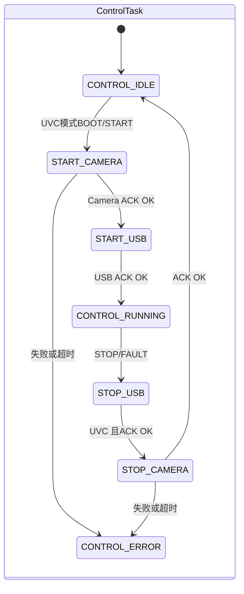
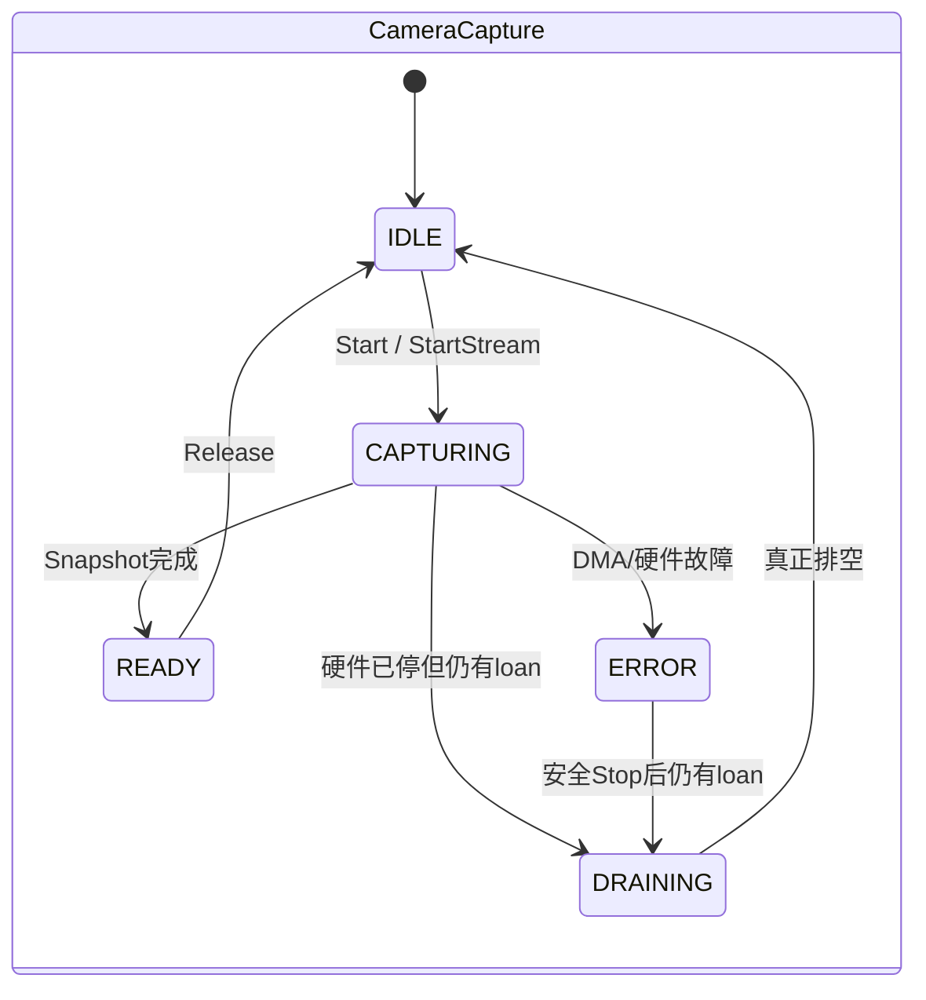
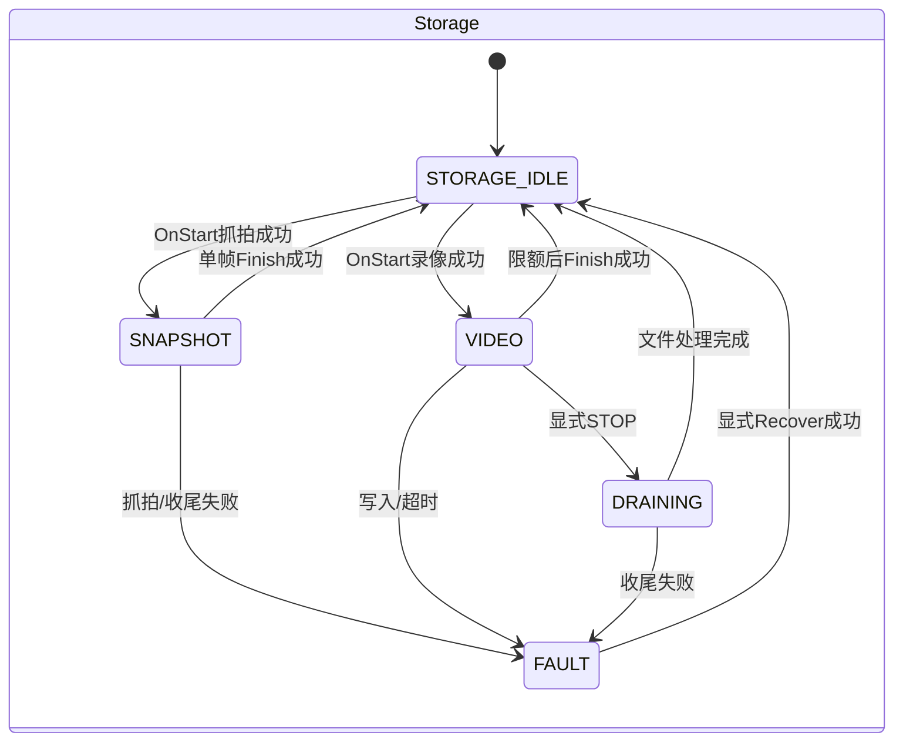
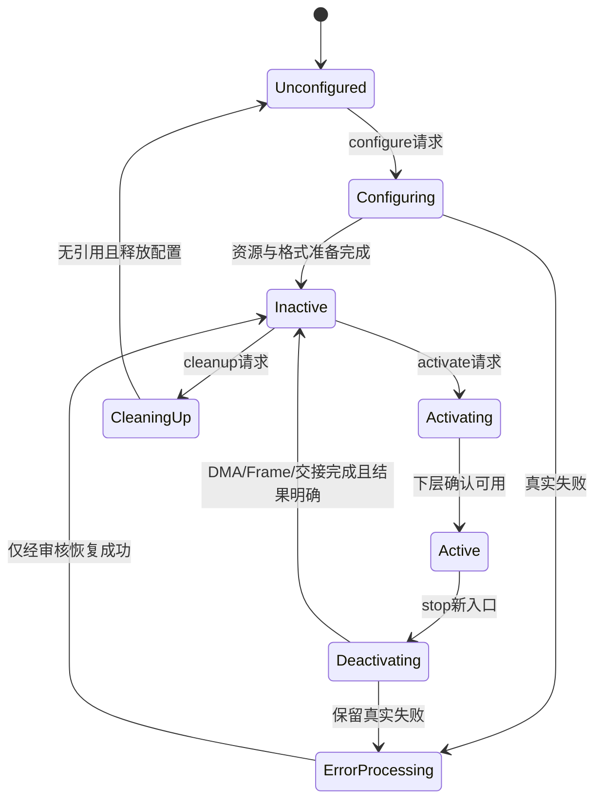

# H7 Managed Lifecycle Architecture

本研究日期2026-11-16，源码唯一基线main@f0ce45fd9ab7250b1e22260e087d606ee5ed9ecb。FACT为此源码已确认事实；REFERENCE为官方架构概念；PROPOSAL为本项目嵌入式适配建议；UNKNOWN为尚无证据。Phase 0只写文档，未运行测试或构建，不改变生产/测试/52B与56B消息/Replay/M4延时，不合并main，不进入C2.2C。C2.2B Final Contract Closure暂停，不能假定支线已合入。

## 1. 官方概念与本地适配

REFERENCE：ROS 2 Managed Nodes描述四个主要状态Unconfigured、Inactive、Active、Finalized，以及配置、激活、停用、清理和错误处理过渡；转换有成功/失败结果。[官方设计](https://design.ros2.org/articles/node_lifecycle.html)。这不意味着应移植ROS executor、DDS、容器或监督进程。

PROPOSAL：借用“稳定状态/进行中的转换/结果”分离。Task继续消费异步消息，不阻塞等待另一Task；各App模块保留自己的状态权威。Inactive可以停止新数据业务，但仍须处理归还/错误与管理消息；这是本项目RTOS适配，不能照抄为完全不再执行Task。Finalized只用于真正不可恢复的终止语义，普通STOP不能当Finalized。

## 2. 当前状态图（FACT，分层而非一个总状态）

非UVC模式直接START_USB；NONE/TEST不能从这图推断未来按需Camera Consumer模型已接入。源码Tasks/control_task.c ControlTask_Process/Command有CONTROL_IDLE、START_CAMERA、START_USB、RUNNING、STOP_USB、STOP_CAMERA、ERROR，FAULT进入停止编排，超时只记录错误不释放资源。

这是CameraCapture模式/状态的概括，不把持续Stream逐帧完成画成READY。Media/Src/camera_capture.c的MODE_NONE/SNAPSHOT/STREAM和STATE_IDLE/CAPTURING/READY/DRAINING/ERROR独立；Stop可能失败保留ERROR，不能从图推断自动恢复已实现。

app_storage.c文件IDLE不等于帧FREE；归还处理可继续。USB_Mode有UNINITIALIZED/IDLE/STARTING/WAIT_CONFIGURED/RUNNING/STOPPING/WAIT_RECONNECT/REGISTERING/ERROR（Service/usb_mode.h）；其RUNNING不代表UVC正在发Frame。Device有UNINIT/READY/RUNNING/BUSY/ERROR，只有init/start/stop Ops，没有cleanup等同ROS的接口。

## 3. 目标生命周期视图（PROPOSAL）

这是适配视图，不要求把所有enum改成同一套。配置/激活/排空/清理应映射到现有App上下文，避免增加第二份running/stopping。Device Stop、Media Stop、USB Return ACK和AVI Finish分别是不同过渡条件，不压成STOPPED。长期静态任务通常不destroy；main当前也无Device DeInit，因此cleanup只能标为待设计能力，不能宣称已具备。

## 4. 实际职责与生命周期映射

| 模块/上下文 | 当前事实 | ROS思想的本地映射/待设计 |
|---|---|---|
| App_Main/Tasks/Events | initcall、静态创建、BOOT屏障 | configure前置依赖；保留既有Framework |
| App_Camera / CameraTask | 唯一业务ctx，Task推进Media/Bridge/FinishRound | configure/activate及异步deactivate完成；Task不成为第二业务模块 |
| App_USB / UsbTask | START直接ModeStart；STOP等待BridgeIdle再ModeStop | USB端独立激活/停止；协议模式与业务状态分开 |
| App_Storage / StorageTask | 四请求命令队列，独占文件，Camera归还 | local deactivate包括排空、文件结果、Frame结果分列 |
| Qualification | C2.2A工具、NULL released/idle | 未来共享采集资格，不代替业务状态或实际引用 |
| Device/BSP | 基础设备操作/硬件完成 | 不负责资格或文件收尾，不把HAL返回当业务终态 |

main CameraTask只接原Camera command；没有Qualification Prepare/Receive/Process/Flush真实调用链，USB/Storage没有AppCameraConsumer对象（该源文件main不存在）。因此不能把C2.2B多消费者独立START/STOP作为main事实，迁移必须先选清晰基线及接口而不是只开回调。

## 5. 自定义协议与过度管理风险

当前命令ACK/FAULT、Bridge Return ACK、生命周期Tx/Rx/Replay各解决不同问题。ROS生命周期不能替代跨队列身份、重复请求缓存或DMA完成通知；不能以“成熟框架”名义直接删除Replay/Frame Lease。建议未来让生命周期转换请求复用原Task队列，结果具完整身份；状态查询只读投影，不从Debug推导业务。

ControlTask目前是实际旧启停协调者；未来应迁移成产品命令入口与有限业务编排，而不是升级为万能LifecycleManager。共享Camera资格由Camera拥有，业务模块自主停止，设备基础操作留在Device/Media。切换需一次可审核的所有权边界，不允许旧Control路径和新资格路径同时控制Camera。

## 6. 可验证的结束条件建议

每个模块声明prepare结果、入口关闭、在途处理、真实归还、文件结果和硬件事实，不用通用on_exit释放别人的资源。BUSY保持原身份重试，错误保留原结果，超时不强收。触发顺序与完成顺序分别采证。实际ROS适配enum/API/内存预算均待审核，本阶段无状态机实现或测试结论。
