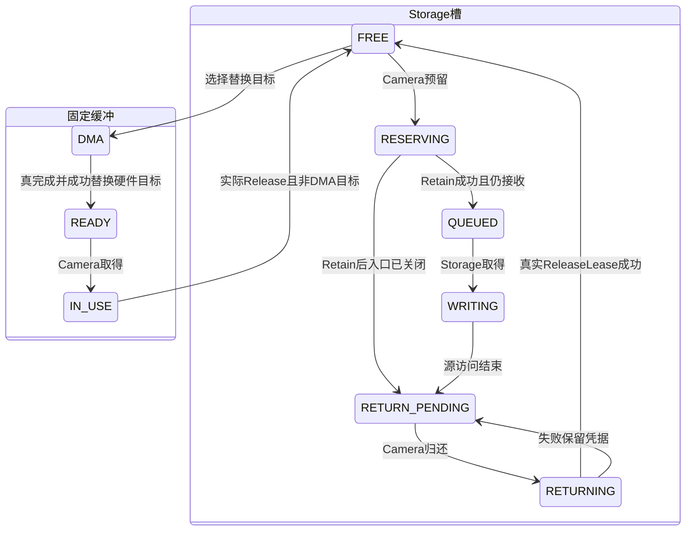
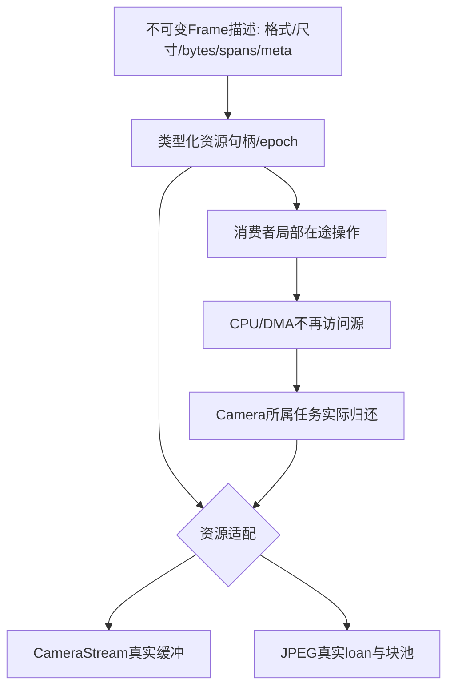

# H7 Media Buffer Architecture

本研究日期2026-11-16，源码唯一基线main@f0ce45fd9ab7250b1e22260e087d606ee5ed9ecb。FACT为此源码已确认事实；REFERENCE为官方架构概念；PROPOSAL为本项目嵌入式适配建议；UNKNOWN为尚无证据。Phase 0只写文档，未运行测试或构建，不改变生产/测试/52B与56B消息/Replay/M4延时，不合并main，不进入C2.2C。C2.2B Final Contract Closure暂停，不能假定支线已合入。

## 1. 成熟模型参考

REFERENCE：videobuf2通过队列回调交接缓冲；stop_streaming要求DMA终止/完成并归还交给驱动的缓冲。启动失败也有明确的返回缓冲规则。[官方vb2接口](https://docs.kernel.org/driver-api/media/v4l2-videobuf2.html)。这是驱动缓冲交还的基础，不是本项目消费者资格协议。

REFERENCE：GstBuffer以数据存储和元数据描述媒体单元；池可复用缓冲，池管理的buffer最后引用释放后归池。池配置与激活有独立约束。[GstBuffer](https://gstreamer.freedesktop.org/documentation/gstreamer/gstbuffer.html)、[BufferPool设计](https://gstreamer.freedesktop.org/documentation/additional/design/bufferpool.html)。不导入GObject/动态分配/任意多插件。

## 2. 当前缓冲实现（FACT）

| 资源 | 权威代码 | 真正的状态/持有者 |
|---|---|---|
| 固定格式CameraStream | Media/Src/camera_capture.c CameraStream_GetFrame/ReleaseFrame/Rotate | FREE、DMA、READY、IN_USE；M0/M1与IN_USE互斥 |
| JPEG字节FIFO | Media/Src/camera_mjpeg_fifo.c | DMA/SEALED/FREE块、parser/READY帧及loan；块references不等于消费者数 |
| JPEG loan | FIFO GetFrame/RetainFrame/ReleaseFrame/ReleaseLease | 原始侧usb_owned和SD侧sd_owned，最后持有者才归还帧块 |
| Storage slot | Application/app_storage.c | FREE/RESERVING/QUEUED/WRITING/RETURN_PENDING/RETURNING；含真实SD lease、local session/generation |
| UVC payload | Service/usb_uvc_class.c与usb_uvc_payload.c | CPU构包/异步Token/Cancel/Abort；返回值不等于原Frame可释放 |
| SD写中转 | Platform/storage_fs.c + BSP/bsp_sdmmc_memory.c | 8KiB内部输入缓冲与32KiB AXI DMA区，不能混作摄像头pool |

SOURCE路径：CameraCapture_StreamGetFrame按JPEG分流到FIFO，否则CameraStream；StreamReleaseFrame按同模式释放。Common/Inc/camera_config.h描述JPEG可跨两个span，固定帧按width/height/bpp验证；消息只复制描述，不复制SDRAM图像。SD-only也短暂用原始loan，原始位不能直接映射USB业务资格。

JPEG不是把上述固定buffer状态生搬过去：一个JPEG帧可跨块且多个帧可共享块，parser自身也可能持块。不能因一个消费者完成就将整个块FREE，不能用global HasLoan替代某消费者退出证明。

## 3. 建议的分层（PROPOSAL）

先抽象描述和查询/归还合同，不立即统一两种物理pool或重写引用算法。句柄绑定存储身份，Frame meta不兼任资源身份。retain/release最终落到一个Media真源；业务资格、Bridge epoch/lease及SD session/id不混用。适配查询不能创建loan或“修复”所有权；错误保持引用，实际释放由Camera执行。

未来扩展消费者时倾向有界owner token/静态consumer slots，而不是把匿名整数refcount散落每层；具体上限和owner表示需独立评审，不给当前两个bit强行加Network。网络控制连接不占Frame，真实异步发送持源才占资源。框架buffer引用归零思想只能指导真正owner管理，不能再加一层影子计数。

## 4. 反压、丢帧与释放

当前Storage SLOT_COUNT=1，wants按record_fps/slot状态决定接收；FIFO GetFrame可丢更旧READY、保留新帧，USB单原始持帧。建议把不同sink的反压策略写明：尚未Retain可以拒绝/丢该sink；已Retain就必须实际归还，不得以丢帧理由清lease。USB阻塞不应让SD文件模块跨Task释放USB；Sink自行完成后以既有协作归还。

复制发送只有所有源读取/复制DMA结束才可归还原Frame；零拷贝需全部指向源的DMA/描述符终结或确认Abort。USB_UVC_CancelFrame只是登记，原UVC_Process/Device_AbortEp条件继续有效。vb2的Stop原则映射为本地异步drain条件，而不是移植一个阻塞wait_all造成Camera/USB死锁。

CPU cache一致性、对齐、FMC/AXI总线延迟与Frame逻辑引用分开审查；状态模型不能消除带宽争用，也不证明FE根因。本阶段不做25FPS优化、SD拷贝参数更改或FE策略修改。

## 5. 主线已具备与未具备

已有静态pool、格式大小验证、JPEG双span、owner位、失败保留归还和SD中转；缺少统一资源视图以及grant到Frame的完整关联。main C2.2A工具尚未接业务，不能声称pool已经支持独立消费者资格退出。

V4L2内核缓冲API与GStreamer对象不是可直接链接到H747的实现选择。建议演进为薄资源适配层，先验证现有固定/JPEG行为等价，保留消息ABI。未来任何句柄/池变化需实测RAM/栈和任务时序，不能只换名字即宣称成熟架构移植完成。
