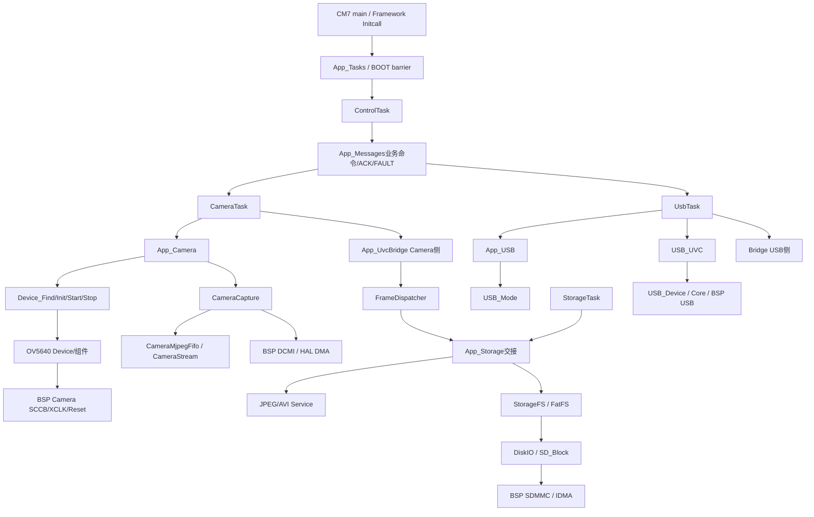
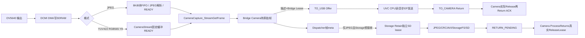
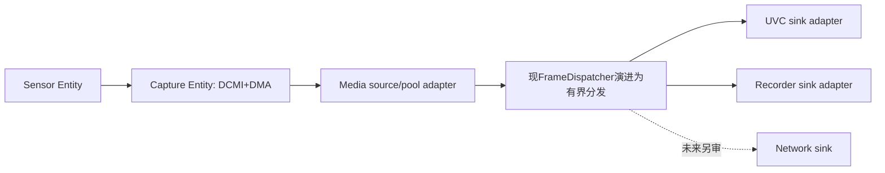

# H7 Media Graph Architecture

本研究日期2026-11-16，源码唯一基线main@f0ce45fd9ab7250b1e22260e087d606ee5ed9ecb。FACT为此源码已确认事实；REFERENCE为官方架构概念；PROPOSAL为本项目嵌入式适配建议；UNKNOWN为尚无证据。Phase 0只写文档，未运行测试或构建，不改变生产/测试/52B与56B消息/Replay/M4延时，不合并main，不进入C2.2C。C2.2B Final Contract Closure暂停，不能假定支线已合入。

## 1. 参考的边界

REFERENCE：Linux Media Controller将媒体硬件建模为有向的entity、pad与link；pad是逻辑端点，不等同芯片引脚。[官方MC模型](https://docs.kernel.org/driver-api/media/mc-core.html)。这里借用可描述、可检查的拓扑思想；不移植内核对象、设备节点、ioctl或完整动态图框架。

## 2. 当前模块依赖图（FACT）

关键源码：CM7/Core/Src/main.c；Application/app_tasks.c App_TasksCreate；Tasks/control_task.c ControlTask_Process；Tasks/camera_task.c CameraTask_Process；Tasks/usb_task.c UsbTask_Process；Application/app_camera.c、app_usb.c、app_uvc_bridge.c、app_storage.c；Media/Src/camera_capture.c；Device/Src/ov5640_device.c；BSP/bsp_camera.c、bsp_dcmi.c。这是一张调用依赖图，不能把每个软件方框都当MC硬件entity。

当前App_Camera直接依赖Device和Media是业务编排；CameraCapture→BSP是资源实现；Device的注册生命周期不等同数据图。Device/Inc/device.h只有init/start/stop Ops，没有deinit/unregister。Device/Src/device.c扫描.device_export并Framework initcall注册；生产中仅ov5640_device.c有DEVICE_EXPORT。USB、SD并未作为同等Device静态导出，不能为了图对称而宣称已有注册。

## 3. 当前数据流（FACT）

app_uvc_bridge.c CameraProcess有随USB帧的DispatcherPublish及无USB请求时SD-only取帧两个入口。SD-only临时通过Media原始持有取得帧，再Retain SD并本地释放，不生成USB Return ACK。JPEG的usb_owned变量不总等同USB业务资格；main没有grant到每帧的完整关联。CameraStream和FIFO是替代资源路径，不把固定缓冲当可变JPEG字节池。

## 4. 目标静态图（PROPOSAL）

建议先用const描述表达节点ID、输入/输出端口、格式能力、资源提供方和当前链路配置；静态图是配置/验证数据，不拥有Frame，不维护第二套active/refcount。Device Registry继续服务硬件发现，Framework Initcall/Event/Timer继续使用。无需创建全局AppManager、额外Task或一套并行事件总线。

Graph验证只决定链路配置是否可行：格式、尺寸、max bytes、共享源限制、目标能否接收；业务模块仍在自己的Task启动/停止。打开link不等于ACQUIRE、持Frame或DMA完成；关闭link也不自动释放owner。Frame所有权必须由Media真实账本确认，生命周期请求继续复用已审核协议，图不能代替Replay身份。

## 5. 源码到图映射

| 当前实现 | 目标角色 | 迁移边界 |
|---|---|---|
| ov5640_device.c + BSP Camera | sensor硬件实体及控制端口 | 依旧由Device执行传感器寄存器/基础生命周期 |
| camera_capture.c + bsp_dcmi.c | Capture实体/源端口及固定池适配 | 原DMA和保护性Stop保持 |
| camera_mjpeg_fifo.c | 变长JPEG资源提供方 | 保留真实块/loan引用，不复制给图 |
| app_frame_dispatcher.c | 分发link路由/帧meta生成 | 明确Storage拒绝仅丢该支路，不回收USB |
| app_uvc_bridge.c | USB sink跨任务交接适配 | lease/Return ACK与topology分离 |
| app_storage.c + JPEG/AVI | recorder sink与文件业务 | 文件收尾不交给graph或Device |
| app_events.c | ISR→Task唤醒 | 通知不是图事件的可靠数据载荷 |

## 6. 重复职责与应保留职责

FACT：ControlTask协调启停，App_Camera又有自身业务停止，C2.2A资格工具也能提出停止意图，但main Task未接入资格路径。它们是旧路径与未来机制并存，不证明“全部冗余”。迁移时必须只保留一个Camera资源启停权威，不能让新graph再开一条硬件Stop入口。

PROPOSAL：把输出能力校验（VideoConfig/Dispatcher/UVC/Device各自验证）明确拆成产品策略、链路兼容、协议格式、硬件能力四层，不盲删同名Validate。对epoch、Bridge lease、SD lease、生命周期request分别记录用途；在未证明可替代前不合并。graph本身只新增拓扑描述，不创造新的引用或ACK协议。

## 7. 已知限制

main仅实现USB/Storage相关静态图，ETH/WIFI输出在Dispatcher返回NOT_SUPPORTED。V1 I2C1/CAM_DVDD_EN及C2.2B Consumer接入不在main，不能用旧支线实板记录验证本图。未来网络控制面不占Frame，数据面真实持有才进入Media所有权，具体适配另审。图变更RAM/遍历WCET见MigrationPlan，不在ISR进行动态遍历。
