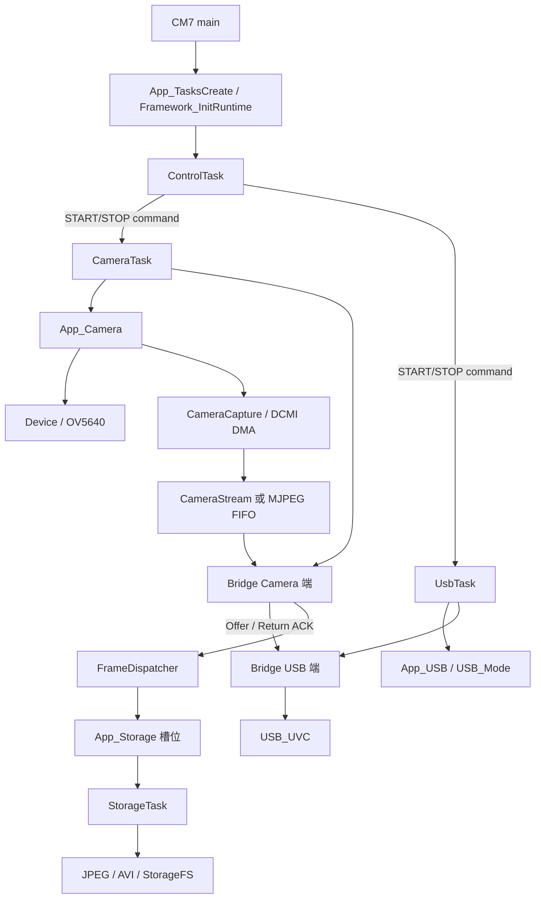
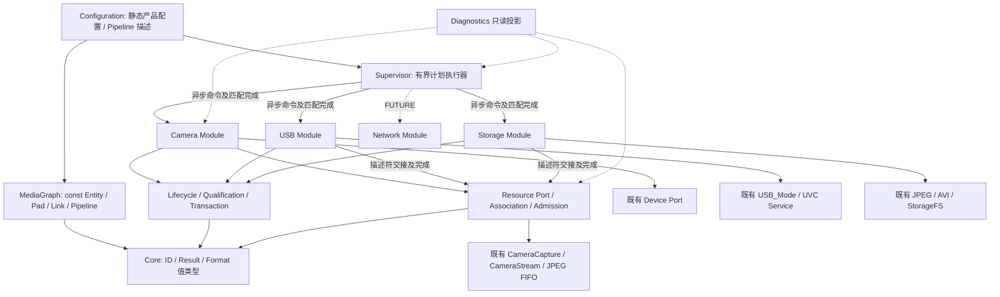

# H7 Application V2 — Phase 0 架构基线

## 1. 冻结范围与证据等级

本轮仅设计。仓库 `ruk93668-creator/h7_mac`；工作目录 `D:/32/STM32H7/h7_mac`；研究分支 `codex/architecture-media-graph-lifecycle`，输入 HEAD `8a0359640007d2c39c74b4983ebdd22126ab406e`；本地与远端 main 均为 `f0ce45fd9ab7250b1e22260e087d606ee5ed9ecb`。检查时工作区干净，远端研究分支同 HEAD。

main 已包含 C2.2A、C2.1.1、R2 和 BASEPRI 修复历史；研究分支相对 main 只有五份 Phase 0 文档和 M4 OLED 稳定延时提交 `8a03596`。旧 Phase 1 未产生交付文件。V2 是新设计，不是旧 Phase 1 实现，也不导入 C2.2B 冻结分支的 WIP。

本文采用 SOURCE_CONFIRMED（源码确认）、DESIGN_PROPOSED（V2 建议）、NOT_PROVEN（证据未闭合）、NOT_RUN（本轮未执行）。所有 V2 API、目录及状态均为 DESIGN_PROPOSED。源码审查不能替代编译、软件回归或实板验证。本轮未运行上述验证。

## 2. 当前实际架构

SOURCE_CONFIRMED：`CM7/Core/Src/main.c::main` 创建静态任务、执行 Framework 初始化并记录准备结果；`CM7/Application/Tasks/control_task.c::ControlTask_Run` 在运行期释放 BOOT。`ControlTask_Process` 把 UVC 和 NONE 都纳入 Camera→USB 的旧启动/停止序列。`CameraTask_Process` 顺序为 BeginRound→回复→至多一条控制命令→Camera Process→Bridge Camera Process→FinishRound→回复；没有消费者资格消息接入。`UsbTask_Process` 明确推进 UVC 与 Bridge，详见全量审计。

SOURCE_CONFIRMED：`CM7/Application/app_camera.c::s_qualification_ops` 的 released/idle 均为 NULL；存在资格核心不表示真实消费者退出已经接入。main 中没有 `app_camera_consumer.c`。`App_StorageProcessReturns` 在 Camera 所有者上下文调用真实 `CameraMjpegFifo_ReleaseLease`；StorageTask 只把槽位置为 RETURN_PENDING。文件关闭和帧归还是不同事实。

## 3. V2 推荐架构

Supervisor 只拥有“本次计划、步骤位置、命令身份、期限和错误策略”，不保存第二份模块 running/stopping、资格表或 Frame 引用。模块自主 STOP 与 Supervisor 编排兼容：USB-only STOP 只向 USB 发命令；全 Pipeline 停止计划才请求各相关模块退出。Camera 仍是采集生命周期唯一推进者，最后消费者真实排空后才可能停硬件。Supervisor 不能调用 Device_Stop、CameraCapture_Stop、USB 端点或 FatFS。

Resource 是端口和关联层，不是第二个 Media 分配器。Camera 执行上下文负责最终 Media Get/Retain/Release；USB 和 Storage 提交完成交接。权威引用继续归原后端，V2 关联账本只记录身份、交接进度和后端令牌，不复制引用计数。Graph 无 Frame 地址、Loan、ACK 或启动硬件函数。

### 3.1 R2第二轮职责收敛（DESIGN_PROPOSED，未实施）

R2输入cd8daa6。主拓扑采用`OV5640 → CameraCapture（内部DCMI/DMA） → RawProvider或JpegProvider → FrameRoute → Sink`。FrameRoute纯逻辑，不引入真实分发任务、Buffer或账本；Provider是现有CameraStream/FIFO的能力视图。USB实际交接沿Bridge端口，Storage沿Camera端数据适配/Storage端口；Resource负责准入/关联/完成，不负责决定业务拓扑。Legacy Dispatcher生成metadata等必要职责必须在功能迁移时显式承接，本轮不删旧代码。

用户配置唯一权威在Configuration不可变请求快照；Core派生媒体layout、Graph聚合纯能力否决，CameraConfig_t、VideoStreamConfig_t、Storage策略分别从同一快照生成。共享媒体与每Sink交付/采样目标分开（候选GraphFormat56B、GraphSinkPolicy12B）；Storage采样不重设Camera/USB。UVC Probe/Commit仅协议选择已配置能力，不直接改运行Camera。当前Configure一次性约束和VideoConfig_RequestUpdate不支持必须保留为事实，未来动态Pipeline重配仍缺API与真实排空证明，UNRESOLVED。

CameraCapture为采集能力权威、OV5640为传感器能力权威、UVC为USB能力权威；Storage拟增加纯能力接口，与真实接收共用现有唯一帧长度上限，Graph不另存一套70000B。纯Validator全部通过只证明合法性，不证明设备已应用。160×120 YUY2@10FPS是用户确认稳定输出基线；25FPS只是目标/待验证，配置返回成功也不证明实际FPS。详见ModuleContract第1.12～1.16节、ADR-01/04和ResourceBudget。

R2-01/02方向认可、03原则认可；04～08具体推荐待审。全部ADR继续UNRESOLVED，Grant→Frame Lease与Stable Admission Closure继续NOT_PROVEN。这里没有网络实现、热重配实现或新资源安全证明。

## 4. 成熟架构参考与 H7 自行适配

| 参考 | 仅吸收的思想 | H7 自行设计；不移植部分 |
|---|---|---|
| Linux Media Controller | Entity、逻辑 Pad、定向 Link 描述拓扑 | 固定容量 const 描述表；不移植内核对象、设备节点或动态发现 |
| ROS 2 Managed Lifecycle | Configure/Activate/Deactivate/Cleanup 与完成条件 | 各模块自有状态机和异步完成；不移植 ROS executor、DDS 或全局状态机 |
| V4L2/videobuf2 | 入队、在途、完成与停止排空的区别 | 复用 MCU 后端；没有 mmap、DMABUF 或用户空间 ioctl |
| GStreamer Buffer/Pool | 格式、内存块、池和消费者生命周期分离 | 静态 FrameView/后端令牌；不加入 GObject、动态分配或另一套 refcount |

参考依据：[Linux Media Controller](https://docs.kernel.org/driver-api/media/mc-core.html)、[ROS 2 Managed nodes](https://design.ros2.org/articles/node_lifecycle.html)、[V4L2 videobuf2](https://docs.kernel.org/driver-api/media/v4l2-videobuf2.html)、[GStreamer BufferPool](https://gstreamer.freedesktop.org/documentation/additional/design/bufferpool.html)、[GstBuffer](https://gstreamer.freedesktop.org/documentation/gstreamer/gstbuffer.html)。上表仅概念映射，下面的 H7 契约是本项目建议，不声称来自这些框架。

## 5. 五类状态与统一安全不变量

Topology（只读结构）→Configuration（经验证的格式/路由）→Module Lifecycle（各模块状态）→Consumer Session（资格身份）→Buffer Ownership（后端真实持有）；箭头表示约束，不表示同一状态或成功自动传播。

1. Link 可用不等于模块 Active，Pipeline 合法不等于授予资格。
2. Command accepted、ACK 入队、ACK 消费、业务完成、Lease 归还、资格释放、硬件停止分别表示不同事件。
3. Grant G 包含 consumer/session/generation/ACQUIRE request；RELEASE R 是另一个 request；Frame/Bridge/Media/Slot 身份各自校验。关联必须显式，不把 request_id 直接等同。
4. 停止入口关闭后，已准入交接继续排空；旧 grant 不得重新开放。超时只报告未完成，不能强行退引用或清 Replay。
5. FAULT 允许必要硬件保护，但不能伪造所有消费者归还；原始失败结果冻结，后台恢复另行报告。
6. SD-only 的 Camera 内部原始持有不是 USB grant。非 JPEG 固定池和 JPEG FIFO 分别证明归还。

Grant→Lease 与稳定关闭目前仍为 NOT_PROVEN，V2 设计不能把它们直接变成 PASS。精确 API 与线性化实现须在 Resource/Lifecycle 阶段单独审核。

## 6. Clean Restart 与保留 Legacy 的时间边界

本阶段旧 `CM7/Application` 原样保留，是审计基准。后续 V2 在 `CM7/ApplicationV2` 建立独立实现，不能调用旧业务模块私有函数、复用旧业务全局状态或复制旧目录作为 Legacy 子目录。开发期间允许源码并存，但只有一个应用实现可绑定真实任务、初始化导出和硬件端口。

V2 完成对应功能和联合验收后，分阶段移除旧工程引用、头路径、初始化导出及旧文件；最终删除旧 Application 架构活动源码，V2 成为唯一应用层。历史由 Git 保存，不创建常驻 Legacy 副本。删除门禁与具体清单见 MigrationPlan。

## 7. 本阶段决策范围

推荐本架构进入人工审查；不授权实施。待审核：Resource 身份关联与 terminal receipt、受控 Tx/Rx 的迁移位置、每模块生命周期精确完成契约、Supervisor 计划接口，以及 V2 编译切换方案。B2 ID23 的有界 BUSY 与 ID31 的“未退出拒绝 START / 合法成功 START 后故障复位”保持，不因 Clean Restart 自动变更。

## 8. R2条件澄清及R3 Resource Ownership设计

输入54718ee。人工通过R2-01/02/04/05/07/08，03原则通过，06有条件通过；ADR-01仍UNRESOLVED。Storage格式Validator推荐依赖CoreMediaFormat，不依赖CameraConfig_t；GraphFormat为同一中立值的别名，Core不反向依赖Graph/Camera。Source采集率、USB交付率、Storage采样率分别配置/观测，FrameRoute继续仅表达拓扑。

R3已形成[资源架构](H7_V2_ResourceOwnershipArchitecture.md)与[并发/验收设计](H7_V2_ResourceOwnershipAcceptance.md)：保留原固定池与FIFO，显式关联G/H/B/M/S，区分请求入队/准入/真实归还/ACK消费/资格撤销/硬件停止。D/T与Media快照、G/R接口及退休边界均待审核实施；当前生产Frame数据面未携带完整grant、released/idle仍NULL，两个NOT_PROVEN不变。成熟项目实际源码机制与H7自行适配设计在资源报告第2节区分。本轮没有测试、编译、硬件执行或应用切换。
