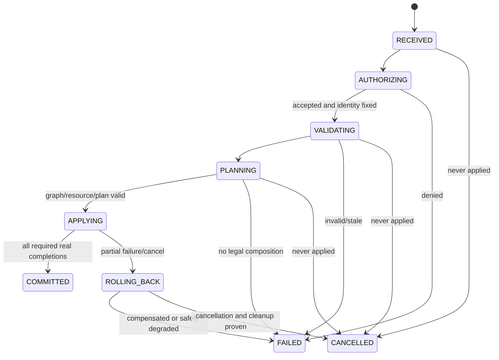

# Application V2 — Transport-independent Control与Configuration Transaction

## 1. 范围、当前事实与冻结五子系统归属

**冻结归属约束**：Application V2只有Control Service、Composition Manager、Execution Manager、Application Modules、Media Resource五个核心。本文Gateway/Request/Event等属于Control Service；配置事务、Registry/Resolver/Selector/Plan Builder属于Composition Manager；Supervisor/Lifecycle执行协调属于Execution Manager。它们是内部职能，不新建顶层管理器或调整目录。Phase0～10原路线不变；提前定义Phase7/8接口不表示实施授权。

输入c52490b，研究分支不变。本轮DESIGN_PROPOSED/UNRESOLVED，只文档，不修改任何IPC/应用消息ABI、Task/Queue、BSP或业务。M7最终配置/组合/执行权威不代表一个万能AppManager；配置对象、纯Composition、Supervisor计划和各模块状态严格分开。

SOURCE_CONFIRMED：当前`CM7/Application/Tasks/control_task.c`是旧编排，不是下文Gateway/事务管理器。`Common/Inc/ipc_shared.h`定义IPC_VERSION=3、320B共享布局、两核各128B状态块；`ipc_application.h`80B应用状态及CM4空状态约束，不提供这里所有统一配置命令。`Common/Inc/ipc_config.h`保留SRAM4 0x38000000/4KiB窗口；`CM7/Core/Src/main.c`及CM4入口有HSEM启动协作，Platform IPC端口提供PRIMASK/屏障。本轮不将reserved字段私自解释为命令、传指针或改布局。

六层仅为逻辑分析视角（不是新增核心）：L1 Control Clients；L2 Transport Adapters/Gateway/Auth/Request/Event；L3 Configuration/Registry/Resolver/Graph Selector/Resource预检/Plan Builder；L4 Supervisor/Lifecycle执行；L5 Camera/UVC/Storage/未来Network/AI Modules；L6 Resource与原Media/Device/BSP/OS。这是逻辑职责，不要求每层新Task；底层资源与驱动不重写。

## 2. R2-16：统一公开控制面

| 入口 | Adapter的潜在核心/硬件归属 | 允许职责及当前缺口 |
|---|---|---|
| M4 OLED | UI/IPC前端可在M4，M7 Gateway最终裁决 | 普通控制客户端；当前IPC状态通道不是完整命令传输，新增控制编码须另审 |
| PC USB Control | 由USB Core/端点owner决定，当前USB在CM7 | 与UVC逻辑分开；当前无独立USB Control服务，不声称已有Composite |
| Mobile BLE | 取决于板上BLE连接哪核，UNRESOLVED | 收包/身份映射/转发，不直接调用Camera/Storage |
| Wi-Fi Web/App | 链路/网络服务实际owner决定，UNRESOLVED | Control Service与Video Service逻辑分离；本轮无网络实现 |
| Ethernet Client | 驱动/网络接口实际owner决定，UNRESOLVED | 同统一API；客户端不是Frame consumer |

Adapter只做有界收包/解析、大小/版本初筛、传输会话绑定、转统一请求/发结果事件。M7 Gateway最终验证身份/角色/操作/字段，不信任来自M4或网络的“已授权”标志；不得由Adapter直接执行模块START/STOP或Resource私有调用。跨核Adapter传送中立值，不共享M7私有ctx地址。

统一API仅语义草案，不冻结wire布局或新Opcode：

| 操作 | 公开语义 | 不意味着 |
|---|---|---|
| GET_CAPABILITIES | 静态模块/Provider/格式/可用性与版本；未来标未实现 | 注册即运行，或全部组合合法 |
| GET_CONFIGURATION | last committed配置/revision、活动事务及一致性标记 | 目标值就是当前所有设备状态 |
| APPLY_CONFIGURATION | 请求Desired及base_revision，返回拒绝或已接受tx_id | 已完成模块Activate或达到目标FPS |
| GET_STATUS | 带来源/年龄/故障的运行只读结果 | Diagnostic快照可作Lease归还凭据 |
| SUBSCRIBE_EVENTS | 有界状态/进度订阅，支持重查状态 | 通知是可靠完成ACK |
| GET_TRANSACTION | 按完整事务身份查询固定结果/阶段/回滚状态 | 缓存外旧请求可重新执行 |
| CANCEL_TRANSACTION | 幂等请求取消指定事务 | 超时强停/清Frame、必然能撤销文件副作用 |

请求概念字段：protocol_version、client_id、transport_session、client_request/write_seq、operation、base_revision、desired值、幂等信息；结果含tx_id、phase、accepted/terminal、错误/冲突/回滚事实。未定义二进制字节偏移，不塞进现52B/56B或IPC80B；未来各传输codec/大小/认证握手需单独审核。统一请求进入M7同一事务路径，不能按来源各自编排业务。

## 3. R2-17：配置对象、身份和单写权威

Configuration Manager唯一写Desired事务对象、last_committed Applied配置、Configuration Revision和事务结果。Module唯一写实际Lifecycle/业务状态，Camera唯一执行Media交接。Manager不保存第二份模块running/stopping或refcount；Gateway/Diagnostics只能读取有来源的投影。

身份互不替代：Control Client Identity是授权主体的客户端实例；Transport Session是一次连接/跨核握手；Configuration Tx是M7接受的配置写事务；Revision是成功提交次序；Module/Media Consumer是执行/资源角色；G/R/H/B/M/S/T按R3原协议。客户端请求启用USB并不取得USB Lease。M7重启/会话换代必须使旧控制身份失效；不能借旧session操作新Frame。

候选事务身份`{m7_boot_session, tx_id}`，client关联`{principal, client_instance, transport_session, write_seq}`；base_revision、request_version、完整规范Desired和结果保存在固定记录。tx_id/revision/session分配不回绕，耗尽拒绝新写；不使用Frame/Lifecycle请求编号。M7 boot session的可持久唯一来源/重启握手尚UNRESOLVED；在此问题批准前不承诺跨复位控制请求可重放。当前IPC也明确不提供完整热复位会话证明。

初期APPLY要求完整规范Desired快照，客户端先读当前配置并连同base_revision提交；不能把遗漏的Storage/其他Sink字段默认当OFF。若未来允许patch，必须显式update_mask、在M7按指定base_revision形成完整快照并重新校验/幂等，不是来源各自修改全局状态。单独停USB应保留Desired中仍启用的Storage，反向亦然；Source格式改变才按依赖影响面整体Drain。

### 3.1 多客户端并发与幂等

推荐只允许**一个活动配置写事务**，另保留有限终结记录；新写在已有活动写期间返回BUSY/active_tx_id，不排成无限队列，不默认覆盖。读取/查询/订阅仍可推进。事务开始前和实际APPLY前都核对base_revision；过旧返回STALE_REVISION及当前revision，禁止Last Writer Wins。BLE/Wi-Fi或USB/M4同时写，由M7受理序号串行裁决，不由传输速度/客户端权限绕过版本检查。

每个认证客户端写seq单调、不回绕；只在正式接受该写时推进high-water。同一已接受seq且规范请求完全相同，返回原tx进度/结果；同seq不同请求报PROTOCOL_CONFLICT。完整规范Desired比较不能只依赖可能碰撞的短hash。旧seq无记录则RESULT_EXPIRED/STALE，永不重新Apply；未受理的BUSY不消耗写seq，可原身份重试。只读查询与事件不推进写事务退休边界。

终结缓存满时可按明确策略淘汰最旧**终结**结果，客户端high-water仍保留以拒绝旧写；活动APPLY/ROLLING_BACK、有未完成步骤或仍在途G/H/M依赖的事务不能淘汰。已安全终结但Storage独立故障态保留的卷不属于Manager私有Frame持有，必须继续由Module暴露清理状态，不能因Tx缓存淘汰清卷。GET_TRANSACTION对已淘汰返回RESULT_EXPIRED并引导GET_CONFIGURATION/STATUS，不伪造成功。客户端会话安全失效/表位复用需要显式握手和所有活动事务完成；断线不直接清记录。控制幂等域与Lifecycle Replay严格分开，本轮不修改C1/C2.1.1算法/角色/缓存/高水位，不把客户端伪装USB/Storage发送其生命周期消息。

取消操作按目标tx身份/授权处理，重复取消复用同一cancel事实，不生成重复模块停止。执行期间的新Desired不隐式覆盖旧事务；用户需先请求取消并等待安全终结，再以新revision提交，或收到BUSY。任何允许抢占的产品策略都需单独审核。

### 3.2 事务状态及成功/失败语义

Transport接收ACK只证明解析/收到；ACCEPTED只证明M7身份/记录已受理；APPLYING才开始计划；COMMITTED需所有必要真实配置/模块完成，revision最后递增并发布Applied。终结结果包含业务失败、补偿结果和actual_consistency，不通过状态名隐去资源。图中ROLLING_BACK只能在真实补偿或明确安全降级之后终结；仍持有Frame、等待Abort或状态未安全时保持活动/故障等待，不能超时转CANCELLED。若所有Frame/交接已终结而卷明确仍由Storage故障态持有，可固定FAILED+FS_CLEANUP_PENDING，卷权威和错误仍在Storage；后续必须通过其公开Recovery/Error Processing能力，不把事务记录淘汰当卷已释放。未知访问仍在途时不得走此安全降级。

FORMAT_VALIDATED、DEVICE_CONFIG_APPLIED、RUNTIME_MEASURED继续分级：配置事务提交不证明25FPS性能。Desired保留用户目标；失败后last_committed配置仍可查询，但标记APPLIED_STATE_DEGRADED/UNKNOWN并返回实际模块状态，不能让旧revision冒充硬件完整恢复。

## 4. 执行、回滚及控制面活性

配置绑定按不可变快照/有界句柄传递；Module owner在Configure真实执行时复制自己的有界配置子集，不能在完成后继续借用可能淘汰的Tx Desired或旧快照指针。Manager staging/applied bank与事务记录仅在无待完成引用时复用；不借“缓存退休”破坏正在使用的配置。Configure/Plan句柄运输仍需单独审原52B命令兼容，不能声称已有消息已支持所有新操作。

Manager/Composition构造声明式计划，Supervisor只按先决步骤发模块公开异步转换并匹配命令结果，Lifecycle统一转换词汇，各Module保留唯一状态。Supervisor不会写USB_STORAGE组合分支、不直接Device_Stop/FS/Release。现有Control角色可承接管理调度，Module owner沿用任务；本轮不实例化Manager、不新增任务/队列、不改栈/优先级。

| 故障/事件 | 处理契约 |
|---|---|
| 预检失败 | 原Applied和硬件不动，终结原错误；只有声明的等价Provider/路径才能另试 |
| 新Sink激活失败 | 只补偿该事务已取得的新依赖/G，保留未受影响模块；真实归还不能伪造 |
| Camera格式重配失败 | 旧资源必须先Drain，失败后仅在旧配置重新实际应用成功才宣称恢复；否则安全停/DEGRADED，保留故障 |
| Storage已经写出数据 | 不把文件删除/倒写当默认回滚；尝试Finish/Close/Unmount，分别记录文件/Frame/卷结果，异常不计正常完成 |
| UVC正在运行 | 不因新Desired直接改Probe/Commit或缓冲；按受影响计划Deactivate/Return/ACK消费，再受审重配 |
| 客户端执行中断线 | 已接受事务由M7继续或执行已声明取消策略，不能借断线释放G/M；重连经授权查询tx/配置 |
| 新请求移除最后恢复通道 | 拒绝CONTROL_RECOVERY_PATH_REQUIRED，或要求已声明独立本地恢复路径；不允许媒体停止把全部控制入口一起切掉 |

控制面恢复根依赖不从属于媒体Pipeline。USB Control与UVC、Wi-Fi API与Video在逻辑状态/权限/资源上分开，即使共享物理链路。**当前`CM7/Service/usb_mode.c::USB_Mode_Stop`352会调用USB_Device_Stop（360），因此并未实现这种独立控制活性**；后续需受审的USB基础设备/Control服务与UVC Class生命周期拆分适配，不能在本轮宣称STOP UVC仍能USB控制。Wi-Fi/以太网尚无实现，更不能承诺物理断网时该传输仍可达；恢复入口可用以至少一个已启用物理控制通道仍存在为前提。

事件Publisher复用既有Framework Event/Timer的装配/唤醒能力，不新增另一通用事件框架；传输订阅/合并记录不是替代原可靠队列，现16订阅/16Timer容量要在后续装配时核对，不自动认定足够。事件Publisher发布tx阶段、revision、错误和模块状态变更，带age/seq/tx关联。慢订阅者有界合并/丢事件并报告gap，客户端GET_STATUS/GET_TRANSACTION补查；事件不是可靠Frame ACK或配置完成的唯一凭据。恢复/查询请求有预算和背压，不能被视频数据无限占满；实际传输仲裁/最坏延迟仍待硬件/协议设计。

## 5. R3-06：跨核与多传输资源边界

M4仅普通客户端：提交期望、读能力/状态、订阅；不持Frame Lease、不读写M7 D/T/FIFO/Raw私有表、不直接执行M7生命周期或DCMI/DMA。M7是配置、依赖、Pipeline和资源交接的最终权威；具体Media引用仍由M7后端管理，USB/Storage owner保留各自业务。

IPC/HSEM仅传输/启动同步机制，不是架构中心或跨核Frame授权。保留现SRAM4、原PRIMASK/屏障/seqlock及两核单写基础；M7单核PRIMASK不保护M4。未来控制命令codec、请求接收ACK及安全会话/序号需要独立IPC协议审核；当前V3只读状态不能通过填reserved冒充完整配置通道。本轮IPC ABI完全不变，M4控制请求的生产接入IMPLEMENTATION_REQUIRED。

若未来网络硬件归M4，Adapter/驱动核心归属不等于将原Frame Lease交给M4：原始Frame仍由M7 owner管理，可研究M7先完成读取到独立传输私有缓冲，再由另一核驱动使用该副本；副本/跨核完成/缓存一致性和容量必须另审，不复用IPC状态窗口当Frame池。本轮不实现该数据通路。

四种事件分别携带各自身份：IPC接收ACK（transport session/request）≠配置COMMITTED（tx/revision）≠Frame Release ACK（B/G/H/M）≠USB消费证明（原D/B）。控制连接关闭、M4重启、BLE断线都不释放媒体消费者资格；媒体模块的退出由自身生命周期和真实DMA/Return证据推进。Network仅控制服务时不创建媒体G，真正持Frame时才需独立consumer资源协议。

## 6. 候选预算、未决项与审核结论

候选容量：4个Tx记录（最多1活动）、8个Client Session、8个订阅、4个合并事件槽、256B规范Desired上限、512BGateway解析工作区；均是设计容量，未冻结ABI/未创建Queue。Tx候选每384B（Desired256+身份/状态128），4条1536B；Applied及回滚前快照各256=512B；client8×64=512B；订阅8×32=256B；事件4×64=256B；Gateway scratch512B。未计真实传输包、认证密钥、网络栈/驱动缓冲，不能当最终RAM估算闭合。

待人工批准：协议/认证/权限来源、client/boot身份与重连失效、缓存退休策略、容量、增量/取消/补偿政策、共享USB控制保持、IPC控制通道版本。R2-16/17和R3-06设计已给出，但生产实现/测试/ABI/Map/栈/DWT均NOT_RUN/IMPLEMENTATION_REQUIRED。两个资源安全NOT_PROVEN及原ADR状态保持；本轮不进入Phase1/C2.2C。
