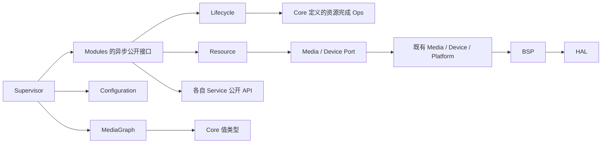
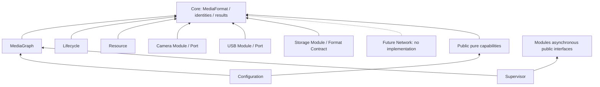

# Application V2 依赖与状态权威规则

基线 `8a03596`。本文件为设计规则；没有修改 include、ABI 或链接关系。

## 1. 依赖有向图

箭头是静态依赖。Lifecycle 所需 Ops 由装配处注入，不能 include Camera Module 私有头。Resource 对资格校验也通过只读接口/同所有者请求完成，不能形成 Lifecycle↔Resource 的源代码循环。产品静态图表在 Configuration，Graph Core 不反向依赖产品。

## 2. 单一权威

| 事实 | 唯一权威 | 允许副本 | 不允许的替代 |
|---|---|---|---|
| Camera 普通启停 | Camera Module，Camera owner 任务 | 命令完成记录 | Supervisor 直接 Device_Stop |
| 消费者资格 | Camera 所有者内资格核心 | 对端 grant identity | Graph Link Enabled |
| 真正帧持有 | 固定池或 JPEG FIFO 后端 | 关联账本的后端令牌 | 第二套全局引用计数 |
| USB 帧仍被传输访问 | USB_UVC / USB Device 的真实状态 | USB Module 本轮结果 | Submit 成功或 SOF 数 |
| AVI/文件/挂载 | Storage Module + StorageFS | 只读诊断 | Resource 统一关闭 FatFS |
| 命令可靠交付 | 受控 Tx/Rx/Replay | 记录同一身份的冻结结果 | 通知位或超时强清 |
| 计划步骤 | Supervisor 的计划执行记录 | 诊断投影 | 镜像全部模块生命周期 |
| IPC 数据 | IPC Service/共享协议 | 带 age 的应用状态 | CM4 直接读取 CM7 私有账本 |

关联账本只证明“哪个资格允许了哪次交接，绑定哪个后端令牌”，不决定引用是否归零。退出核验必须在 Camera 所有者执行：关闭指定 grant 准入→处理此前提交的交接→后端只读持有核验→终结收据/ACK 条件→资格释放。跨任务若需证据，由消息和各自单写记录表达；禁止裸读 USB 与 Storage 私有字段后拼接结论。

## 3. 同步约束

保持现有 Platform PRIMASK 保存/恢复、嵌套及内存屏障语义；不能把 volatile 当锁。FreeRTOS 临界区不自动约束另一个核或外设 DMA。新元数据临界区只允许有界拷贝与状态提交，不包含文件写入、等待队列、阻塞 USB Abort 或 SCCB。Camera/USB/Storage 任务不得相互同步等待完成；所有等待由异步 pending 推进，期间持续处理 Return 与回复。

ISR 仅发布原始硬件事实和唤醒提示；不可执行 Graph 验证、Lifecycle 转换、业务 STOP、文件关闭或复杂 dump。现有 `AppEvents_UsbNotify`、`AppEvents_CameraNotify` 的 task/ISR 分流必须被 V2 runtime 承接；它们不是可靠消息。可靠请求必须仍有队列和重试记录。

## 4. 运输与编号规则

沿用现行 52B AppMessage 工程 ABI 与 56B Lifecycle ABI 的兼容目标；52B 依赖目标 ARMCC5/短枚举配置，不能按 host enum 大小推断。`app_camera_lifecycle.h`、`app_camera_lifecycle_replay.h` 已有协议/Tx/Rx 布局断言；`Tests/LegacyLifecycle/R2/layout_test.c` 是历史 ARM 布局检查入口。本轮未重新测量。

四个方向独立单调编号，Stage 成功推进 issued_through，READY 取消不回退；请求跨 session/generation 不回绕。不增加 Replay 配额；保留高水位、合法后继、HELD/QUARANTINED、原 ReplayRetire 禁止成功。RxComplete 的 api_busy 表示重入/所有权问题，不是普通队列背压；回调不得通过 Reset、改 api_busy 绕过。队列满在 Flush 重试同一身份。

## 5. 自动化依赖门禁的后续设计

后续实施前新增独立检查器：扫描活动源的 include/符号引用；禁止 ApplicationV2 使用 HAL_/LL_/寄存器和 BSP 私有符号；允许列表只授予明确的 Ports 公开接口；扫描新旧重复导出、Initcall、任务创建和旧头路径。解析 Keil 的 target/group/file 有效配置，而非只扫描 XML 字符串。此门禁本轮只设计，未新增或运行工具。

## 6. 安全契约不能靠目录整理改变

AC-01：按 consumer identity 核验，不在 Camera 核心不断增加 USB/SD/Network 专用分支。

AC-02/03：ACQUIRE grant 与 RELEASE 请求身份不同，RELEASE 必须绑定原 grant。AC-04：消费者各自拥有的 Frame 不互相释放；未来 Network 的所有权需要后端真实支持，不能只加 owner 数字。AC-05：传输完成、DMA 完成、ACK 入队、ACK 消费、Camera Release 和消费者退出分别验证。AC-06：复制发送在全部原始读取/DMA 结束后才能归还，零拷贝在全部异步访问结束后才能归还。

这些是用户批准的安全约束，不声称当前 main 已完整实现。V2 改变实现位置可以提出，改变行为必须另行批准；尤其 B2 ID23/31 不能随重写被静默恢复成旧同步重启。

## 7. R2条件补充与R3所有权审核

输入54718ee。CoreMediaFormat为中立媒体值草案，GraphFormat只作别名；Storage公共纯格式接口只依赖Core，不依赖CameraConfig_t或Graph业务结构。Camera和UVC端口各自显式转换到原配置类型；Storage真实Frame/Lease交接适配与纯能力接口分开，唯一70000B限制源不复制。目录/字段均待审核，不是新生产API。

Source Capture Rate、USB Delivery Rate、Storage Sampling Rate分别有配置意图和运行证据，互不冒充；Graph无新运行时FrameDispatch/引用账本。R3资源关联仅记录G/H/M与B/S，权威owner仍归后端。候选D/T的USB端发布/消费字段和Camera端受理/终结字段各自单写；发布与队列发送分开，禁止共享phase多写者。完整契约及未决项见[资源架构](H7_V2_ResourceOwnershipArchitecture.md)第5～8节；本轮不因文档存在而改变NOT_PROVEN或准入实施状态。

## 8. R2最终依赖与R3第二轮接口审核（输入c52490b）

本图箭头表示“依赖/使用”，不是初始化执行顺序；Core只有中立值/结果码，不反向include任何模块。

| 接口/层 | 允许类型/依赖 | 必须阻止的反向依赖 |
|---|---|---|
| CoreMediaFormat / identity值 | 标准定宽类型、公共结果值 | CameraConfig/CameraPixelFormat、Graph私有结构、HAL、运行时Lease |
| StorageFormat_GetCaps/Validate | CoreMediaFormat/中立Caps/SysResult | CameraConfig_t、Graph私有头、Debug/任务/FS/Media所有权访问 |
| Camera兼容Port | Core媒体/身份与原CameraConfig/Media公开API显式转换 | 把Camera枚举直接当Core码cast；把私有Capture上下文指针传Graph |
| UVC兼容Port | Core值到VideoStreamConfig/B值的映射，USB独占Service | Resource/Graph读取UVC私有ctx、硬件EP/Abort旁路 |
| Storage帧Port | 中立G/H/S值与现Frame/Lease/原槽的内部映射 | Resource公共API参数暴露StorageSlot_t/CameraMjpegLease_t；第二Storage槽账本 |
| Resource公共API | CoreGrantKey/ReleaseKey/HandoffKey/MediaToken、ExitProof | AppMessage_t/Bridge结构/USB私有状态/Camera业务配置。52B运输映射留Ports，协议不重定义 |
| Media纯Snapshot | 公开中立只读schema、固定容量与码域 | Application私有头/Debug、查询中Get/Release或DMA操作 |
| Lifecycle/Qualification | 原Tx/Rx/Replay及注入的中立资源结果Ops | 直接Get/Release、关闭文件、USB端点、Resource私有记录 |
| Supervisor | 已验证图、异步模块请求/完成 | 直接硬件/Frame操作，复制消费者资格或所有模块状态 |

FrameRoute只管理拓扑。Resource只管理交接契约，后端继续唯一持有权威；Camera是实际采集/Get/Retain/Release执行者，USB独占UVC，Storage独占FatFS/AVI。端口类型转换不增加第二套引用计数或资格状态机。公共接口虽中立，不代表任何任务可直接调用；任务权限由Runtime/Ports校验，Snapshot本身不成为Release capability。

R2-09～13独立结论见ModuleContract1.18～1.22；R3-01～05身份/单写/关闭/快照见ResourceOwnershipArchitecture13。原非回绕Frame command票据优先复用，不新增Replay配额或通道。R3字段布局是候选，现released/idle仍NULL；Grant→Frame Lease及Stable Admission Closure继续NOT_PROVEN，ADR全UNRESOLVED。此表未修改任何include/工程/ABI。

## 9. 统一Composition/Control依赖与循环消除

本轮六层逻辑图见ApplicationArchitecture第3节；代码依赖必须通过Core中立DTO/纯接口反转，不按逻辑执行箭头建立源代码循环。

- Control Adapter只依赖Core控制语义/Transport公开接口，向M7 Gateway提交；不include Module私有业务头或直接Start/Resource Release。M4前端不依赖M7资源私有表。
- Gateway认证/Request/Event与Configuration Manager公开接口分开；Manager调用纯Composition接口，接收Supervisor计划进度/结果，但Supervisor只依赖Core的Plan/Completion契约，不反向include Manager。进度通过注入完成端口/消息返回。
- Module Registry只提供const Module/Capability描述。Resolver依赖这些描述/版本规则和Core值；不依赖模块ctx/硬件、不改变Lifecycle，不与Device Registry合并。
- PipelineSelector依赖Resolver的中立Resolution与Graph公开值。Resource能力预检只接收CoreMediaFormat/中立ConsumerUseSet，不反向读取Graph。Plan Builder使用二者结果，不把业务选择交给Resource。
- Supervisor仅执行Core Plan步骤和Module公开异步端口；Lifecycle转换状态在各Module唯一。Module不反向读取Supervisor/Configuration私有事务，配置通过不可变绑定传入。
- Resource通过注入的资格只读/关闭接口匹配G/R，生命周期回调只返回资源事实；两者共享Core身份/结果，不互相include私有结构。Media Snapshot为公开只读schema，M7 owner负责核验。

潜在循环及明确修订：Manager↔Supervisor改为Core Plan/Completion双向消息端口；Graph↔Resource改为Configuration派生UseSet；Registry↔Module runtime改为const描述+公开Ops，无Module状态镜像；跨核Adapter↔M7私有对象改为受审控制codec（当前IPC未实现，不能传指针或用reserved）。这是具体依赖方案，不只是给循环起别名。

Control基础依赖与媒体Pipeline停/重配解耦；共享USB/Wi-Fi设备由独立基础能力的公开生命周期约束，当前缺独立USB Control能力不写成已实现。所有入口由M7单写配置/Revision裁决，Control Client/Transport Session与媒体Consumer/Lease独立。新模块优先通过描述/端口/策略扩展，不能在Supervisor新增组合分支；后端资源不足仍拒绝。

新增模块/控制/事务ADR仍UNRESOLVED。未来动态运行解析指在已编译静态集合内计算合法选择，不是动态链接、动态内存或新增Task。既有Framework Initcall/Timer/Event复用，但通知/事件仅唤醒或状态投影，不能替代可靠命令与ACK。

## 10. 冻结五子系统与无新增顶层管理器

以ApplicationArchitecture第10节为统一归属：Control Service负责所有传输入口/统一控制；Composition Manager内含Config事务与纯组合；Execution Manager内含Supervisor/生命周期协调；Application Modules独占业务状态；Media Resource独占资源交接契约/后端适配。旧六层只作逻辑分析，不增加第六个核心，也不重画目录。

Configuration Manager、Request Manager、Lifecycle Manager、Resource Manager这些称谓均是上述子系统内部职责，不生成新顶层服务/状态权威。静态注册/运行依赖解析/媒体选择与真实切换分别有接口及完成条件；候选结果不能发布为“重配置已成功”。Phase0～10原表和DirectoryStructure不改，Phase7/8提前接口定义不构成进入实施。
