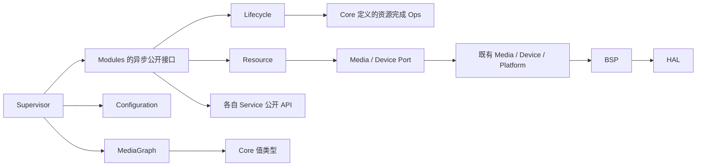

# Application V2 依赖与状态权威规则

基线 `8a03596`。本文件为设计规则；没有修改 include、ABI 或链接关系。

## 1. 依赖有向图

箭头是静态依赖。Lifecycle 所需 Ops 由装配处注入，不能 include Camera Module 私有头。Resource 对资格校验也通过只读接口/同所有者请求完成，不能形成 Lifecycle↔Resource 的源代码循环。产品静态图表在 Configuration，Graph Core 不反向依赖产品。

## 2. 单一权威

| 事实 | 唯一权威 | 允许副本 | 不允许的替代 |
|---|---|---|---|
| Camera 普通启停 | Camera Module，Camera owner 任务 | 命令完成记录 | Supervisor 直接 Device_Stop |
| 消费者资格 | Camera 所有者内资格核心 | 对端 grant identity | Graph Link Enabled |
| 真正帧持有 | 固定池或 JPEG FIFO 后端 | 关联账本的后端令牌 | 第二套全局引用计数 |
| USB 帧仍被传输访问 | USB_UVC / USB Device 的真实状态 | USB Module 本轮结果 | Submit 成功或 SOF 数 |
| AVI/文件/挂载 | Storage Module + StorageFS | 只读诊断 | Resource 统一关闭 FatFS |
| 命令可靠交付 | 受控 Tx/Rx/Replay | 记录同一身份的冻结结果 | 通知位或超时强清 |
| 计划步骤 | Supervisor 的计划执行记录 | 诊断投影 | 镜像全部模块生命周期 |
| IPC 数据 | IPC Service/共享协议 | 带 age 的应用状态 | CM4 直接读取 CM7 私有账本 |

关联账本只证明“哪个资格允许了哪次交接，绑定哪个后端令牌”，不决定引用是否归零。退出核验必须在 Camera 所有者执行：关闭指定 grant 准入→处理此前提交的交接→后端只读持有核验→终结收据/ACK 条件→资格释放。跨任务若需证据，由消息和各自单写记录表达；禁止裸读 USB 与 Storage 私有字段后拼接结论。

## 3. 同步约束

保持现有 Platform PRIMASK 保存/恢复、嵌套及内存屏障语义；不能把 volatile 当锁。FreeRTOS 临界区不自动约束另一个核或外设 DMA。新元数据临界区只允许有界拷贝与状态提交，不包含文件写入、等待队列、阻塞 USB Abort 或 SCCB。Camera/USB/Storage 任务不得相互同步等待完成；所有等待由异步 pending 推进，期间持续处理 Return 与回复。

ISR 仅发布原始硬件事实和唤醒提示；不可执行 Graph 验证、Lifecycle 转换、业务 STOP、文件关闭或复杂 dump。现有 `AppEvents_UsbNotify`、`AppEvents_CameraNotify` 的 task/ISR 分流必须被 V2 runtime 承接；它们不是可靠消息。可靠请求必须仍有队列和重试记录。

## 4. 运输与编号规则

沿用现行 52B AppMessage 工程 ABI 与 56B Lifecycle ABI 的兼容目标；52B 依赖目标 ARMCC5/短枚举配置，不能按 host enum 大小推断。`app_camera_lifecycle.h`、`app_camera_lifecycle_replay.h` 已有协议/Tx/Rx 布局断言；`Tests/CameraStopOwnershipR2/layout_test.c` 是历史 ARM 布局检查入口。本轮未重新测量。

四个方向独立单调编号，Stage 成功推进 issued_through，READY 取消不回退；请求跨 session/generation 不回绕。不增加 Replay 配额；保留高水位、合法后继、HELD/QUARANTINED、原 ReplayRetire 禁止成功。RxComplete 的 api_busy 表示重入/所有权问题，不是普通队列背压；回调不得通过 Reset、改 api_busy 绕过。队列满在 Flush 重试同一身份。

## 5. 自动化依赖门禁的后续设计

后续实施前新增独立检查器：扫描活动源的 include/符号引用；禁止 ApplicationV2 使用 HAL_/LL_/寄存器和 BSP 私有符号；允许列表只授予明确的 Ports 公开接口；扫描新旧重复导出、Initcall、任务创建和旧头路径。解析 Keil 的 target/group/file 有效配置，而非只扫描 XML 字符串。此门禁本轮只设计，未新增或运行工具。

## 6. 安全契约不能靠目录整理改变

AC-01：按 consumer identity 核验，不在 Camera 核心不断增加 USB/SD/Network 专用分支。

AC-02/03：ACQUIRE grant 与 RELEASE 请求身份不同，RELEASE 必须绑定原 grant。AC-04：消费者各自拥有的 Frame 不互相释放；未来 Network 的所有权需要后端真实支持，不能只加 owner 数字。AC-05：传输完成、DMA 完成、ACK 入队、ACK 消费、Camera Release 和消费者退出分别验证。AC-06：复制发送在全部原始读取/DMA 结束后才能归还，零拷贝在全部异步访问结束后才能归还。

这些是用户批准的安全约束，不声称当前 main 已完整实现。V2 改变实现位置可以提出，改变行为必须另行批准；尤其 B2 ID23/31 不能随重写被静默恢复成旧同步重启。
