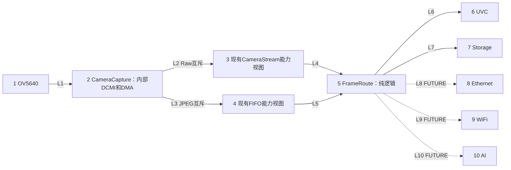

# Application V2 模块与接口契约草案

全部接口为DESIGN_PROPOSED，不存在于当前生产代码。具体字段布局、API拼写和实现需要下一阶段批准；本轮不改变52B/56B消息及Media ABI。

## 1. R2：Static Typed Media Graph 精确设计

### 1.1 审核状态、范围与三个直接回答

R2第二轮输入研究分支HEAD `cd8daa6`，实际CM7源码仍与main `f0ce45f`相同。以下C声明仅是文档规格，未创建头文件、编译或接入生产。**ADR-01仍UNRESOLVED**；认可Static Typed Media Graph研究方向不等于批准具体API、容量或实现。Grant→Frame Lease、Stable Admission Closure继续NOT_PROVEN。

- **R2-01：允许一个Source Pad连接多个Sink Pad**，通过多个独立、静态的Link表示；选中边数受Pad的FANOUT标志/max_links限制。一个Link只连两个端点。图fan-out不分配Frame、不自动Retain，不保证后端支持这些消费者同时持有。
- **R2-02：每条具体Pipeline固定一种Backend与选定Link集合**。Raw和JPEG用不同Pipeline描述，共享同一Graph中的公共前缀。分辨率/目标速率在该路由能力内配置；不在一条正在运行的Pipeline里切换Raw/JPEG隐藏路由。多个相同Backend、相同规范格式的Pipeline可以配置成一个合并视图；不用枚举每一种消费者组合。
- **R2-03：Graph是静态连接和格式交集的聚合者，不是覆盖驱动限制的新权威**。OV5640、CameraCapture、UVC分别拥有本层格式否决权；端到端格式必须全部接受。没有一个“最后验证器返回OK”能覆盖前面的失败。生命周期实际配置还可因设备/会话状态失败；Graph成功不证明采集速率、资源归还或硬件已启动。

Typed含义为：端点身份类型分离、Pad方向/数据协议/媒体类型/像素格式/Backend/能力可机械校验；不是把模块名和箭头硬编码在switch中。Graph Core不得依赖USB/Storage私有状态。下述ID使用结构包装，避免普通整数typedef在C中仍能任意互换；存储的枚举码用固定宽度字段，避免ARMCC短枚举影响Graph内部布局预测。

人工第二轮结论：R2-01/02/04/05/07/08通过，R2-03原则通过，R2-06有条件通过（补充Storage公共接口依赖方向）。只记录设计项审核意见，ADR-01继续UNRESOLVED。R2-06补充及R3入口见第1.17节；R2-04～08比较见第1.12～1.16节。推荐主表已合并DCMI/DMA为CameraCapture，并将FrameDispatch明确为纯逻辑FrameRoute；旧11/16/11表只保留作方案B历史比较，非当前推荐表。

参考固定Linux v6.12：[media-entity.h](https://github.com/torvalds/linux/blob/v6.12/include/media/media-entity.h)、[mc-entity.c](https://github.com/torvalds/linux/blob/v6.12/drivers/media/mc/mc-entity.c)。借鉴端点/链路/管线校验模型；const冻结、迭代有界算法和后面的接口是H7适配建议，不声称Linux采用相同静态表。

### 1.2 C值类型、Pad类型与格式

```c
#include <stdint.h>
#include "sys_result.h"

#define GRAPH_ENTITY_MAX    16U
#define GRAPH_PAD_MAX       32U
#define GRAPH_LINK_MAX      32U
#define GRAPH_PIPELINE_MAX   8U
#define GRAPH_CAPS_MAX      32U
#define GRAPH_SINK_MAX       5U
#define GRAPH_DEP_MAX        4U

typedef struct { uint16_t value; } GraphEntityId;
typedef struct { uint16_t value; } GraphPadId;
typedef struct { uint16_t value; } GraphLinkId;
typedef struct { uint16_t value; } GraphPipelineId;
typedef struct { uint16_t value; } GraphCapsId;
typedef struct {
    GraphEntityId entity;
    GraphPadId pad;                 /* entity内0-based，不是GPIO */
} GraphEndpoint;

enum { GRAPH_PAD_SINK = 1, GRAPH_PAD_SOURCE = 2 };
enum { CORE_MEDIA_VIDEO = 1U, CORE_MEDIA_METADATA = 2U };
#define GRAPH_MEDIA_VIDEO CORE_MEDIA_VIDEO
#define GRAPH_MEDIA_METADATA CORE_MEDIA_METADATA
enum {
    GRAPH_PROTO_SENSOR_BYTES = 1,   /* sensor外部视频字节流 */
    GRAPH_PROTO_DCMI_WORDS = 2,     /* 外设到DMA的逻辑word流 */
    GRAPH_PROTO_DMA_CHUNKS = 3,     /* DMA写入后端的chunk */
    GRAPH_PROTO_FRAME_VIEW = 4,     /* 完整帧的不可变视图 */
    GRAPH_PROTO_METADATA = 5        /* FUTURE；当前无实现 */
};
enum { CORE_PIXEL_Y8 = 1, CORE_PIXEL_RGB565 = 2,
       CORE_PIXEL_YUY2 = 3, CORE_PIXEL_JPEG = 4 };
#define GRAPH_PIXEL_Y8 CORE_PIXEL_Y8
#define GRAPH_PIXEL_RGB565 CORE_PIXEL_RGB565
#define GRAPH_PIXEL_YUY2 CORE_PIXEL_YUY2
#define GRAPH_PIXEL_JPEG CORE_PIXEL_JPEG
enum { CORE_BACKEND_RAW = 1, CORE_BACKEND_JPEG = 2 };
#define GRAPH_BACKEND_RAW CORE_BACKEND_RAW
#define GRAPH_BACKEND_JPEG CORE_BACKEND_JPEG
enum { CORE_STREAM_RAW_FRAMES = 1, CORE_STREAM_JPEG_FRAMES = 2 };
#define GRAPH_STREAM_RAW_FRAMES CORE_STREAM_RAW_FRAMES
#define GRAPH_STREAM_JPEG_FRAMES CORE_STREAM_JPEG_FRAMES
enum { GRAPH_ENTITY_HW = 1, GRAPH_ENTITY_CAPTURE = 2,
       GRAPH_ENTITY_TRANSFER = 3, GRAPH_ENTITY_PROVIDER = 4,
       GRAPH_ENTITY_PROCESSOR = 5, GRAPH_ENTITY_CONSUMER = 6 };
enum { GRAPH_E_IMPLEMENTED = 1U, GRAPH_E_FUTURE = 2U,
       GRAPH_E_TERMINAL = 4U };
enum { GRAPH_P_FANOUT = 1U, GRAPH_P_REQUIRED = 2U };
enum { GRAPH_L_AVAILABLE = 1U, GRAPH_L_FUTURE = 2U };
enum { GRAPH_PIPE_TEMPLATE = 1U };
enum { GRAPH_CAP_RATE_UNKNOWN = 1U, GRAPH_CAP_COARSE = 2U };

typedef struct CoreMediaFormat {
    uint32_t media_type;            /* 单一媒体码，不是mask */
    uint32_t pixel_format;
    uint32_t stream_kind;
    uint32_t width, height;
    uint32_t bytes_per_line;
    uint32_t size_image;
    uint32_t max_payload;
    uint32_t plane_count;
    uint32_t max_spans;
    uint32_t backend;
    uint32_t dma_alignment;         /* DMA目标要求 */
    uint32_t frame_alignment;       /* 完整Frame地址要求，JPEG可为1 */
    uint32_t flags;                 /* R2要求0，拒绝未知位 */
} CoreMediaFormat;

/* 声明归Core；Graph只作兼容命名，不再独立定义同字段结构 */
typedef CoreMediaFormat GraphFormat;

typedef struct GraphFrameRate {
    uint32_t num, den;              /* Sink目标交付/采样率，不是Sensor FPS */
} GraphFrameRate;

typedef struct GraphSinkPolicy {
    GraphEntityId sink;
    uint16_t reserved;              /* 0 */
    GraphFrameRate rate;
} GraphSinkPolicy;

typedef struct GraphCaps {
    uint32_t media_mask, pixel_mask, backend_mask;
    uint16_t width_min, width_max, height_min, height_max;
    uint16_t width_step, height_step;
    uint32_t max_payload;           /* 0表示本Pad不再加整帧上限 */
    uint16_t max_spans, flags;
    uint32_t max_fps_num, max_fps_den;
    uint32_t dma_alignment, frame_alignment;
} GraphCaps;
```

Entity/Link/Pipeline/Caps ID分别为1..对应count，0无效；按数组顺序稠密编号，使查询有界且无需动态Map。Pad ID为父Entity内0..pad_count-1，通过Entity.pad_first索引全局Pad表。任何ID越界先拒绝，再计算mask；Entity bit为id-1（最多15），Link bit最多31，用uint32_t计算。

pixel_mask的bit0..3对应上述四个像素码；backend_mask的bit0/1对应Raw/JPEG；先验证码域再shift。方向只能恰为SINK或SOURCE，不能双向混用。Link两端protocol必须相同；媒体/像素/Backend能力必须有交集。推荐CameraCapture Entity内部封装SENSOR_BYTES→DCMI_WORDS→DMA_CHUNKS，不为中间DCMI_WORDS单独建立可启停节点；Provider描述DMA_CHUNKS→FRAME_VIEW的既有后端能力。这只是内部数据写入/组帧表示，不是新公开GetChunk接口或图像编码转换。DCMI_WORDS枚举仅保留给方案B/内部诊断。FrameRoute为FRAME_VIEW→FRAME_VIEW的纯逻辑节点，无运行函数和所有权。

R2执行格式仅VIDEO；METADATA协议/媒体码只是未来命名保留，当前不能以未知pixel绕过视频校验。RGB565映射现有Sensor字节顺序（高字节在前），YUY2明确Y0 U0 Y1 V0；当前不定义自动字节序/颜色空间转换。

Caps的范围是粗筛，不足以表达JPEG离散尺寸等非矩形集合，选中实体必须再经过本层纯验证器。step从min起计算，必须非0；alignment为非0的2次幂；能力中max_fps_num=0且RATE_UNKNOWN时表示该层未提供速率保证，不能当作无限物理带宽。UVC仍执行自身确定的FS约束。FUTURE能力仅用于描述，不作为已实现承诺。

GraphFormat规范：Y8为W字节行；RGB565/YUY2为2W；YUY2宽必须偶数。Raw要求size_image=max_payload=bytes_per_line×H、plane_count=1、max_spans=1、backend=RAW、stream_kind=RAW_FRAMES。JPEG要求bytes_per_line=0、size_image=max_payload≥4、plane_count=1、max_spans=2、backend=JPEG、stream_kind=JPEG_FRAMES。JPEG双Span不是双Plane；MJPEG表示JPEG帧序列及UVC/AVI封装，不新增Sensor pixel枚举。尺寸、乘法和窄化转换须先检查溢出。

### 1.3 Entity、Pad、Link、Pipeline和Graph表

```c
typedef struct GraphEntityDesc GraphEntityDesc;
typedef struct GraphIssue GraphIssue;
typedef struct GraphCheckContext {
    uint32_t schema_version;
    uint32_t product_revision;
} GraphCheckContext;

typedef struct GraphEntityOps {
    SysResult_t (*validate_format)(
        const GraphEntityDesc *entity, const GraphFormat *format,
        const GraphCheckContext *context, GraphIssue *issue);
    SysResult_t (*validate_sink_config)(
        const GraphEntityDesc *entity, const GraphFormat *format,
        const GraphFrameRate *rate, const GraphCheckContext *context,
        GraphIssue *issue);
} GraphEntityOps;

struct GraphEntityDesc {
    GraphEntityId id;
    uint16_t kind;
    const char *name;
    uint16_t pad_first, pad_count;
    uint16_t exclusion_group;       /* 0无互斥组，Provider共享1 */
    uint16_t flags;
    const GraphEntityOps *ops;      /* 只有纯校验，无Start/Stop */
};

typedef struct GraphPadDesc {
    GraphPadId id;
    uint16_t direction;
    GraphEntityId parent;
    uint16_t protocol;
    GraphCapsId caps;
    uint16_t flags;
    uint16_t max_links;             /* 当前配置选中边数上限 */
    uint16_t reserved;              /* 必须0 */
} GraphPadDesc;

typedef struct GraphLinkDesc {
    GraphLinkId id;
    uint16_t flags;                 /* 可用性，不是运行状态 */
    GraphEndpoint source, sink;
    uint16_t reserved[2];           /* 必须0 */
} GraphLinkDesc;

typedef struct GraphPipelineDesc {
    GraphPipelineId id;
    uint16_t flags;
    const char *name;
    GraphEntityId source;
    uint16_t backend;              /* 此描述固定一种Backend */
    GraphEntityId sinks[GRAPH_SINK_MAX];
    uint16_t sink_count;
    GraphLinkId links[GRAPH_LINK_MAX];
    uint16_t link_count;
    GraphPipelineId dependencies[GRAPH_DEP_MAX];
    uint16_t dependency_count;
    const GraphFormat *default_format;
    const GraphFrameRate *default_sink_rates; /* 长度等于sink_count，同序 */
} GraphPipelineDesc;

typedef struct GraphDesc {
    uint32_t schema_version;
    const GraphEntityDesc *entities;
    const GraphPadDesc *pads;
    const GraphLinkDesc *links;
    const GraphPipelineDesc *pipelines;
    const GraphCaps *caps;
    uint16_t entity_count, pad_count, link_count, pipeline_count;
    uint16_t caps_count, reserved;
    const GraphCheckContext *check_context;
} GraphDesc;
```

所有描述表、名称、默认格式和Ops在const区，整个生命周期不可修改；名称≤31字节加NUL、无动态注册/卸载。数组计数以声明处的sizeof推导，拒绝超限，不以大count截断继续。Graph不接受外部网络反序列化的任意C指针；描述对象长度/生命周期由本机可信静态声明保证，运行时检查不声称可验证任意伪造指针。

本R2子集还限制内部路由形状：HW Source只有输出；Capture/Transfer/Provider至多一个SINK并有明确输出；Processor至多一个SINK，各输出继承该输入的同一图像格式；Consumer只有一个SINK且无输出。各kind的协议变化按第1.2节规则校验。不能用Entity级可达性假定任意多输入/多输出天然互联；未来Mux、编码/转换、AI metadata输出需要显式内部路由/转换契约后再扩展，本轮不支持。

Pipeline只有count前缀有效；未用ID槽要求0，拒绝重复Sink/Link/依赖。Entity路径由选中Link推导并输出拓扑顺序，不再保存另一份可能漂移的path列表。Source是Entity，Sink可为TERMINAL Consumer，或capture-only场景的TERMINAL Provider；终端不得继续有选中出边。依赖指其他Pipeline的配置需求，不是模块启动状态机。

Link端点永久固定。`GRAPH_L_AVAILABLE`只表示允许被选入配置；**effective_enabled = AVAILABLE且Link ID属于当前已验证视图的link_mask**。不在Link对象另存可变enabled副本；没有运行期SetLink API。FUTURE边不能AVAILABLE，也不能在执行配置中选中。Catalog里Raw/JPEG边都可AVAILABLE，只有当前Pipeline选中的一边effective_enabled。

### 1.4 第二轮推荐主表：统一Capture、逻辑FrameRoute

本表是方案A推荐，不是生产实体已注册，也不是ADR-01已批准。Entity表示能力/数据边界，不要求与一个C文件一一对应；CameraCapture门面协调后端，Provider只是现有CameraStream/FIFO的能力视图，不另建Pool/任务/生命周期。

| ID | Entity / kind | pad_first/count | Pad方向与协议 | 说明 |
|---:|---|---|---|---|
| 1 | OV5640 / HW | 0/1 | 0 SOURCE SENSOR_BYTES | 现有Sensor公开能力 |
| 2 | CameraCapture / CAPTURE | 1/2 | 0 SINK SENSOR_BYTES，1 SOURCE DMA_CHUNKS | 统一采集控制，内部封装DCMI/DMA；输出为逻辑后端写入面 |
| 3 | RawProvider / PROVIDER | 3/2 | 0 SINK DMA_CHUNKS，1 SOURCE FRAME_VIEW | group1；现有CameraStream；可作capture-only终端 |
| 4 | JpegProvider / PROVIDER | 5/2 | 0 SINK DMA_CHUNKS，1 SOURCE FRAME_VIEW | group1；现有FIFO；不新增物理Pool |
| 5 | FrameRoute / PROCESSOR | 7/2 | 0 SINK FRAME_VIEW，1 SOURCE FRAME_VIEW | **纯逻辑**，SOURCE FANOUT/max_links=5 |
| 6 | USB_UVC / CONSUMER | 9/1 | 0 SINK FRAME_VIEW | TERMINAL；YUY2/JPEG |
| 7 | Storage / CONSUMER | 10/1 | 0 SINK FRAME_VIEW | TERMINAL；JPEG |
| 8 | Ethernet / CONSUMER | 11/1 | 0 SINK FRAME_VIEW | FUTURE/TERMINAL |
| 9 | WiFi / CONSUMER | 12/1 | 0 SINK FRAME_VIEW | FUTURE/TERMINAL |
| 10 | AI / CONSUMER | 13/1 | 0 SINK FRAME_VIEW | FUTURE/TERMINAL |

| Link ID | 静态端点 | 属性 |
|---:|---|---|
| 1 | 1:0→2:0 | AVAILABLE |
| 2 | 2:1→3:0 | AVAILABLE，Raw分支 |
| 3 | 2:1→4:0 | AVAILABLE，JPEG分支 |
| 4 | 3:1→5:0 | AVAILABLE |
| 5 | 4:1→5:0 | AVAILABLE |
| 6 | 5:1→6:0 | AVAILABLE，USB |
| 7 | 5:1→7:0 | AVAILABLE，Storage |
| 8 | 5:1→8:0 | FUTURE，Ethernet |
| 9 | 5:1→9:0 | FUTURE，WiFi |
| 10 | 5:1→10:0 | FUTURE，AI |



这里的Capture→Provider是内部数据写入关系，不是把CameraCapture_StreamGetFrame拆成“Capture先返回chunk再调用新Pool”。所有实际GetFrame/Release仍走现有公开门面及授权的Media端口；JPEG独立Retain/ReleaseLease保持原后端权威。CameraCapture与其Provider视图共享一个控制所有者，不按Graph.topo逐节点启动。

除FrameRoute输出外各Pad max_links=1；已选中非Source的必需输入Pad标REQUIRED，Provider输出在capture-only终端可无选中出边。Link6/7共享端点5:1，表达fan-out，不自动Retain。候选Raw/JPEG Link2/3可同时存在，但配置中group1最多一个Provider、Capture输出max_links=1，同一Pipeline固定Backend。所有ID仅为新文档表ID，不修改consumer_id、stream_epoch或lease_id。

### 1.5 Pipeline实例声明和容量评估

```c
/* 默认格式对象只在文档声明；没有新增生产字段。 */
static const GraphFormat raw_yuy2 = {
    1, 3, 1, 160, 120, 320, 38400, 38400,
    1, 1, 1, 32, 32, 0
};
static const GraphFormat jpeg_qvga = {
    1, 4, 2, 320, 240, 0, 40000, 40000,
    1, 2, 2, 32, 1, 0
};
static const GraphFormat raw_y8 = {
    1, 1, 1, 160, 120, 160, 19200, 19200,
    1, 1, 1, 32, 32, 0
};
/* 引用同一产品配置默认值；示例数字不形成第二配置权威。 */
static const GraphFrameRate rate_10[] = {{10, 1}};
static const GraphFrameRate rate_25[] = {{25, 1}}; /* TARGET / NOT_VERIFIED */
static const GraphFrameRate rate_25_pair[] = {{25, 1}, {25, 1}};
static const GraphPipelineDesc pipelines[] = {
    { .id={1}, .name="raw-uvc", .source={1}, .backend=1,
      .sinks={{6}}, .sink_count=1,
      .links={{1},{2},{4},{6}}, .link_count=4,
      .default_format=&raw_yuy2, .default_sink_rates=rate_10 },
    { .id={2}, .name="jpeg-uvc", .source={1}, .backend=2,
      .sinks={{6}}, .sink_count=1,
      .links={{1},{3},{5},{6}}, .link_count=4,
      .default_format=&jpeg_qvga, .default_sink_rates=rate_25 },
    { .id={3}, .name="jpeg-storage", .source={1}, .backend=2,
      .sinks={{7}}, .sink_count=1,
      .links={{1},{3},{5},{7}}, .link_count=4,
      .default_format=&jpeg_qvga, .default_sink_rates=rate_25 },
    { .id={4}, .flags=GRAPH_PIPE_TEMPLATE,
      .name="future-jpeg-eth-storage", .source={1}, .backend=2,
      .sinks={{7},{8}}, .sink_count=2,
      .links={{1},{3},{5},{7},{8}}, .link_count=5,
      .default_format=&jpeg_qvga, .default_sink_rates=rate_25_pair },
    { .id={5}, .flags=GRAPH_PIPE_TEMPLATE,
      .name="future-jpeg-wifi-storage", .source={1}, .backend=2,
      .sinks={{7},{9}}, .sink_count=2,
      .links={{1},{3},{5},{7},{9}}, .link_count=5,
      .default_format=&jpeg_qvga, .default_sink_rates=rate_25_pair },
    { .id={6}, .flags=GRAPH_PIPE_TEMPLATE,
      .name="future-raw-ai", .source={1}, .backend=1,
      .sinks={{10}}, .sink_count=1,
      .links={{1},{2},{4},{10}}, .link_count=4,
      .default_format=&raw_y8, .default_sink_rates=rate_25 },
    { .id={7}, .name="raw-capture", .source={1}, .backend=1,
      .sinks={{3}}, .sink_count=1,
      .links={{1},{2}}, .link_count=2,
      .default_format=&raw_y8, .default_sink_rates=rate_25 }
};
```

未指定的静态字段为0；raw_yuy2只定义媒体布局，其Sink默认rate_10按用户确认的稳定输出基线选择10FPS。JPEG/Y8的rate_25仅为待验证目标。它们都不是修改当前video_config.c。P7保留Y8/RGB565等底层capture-only能力，其请求格式可在Raw路由内变化；不假装这些格式已能走当前UVC或AVI。JPEG→USB+Storage可用P2/P3合并视图，不另建第8条“dual”描述。

第二轮推荐Catalog为10 Entity/14 Pad/10 Link/7 Pipeline/10 caps，保留16/32/32/8上限，余量6/18/22/1。8 Pipeline仍不是永久容量保证；通过合并相容路由避免枚举全部消费者组合。方案B的11/16/11/7仅用于第1.12节比较，不与本主表混用。新编码/转换或AI多Pad先审核契约与预算；超限拒绝，不截断或擅增容量。

Source相同、Backend和规范媒体格式完全一致的多个Pipeline可合并选中Link；不同Sink的rate策略可以不同。公共前缀只记录一次；相同Sink的策略必须一致才可去重，不表示增加业务消费者数/再次ACQUIRE。不同Source、媒体格式/Backend或同Sink策略冲突拒绝。依赖必须显式列入本次请求集合，不自动激活遗漏的Pipeline。

### 1.6 Graph格式校验与现有验证器的协作

| 层/节点 | 当前源码确认的约束及适配方式 | 最终否决权 |
|---|---|---|
| 基本帧格式 | `Common/Inc/camera_config.h::CameraConfig_GetFrameSize/CameraConfig_IsJpegSizeSupported`；Raw按BPP算长度，YUY2偶数宽，JPEG三个离散尺寸 | 基本参数不合法直接拒绝 |
| OV5640 | `CM7/Device/Src/ov5640_device.c::Ov5640_ValidateConfig`（304）；非JPEG只160×120，JPEG仅160×120/320×240/640×480 | sensor支持集合，不允许Graph范围表放宽 |
| CameraCapture | `CM7/Media/Src/camera_capture.c::CameraCapture_ValidateStreamConfig`（857）；Raw≤614400B、4字节整除、DMA word数≤0xffff；JPEG检查上述离散尺寸 | 采集后端能力，Graph不直接调BSP/HAL |
| JPEG运行准备 | `CM7/Media/Src/camera_mjpeg_fifo.c::CameraMjpegFifo_Start`（194）还检查running/HasLoan、单调session并修改硬件/状态 | **不能把Start当纯验证器调用**；归Lifecycle/Resource就绪检查 |
| UVC | `CM7/Service/usb_uvc_class.c::USB_UVC_ValidateConfig`（216）只转调`usb_uvc_desc.c::USB_UVC_ValidateFSConfig`（265）；YUY2/JPEG、整数fps≤1000；JPEG配置长度4..262140；ceil(bytes/1021)≤floor(1000/fps) | 传输配置的否决权，不证明PC枚举/Commit/Alt |
| Storage | `CM7/Application/app_storage.c::App_StorageOfferFrame`（237）目前是有副作用的运行期接收：只JPEG、4..70000B、合法双span；`Storage_Request`拒绝非JPEG/USB_TEST | **不能调用OfferFrame做Graph试探**；后续纯适配共享公开上限/格式规则，缺少纯接口时先审，不复制挂载/Retain逻辑 |
| Ethernet/WiFi/AI | 当前无实现，无格式/驱动可用性证明 | Graph执行配置明确NOT_SUPPORTED，不假定网络带宽或AI解码能力 |

本轮再次核对UVC真实实现在`usb_uvc_class.c`，没有`CM7/Service/usb_uvc.c`。五种纯Ops草案分别是Sensor验证、CameraCapture验证（只在统一Capture节点执行）、表示契约验证（Provider和逻辑FrameRoute复用，不检查运行状态）、UVC验证、Storage纯能力适配；Core只调用Ops，不按实体ID硬编码这些调用。GraphCheckContext只含不可变版本值，禁止借context传入可变私有业务对象。

第二轮caps按下表配置：media_mask为VIDEO、步长均1、flags均COARSE，除UVC外另带RATE_UNKNOWN；未知速率统一0/1。pixel/backend按第1.2节映射。表中的宽范围只是粗筛，不能替代离散尺寸与实际接收能力。Graph中不再拥有独立70000B限制：Storage行max_payload=0，把最终限制交给唯一Storage能力源及纯适配器，第1.14节说明最小ADAPT。

| Caps ID | pixel / Backend | W / H范围 | max_payload粗筛 | spans | max_fps | DMA / Frame alignment |
|---:|---|---|---:|---:|---|---|
| 1 Sensor | 四pixel / Raw+JPEG | 160..640 / 120..480 | 0 | 2 | unknown | 1 / 1 |
| 2 CameraCapture | 四pixel / Raw+JPEG | 1..640 / 1..480 | 0 | 2 | unknown | 32 / 1 |
| 3 RawProvider视图 | Y8/RGB565/YUY2 / Raw | 1..640 / 1..480 | 0 | 1 | unknown | 32 / 32 |
| 4 JpegProvider视图 | JPEG / JPEG | 160..640 / 120..480 | 0 | 2 | unknown | 32 / 1 |
| 5 FrameRoute逻辑 | 四pixel / Raw+JPEG | 1..65535 / 1..65535 | 0 | 2 | unknown | 1 / 1 |
| 6 UVC | YUY2/JPEG / Raw+JPEG | 160..640 / 120..480 | 0 | 2 | 1000/1粗筛 | 1 / 1 |
| 7 Storage | JPEG / JPEG | 160..640 / 120..480 | 0 | 2 | unknown | 1 / 1 |
| 8 Ethernet模板 | JPEG / JPEG | 1..65535 / 1..65535 | 0 | 2 | unknown | 1 / 1 |
| 9 WiFi模板 | JPEG / JPEG | 1..65535 / 1..65535 | 0 | 2 | unknown | 1 / 1 |
| 10 AI模板 | Y8/RGB565 / Raw | 1..65535 / 1..65535 | 0 | 1 | unknown | 1 / 1 |

max_payload=0仅表示Graph不增加独立上限，不承诺无限内存。Raw池容量/DMA计数交CameraCapture真实验证，UVC的262140及FS限制交UVC真实验证，Storage上限交Storage纯接口；图像布局只在Core Format统一计算。网络/AI不可执行，即使有caps条目也不是实现或能力证明。caps中的格式/表示粗筛是产品描述，各层完整否决仍不可省略。

格式适配器由公开能力端口/V2 Ports提供，使用Graph/Core定义的纯接口；Configuration只装配const Ops。Graph Core不include Device/Media/USB/业务模块头，模块也不以Graph状态替代自身配置权威。能力验证端口与实际控制/资源端口分离，不能经函数指针隐式执行生命周期操作。

适配步骤：GraphFormat/CoreMediaFormat码域检查；仅Camera/Sensor端口显式映射到现有CameraPixelFormat_t（不直接cast），检查uint16 width/height可表示并构造局部CameraConfig_t；UVC另读取本Sink rate，确认整数及uint16 fps可表示后构造VideoStreamConfig_t→调用上述只读验证器。Storage格式端口直接传CoreMediaFormat，不构造CameraConfig_t；Storage record_fps按自身uint32策略约束，不经UVC窄化。UVC和Storage当前Sink rate.den必须1，拒绝静默取整；所有Sink rate进入Graph时要求非0且约分，比较上限采用uint64_t交叉乘法。约分GCD对uint32最多固定64轮，非递归；不引入浮点。

最终配置为**用户明确选择的同一个规范格式与所有节点能力的交集**。Graph不自动改分辨率、JPEG上限或fps来“协商成功”，没有转换实体时也不能将RGB565接到当前UVC或把YUY2直接送AVI。共享Source的多个请求必须同56B规范媒体格式一致，但不同Sink的目标交付/采样率独立；JPEG_UVC与JPEG_Storage都选择40000B可共享，若分别选择40000/70000则拒绝，不能默默降低另一媒体请求。USB 10FPS与Storage 25FPS目标可作为两条Sink策略，不要求修改Sensor或互相取同一FPS。

GraphFormat不再含FPS；Graph配置仍包含独立GraphFrameRate/GraphSinkPolicy，详见第1.15～1.16节。Graph的max_payload为配置接收上限，不保证OV5640每个JPEG都压到该长度。运行时每帧检查仍在Resource/consumer端：现有`USB_UVC_SubmitFrameView`会拒绝超过配置的JPEG，Storage有自己的70000B检查。V2公共帧端口如何按已配置视图拒绝超限帧尚未实施；不能把静态校验冒充运行帧长度或25FPS实测证明。

### 1.7 校验输入、输出、错误与只读API

```c
typedef struct GraphSelection {
    GraphPipelineId pipeline;
    uint16_t reserved;              /* 0 */
    GraphFormat format;            /* Core规范化的媒体布局 */
    GraphSinkPolicy sink_policies[GRAPH_SINK_MAX];
    uint16_t sink_policy_count, reserved_tail;
} GraphSelection;

struct GraphIssue {
    uint32_t code;
    GraphEntityId entity;
    GraphPadId pad;
    GraphLinkId link;
    GraphPipelineId pipeline;
    uint32_t field;
    uint32_t expected, actual;
    SysResult_t backend_result;     /* 保留真实纯验证器返回码 */
};

typedef struct GraphWorkspace {
    uint8_t indegree[GRAPH_ENTITY_MAX];
    uint8_t ready[GRAPH_ENTITY_MAX];
    uint8_t forward[GRAPH_ENTITY_MAX];
    uint8_t reverse[GRAPH_ENTITY_MAX];
    uint8_t dependency_indegree[GRAPH_PIPELINE_MAX];
    uint8_t dependency_ready[GRAPH_PIPELINE_MAX];
    uint8_t entity_order[GRAPH_ENTITY_MAX];
    uint8_t reserved[16];
} GraphWorkspace;

typedef struct GraphValidatedView {
    const GraphDesc *graph;
    uint32_t pipeline_mask, entity_mask, link_mask;
    GraphFormat format;            /* R2仅支持一个物理Source */
    GraphEntityId topo[GRAPH_ENTITY_MAX];
    GraphSinkPolicy sinks[GRAPH_SINK_MAX];
    uint16_t topo_count, sink_count;
} GraphValidatedView;

typedef struct GraphScratch {
    GraphWorkspace work;
    GraphValidatedView candidate;
} GraphScratch;

SysResult_t Graph_ValidateCatalog(const GraphDesc *graph,
    GraphWorkspace *work, GraphIssue *issue);
SysResult_t Graph_ValidateSet(const GraphDesc *graph,
    const GraphSelection *selections, uint16_t count,
    GraphScratch *scratch, GraphValidatedView *out, GraphIssue *issue);
const GraphEntityDesc *Graph_GetEntity(const GraphDesc *, GraphEntityId);
const GraphLinkDesc *Graph_GetLink(const GraphDesc *, GraphLinkId);
const GraphPipelineDesc *Graph_GetPipeline(const GraphDesc *, GraphPipelineId);
```

两个Validate接口不得在ISR调用；由配置所有者串行使用scratch，输入是生命周期足够长的不可变本机表/请求，不能被别的任务同时修改。Core不读HAL/RTOS寄存器；上下文门禁由Runtime调用层保证。禁止校验回调重入同一次验证、启动设备、改队列或Debug。Getter只返回const描述，越界返回NULL；没有Frame API、注册新消费者或SetLink。

GraphIssue.code拟使用固定uint32错误码，至少区分：BOUND、DUP_ENTITY、PAD_ID、SOURCE_DIRECTION、SINK_DIRECTION、MISSING_ENTITY、MISSING_PAD、DUP_LINK、MEDIA_TYPE、PIXEL_FORMAT、RESOLUTION、BUFFER_SIZE、PIPELINE、CYCLE、UNIMPLEMENTED、BACKEND_CONFLICT、FANIN/FANOUT_LIMIT、RATE、SINK_POLICY_MISSING、SINK_POLICY_CONFLICT、ALIGNMENT、OVERFLOW、ADAPTER_ERROR、DEPENDENCY、SOURCE_CONFLICT。0表示无错误。code不是SysResult位组合；输出SysResult按非法参数/不支持/容量不足/内部协议错误分类，backend_result保留原错误。

输出、issue、scratch与所有输入存储必须互不重叠；地址加法先检查溢出，别名错误不得为了写诊断破坏out。对合法输出存储，失败只更新issue，out保持逐字节不变。没有“部分有效的Pipeline”返回；配置调用者不能使用scratch中的半成品。

### 1.8 有界Graph Validation完整算法与失败原子性

**A. Catalog验证（启动时；纯静态）**

1. 检查schema、可信表指针/count关系、所有上限、reserved/flag码域、名称有界NUL。先检查count再遍历，不截断。0实体/0Pipeline的产品图拒绝；0依赖合法。
2. 检查Entity ID唯一且为数组下标+1、kind合法、Pad范围不越界且范围互不重叠/完整覆盖Pad表、IMPLEMENTED与FUTURE必须恰有一项设置；每实体至少一Pad。所有IMPLEMENTED实体须有相应纯Ops，FUTURE可为NULL；非终端必须有validate_format，具有TERMINAL能力的实体必须有validate_sink_config。RawProvider同时有两回调，因为P7可在此结束、P1可继续；真正Consumer终端可仅实现后者。
3. 检查每Pad的(parent,id)与Entity范围一致、方向单一、协议/媒体码合法、caps ID有效、max_links为1..32、无FANOUT时max_links=1；SINK不得带FANOUT且max_links必须1。检查caps位域、范围/步长、对齐、Sink rate分母及未知速率标志。精确格式检查留到请求配置。
4. 遍历所有Link，检查ID/flags/端点父Entity与本地Pad存在、SOURCE→SINK方向、protocol一致、有已知类型交集、无重复端点四元组、自环或未知位。FUTURE边只描述，不可AVAILABLE。Catalog**不按所有候选边同时启用计算fan-in/fan-out或互斥**，否则会误拒Raw/JPEG两个候选。
5. 检查每Pipeline默认格式指针、ID/count、列表前缀/未用零槽、Source/Sink/Link/依赖引用、非空Sink/Link、无重复/自依赖。逐Pipeline复用B3～4的有界结构检查（可达/终端/度数/互斥/Backend）及默认媒体格式及同序默认Sink rate的码域、算术和粗caps检查；不在Catalog阶段调用Entity Ops。含FUTURE节点/边的描述必须标TEMPLATE，检查时允许描述其静态连通性，不允许标为可执行。默认配置的精确后端否决仍在ValidateSet执行；任何未选路由不能跳过该阶段直接Activate。
6. 对完整数据Catalog（包括未来描述）做迭代Kahn排序，处理节点数不足则CYCLE。对Pipeline依赖图单独做同样检查。此H7静态子集不支持数据反馈环；依赖边不混入数据边，不把Provider反向提供DMA地址画成数据环。Catalog通过不表示每一组候选Link可同时使用，也不表示TEMPLATE可运行。

**B. 请求集合验证（配置阶段；不在每帧/IRQ重复全图）**

1. 校验selections/out/issue/scratch契约；Catalog尚未由本次可信快照验证时先执行A。本规格默认每次调用A，避免依赖可变“已验证”标志；未来缓存优化需另审。
2. count为1..8；请求Pipeline不重复，必须明确包含其依赖。复制各媒体格式到候选计算值，不修改原输入；检查像素/Backend/媒体/stream、尺寸、平面/span、对齐、乘法/窄化规范。每条请求的Sink policy集合必须与该Pipeline的Sink集合一一对应，拒绝缺失/重复/错误目标/未知flag；逐条rate检查分母、约分及可表示范围。
3. 对每个Pipeline，从**仅其选中Link**建立entity/edge集合；核验全部Sink从所声明Source可达、每条边都在Source→至少一个Sink的路径上、没有孤立分支/额外Source，所有必需输入接入，终端类型/零出边成立。前向可达与从Sink反向可达两次迭代扫描，最多N轮，每轮L边。
4. 检查选中Pad的入/出度与max_links；Source fan-out须显式FANOUT，Sink不允许隐式fan-in。所有非0 exclusion_group选中实体数≤1，Pipeline.backend与选中能力一致。重复检查本Pipeline数据环，不能因Catalog被误标已验证而放过坏请求。
5. 遇到TEMPLATE、未IMPLEMENTED Entity或非AVAILABLE Link，返回UNIMPLEMENTED/NOT_SUPPORTED，**没有allow_future=true旁路**。可读诊断仍能显示未来拓扑，但不能构造可执行视图。
6. 对每条边两端caps检查本次规范格式：media/pixel/backend、范围/步长、payload/spans、对齐；仅在终端以对应Sink policy检查已知目标速率。此步不调用Entity Ops，先完成集合的结构/格式兼容检查，避免逐Pipeline重复调用。
7. 合并多个Pipeline：要求同一个Source且GraphFormat全部规范媒体字段一致；公共边/实体去重；不同Sink可用不同rate，相同Sink的rate/策略必须一致才能去重，不产生第二个业务grant。对合并结果再执行可达、必需输入、入/出度、互斥、终端及环检查。P2+P3形成JPEG双sink；Raw+JPEG、YUY2+Y8或不同JPEG上限拒绝。每个Sink仍最多一个实际业务实例，重复业务START由模块拒绝，Graph不管理其计数。合并检查完成后，按Entity ID升序调用存在的validate_format，再按Sink ID升序对每终端调用validate_sink_config（传本Sink rate）。最多16+5=21次/视图；CameraCapture验证只在统一Capture Entity执行一次，表示契约帮助可被Provider/逻辑节点复用；否决保留具体错误，不调Start/Configure/Offer/Retain试探。
8. 在scratch.candidate填入全部mask、规范格式、Source路径推导的topo和去重Sink集合。采用ID递增的Kahn ready选择，使同一输入得到确定顺序；依赖顺序单独校验，不把其误称实际启动顺序。所有检查成功后**只在最后一次性复制candidate到out**，并清issue。Sink输出同时保存目标rate，不把任何目标值写成Source实测速率。

遍历顺序固定：表顺序→请求Pipeline顺序→字段顺序→Entity ID升序；报告首个违例。边界/ID检查先于索引、shift、模运算和乘法。到达错误立即返回，不“修正”输入，不继续调用后续验证器掩盖首错。Graph约束和Ops都通过才得到FORMAT_VALIDATED（第1.15节）；不存在因某个Ops接受而跳过其他节点。

**C. 失败回滚和发布边界**

Graph是纯验证器，失败不写旧out、不修改const表、不更新任何模块状态；scratch半成品直接无效，下次显式重新初始化工作数组。不存在清Frame、清grant、回绕ID或停止硬件的Graph回滚。若纯Ops违反契约产生副作用，属于适配器缺陷，不能靠Graph恢复硬件掩盖。

“最后一次复制”是逻辑提交，不保证168B拷贝对其他任务原子可见。Configuration拥有已验证视图；初期只在BOOT前且无并发读取者时安装一次，运行期只读；本轮统一目标的Runtime Selection先生成候选，不自动放开安装/重配边界。模块Active/资格或Lease尚未退出时不得替换该Source的格式/Backend/路由。未来重配需要Lifecycle/Resource真实排空后再发布新视图；其安全前提仍NOT_PROVEN，Graph不另造关闭屏障。168B视图不能当作原52B命令载荷发送，后续Runtime适配不得擅改消息ABI；R2初期可只支持BOOT静态装配；最新统一目标允许运行期计算候选Selection，但真实安装/Apply仍需已证明的排空、生命周期及重配能力，不能因为Resolver计算完成就替换Active视图。

USB_TEST或无Camera活动计划不创建伪空Pipeline、不为通过count检查启动Camera：可只校验静态Catalog，Supervisor不提交媒体路由激活。Graph不改变main已有启动行为；按需模式的业务迁移仍需单独授权。

若后续Lifecycle激活某模块失败，已通过Graph的拓扑能力不因此变成“硬件已回滚”；Supervisor只撤销已确认完成的计划步骤，模块保留实际错误与待归还资源。Graph不调用Cleanup替所有者释放。

### 1.9 与采集、生命周期、资源和Supervisor的接口边界

| 对象 | 本层职责 | 不属于本层的事实 |
|---|---|---|
| Graph | const连接/类型/格式交集、候选Backend互斥、只读视图和逻辑FrameRoute | Frame分配、资格、引用、DMA/文件/端点操作、模块运行状态 |
| CameraCapture | 真实采集门面；按格式选择内部CameraStream/FIFO，保留R2 stop facts | 不由每个图Entity重新实例化一个Capture |
| CameraStream | 现有固定Pool及DMA/READY/IN_USE | 不因Graph多边自动增加raw消费者引用 |
| CameraMjpegFifo | 现有块/Loan/SD Lease与双span帧 | 不把Graph sink ID当新owner位 |
| Lifecycle / Camera Module | 配置/激活/退出与Camera唯一硬件协调 | Link enabled不是ACTIVE；普通STOP不由Graph推进 |
| Resource Manager | G/H/M关联、准入/真实交接/归还及退出核验 | 不维护产品拓扑，也不复制底层refcount |
| Supervisor | 根据已验证路由组织模块准备/激活顺序，匹配异步完成 | Graph.topo不等于可机械调用每节点start；共享Sensor只启一次 |

RawProvider是CameraStream的图表示，JpegProvider是现有FIFO的图表示；不是新建物理Frame Pool。CameraCapture Entity内部协调DCMI/DMA，后端准备DMA写入地址，主图仅表示其数据关系；配置/控制依赖通过既有端口，不反向增加Link造成伪环。当前Capture/OV5640/USB/FIFO的真实状态保持唯一权威。

模块活动与Link启用不同：可在冷启动为JPEG_UVC+JPEG_Storage配置一个静态视图，Storage暂Inactive而USB运行；之后同格式Storage取得资格再收帧，不改变Link对象。若最初配置没有该sink或请求另一Backend，不能靠本地accepting=true绕过，必须先走独立审核的重配流程。

### 1.10 三个具体拓扑实例

#### 实例A：160×120 YUV422 → USB UVC

`P1: Sensor(1) --L1--> CameraCapture(2) --L2--> RawProvider(3) --L4--> FrameRoute(5) --L6--> UVC(6)`。

选择raw_yuy2及UVC rate_10：320B/line，38400B/frame，10/1目标交付fps，单plane单span，Raw。Sensor的160×120/YUV422、Capture的9600 DMA words≤65535、4字节整除/池容量均符合已读验证条件。UVC包数ceil(38400/1021)=38≤floor(1000/10)=100。160×120 YUY2@10FPS按本轮用户确认为已有稳定输出基线，未绑定本次固件实测。若申请25FPS，38≤40仅说明FS参数预算可通过，25FPS仍是目标/待验证；本轮设备配置与运行测量NOT_RUN。

目标启动：静态Graph验证→配置Camera/Provider与UVC descriptor（不运行DMA）→USB模块准备→经既有可靠协议申请Camera资格→Camera owner准备Raw后端/Device并按现有安全顺序启动采集→匹配成功回复→USB业务Activate，在PC Configured/Commit/Alt允许后才请求帧。USB枚举和资格结果不是同一个完成。此V2流程尚未实现，不将main当前Control顺序改写成已运行事实。

Resource在GetFrame正式交接前核验USB grant、绑定实际Raw持有令牌；UVC不再读原帧后Return，Camera真实释放再ACK，USB消费ACK后才能继续退出。当前Raw单IN_USE保留，Graph不新增引用计数。G→Loan与稳定关闭未实现，仍NOT_PROVEN；Graph校验只能给出类型/格式结论。

#### 实例B：JPEG → Storage

`P3: Sensor(1) --L1--> CameraCapture(2) --L3--> JpegProvider(4) --L5--> FrameRoute(5) --L7--> Storage(7)`；P7/Raw路径未选中，无USB sink。选择jpeg_qvga及Storage rate_25：320×240，max_payload/size_image=40000，25/1采样目标，单plane最多双span。Sensor/Capture JPEG离散尺寸检查满足；40000≤70000的Storage接收上限；AVI使用JPEG帧序列，不把像素变成新MJPEG枚举。未实测卡速或输出fps。

目标启动：Graph/Format验证→Storage准备策略及服务→QUERY/ACQUIRE→Camera owner启动JPEG后端并回复→授权后Mount/准备文件→Storage Activate/开放收帧。任何挂载/文件失败关闭本地入口并清理已发生工作，资格撤销需真实资源证明，不伪造完成。文件和帧结果分开。

SD-only由Camera内部原始持有产生Storage独立Lease，不创建USB grant；写完只登记Return Pending，Camera实际ReleaseLease后归还。停止要保留AVI Finish→Close/Unmount和真实归还各自条件。Graph没有USB link不等于Media当前usb_owned位必为0；字段名可能代表Camera内部原始持有。Resource关联与退出核验仍NOT_PROVEN。

#### 实例C：未来Camera → Ethernet + Storage

`P4: 1→2→4→5`，纯逻辑FrameRoute同一个Source Pad 5:1经L7到Storage 7:0、L8到Ethernet 8:0。JPEG规格沿用jpeg_qvga用于讨论，不假设网络支持已证实；无需JPEG编码/格式转换节点。两边必须接受同一源格式，网络分包在sink/transport，不反向改变Camera帧协议。

当前生产配置验证必须在TEMPLATE/FUTURE边界返回UNIMPLEMENTED/NOT_SUPPORTED，不能因图能画出或类型交集可计算就报告可运行。网络格式验证器、后端新owner支持、发送完成证据均未存在；**本轮不新增Network Consumer，不修改Replay角色或56B消息**。

未来经单独授权实现后，启动计划才是：两sink准备并关闭接收→分别取得共享Camera使用资格（现协议仅USB/Storage，Network扩展另审）→Camera只启动一次JPEG资源→各自确认后Activate；Storage文件和Ethernet连接/发送就绪独立。图的两个Sink不是两次Sensor Start。

Resource必须为Ethernet和Storage独立绑定G/H/M。复制发送等待所有原帧读取完成再归还；零拷贝等待全部DMA访问终止；TCP/驱动接受不是Camera Return ACK。一方退出另一方继续，最后消费者也须真实排空再停硬件。现FIFO只提供原始/SD两类持有，不能借用USB owner位冒充Ethernet能力；所需后端扩展和资源证明均NOT_PROVEN/IMPLEMENTATION_REQUIRED。

### 1.11 验证设计、成本与审核结论

后续专项至少覆盖：正确P1/P3、P2+P3 fan-out；Raw/JPEG同时选中；单入Pad双生产者；非FANOUT Source多出边；重复/越界ID；无效方向/协议/media/pixel；孤立Link/不可达Sink/假Source；data/dependency cycle；future启用；Y8误接当前UVC；无转换RGB565→UVC；JPEG离散尺寸/Raw word超限；fps分母/约分/FS带宽/整数窄化；JPEG上限不一致；独立Sink速率/同Sink策略冲突；Ops失败保留原结果；多请求同源格式冲突；alias/reentry违规；所有失败out逐字节不变、const表和硬件调用计数不变。本轮仅设计，未编写/运行测试，不声称这些断言已经PASS。

按R2声明预测ARM32/指针4B、普通4B对齐：Entity20、Pad16、Link16、Pipeline108、Caps48、Format56、FrameRate8、SinkPolicy12、GraphDesc40、Ops8、CheckContext8、Issue28、Selection124、Workspace112、ValidatedView168、Scratch280B。全部需后续ARMCC5 sizeof/offsetof/Map证实，不能拿文档结构代替ABI测量。

第二轮7路由示例const对象预计2108B，含17个名称最大544B则≤2652B数据（不含代码、可选请求表和链接填充）；Scratch280B+Issue28B+发布视图168B=476B，最坏8条RAM请求8×124=992B，同时保留总1468B。请求为const则相应改计ROM。Storage纯能力查询的局部16B等属于适配调用栈，仍需ARMCC5调用图/实测，不擅增task栈。

Catalog/请求验证只有有界循环：ID/重复检查O(N²+P²+L²)，可达/环O(N×L)，Catalog遍历K个描述、请求再检查最多K条路由，均为O(K×N×L)加K²依赖检查；只有ValidateSet对合并视图调用≤N+S次纯Ops（S≤5），另有有界GCD/算术。上限分别16/32/32/8；具体循环次数/优化和WCET需后续实现与DWT测量。本轮没有微秒数、真实栈或CPU利用率证据。

R2结论：给出可以人工逐项审阅的Typed Graph结构、数据表、配置视图、完整验证与失败原子性方案。R2-01/02/04/05/07/08人工通过；R2-03原则通过，R2-06有条件通过、接口依赖澄清见第1.17节；ADR-01～07不因此获批。Graph设计深化不关闭两个Resource NOT_PROVEN，不授权V2 Phase1或C2.2C。


### 1.12 R2-04：CameraCapture Entity与DCMI/DMA边界

**SOURCE_CONFIRMED**：`CM7/Media/Src/camera_capture.c::CameraCapture_StartStream`（450）选择JPEG后端，或初始化内部CameraStream并调用`BSP_DCMI_StartContinuous`；没有由Application独立启动DMA的公开生命周期。`CM7/BSP/bsp_dcmi.c::BSP_DCMI_Init`（285）在同一控制对象初始化DCMI与DMA；`BSP_DCMI_StartContinuous`（399）执行多缓冲DMA启动及DCMI使能。`BSP_DCMI_Stop`（590）以同一busy边界关闭IRQ/DCMI/DMA并等待/恢复HAL。`CameraCapture_Stop`（695，底层调用768）记录真实停止结果，成功后才通知FIFO；仍有Loan则进入DRAINING，不能视为完全停止。

| 维度 | A：统一CameraCapture Entity（推荐） | B：DCMI、DMA独立Entity |
|---|---|---|
| 图中职责 | Sensor字节到采集后端写入的统一边界；封装硬件耦合 | 表达两个硬件阶段，仍须共用一个实际Capture控制者 |
| 能力验证 | Sensor由OV验证，Capture由现有纯ValidateStreamConfig否决；BSP约束需纯适配，不启停试探 | 要分别公开DCMI/DMA能力并证明交叉约束；现有公开API不足 |
| 生命周期 | 一个采集控制面；Provider是已有后端能力视图 | 若各自Configure/Start/Stop会重复控制相同handle；必须另建分组协调，收益有限 |
| 扩展性 | 未来其他采集器可替换Capture适配；仅在确有可独立路由的硬件再拆 | 适合DMA可被独立选择/复用且有独立控制契约的产品；目前无此需求证据 |
| 描述成本 | 主表10 Entity/14 Pad/10 Link/7 Pipeline | 同一第二轮schema预测11/16/11/7；多Entity20+Pad32+Link16+Caps48=116B，加名称上限32B，共148B；不含额外适配代码 |
| 风险 | 注意图不是实际函数调用栈，Capture仍保留GetFrame门面 | 容易把同一硬件状态拆成两个权威状态，造成重复停止与错误回滚 |

**DESIGN_PROPOSED**：采用A。RawProvider/JpegProvider仅表示CameraStream/FIFO现有物理后端的类型和互斥选择，不是新增Pool，不独立操作BSP。Capture→Provider表示内部数据写入关系，不新增公开DMA_CHUNKS交接API，也不要求把现有CameraCapture_GetFrame挪到Graph。B可作为诊断图展示内部硬件，无需成为可配置/可启停Entity。实际底层完整能力查询及新适配尚IMPLEMENTATION_REQUIRED；不借Entity归并改变停止算法。

### 1.13 R2-05：FrameRoute是纯逻辑分支，数据交接留在所有者端口

**SOURCE_CONFIRMED**：`CM7/Application/app_uvc_bridge.c::App_UvcBridgeCameraProcess`的USB请求分支先GetFrame，再Publish给Storage，另经Bridge Offer/Return/ACK服务USB；SD-only分支先取得Camera内部原始持有，Publish后归还内部持有。`CM7/Application/app_frame_dispatcher.c::App_FrameDispatcherPublish`（61）生成帧metadata并按Storage需求调用Offer，不负责USB传输。`App_StorageOfferFrame`（237）会检查槽位、Retain并更新状态/诊断，不是纯路由查询。

**推荐**：Graph的候选FrameDispatch改称FrameRoute，只有const Pad/Link和类型验证，无运行时实例、Task、Frame队列、生命周期或帧账本。V2不再创建一个与Bridge、StorageSlot、Resource重叠的通用数据分发模块。选中路由安装到各模块端口配置，由Camera owner的数据面适配明确执行已授权的Get/交接和Storage Retain，USB/Storage分别驱动需求、背压和完成；现有metadata生成职责由该Camera端适配承接一次，不因节点删除而遗漏。承接的具体函数/回归另审，Legacy当前文件仍完整保留。

Resource只执行已选消费者端口的身份/准入/归还契约，不遍历Graph决定业务路由，不管理拓扑；媒体后端保有唯一引用计数。各消费者不能自行跨任务Release。推荐与“真实通用Dispatcher负责fan-out”相比，避免重复Retain和排空账本；与“完全由各消费者直接Get/Release”相比，保留Camera单所有者安全边界。Graph fan-out仅声明可用连接，不意味着自动取得多份Loan。Raw单IN_USE限制、JPEG独立SD Lease和SD-only内部持有仍必须遵守，两个Resource证明继续NOT_PROVEN。

### 1.14 R2-06：格式权威、否决接口与最小ADAPT

不存在一个能覆盖所有层的硬件格式万能验证器。最终Graph结论是**全部选中层约束的交集**；用户配置有唯一来源，每层只权威地否决自身能力，Graph不得覆盖任何否决。粗Caps是加速描述，不是第二份精确硬件能力表。

| 层 | 唯一负责的约束/来源 | 纯验证与边界 |
|---|---|---|
| Configuration | 用户选择的媒体/各Sink策略及不可变版本 | 决定请求，不宣称设备已配置；同一字段不能另有可写默认副本 |
| Core Format | 码域、layout、溢出、显式映射、规范化 | 统一值语义，不拥有传感器尺寸白名单、卡速或USB带宽事实 |
| Graph | Pad/Link类型、路由、互斥、跨模块媒体一致性 | 聚合纯验证结果、保留原错误；不Configure/Start/Offer试探 |
| OV5640 Device | `CM7/Device/Src/ov5640_device.c::Ov5640_ValidateConfig`（304）的离散尺寸/像素能力 | 无硬件副作用验证；最终寄存器配置成功仍需真实操作返回 |
| CameraCapture | `CameraCapture_ValidateStreamConfig`（857）的后端布局、Raw容量及DMA words限制 | 继续调用现有纯接口；不复制614400B等常量到Graph精确表 |
| USB UVC | `USB_UVC_ValidateConfig`（216）→`USB_UVC_ValidateFSConfig`（usb_uvc_desc.c:265），以及协议Probe/Commit验证 | 使用本Sink rate和统一媒体配置构造局部VideoStreamConfig；EP0协议校验仍属UVC |
| Storage | `app_storage.h::APP_STORAGE_FRAME_LIMIT`（9）及`App_StorageOfferFrame`（237）当前JPEG/span/长度接收条件 | 当前没有完整纯格式接口；最小ADAPT见下，不调用Offer或Prepare预检 |

**Storage最小候选API（未实施，名称/布局待审）**：

```c
typedef struct StorageFormatCaps {
    uint32_t pixel_format; /* Core中立pixel码，不是CameraPixelFormat_t */
    uint32_t min_frame_bytes, max_frame_bytes, max_spans;
} StorageFormatCaps;             /* ARM32预测16B */
SysResult_t StorageFormat_GetCaps(StorageFormatCaps *out);
SysResult_t StorageFormat_Validate(const CoreMediaFormat *format);
```

接口由Storage接收策略所属层定义，数据来自**同一个规范常量/纯规则实现**。现有APP_STORAGE_FRAME_LIMIT=70000U仍为唯一上限源；若未来迁移头文件，只移动定义并保持旧名别名，不同时定义两个70000，也不在Graph设置独立70000 fallback。实际Offer/运行时帧检查与纯能力接口必须共享规则；Graph Storage粗caps.max_payload=0表示交由精确适配器，不是无限容量。GetCaps只写out，不读Debug/任务状态，不挂载、不打开文件、不发消息、不Retain。Validate核验JPEG/有效尺寸、格式码、最大帧和span数量能力；配置与实际帧尺寸的一致性、JPEG内容SOI/EOI、实际span长度/指针、槽位和运行期错误仍在真实接收路径检查。配置上限<=能力不保证每个实际JPEG都满足上限。

record_fps为独立策略，当前`App_StoragePrepare`（156）检查1..60但还会初始化对象/诊断，不能拿它做纯预检。若需复用策略验证，最小提取无副作用策略helper供Prepare和Graph适配共同调用，合法范围仍一处定义，不改AVI时间计算策略。以上只是ADAPT建议，不授权生产修改。

CameraCapture现有纯Validator可先作约束否决。Core若需要查询精确对齐/span/容量以规范化，而现API不能导出，可另审`CameraCapture_DescribeFormat(config,out_caps)`这类最小纯描述接口：从现有常量/规则派生，不返回可变Loan/owner、不推进Media。不得通过猜测复制常量填Graph表。当前未实现字段的权威来源不足须报UNRESOLVED，不能自给“合理默认值”。

GraphEntityOps分媒体validate_format和终端validate_sink_config，避免把所有Sink速率塞回共享媒体格式。Sensor/Capture Ops只实现前者；表示契约Ops两个回调均实现、被Raw/Jpeg Provider与FrameRoute复用（RawProvider是TERMINAL能力）；UVC/Storage Ops仅实现后者。仅对选中实际终端执行第二回调，不对所有带TERMINAL能力但仍有选中下游的Provider重复检查rate。UVC使用现有纯校验；Storage用上述ADAPT；未来sink无实现时拒绝运行。适配调用上下文仍是配置所有者串行线程，不进ISR。能力查询不是资源归还证明，不关闭Grant→Lease和稳定准入两个NOT_PROVEN。

### 1.15 R2-07：格式、配置、实测的三个证据等级

| 等级 | 成功只证明 | 必需证据 | 不允许推导 |
|---|---|---|---|
| FORMAT_VALIDATED | 路由、类型、静态约束和预算相容 | 全部纯Validator通过的请求/诊断 | 传感器已运行、达到目标FPS |
| DEVICE_CONFIG_APPLIED | 指定设备/服务实际配置返回成功 | 配置版本、设备结果；失败记录及回滚事实 | 所有Sink已传帧或长期性能达标 |
| RUNTIME_MEASURED | 指定固件/板卡/持续时间/负载下真实表现 | 采集、UVC完成、文件提交计数与时间窗口，丢帧/错误/队列/栈证据 | 未测并行组合也达标，或统计目标值等于实测速率 |

**人工输入**：160×120 YUY2@10FPS是已有稳定输出基线，记USER_CONFIRMED_STABLE_BASELINE。未提供其固件SHA/窗口/误差，本轮不补造独立实板证据。当前`CM7/Application/video_config.c`默认25以及Storage.record_fps=25是SOURCE_CONFIG_TARGET；JPEG/Y8示例25同为TARGET/NOT_VERIFIED。本轮不改这些源码值、不执行构建或实板。

160×120×2=38400B/frame；10FPS有效载荷384000B/s，25目标为960000B/s，均不含协议/调度开销。FS 38包/frame在10时38<=100、25时38<=40仅通过参数预算，后者余量小更不能声称实测达标。OV5640输出采集率、USB实际完成率、Storage实际保存率各自统计；不得插入重复帧或只用期望record_fps假装采集25。运行性能与Graph校验分开验收，未来必须注明单路/双路和Raw/JPEG负载。

### 1.16 R2-08：用户配置权威、派生关系与UVC Commit隔离

推荐Configuration持有一份不可变的**用户请求快照**：共享Camera媒体意图（像素、尺寸、JPEG接收上限）、路由选择、各Sink独立策略。Core派生布局值，Graph验证并产生只读运行视图，模块持有实际应用结果。版本只表示配置，不冒充session/generation/lease。Supervisor只执行应用计划，不另建可写配置权威或万能AppManager。

| 表示 | 来源/派生 | 写入与生效边界 |
|---|---|---|
| GraphFormat（本轮56B草案） | 用户媒体意图+Core规范化layout | 候选到验证视图；不可由Sink私自修改共享格式 |
| GraphSinkPolicy/GraphFrameRate | 同一用户快照的每Sink策略 | USB交付目标与Storage采样目标独立，目标不是传感器实际FPS |
| CameraConfig_t | 显式映射pixel/width/height | 由Camera owner应用；现类型没有FPS字段，不虚构setter |
| VideoStreamConfig_t（Common/Inc/video_config_types.h） | CameraConfig+本UVC Sink整数rate+统一JPEG bound | UVC描述符/预算输入，非第二份用户Camera选择 |
| UVC Probe/Commit | 已配置服务广告的选择及协议状态 | USB owner/EP0；只确认已允许配置，不能越过Pipeline申请改变采集格式 |
| AppStorageConfig_t | 产品文件策略、独立record_fps/预算等 | Storage owner应用；record_fps不重设Camera或UVC，也不决定JPEG layout |

共享Source要求**媒体布局完全一致**，不要求所有Sink速率相等。例如相同JPEG媒体下USB目标10与Storage采样目标25可独立表达；是否采集/传送/保存得到对应速率需运行测量。不能承诺当前Raw单IN_USE自动支持双消费者。GraphPipelineDesc的default_format/default_sink_rates是产品策略的只读默认引用，不能再放一份可被独立修改的video_config副本；运行Selection由同一快照生成，所有派生值再次校验。不一致返回配置错误，禁止“最后写者获胜”。捕获专用P7终端rate仅表示消费/观察目标，同样不是硬件帧率控制。

**SOURCE_CONFIRMED**：`CM7/Service/usb_uvc_class.c::USB_UVC_Configure`（221）校验后冻结服务配置，已configured时拒绝重复Configure；`UVC_ProbeSet`（818附近）归一化至已配置单格式/帧/间隔并检查payload，`UVC_CommitSet`（855附近）要求有效/已读取Probe且内容匹配，存储Commit，不调用Camera配置。实际符号见同文件定义；协议行为继续由UVC独占。`CM7/Application/video_config.c::VideoConfig_RequestUpdate`当前返回NOT_SUPPORTED；`app_camera.c::App_CameraConfigure`也有一次配置约束。当前源码没有可用的通用热重配置流程。

**推荐策略**：首期冻结冷启动Pipeline配置，PC Commit仅接受广告范围。未来若批准多配置：新用户请求→全图纯预检→关闭相关入口→模块独立停止/返回ACK消费→真实Lease排空/资格处理→唯一Camera路径停止→受审的Cleanup/Configure能力→重新应用所有派生配置→全部实际成功才发布新视图及重新Activate。失败保留旧运行事实和真实错误；旧配置回滚必须实际成功，不能简单复制旧结构就声明硬件已恢复。现缺完整排空证明及重配API，该动态路径为UNRESOLVED/IMPLEMENTATION_REQUIRED，不能靠清s_video_configured、覆盖缓冲或EP0回调直接操作Camera绕过。

第二轮后续验证设计（本轮NOT_RUN，不创建测试代码）：

| 用例 | 应验证的契约 |
|---|---|
| Capture普通/保护性停止与配置失败 | 仍由唯一Camera owner按既有Media完全停止/Device_Stop顺序执行，图实体个数不增加底层停止调用 |
| USB/Storage同帧与SD-only | 路由只生成允许的端口选择，metadata一次、真实Retain/Return按后端权威；不凭fan-out补造引用 |
| Storage纯查询正/负对照 | 已知JPEG合法/超限/Raw/非法spans逐项否决；查询前后模块/Debug/FS/Loan不变，Offer/挂载调用次数0 |
| 唯一能力源变化 | 在受控夹具改变规范上限，Graph适配与真实接收同时改变边界；Graph内部不存在第二个70000常量 |
| 同JPEG媒体USB10+Storage25 | 请求可表达独立Sink目标；同Sink冲突拒绝，媒体上限不同拒绝；不产生Camera FPS setter |
| Probe/Commit错误及重复 | 保留UVC原协议验证；不得隐式调用CameraConfigure/Start，错误不能改Graph已发布视图 |
| Active中请求新媒体/Backend | 保持当前配置或拒绝，不绕过未闭合的资源排空/重配门禁；不清owner或配置锁 |
| 10/25FPS分级 | Validator成功只生成FORMAT_VALIDATED；无真实配置结果不可宣称DEVICE_CONFIG_APPLIED；无计数/窗口不可生成RUNTIME_MEASURED |
| 容量与预算 | 最大表/多Sink/错误分支有界，ARMCC5后续检查sizeof/offset/Map与调用栈；不改现有Task配置 |

GraphFormat/Selection/回调等是尚未编码的V2本地设计类型，本轮修订不改变现有52B AppMessage、56B Lifecycle消息、Frame结构或任何协议。R2-04/05/07/08设计项人工通过，R2-06的公共接口依赖澄清仍待复核；ADR-01及其他ADR继续UNRESOLVED。

### 1.17 R2条件澄清与R3审核入口（输入54718ee）

**人工状态**：R2-01/02/04/05/07/08通过，03原则通过，06有条件通过。ADR-01仍UNRESOLVED；下述接口完善不是自行批准新API。

Storage公共Validator不得include CameraConfig_t或Graph私有头。推荐把第1.2节14个uint32的媒体值移至Core定义为CoreMediaFormat（预测56B），GraphFormat仅typedef别名，不建立两套字段/可写状态。Core pixel/backend码归Core中立定义；上文GRAPH_PIXEL等名称是文档兼容别名，未来可迁为CORE_PIXEL，值映射由适配器显式完成，非强制cast或已实施符号变化。

依赖方向为：`Graph → Core`，`Storage Format Contract → Core`；`Configuration/Ports → Graph公开Ops + Storage纯能力接口`；`Camera Port → Core + CameraConfig_t + Media/Device纯接口`；`UVC Port → Core + VideoStreamConfig_t + UVC纯接口`。只有边界适配器做Camera类型转换，Core、Graph Core和Storage格式契约不反向依赖Camera Module。Storage的实际CameraFrame_t/Lease兼容适配仍留在迁移端口，不以此为理由把Camera类型泄漏回纯格式接口。未来独立Storage公共头路径可为Modules/Storage/storage_format.h，只include Core媒体/结果类型；不是本轮创建文件或改变目录。

StorageFormat_GetCaps输出中立pixel码；StorageFormat_Validate只读CoreMediaFormat的pixel/尺寸/布局/最大帧/spans，不能依赖Camera运行态。真实Offer检查所需的指针、实际长度、metadata、slot、SOI/EOI等是另一运行期契约。纯验证和真实接收仍共享单一Storage能力源，不另放70000B。CoreMediaFormat代表共享像素/内存表示，不拥有Buffer，不包含资格/Lease，也不携带实际FPS。提案只改变尚未编码的V2文档类型归属，不改任何现有消息/配置ABI。

三类速率分别定义：**Source Capture Rate**是Sensor/DCMI实际产出完整帧的速率（配置能力与测量事实分开，当前CameraConfig_t没有FPS setter）；**USB Delivery Rate**是UVC交付目标及单独测量的完整帧完成率；**Storage Sampling Rate**是Storage选择/接收帧目标及单独测量的保存率。后两者由各Sink策略给出，不反向成为Source实际FPS。共享Source仅共享媒体表示，不强制这三类数字相等。10FPS是用户确认YUY2稳定基线；25FPS仍待实测。

FrameRoute只表达拓扑，无第二套真实分发、Retain/Release或资源账本。真实交接、关联和排空详见[H7_V2_ResourceOwnershipArchitecture.md](H7_V2_ResourceOwnershipArchitecture.md)及[并发/验收矩阵](H7_V2_ResourceOwnershipAcceptance.md)。后者是R3设计，不是已实现功能。Grant→Frame Lease和Stable Admission Closure继续NOT_PROVEN，released/idle生产回调仍NULL。

### 1.18 R2-09最终复核：Storage公共API依赖修订

输入c52490b，以下为DESIGN_PROPOSED的正式文档契约修订，不是新增生产头。Core中唯一CoreMediaFormat定义及中立媒体/像素码见第1.2节；GraphFormat仅别名。Graph公共Selection/View/Ops只使用该中立值/别名，不传CameraConfig_t或CameraPixelFormat_t；后者只允许出现在Camera Port的显式转换实现中。UVC兼容端口构造VideoStreamConfig_t属于Service适配，不泄漏到Graph Core。Storage公共接口固定为第1.14节的StorageFormatCaps、GetCaps(out)、Validate(const CoreMediaFormat*)。

GetCaps仅返回不可变静态接收能力，Validate只检查中立格式值；不读任务、Debug、slot/Lease，不Mount/Open、不发送消息、不Retain/Release。Source Camera配置、Graph私有对象、Frame指针及运行时资源证明不能作为它们参数。Configuration装配公开纯Ops，不以依赖注入为由偷传私有可变context；Core不include Camera/Storage/Graph/HAL。

能力来源仍是`CM7/Application/app_storage.h:9`的APP_STORAGE_FRAME_LIMIT=70000U及当前接收规则。 SOURCE_CONFIRMED使用链：`app_storage.c::App_StorageOfferFrame`252检查实际帧上限；`Storage_OnStart`657用同常量加reserve/开销检查可用空间；不是两个独立定义。未来GetCaps/Validator也应读这个同一来源。后续纯接口和真实Offer应共用该唯一规则，迁移仅移动定义/保留兼容别名；Core/Graph禁止独立70000常量。GraphCaps.max_payload=0委托精确Validator，不是无限能力。

| 检查层 | 校验输入/时机 | 权威/禁止混合 |
|---|---|---|
| 静态格式能力 | CoreMediaFormat，配置前 | Storage纯Validator；JPEG/布局/配置接收上限，不看真实像素内容 |
| 实际Frame长度 | 每次收到真实Frame | 运行接收适配按同一上限核验，目标上限不保证实际每帧小于它 |
| SOI/EOI/JPEG完整性/CRC | 实际帧数据，Storage工作阶段 | JPEG/业务Service真实检查，不塞进纯能力查询 |
| span指针/分段长度 | 实际数据描述 | Frame Port检查可达/边界/合计，不能从max_spans推断指针合法 |
| Slot/Lease | 真实受理、写入、归还 | Camera/Storage原槽和Media权威，FORMAT_VALIDATED不是持有或释放证明 |

**R2-09结论：设计修订完成、依赖方向符合条件；纯接口实现IMPLEMENTATION_REQUIRED，人工最终批准待定。** 现StorageFrame/Lease仍用旧类型的事实不被改写为已迁移。

### 1.19 R2-10最终复核：速率所有者与证据

| 速率 | 用户/配置意图所有者 | 真实统计所有者 | 验收证据 |
|---|---|---|---|
| Source Capture Rate | Configuration记录采集意图，Camera/Device能力决定能否应用；当前CameraConfig_t无FPS配置字段 | CameraCapture的完整帧/时间事实；中断/块事件不能直接当完整JPEG帧数 | 源固件/板型/窗口、完整帧增量、错误/丢帧；不得拿USB计数冒充传感器产出 |
| USB Delivery Rate | USB Sink策略，单一用户快照派生VideoStreamConfig/广告间隔 | UVC完整帧完成计数（usb_uvc_class.c::USB_UVC_GetCompletedFrameCount），不是Submit/包/SOF计数 | PC协议就绪、真实完成帧和持续时间、丢弃/Abort；配置10或25不等于实测 |
| Storage Sampling Rate | Storage策略record_fps；既有WantsFrame按间隔筛选 | Storage分别记录选择/接收/实际保存帧及时间，文件正常完成另计 | offers/accepted/saved各自增量，slot背压、AVI时间与错误；不能将record_fps直接写为保存率 |

三者可以不同；Graph只校验目标可表达与约束相容，不控制Camera时钟。10FPS YUY2继续是USER_CONFIRMED稳定输出基线，不自动等于Source实测10。25FPS仍TARGET/RUNTIME_NOT_PROVEN。三种测量可由Diagnostics只读投影，不新增业务统计权威副本。**R2-10结论：语义/所有者已区分，本轮配置/实测均NOT_RUN。**

### 1.20 R2-11最终复核：Graph公共面清单

| 对象/API | 最终候选契约 | 审核状态 |
|---|---|---|
| Entity/Pad/Link/Pipeline/Caps ID | 各自包装uint16，Entity/Link/Pipeline/Caps为1..count且稠密；Pad为父Entity内0..count-1；先界限再索引/shift | DESIGN_PROPOSED；不是consumer/lease ID |
| Entity / Pad | const Entity范围完整覆盖Pad表；单一SOURCE/SINK方向、协议/caps、SINK单入 | 第1.3～1.4节；无Frame地址/Task |
| Link | 固定两个合法端点，方向/协议/已知媒体交集一致；effective enabled由只读选中mask派生 | 不另存第二可写enabled |
| Pipeline | 固定Backend和所选边，Raw/JPEG Provider同互斥组；依赖明确列入 | 不隐藏运行中Backend切换 |
| GraphFormat/CoreMediaFormat | 一个Core定义/Graph别名，14个uint32，媒体布局不含FPS | 公共接口无Camera私有配置 |
| GraphCaps | 只读粗能力；精确约束由纯Ops否决，Storage不复制长度常量 | 不证明资源/性能 |
| GraphSelection | Pipeline+媒体格式+独立Sink策略，count/身份完整 | 同Source媒体一致；不同Sink速率独立，同Sink策略冲突拒绝 |
| GraphValidatedView | const graph引用/mask/媒体/topo/Sink策略 | 逻辑最后提交，跨任务安装另需同步；不是可发入52B消息的结构 |
| GraphIssue | 有限错误码、位置、字段、原backend结果 | 失败保留首错，out不变 |
| GraphEntityOps | validate_format/validate_sink_config，中立媒体值、常量版本context | 只读、禁止重入及Configure/Start/Offer/Retain/Release/HAL/BSP |
| ValidateCatalog / ValidateSet | 配置所有者串行、有界scratch、无动态内存 | Graph合法不等于Lifecycle Active或后端能多持有 |
| GetEntity/GetLink/GetPipeline | 范围合法返回const描述，否则NULL | 不隐式启动、分配或采样业务状态 |

FANOUT只在显式Source Pad且出边≤max_links成立；共享前缀去重，多Pipeline合并媒体/路由相容但不增加业务grant。Graph不返回Buffer/Lease、不管理Lifecycle或直接控制硬件。**R2-11结论：公共值类型已贯穿，当前接口仍DESIGN_PROPOSED/IMPLEMENTATION_REQUIRED，未修改现有消息ABI。**

### 1.21 R2-12最终复核：遍历上限与首错规则

N≤16、P≤32、L≤32、K≤8、C≤32、S≤5、每Pipeline依赖≤4。第1.8节所有入口先检查count、reserved、指针/存储不重叠，再访问数组。默认ValidateSet先ValidateCatalog；可信静态C指针的对象真实长度由装配声明保证，不能宣称运行时检查可识别任意伪造C指针。

| 有界阶段 | 最大迭代/操作单位（设计保守上限） |
|---|---|
| 稠密ID/字段扫描 | 各N/P/L/K/C范围扫描；名称每个≤32字节；描述/查询无动态Map |
| 重复/范围配对 | 若使用全配对，N²+P²+L²+C²+K²≤3392次成对检查；固定字段比较为常数成本 |
| 一次路径/环helper | 前向N×L、反向N×L、Kahn移除最多N×L=各≤512边探测；ready选择≤N²=256；入度构建与degree检查各≤L=32。该helper合计≤1856个上述探测/选择单位，其他字段/互斥检查另计 |
| Catalog路径helper | 每Pipeline K次+完整Catalog一次，共≤9次；不能漏掉完整Catalog环检测 |
| Request/merge helper | 逐请求≤K次+合并一次，共≤9次；不得因Catalog已检查跳过合并环/可达性 |
| 合并调用Catalog的路径预算 | 最多18个helper槽位；可达/移除边探测≤27648、ready选择≤4608、建度扫描≤1152；共≤33408个helper单位，不是全部CPU指令或WCET |
| 后端互斥/规范格式 | 每视图按N²≤256检查group；每请求/默认14媒体字段与有界caps/Link扫描；先溢出/窄化再算式 |
| rate规范化 | 默认与请求各最多K×S=40，再加C=32个能力rate，最多112个GCD校验；每个≤64次模运算，≤7168步；无浮点/静默取整 |
| Pipeline依赖 | ≤K×4=32个声明边；Kahn最多K²=64扫描/选择量级，各实现循环需逐项标注，不递归 |
| 精确Ops | 合并格式与终端验证总≤N+S=21次；只在结构/caps检查成功后调用一次，不逐Pipeline重复 |

完整复杂度为O(N²+P²+L²+C²+K² + (2K+2)NL + KSL + KN²)，另加有界GCD和最多21次纯Ops；各常数需后续代码逐循环核对。上表是明确设计循环槽位，不是本轮性能测量，也不把验证器内部CPU指令数纳入图边探测单位。Ops自身也必须有界、无阻塞/硬件操作。

边界、Pad方向、Link/protocol/媒体、互斥/FANOUT、Source可达/反向路径、环、合并Sink冲突及Ops否决任一失败，立刻输出首个GraphIssue并返回原SysResult类别；out原字节不变。约分只能形成局部比较值，不能把不支持的速率/尺寸自动改成另一个用户配置；原请求不改。临时scratch不作为部分成功视图。**R2-12结论：算法义务与上限已明确，实际实现/WCET仍NOT_RUN/RUNTIME_NOT_PROVEN。**

### 1.22 R2-13最终复核：预算及Graph/Resource联合门禁

Graph候选尺寸和描述预算仍见第1.11节；Core别名移动不多建一份格式。Resource第二轮身份/端点/快照候选布局见ResourceOwnershipArchitecture第13节，统一逐对象成本见ResourceBudget的“R2-13/R3第二轮”表；不可将两套表相加重复计算同一对象。

必须分开验收：Graph FORMAT_VALIDATED → Resource后端使用组合可满足（纯能力预检，不Get/Retain）→各模块真实配置/资格完成→真实DMA/帧交接→实测速率。Graph fan-out合法不能跳过Raw单IN_USE或JPEG两owner位限制。Resource不遍历Graph决定拓扑；Configuration从已验证视图生成中立ConsumerUseSet，Resource端口只校验使用需求/后端能力。该新预检接口仍待审，不能用运行试探替代纯查询。

联合矩阵J01～J08见ResourceOwnershipAcceptance第7节，R3-01～32原设计仍NOT_RUN。尤其当前Raw→USB+Storage先因Storage只JPEG而格式拒绝，不能冒充“Raw双消费者所有权拒绝”证据；专门的同格式合成图负对照应区分两阶段。本轮没有sizeof/offsetof、Map、栈high-water或DWT/实板结果。**R2-13结论：预测预算/验收义务完成，编译和运行证据仍NOT_RUN；不批准生产实现。**

### 1.23 R2-14：Module Registry / Runtime Dependency Resolver

完整契约及新外部源码研究见[ModuleDependencyDesign](H7_V2_ModuleDependencyDesign.md)第2～4节。静态注册已编译Module描述，不动态加载；每模块声明ID/Version、Provided/Required/Optional/Conflicting能力、公开/Lifecycle Ops和ResourceRequirements，不持Frame或镜像Lifecycle状态。

纯Registry Validate/Get、Resolver Resolve接口只处理Core值与const描述。迭代展开Required闭包（逻辑递归、C调用不递归）、版本/Provider明确选择、Optional显式规则、冲突与环检测、有界拓扑排序/资源汇总。最多8个产品允许替代尝试，歧义/缺失/容量/预算用明确错误返回，不能启动设备试探。M≤16等候选容量不是永久扩展保证；字段布局/ABI未冻结。**R2-14：设计完成供审，具体策略/容量UNRESOLVED；运行/实现NOT_RUN。**

### 1.24 R2-15：Runtime Pipeline Selection

Desired → Resolver → SelectedModules → 声明候选Topology → Graph Validation → 资源使用能力纯预检 → ExecutionPlan。分别保存候选结果，不将GraphValidatedView直接当Applied/Active。Entity/Link表const，运行时只从声明的≤8允许组合挑选有效mask/格式/各Sink策略；不是任意动态Link编辑。

替代Provider/路径仅按显式等价声明和确定顺序，不静默改变用户尺寸/速率/功能。资源不支持第三owner/Raw多零拷贝即拒绝，Graph合法也不能越过；资源支持但类型/协议错误也拒绝。新Sink同格式可增量激活的能力须模块声明，Camera格式/Backend改变必须先真实Drain并走受审重配。**R2-15：流程/边界设计完成，实际热重配置/后端证明仍IMPLEMENTATION_REQUIRED、NOT_PROVEN。**

### 1.25 R2-16：Transport-independent Control Plane

公开语义：GET_CAPABILITIES、GET_CONFIGURATION、APPLY_CONFIGURATION、GET_STATUS、SUBSCRIBE_EVENTS、GET_TRANSACTION、CANCEL_TRANSACTION。全部入口经Adapter→M7 Gateway身份/权限验证→统一Configuration事务路径。M4 OLED是普通客户端，Adapter可在硬件实际owner核心；不能假定全部在M7，也不能直接调用Camera/Storage/UVC内部业务。

Control Client/Transport Session与Module/Consumer/G/R/H/B/M/S/T身份独立。USB Control/UVC、Wi-Fi Control/Video即使共享物理链路也分别管理逻辑状态和资源；控制恢复根不能依赖媒体Pipeline。当前USB_Mode_Stop会停Device，IPC V3无完整控制命令，这些适配缺口如实保留，不能用新图冒充实现。完整候选API/跨核/身份/缓存见[ControlPlaneArchitecture](H7_V2_ControlPlaneArchitecture.md)。**R2-16：统一契约设计完成，协议/认证/控制传输ABI待审，NOT_RUN。**

### 1.26 R2-17：Configuration Transaction

Configuration Manager唯一写Desired事务、Applied/revision，M7配置写串行：同一时刻一活动写；其他返回BUSY，base_revision过旧拒绝，不Last Writer Wins。完整Desired/请求身份比对实现幂等；旧缓存已退休只返回RESULT_EXPIRED，不重执行。读取/订阅不占媒体Lease，不推进配置写水位。

RECEIVED→AUTHORIZING→VALIDATING→PLANNING→APPLYING→COMMITTED；失败/取消按是否已执行进入FAILED/CANCELLED或ROLLING_BACK。接收ACK/ACCEPTED/COMMITTED分开，取消不强退Frame。客户端断线不取消既有grant或Frame，执行中修改不隐式覆盖。文件追加无法简单回滚、旧硬件配置必须实际重新应用才宣称恢复，失败状态可DEGRADED。Supervisor只执行有界Plan，Lifecycle管模块转换，不集中接管所有业务状态。完整并发/回滚/重连待审项见ControlPlaneArchitecture第3～4节。**R2-17：仲裁和事务设计完成；boot/client身份、编码/认证/容量/补偿政策仍UNRESOLVED/NOT_RUN。**

## 2. Lifecycle与完成语义

每模块独立UNCONFIGURED→CONFIGURING→INACTIVE→ACTIVATING→ACTIVE→DEACTIVATING→INACTIVE；Cleanup经CLEANING_UP返回UNCONFIGURED，失败进入ERROR/错误处理，不将ERROR当已排空。Cleanup仅在资源清理条件满足后转Unconfigured。Error Processing不是所有资源已释放；故障与排空可并存，失败结果冻结。它们是V2目标概念，不能机械映射一个enum覆盖现有Media、Device、USB_Mode和StorageFS状态。

候选接口：`Module_RequestTransition(id, command)` 返回接受/队列满/非法身份；`Module_Process(now,budget)` 由owner调用；`Module_GetCompletion(identity,out)` 返回只读匹配完成；`Module_ConfirmCompletion(identity)` 只确认交付；`Module_GetStatus(out)` 无业务副作用。不会将同名接口实现为跨任务同步等待。Task只有运输、调度、诊断和端口调用；模块唯一拥有业务状态。

| 事件 | 只证明 | 不证明 |
|---|---|---|
| Request accepted | 请求可靠登记/入队 | Activate/Deactivate完成 |
| 终结回复固定 | 原请求结果不可变 | 回复已入队或被消费 |
| ACK enqueued | 已入运输队列 | 对端处理完成 |
| ACK consumed | 匹配接收方消费 | 文件成功或Hardware Stop |
| Frame return confirmed | Camera真实完成指定后端归还 | 消费者资格释放 |
| RELEASE confirmed | 身份及独立退出核验满足 | 其他消费者退出/硬件已停止 |
| Hardware stopped | 特定停止请求对应真实硬件结果 | 文件封尾成功 |

## 3. Resource接口及唯一后端权威

候选只读/请求API：`Resource_RequestFrame(G,H)`、`Resource_Return(G,H,M,completion)`、`Resource_CloseAdmission(G,R)`、`Resource_QueryExit(G,R,out)`。调用方为模块owner；实际Get/Retain/Release由Camera owner消费后执行。输出是受保护的一致性证据，不能由USB/Storage裸读Camera私有对象组合。

G=(consumer,session,generation,ACQUIRE request)；R=(consumer,session,generation,RELEASE request,关联G)；H=一次单调交接号；M=后端实际Loan或固定池所有权令牌；B=原Bridge epoch/lease/command；S=Storage slot/generation/session。各种request_id不等同。关联必须在正式受理时固定，失败回滚不得遗失已实际Retain的令牌。

Resource不增加引用计数，不管理Pipeline策略，不关闭文件。raw适配保存原固定池语义和单IN_USE限制；JPEG适配真实Loan和SD Lease。`RETURN_PENDING`仅请求，不是ReleaseLease完成。资源查询只读不创建Loan、不改变owner、不Release。

线性化候选：L_admit在Camera owner验证G仍ACTIVE并成功绑定后端持有/在途记录的提交点；L_close在同owner把指定G置RELEASING并永久关闭该G准入；L_verify在同owner处理完旧入队/在途交接、后端无该G持有且终结消息条件满足后生成一致性结果。关闭后既有持有仍可Return，未受理请求负向终结，旧通知不重开入口。需要明确处理“入队未消费”窗口；关闭与受理不得分属无同步裸读。

这些是待证明设计。现有Media不记录完整G，Grant→M关联及关闭屏障依旧NOT_PROVEN。必须先审API和有界关联元数据、终结收据/退休条件，再编码；不能把SchemaA WIP直接当作通过方案。

## 4. Camera Module

输入：产品采集配置、合法消费者请求、停止/Shutdown计划、Media事件。输出：资格/完成消息、帧描述和只读状态。唯一权威：配置应用事实、Camera lifecycle、消费者资格、停止请求真实结果；Media仍保有帧引用权威。

Configure验证sensor/捕获/格式；Activate由Camera任务经Device/Media端口准备运行，只启动一次共享采集。普通STOP唯一收尾推进入口；BeginRound必须在本轮命令前，保护性停止立即执行后记录事实避免同轮重复。Device_Stop只在Media真正停止后执行；Bridge/交接排空也必须独立核验。失败原结果不能被后台恢复覆盖。

Shutdown先拒绝新申请、要求各消费者自主停止、持续处理Return/ACK，全部真实资格退出和后端排空后才停硬件。必要保护性停止不伪造消费者归还。没有启动过的STOP_IF_IDLE不初始化sensor、不随意标HARDWARE_STOPPED。

## 5. USB Module

输入：显式START/STOP、UVC进度、匹配Camera资格回复。输出：USB业务ACK/FAULT、Frame Return及资格事务。资格成功后才接收视频帧；USB_TEST不申请Camera；Reset/Disconnect/Suspend/Resume不隐式释放资格。

STOP先关闭本地入口→遵循UVC Cancel/Process→Frame Return→Camera真实归还→ACK消费→Mode Stop→RELEASE→STOP_IF_IDLE。USB业务停止与资格释放独立推进；首次STOP失败ACK保持原错误，后台最终恢复不能因stop_command已清除而漏掉RELEASE。另一消费者ACTIVE时Camera BUSY不代表USB自身STOP失败。

UVC frame_owned=false是传输端必要条件，不是Camera归还证明；Submit成功不证明任何DMA已停止。USB Module不能操作CameraCapture_Stop，也不能自己清Media引用。

## 6. Storage Module

输入：录像/抓拍/STOP/RECOVER配置和帧描述。输出：文件业务结果、清理结果、Return及资格消息。Storage owner独占FatFS、AVI/JPEG Service；Camera owner执行实际SD Lease Retain/Release。

启动次序需冻结：准备配置/只读可用性→QUERY/ACQUIRE→授权后Mount/文件→开放收帧；挂载或文件失败需关入口、处理已接收帧、撤销资格；不能遗留永久ACTIVE。STOP请求本地立即关入口与task实际STOP分开，pending START与STOP按可靠命令顺序处理，已获授权但STOP已请求不能重新开放收帧。

正常录像：关入口→完整在途帧→AVI Finish→Close/Unmount→真实帧归还核验→资格释放。文件失败但真实帧与交接均已安全终结时，允许资格释放，文件/卷故障继续保留；不把异常文件计为正常完成。文件封尾、挂载清理、帧归还分别报告。现有部分写入、CRC、Snapshot回读和恢复策略要逐项迁移，不因重写丢弃。

## 7. Supervisor和Network

Supervisor输入用户意图与静态Pipeline计划，输出指定模块的异步转换请求；每计划持有步骤索引/依赖完成/命令身份/期限/首错。不持有帧、模块私有状态或硬件Ops。扩展模式靠const步骤表和模块端口，不能增长“USB失败就Camera_STOP”等分散业务if/else。超时保留未完成事实，不能清资格或停止硬件冒充成功；取消只能取消未提交步骤。

Network当前NOT_IMPLEMENTED。未来Ethernet/Wi-Fi各有Control Plane（配置/状态/故障）和Data Plane（分包/异步/背压/重连）。只有真实持有Frame才参与Camera消费者；复制与零拷贝分别证明全部原始访问结束。TCP接受或驱动接受不替代Camera Return ACK。当前不注册新消费者、不加网络队列或改变56B协议。

## 8. 安全契约与旧实现的取舍

| 对象 | 必须保留 | 可调整实现方式（待授权） | 不能静默改变 |
|---|---|---|---|
| C2.2A | 独立消费者资格、身份代次、DECIDED/BLOCKED、真实释放核验 | 从旧App内部访问迁到V2注入端口 | 不完整证据不能返回释放成功 |
| Replay | 单调编号、高水位、候选隔离、合法后继、冻结结果、禁止强清 | 迁移源码位置/公开适配 | 不增配额、不开放Retire、不重写算法 |
| AC-01～06 | 身份、独立所有权、ACK/DMA真实完成全部保留 | 有界关联元数据/只读核验API | 不新增第二套引用计数 |
| B2 ID23 | 人工选A：退出前新START有界BUSY并保留ACK/FAULT映射 | V2入口与测试夹具 | 不能伪装成功重启 |
| B2 ID31 | 人工选B：当前未退出拒绝与未来合法成功START后FAULT复位分开验收 | 新模块成功START清理时点 | 保留原成功重启目标，未成功不得清历史故障 |

Supervisor计划属于新V2机制，不复用旧Control全局状态；格式、资源身份与承诺结果若需要变更协议，先提出差异与内存影响，再等待人工批准。

## 补充：设计状态与兼容目标

DESIGN_PROPOSED与本轮ADR的UNRESOLVED同义：都是待审核建议，非已批准实现。VIDEO_OUTPUT_NONE按需采集、USB_TEST不申请Camera是此前人工批准的目标；当前main的Control仍在NONE模式主动启动Camera，两者必须作为显式迁移差异，不能混写为现状。B2 ID23/31也是V2兼容要求，不声称当前main已接入相关Consumer路径。

对齐约束按用途区分：DMA块/固定池基址对齐、CPU JPEG字节视图、USB packet和SDMMC中转分别验证。JPEG两span起点不必都32B对齐；不可因统一格式模型拒绝现有合法帧或偷偷复制整帧。

Cleanup只处理已由V2持有的上层配置/关联与明确可清理资源，不伪造现有Device不存在的deinit/unregister。静态Device注册可保留；若需求要实际断电/卸载设备，须另行设计底层接口并批准，不把Lifecycle的Cleanup成功冒称为硬件电源已关闭。

## 9. R3-06与统一公共接口依赖

R3-01～05的精确候选以ResourceOwnershipArchitecture13节为准；R3-06新增跨核/控制/媒体边界见其14节和ControlPlaneArchitecture5节。这里的R3议题号不是验收矩阵R3-01～32的场景编号。

Core中立媒体、身份/结果为各层基础；Module Registry与Graph为不同描述表，Resolver不启动硬件，Resource不管理拓扑，Lifecycle不拥有Frame，Supervisor只接受ExecutionPlan并匹配异步完成。Adapters不成为配置权威，M4不读取M7所有权账本。控制请求身份/IPC接收ACK/Config提交/Frame ACK/USB消费证明严格分开。所有接口只为文档候选，未冻结二进制协议或注册未来模块。

R2-10补充未来速率：Network Delivery目标由Network Sink策略、实测由其完整发送/接收定义的端到端口径分别提供；AI Processing目标由AI策略、实测按实际推理完成/时间和丢弃/排队统计。复制/零拷贝背压、丢帧和最大持有时长由各模块声明，不能超过后端能力或用超时强释放。当前Network/AI无实现、口径/缓冲容量UNRESOLVED，全部NOT_RUN。源采集/USB/Storage详细口径仍见1.19；320×240 MJPEG@25FPS为TARGET，不是已验收。

### 9.1 五类速率、缓冲与超限策略（R2-10整合补充）

| 域 | 配置所有者 / 实际测量者 | 统计与缓冲/超限契约 |
|---|---|---|
| Source Capture | Configuration目标、Camera/Device应用能力；CameraCapture完整帧事实 | Raw/FIFO原READY/块策略保留；压力可丢未借出帧/使用原drop目标，不覆盖IN_USE/Loan；测完整产出与丢帧/时间，不拿块IRQ数当帧 |
| USB Delivery | USB Sink目标，UVC完成计数 | 原Bridge单未完成/逐包传输，背压不借第二原始帧；Abort失败保留M；统计完成帧、丢弃/错误和窗口 |
| Storage Sampling | Storage record_fps，分别计选择/接收/保存 | 原slot1与采样间隔，满槽拒收/丢未受理，不强退M；文件正常Finish另计，不能按目标推保存FPS |
| Network Delivery | 未来Network Sink策略，模块记录定义清楚的完整帧传送/接收完成率 | 复制/零拷贝各自有界缓存/背压/断线策略；驱动接受/TCP入队不当最终交付或Camera ACK；实现/端到端口径UNRESOLVED |
| AI Processing | 未来AI采样/处理目标，实际推理完成计数 | 有界工作/可丢尚未受理输入，推理取消/异步读取结束后才Return；模型/tensor/缓冲容量待审 |

所有域报告固件/板卡/时间窗口、分子定义、丢弃/错误、实际负载。Source实际率不受Sink目标自动控制，USB与Storage目标可不同；160×120 YUY2@10FPS是用户确认输出基线，320×240 MJPEG@25FPS仍TARGET/NOT_RUN，不从配置或纯验证升级为实测达标。

## 10. 五核心冻结契约与阶段边界（最新约束）

本轮所有Manager名称限定内属：Control Gateway/Adapters/Request/Event∈Control Service；Configuration Transaction/Module Registry/Resolver/Graph Selector/Plan Builder∈Composition Manager；Supervisor/Lifecycle协调∈Execution Manager；Camera/USB/Storage等∈Application Modules；Resource Ports/后端关联∈Media Resource。没有额外顶层Manager；Core只是中立公共值基础，底层Platform仍复用。

公开边界语义为ControlService提交统一请求→CompositionManager产生候选/事务/Plan→ExecutionManager执行计划并报告→各Module owner完成业务/MediaResource完成真实交接；这些名称是冻结子系统的接口角色，不是新的生产符号/目录。不得通过泛化调用绕过Module Task权限或让Composition直接Get/Stop。

明确区分注册/解析/图选择/真实切换：Registry绑定const描述不激活；Resolver计算Modules不配置；Selector/Graph验证候选不持Frame；只有Execution按已批准能力完成Drain/实际Configure/生命周期结果后才发布新的Applied。现一次配置/资源缺口不因候选成功消失。

Phase0～10路线及原目录结构未改；Phase7/8的USB/Storage接口可在此提前澄清，但本轮不实施这些生产功能，也不新增Control/Resolver Task或Queue。IPC、USB、BLE、Wi-Fi、Ethernet都是统一Control Service入口，Client断线不等于Lease归还、网络发送完成不等于Camera Release ACK。所有新API/策略均PROPOSED/UNRESOLVED，原Replay/NOT_PROVEN保持。
