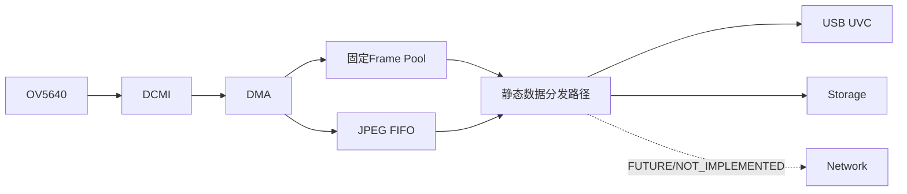

# Application V2 模块与接口契约草案

全部接口为DESIGN_PROPOSED，不存在于当前生产代码。具体字段布局、API拼写和实现需要下一阶段批准；本轮不改变52B/56B消息及Media ABI。

## 1. Core与静态MediaGraph

Core值类型仅包含ModuleId、ConsumerId、Result、CommandIdentity、MediaFormat、不可变FrameView和后端token类型。现有外部协议结构不嵌入指针扩展，不因V2扩大队列单元。内部关联表的静态容量和字段在Resource阶段冻结；不先增加完整四方向业务对象。

Graph Entity定义id/type/name/const caps/逻辑pad范围/只读验证ops；类型为硬件、采集、处理、缓冲提供者、消费者。Pad定义(parent,id,direction,media type,format caps)；Link定义两个端点及静态可用标志；Pipeline定义source/sink集合/选中links/format/rate/dependencies。Pad不是GPIO。Entity ops无start/stop/retain/release。

Raw/JPEG是互斥配置路径，不同时启动两个采集后端。当前真实USB分支由Bridge实现，Storage分支由Dispatcher同步Offer实现；目标图不是当前已有Graph对象。SD-only仍从Camera内部原始持有派生SD Lease，不需要伪造USB消费者。

建议固定上限16 Entity、32 Pad、32 Link、8 Pipeline，初始化只读验证后冻结。上线前验证重复ID/无效端点/方向/重复边/media和格式/分辨率/容量/非法Pipeline/环/未来节点误启用。迭代拓扑排序，禁止递归或ISR验证；无运行期SetLink、无Graph Task。图结构合法不表示业务可启动。

格式草案包含pixel、stream kind、width/height、bytes_per_line、size_image、max_payload、fps numerator/denominator、plane_count、max_spans、地址/长度对齐。raw精确步长和容量；JPEG步长0、实际payload≤上限、一plane最多两span。YUV422明确Y0 U0 Y1 V0；未有转换实体时拒绝自动格式转换。图只做能力交集，不改变现有sensor/USB/Storage验证器。

## 2. Lifecycle与完成语义

每模块有独立Unconfigured→Inactive→Active→Deactivating→Inactive；Cleanup仅在资源清理条件满足后转Unconfigured。Error Processing不是所有资源已释放；故障与排空可并存，失败结果冻结。它们是V2目标概念，不能机械映射一个enum覆盖现有Media、Device、USB_Mode和StorageFS状态。

候选接口：`Module_RequestTransition(id, command)` 返回接受/队列满/非法身份；`Module_Process(now,budget)` 由owner调用；`Module_GetCompletion(identity,out)` 返回只读匹配完成；`Module_ConfirmCompletion(identity)` 只确认交付；`Module_GetStatus(out)` 无业务副作用。不会将同名接口实现为跨任务同步等待。Task只有运输、调度、诊断和端口调用；模块唯一拥有业务状态。

| 事件 | 只证明 | 不证明 |
|---|---|---|
| Request accepted | 请求可靠登记/入队 | Activate/Deactivate完成 |
| 终结回复固定 | 原请求结果不可变 | 回复已入队或被消费 |
| ACK enqueued | 已入运输队列 | 对端处理完成 |
| ACK consumed | 匹配接收方消费 | 文件成功或Hardware Stop |
| Frame return confirmed | Camera真实完成指定后端归还 | 消费者资格释放 |
| RELEASE confirmed | 身份及独立退出核验满足 | 其他消费者退出/硬件已停止 |
| Hardware stopped | 特定停止请求对应真实硬件结果 | 文件封尾成功 |

## 3. Resource接口及唯一后端权威

候选只读/请求API：`Resource_RequestFrame(G,H)`、`Resource_Return(G,H,M,completion)`、`Resource_CloseAdmission(G,R)`、`Resource_QueryExit(G,R,out)`。调用方为模块owner；实际Get/Retain/Release由Camera owner消费后执行。输出是受保护的一致性证据，不能由USB/Storage裸读Camera私有对象组合。

G=(consumer,session,generation,ACQUIRE request)；R=(consumer,session,generation,RELEASE request,关联G)；H=一次单调交接号；M=后端实际Loan或固定池所有权令牌；B=原Bridge epoch/lease/command；S=Storage slot/generation/session。各种request_id不等同。关联必须在正式受理时固定，失败回滚不得遗失已实际Retain的令牌。

Resource不增加引用计数，不管理Pipeline策略，不关闭文件。raw适配保存原固定池语义和单IN_USE限制；JPEG适配真实Loan和SD Lease。`RETURN_PENDING`仅请求，不是ReleaseLease完成。资源查询只读不创建Loan、不改变owner、不Release。

线性化候选：L_admit在Camera owner验证G仍ACTIVE并成功绑定后端持有/在途记录的提交点；L_close在同owner把指定G置RELEASING并永久关闭该G准入；L_verify在同owner处理完旧入队/在途交接、后端无该G持有且终结消息条件满足后生成一致性结果。关闭后既有持有仍可Return，未受理请求负向终结，旧通知不重开入口。需要明确处理“入队未消费”窗口；关闭与受理不得分属无同步裸读。

这些是待证明设计。现有Media不记录完整G，Grant→M关联及关闭屏障依旧NOT_PROVEN。必须先审API和有界关联元数据、终结收据/退休条件，再编码；不能把SchemaA WIP直接当作通过方案。

## 4. Camera Module

输入：产品采集配置、合法消费者请求、停止/Shutdown计划、Media事件。输出：资格/完成消息、帧描述和只读状态。唯一权威：配置应用事实、Camera lifecycle、消费者资格、停止请求真实结果；Media仍保有帧引用权威。

Configure验证sensor/捕获/格式；Activate由Camera任务经Device/Media端口准备运行，只启动一次共享采集。普通STOP唯一收尾推进入口；BeginRound必须在本轮命令前，保护性停止立即执行后记录事实避免同轮重复。Device_Stop只在Media真正停止后执行；Bridge/交接排空也必须独立核验。失败原结果不能被后台恢复覆盖。

Shutdown先拒绝新申请、要求各消费者自主停止、持续处理Return/ACK，全部真实资格退出和后端排空后才停硬件。必要保护性停止不伪造消费者归还。没有启动过的STOP_IF_IDLE不初始化sensor、不随意标HARDWARE_STOPPED。

## 5. USB Module

输入：显式START/STOP、UVC进度、匹配Camera资格回复。输出：USB业务ACK/FAULT、Frame Return及资格事务。资格成功后才接收视频帧；USB_TEST不申请Camera；Reset/Disconnect/Suspend/Resume不隐式释放资格。

STOP先关闭本地入口→遵循UVC Cancel/Process→Frame Return→Camera真实归还→ACK消费→Mode Stop→RELEASE→STOP_IF_IDLE。USB业务停止与资格释放独立推进；首次STOP失败ACK保持原错误，后台最终恢复不能因stop_command已清除而漏掉RELEASE。另一消费者ACTIVE时Camera BUSY不代表USB自身STOP失败。

UVC frame_owned=false是传输端必要条件，不是Camera归还证明；Submit成功不证明任何DMA已停止。USB Module不能操作CameraCapture_Stop，也不能自己清Media引用。

## 6. Storage Module

输入：录像/抓拍/STOP/RECOVER配置和帧描述。输出：文件业务结果、清理结果、Return及资格消息。Storage owner独占FatFS、AVI/JPEG Service；Camera owner执行实际SD Lease Retain/Release。

启动次序需冻结：准备配置/只读可用性→QUERY/ACQUIRE→授权后Mount/文件→开放收帧；挂载或文件失败需关入口、处理已接收帧、撤销资格；不能遗留永久ACTIVE。STOP请求本地立即关入口与task实际STOP分开，pending START与STOP按可靠命令顺序处理，已获授权但STOP已请求不能重新开放收帧。

正常录像：关入口→完整在途帧→AVI Finish→Close/Unmount→真实帧归还核验→资格释放。文件失败但真实帧与交接均已安全终结时，允许资格释放，文件/卷故障继续保留；不把异常文件计为正常完成。文件封尾、挂载清理、帧归还分别报告。现有部分写入、CRC、Snapshot回读和恢复策略要逐项迁移，不因重写丢弃。

## 7. Supervisor和Network

Supervisor输入用户意图与静态Pipeline计划，输出指定模块的异步转换请求；每计划持有步骤索引/依赖完成/命令身份/期限/首错。不持有帧、模块私有状态或硬件Ops。扩展模式靠const步骤表和模块端口，不能增长“USB失败就Camera_STOP”等分散业务if/else。超时保留未完成事实，不能清资格或停止硬件冒充成功；取消只能取消未提交步骤。

Network当前NOT_IMPLEMENTED。未来Ethernet/Wi-Fi各有Control Plane（配置/状态/故障）和Data Plane（分包/异步/背压/重连）。只有真实持有Frame才参与Camera消费者；复制与零拷贝分别证明全部原始访问结束。TCP接受或驱动接受不替代Camera Return ACK。当前不注册新消费者、不加网络队列或改变56B协议。

## 8. 安全契约与旧实现的取舍

| 对象 | 必须保留 | 可调整实现方式（待授权） | 不能静默改变 |
|---|---|---|---|
| C2.2A | 独立消费者资格、身份代次、DECIDED/BLOCKED、真实释放核验 | 从旧App内部访问迁到V2注入端口 | 不完整证据不能返回释放成功 |
| Replay | 单调编号、高水位、候选隔离、合法后继、冻结结果、禁止强清 | 迁移源码位置/公开适配 | 不增配额、不开放Retire、不重写算法 |
| AC-01～06 | 身份、独立所有权、ACK/DMA真实完成全部保留 | 有界关联元数据/只读核验API | 不新增第二套引用计数 |
| B2 ID23 | 人工选A：退出前新START有界BUSY并保留ACK/FAULT映射 | V2入口与测试夹具 | 不能伪装成功重启 |
| B2 ID31 | 人工选B：当前未退出拒绝与未来合法成功START后FAULT复位分开验收 | 新模块成功START清理时点 | 保留原成功重启目标，未成功不得清历史故障 |

Supervisor计划属于新V2机制，不复用旧Control全局状态；格式、资源身份与承诺结果若需要变更协议，先提出差异与内存影响，再等待人工批准。

## 补充：设计状态与兼容目标

DESIGN_PROPOSED与本轮ADR的UNRESOLVED同义：都是待审核建议，非已批准实现。VIDEO_OUTPUT_NONE按需采集、USB_TEST不申请Camera是此前人工批准的目标；当前main的Control仍在NONE模式主动启动Camera，两者必须作为显式迁移差异，不能混写为现状。B2 ID23/31也是V2兼容要求，不声称当前main已接入相关Consumer路径。

对齐约束按用途区分：DMA块/固定池基址对齐、CPU JPEG字节视图、USB packet和SDMMC中转分别验证。JPEG两span起点不必都32B对齐；不可因统一格式模型拒绝现有合法帧或偷偷复制整帧。

Cleanup只处理已由V2持有的上层配置/关联与明确可清理资源，不伪造现有Device不存在的deinit/unregister。静态Device注册可保留；若需求要实际断电/卸载设备，须另行设计底层接口并批准，不把Lifecycle的Cleanup成功冒称为硬件电源已关闭。
