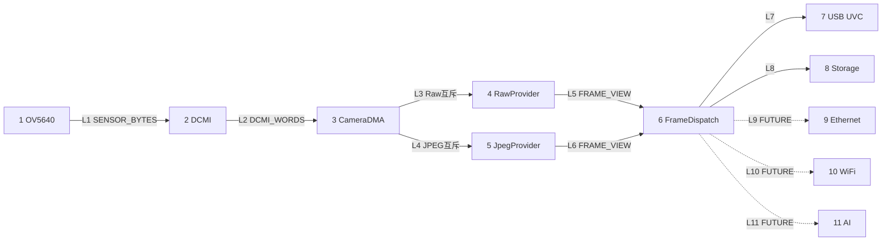

# Application V2 模块与接口契约草案

全部接口为DESIGN_PROPOSED，不存在于当前生产代码。具体字段布局、API拼写和实现需要下一阶段批准；本轮不改变52B/56B消息及Media ABI。

## 1. R2：Static Typed Media Graph 精确设计

### 1.1 审核状态、范围与三个直接回答

R2输入研究分支HEAD `2108b42`，实际CM7源码仍与main `f0ce45f`相同。以下C声明仅是文档规格，未创建头文件、编译或接入生产。**ADR-01仍UNRESOLVED**；认可Static Typed Media Graph研究方向不等于批准具体API、容量或实现。Grant→Frame Lease、Stable Admission Closure继续NOT_PROVEN。

- **R2-01：允许一个Source Pad连接多个Sink Pad**，通过多个独立、静态的Link表示；选中边数受Pad的FANOUT标志/max_links限制。一个Link只连两个端点。图fan-out不分配Frame、不自动Retain，不保证后端支持这些消费者同时持有。
- **R2-02：每条具体Pipeline固定一种Backend与选定Link集合**。Raw和JPEG用不同Pipeline描述，共享同一Graph中的公共前缀。分辨率/目标速率在该路由能力内配置；不在一条正在运行的Pipeline里切换Raw/JPEG隐藏路由。多个相同Backend、相同规范格式的Pipeline可以配置成一个合并视图；不用枚举每一种消费者组合。
- **R2-03：Graph是静态连接和格式交集的聚合者，不是覆盖驱动限制的新权威**。OV5640、CameraCapture、UVC分别拥有本层格式否决权；端到端格式必须全部接受。没有一个“最后验证器返回OK”能覆盖前面的失败。生命周期实际配置还可因设备/会话状态失败；Graph成功不证明采集速率、资源归还或硬件已启动。

Typed含义为：端点身份类型分离、Pad方向/数据协议/媒体类型/像素格式/Backend/能力可机械校验；不是把模块名和箭头硬编码在switch中。Graph Core不得依赖USB/Storage私有状态。下述ID使用结构包装，避免普通整数typedef在C中仍能任意互换；存储的枚举码用固定宽度字段，避免ARMCC短枚举影响Graph内部布局预测。

参考固定Linux v6.12：[media-entity.h](https://github.com/torvalds/linux/blob/v6.12/include/media/media-entity.h)、[mc-entity.c](https://github.com/torvalds/linux/blob/v6.12/drivers/media/mc/mc-entity.c)。借鉴端点/链路/管线校验模型；const冻结、迭代有界算法和后面的接口是H7适配建议，不声称Linux采用相同静态表。

### 1.2 C值类型、Pad类型与格式

```c
#include <stdint.h>
#include "sys_result.h"

#define GRAPH_ENTITY_MAX    16U
#define GRAPH_PAD_MAX       32U
#define GRAPH_LINK_MAX      32U
#define GRAPH_PIPELINE_MAX   8U
#define GRAPH_CAPS_MAX      32U
#define GRAPH_SINK_MAX       5U
#define GRAPH_DEP_MAX        4U

typedef struct { uint16_t value; } GraphEntityId;
typedef struct { uint16_t value; } GraphPadId;
typedef struct { uint16_t value; } GraphLinkId;
typedef struct { uint16_t value; } GraphPipelineId;
typedef struct { uint16_t value; } GraphCapsId;
typedef struct {
    GraphEntityId entity;
    GraphPadId pad;                 /* entity内0-based，不是GPIO */
} GraphEndpoint;

enum { GRAPH_PAD_SINK = 1, GRAPH_PAD_SOURCE = 2 };
enum { GRAPH_MEDIA_VIDEO = 1U, GRAPH_MEDIA_METADATA = 2U };
enum {
    GRAPH_PROTO_SENSOR_BYTES = 1,   /* sensor外部视频字节流 */
    GRAPH_PROTO_DCMI_WORDS = 2,     /* 外设到DMA的逻辑word流 */
    GRAPH_PROTO_DMA_CHUNKS = 3,     /* DMA写入后端的chunk */
    GRAPH_PROTO_FRAME_VIEW = 4,     /* 完整帧的不可变视图 */
    GRAPH_PROTO_METADATA = 5        /* FUTURE；当前无实现 */
};
enum { GRAPH_PIXEL_Y8 = 1, GRAPH_PIXEL_RGB565 = 2,
       GRAPH_PIXEL_YUY2 = 3, GRAPH_PIXEL_JPEG = 4 };
enum { GRAPH_BACKEND_RAW = 1, GRAPH_BACKEND_JPEG = 2 };
enum { GRAPH_STREAM_RAW_FRAMES = 1, GRAPH_STREAM_JPEG_FRAMES = 2 };
enum { GRAPH_ENTITY_HW = 1, GRAPH_ENTITY_CAPTURE = 2,
       GRAPH_ENTITY_TRANSFER = 3, GRAPH_ENTITY_PROVIDER = 4,
       GRAPH_ENTITY_PROCESSOR = 5, GRAPH_ENTITY_CONSUMER = 6 };
enum { GRAPH_E_IMPLEMENTED = 1U, GRAPH_E_FUTURE = 2U,
       GRAPH_E_TERMINAL = 4U };
enum { GRAPH_P_FANOUT = 1U, GRAPH_P_REQUIRED = 2U };
enum { GRAPH_L_AVAILABLE = 1U, GRAPH_L_FUTURE = 2U };
enum { GRAPH_PIPE_TEMPLATE = 1U };
enum { GRAPH_CAP_RATE_UNKNOWN = 1U, GRAPH_CAP_COARSE = 2U };

typedef struct GraphFormat {
    uint32_t media_type;            /* 单一媒体码，不是mask */
    uint32_t pixel_format;
    uint32_t stream_kind;
    uint32_t width, height;
    uint32_t bytes_per_line;
    uint32_t size_image;
    uint32_t max_payload;
    uint32_t fps_num, fps_den;      /* 约分后的请求目标，不是实测FPS */
    uint32_t plane_count;
    uint32_t max_spans;
    uint32_t backend;
    uint32_t dma_alignment;         /* DMA目标要求 */
    uint32_t frame_alignment;       /* 完整Frame地址要求，JPEG可为1 */
    uint32_t flags;                 /* R2要求0，拒绝未知位 */
} GraphFormat;

typedef struct GraphCaps {
    uint32_t media_mask, pixel_mask, backend_mask;
    uint16_t width_min, width_max, height_min, height_max;
    uint16_t width_step, height_step;
    uint32_t max_payload;           /* 0表示本Pad不再加整帧上限 */
    uint16_t max_spans, flags;
    uint32_t max_fps_num, max_fps_den;
    uint32_t dma_alignment, frame_alignment;
} GraphCaps;
```

Entity/Link/Pipeline/Caps ID分别为1..对应count，0无效；按数组顺序稠密编号，使查询有界且无需动态Map。Pad ID为父Entity内0..pad_count-1，通过Entity.pad_first索引全局Pad表。任何ID越界先拒绝，再计算mask；Entity bit为id-1（最多15），Link bit最多31，用uint32_t计算。

pixel_mask的bit0..3对应上述四个像素码；backend_mask的bit0/1对应Raw/JPEG；先验证码域再shift。方向只能恰为SINK或SOURCE，不能双向混用。Link两端protocol必须相同；媒体/像素/Backend能力必须有交集。Entity内部可将SENSOR_BYTES→DCMI_WORDS、DCMI_WORDS→DMA_CHUNKS、DMA_CHUNKS→FRAME_VIEW，这只是表示层/组帧变化，不是图像编码转换；每种Entity Ops明确其允许的内部转换。Dispatcher是FRAME_VIEW→FRAME_VIEW、格式不变。

R2执行格式仅VIDEO；METADATA协议/媒体码只是未来命名保留，当前不能以未知pixel绕过视频校验。RGB565映射现有Sensor字节顺序（高字节在前），YUY2明确Y0 U0 Y1 V0；当前不定义自动字节序/颜色空间转换。

Caps的范围是粗筛，不足以表达JPEG离散尺寸等非矩形集合，选中实体必须再经过本层纯验证器。step从min起计算，必须非0；alignment为非0的2次幂；能力中max_fps_num=0且RATE_UNKNOWN时表示该层未提供速率保证，不能当作无限物理带宽。UVC仍执行自身确定的FS约束。FUTURE能力仅用于描述，不作为已实现承诺。

GraphFormat规范：Y8为W字节行；RGB565/YUY2为2W；YUY2宽必须偶数。Raw要求size_image=max_payload=bytes_per_line×H、plane_count=1、max_spans=1、backend=RAW、stream_kind=RAW_FRAMES。JPEG要求bytes_per_line=0、size_image=max_payload≥4、plane_count=1、max_spans=2、backend=JPEG、stream_kind=JPEG_FRAMES。JPEG双Span不是双Plane；MJPEG表示JPEG帧序列及UVC/AVI封装，不新增Sensor pixel枚举。尺寸、乘法和窄化转换须先检查溢出。

### 1.3 Entity、Pad、Link、Pipeline和Graph表

```c
typedef struct GraphEntityDesc GraphEntityDesc;
typedef struct GraphIssue GraphIssue;
typedef struct GraphCheckContext {
    uint32_t schema_version;
    uint32_t product_revision;
} GraphCheckContext;

typedef struct GraphEntityOps {
    SysResult_t (*validate_format)(
        const GraphEntityDesc *entity, const GraphFormat *format,
        const GraphCheckContext *context, GraphIssue *issue);
} GraphEntityOps;

struct GraphEntityDesc {
    GraphEntityId id;
    uint16_t kind;
    const char *name;
    uint16_t pad_first, pad_count;
    uint16_t exclusion_group;       /* 0无互斥组，Provider共享1 */
    uint16_t flags;
    const GraphEntityOps *ops;      /* 只有纯校验，无Start/Stop */
};

typedef struct GraphPadDesc {
    GraphPadId id;
    uint16_t direction;
    GraphEntityId parent;
    uint16_t protocol;
    GraphCapsId caps;
    uint16_t flags;
    uint16_t max_links;             /* 当前配置选中边数上限 */
    uint16_t reserved;              /* 必须0 */
} GraphPadDesc;

typedef struct GraphLinkDesc {
    GraphLinkId id;
    uint16_t flags;                 /* 可用性，不是运行状态 */
    GraphEndpoint source, sink;
    uint16_t reserved[2];           /* 必须0 */
} GraphLinkDesc;

typedef struct GraphPipelineDesc {
    GraphPipelineId id;
    uint16_t flags;
    const char *name;
    GraphEntityId source;
    uint16_t backend;              /* 此描述固定一种Backend */
    GraphEntityId sinks[GRAPH_SINK_MAX];
    uint16_t sink_count;
    GraphLinkId links[GRAPH_LINK_MAX];
    uint16_t link_count;
    GraphPipelineId dependencies[GRAPH_DEP_MAX];
    uint16_t dependency_count;
    const GraphFormat *default_format;
} GraphPipelineDesc;

typedef struct GraphDesc {
    uint32_t schema_version;
    const GraphEntityDesc *entities;
    const GraphPadDesc *pads;
    const GraphLinkDesc *links;
    const GraphPipelineDesc *pipelines;
    const GraphCaps *caps;
    uint16_t entity_count, pad_count, link_count, pipeline_count;
    uint16_t caps_count, reserved;
    const GraphCheckContext *check_context;
} GraphDesc;
```

所有描述表、名称、默认格式和Ops在const区，整个生命周期不可修改；名称≤31字节加NUL、无动态注册/卸载。数组计数以声明处的sizeof推导，拒绝超限，不以大count截断继续。Graph不接受外部网络反序列化的任意C指针；描述对象长度/生命周期由本机可信静态声明保证，运行时检查不声称可验证任意伪造指针。

本R2子集还限制内部路由形状：HW Source只有输出；Capture/Transfer/Provider至多一个SINK并有明确输出；Processor至多一个SINK，各输出继承该输入的同一图像格式；Consumer只有一个SINK且无输出。各kind的协议变化按第1.2节规则校验。不能用Entity级可达性假定任意多输入/多输出天然互联；未来Mux、编码/转换、AI metadata输出需要显式内部路由/转换契约后再扩展，本轮不支持。

Pipeline只有count前缀有效；未用ID槽要求0，拒绝重复Sink/Link/依赖。Entity路径由选中Link推导并输出拓扑顺序，不再保存另一份可能漂移的path列表。Source是Entity，Sink可为TERMINAL Consumer，或capture-only场景的TERMINAL Provider；终端不得继续有选中出边。依赖指其他Pipeline的配置需求，不是模块启动状态机。

Link端点永久固定。`GRAPH_L_AVAILABLE`只表示允许被选入配置；**effective_enabled = AVAILABLE且Link ID属于当前已验证视图的link_mask**。不在Link对象另存可变enabled副本；没有运行期SetLink API。FUTURE边不能AVAILABLE，也不能在执行配置中选中。Catalog里Raw/JPEG边都可AVAILABLE，只有当前Pipeline选中的一边effective_enabled。

### 1.4 静态产品拓扑、fan-out与互斥组

下表是V2产品描述建议，尚未实例化；“已有能力”不是V2实体已经注册。

| ID | Entity / kind | pad_first/count | Pad协议与方向（本地ID） | 互斥组/能力 |
|---:|---|---|---|---|
| 1 | OV5640 / HW | 0/1 | 0 SOURCE SENSOR_BYTES | 已有；Ops调用OV5640纯验证 |
| 2 | DCMI / CAPTURE | 1/2 | 0 SINK SENSOR_BYTES，1 SOURCE DCMI_WORDS | 已有，保留采集门面 |
| 3 | CameraDMA / TRANSFER | 3/2 | 0 SINK DCMI_WORDS，1 SOURCE DMA_CHUNKS | 已有；不能由Graph启停 |
| 4 | RawProvider / PROVIDER | 5/2 | 0 SINK DMA_CHUNKS，1 SOURCE FRAME_VIEW | group1；RAW；允许capture-only终端 |
| 5 | JpegProvider / PROVIDER | 7/2 | 0 SINK DMA_CHUNKS，1 SOURCE FRAME_VIEW | group1；JPEG；不另建Pool |
| 6 | FrameDispatch / PROCESSOR | 9/2 | 0 SINK FRAME_VIEW，1 SOURCE FRAME_VIEW | SOURCE FANOUT/max_links=5 |
| 7 | USB_UVC / CONSUMER | 11/1 | 0 SINK FRAME_VIEW | TERMINAL；YUY2/JPEG |
| 8 | Storage / CONSUMER | 12/1 | 0 SINK FRAME_VIEW | TERMINAL；JPEG |
| 9 | Ethernet / CONSUMER | 13/1 | 0 SINK FRAME_VIEW | FUTURE/TERMINAL；示例JPEG |
| 10 | WiFi / CONSUMER | 14/1 | 0 SINK FRAME_VIEW | FUTURE/TERMINAL；示例JPEG |
| 11 | AI / CONSUMER | 15/1 | 0 SINK FRAME_VIEW | FUTURE/TERMINAL；示例Raw，不假设已支持JPEG解码 |



此图只是上述const表的可视化；类型、能力、选中集合和校验契约由C规格决定，图示本身不能作为所有权或运行证明。

除Dispatcher SOURCE外所有Pad max_links=1；选中非Source实体的必需输入Pad标REQUIRED。Raw/JPEG Provider输出可在capture-only终端不连接；其余已选中中间路径必须连通。多条候选边可连同一Sink Pad，但一个配置内最多一条，不支持隐式fan-in/混流。

| Link ID | 静态连接 | 属性 |
|---:|---|---|
| 1 | 1:0→2:0 | AVAILABLE |
| 2 | 2:1→3:0 | AVAILABLE |
| 3 | 3:1→4:0 | AVAILABLE，Raw分支 |
| 4 | 3:1→5:0 | AVAILABLE，JPEG分支 |
| 5 | 4:1→6:0 | AVAILABLE |
| 6 | 5:1→6:0 | AVAILABLE |
| 7 | 6:1→7:0 | AVAILABLE |
| 8 | 6:1→8:0 | AVAILABLE |
| 9 | 6:1→9:0 | FUTURE，当前不允许启用 |
| 10 | 6:1→10:0 | FUTURE，当前不允许启用 |
| 11 | 6:1→11:0 | FUTURE，当前不允许启用 |

例如L7/L8共享Source Endpoint 6:1，分别连7:0、8:0，构成真正Pad fan-out。Core按方向/协议/caps/数量校验，不写“如果USB+SD则…”分支。Dispatcher已存在Storage分发与Bridge USB两条实际路由，但Graph描述不替代后续Resource Retain与Return。

每个配置中同一非0 exclusion_group最多一个选中Entity，且Pipeline.backend必须被所有相关Pad caps接受。因此L3+L4不能同时启用；DMA Source的max_links=1还提供独立约束。此限制由表和通用算法表达，非按Raw/JPEG名字特判。

### 1.5 Pipeline实例声明和容量评估

```c
/* 默认格式对象只在文档声明；没有新增生产字段。 */
static const GraphFormat raw_yuy2 = {
    1, 3, 1, 160, 120, 320, 38400, 38400,
    25, 1, 1, 1, 1, 32, 32, 0
};
static const GraphFormat jpeg_qvga = {
    1, 4, 2, 320, 240, 0, 40000, 40000,
    25, 1, 1, 2, 2, 32, 1, 0
};
static const GraphFormat raw_y8 = {
    1, 1, 1, 160, 120, 160, 19200, 19200,
    25, 1, 1, 1, 1, 32, 32, 0
};
static const GraphPipelineDesc pipelines[] = {
    { .id={1}, .name="raw-uvc", .source={1}, .backend=1,
      .sinks={{7}}, .sink_count=1,
      .links={{1},{2},{3},{5},{7}}, .link_count=5,
      .default_format=&raw_yuy2 },
    { .id={2}, .name="jpeg-uvc", .source={1}, .backend=2,
      .sinks={{7}}, .sink_count=1,
      .links={{1},{2},{4},{6},{7}}, .link_count=5,
      .default_format=&jpeg_qvga },
    { .id={3}, .name="jpeg-storage", .source={1}, .backend=2,
      .sinks={{8}}, .sink_count=1,
      .links={{1},{2},{4},{6},{8}}, .link_count=5,
      .default_format=&jpeg_qvga },
    { .id={4}, .flags=GRAPH_PIPE_TEMPLATE,
      .name="future-jpeg-eth-storage", .source={1}, .backend=2,
      .sinks={{8},{9}}, .sink_count=2,
      .links={{1},{2},{4},{6},{8},{9}}, .link_count=6,
      .default_format=&jpeg_qvga },
    { .id={5}, .flags=GRAPH_PIPE_TEMPLATE,
      .name="future-jpeg-wifi-storage", .source={1}, .backend=2,
      .sinks={{8},{10}}, .sink_count=2,
      .links={{1},{2},{4},{6},{8},{10}}, .link_count=6,
      .default_format=&jpeg_qvga },
    { .id={6}, .flags=GRAPH_PIPE_TEMPLATE,
      .name="future-raw-ai", .source={1}, .backend=1,
      .sinks={{11}}, .sink_count=1,
      .links={{1},{2},{3},{5},{11}}, .link_count=5,
      .default_format=&raw_y8 },
    { .id={7}, .name="raw-capture", .source={1}, .backend=1,
      .sinks={{4}}, .sink_count=1,
      .links={{1},{2},{3}}, .link_count=3,
      .default_format=&raw_y8 }
};
```

未指定的静态字段为0；默认格式是明确样例，不是已有生产配置。P7保留Y8/RGB565等底层capture-only能力，其请求格式可在Raw路由内变化；不假装这些格式已能走当前UVC或AVI。JPEG→USB+Storage可用P2/P3合并视图，不另建第8条“dual”描述。

示例Catalog为11 Entity/16 Pad/11 Link/7 Pipeline/11 caps；每Pad引用其实体caps（当前Entity内caps可复用，未来不同Pad可以不同caps）。16/32/32/8上限暂时合理：剩余5 Entity、16 Pad、21 Link、1 Pipeline。**8 Pipeline不是所有未来组合的永久容量保证**；靠合并相容路由避免组合爆炸，不能默默扩表/截断。未来新增编码器、格式转换、AI多Pad等先评估实体/Pad/协议/后端能力及预算，超限返回NO_RESOURCE并另审容量。

Source相同、Backend和规范格式完全一致的多个Pipeline可合并选中Link；公共前缀与相同Sink只记录一次，不表示增加业务消费者数/再次ACQUIRE。不同Source或格式/Backend冲突拒绝。依赖必须显式列入本次请求集合，不自动激活遗漏的Pipeline。

### 1.6 Graph格式校验与现有验证器的协作

| 层/节点 | 当前源码确认的约束及适配方式 | 最终否决权 |
|---|---|---|
| 基本帧格式 | `Common/Inc/camera_config.h::CameraConfig_GetFrameSize/CameraConfig_IsJpegSizeSupported`；Raw按BPP算长度，YUY2偶数宽，JPEG三个离散尺寸 | 基本参数不合法直接拒绝 |
| OV5640 | `CM7/Device/Src/ov5640_device.c::Ov5640_ValidateConfig`（304）；非JPEG只160×120，JPEG仅160×120/320×240/640×480 | sensor支持集合，不允许Graph范围表放宽 |
| Capture/DCMI/DMA/Provider | `CM7/Media/Src/camera_capture.c::CameraCapture_ValidateStreamConfig`（857）；Raw≤614400B、4字节整除、DMA word数≤0xffff；JPEG检查上述离散尺寸 | 采集后端能力，Graph不直接调BSP/HAL |
| JPEG运行准备 | `CM7/Media/Src/camera_mjpeg_fifo.c::CameraMjpegFifo_Start`（194）还检查running/HasLoan、单调session并修改硬件/状态 | **不能把Start当纯验证器调用**；归Lifecycle/Resource就绪检查 |
| UVC | `CM7/Service/usb_uvc_class.c::USB_UVC_ValidateConfig`（216）只转调`usb_uvc_desc.c::USB_UVC_ValidateFSConfig`（265）；YUY2/JPEG、整数fps≤1000；JPEG配置长度4..262140；ceil(bytes/1021)≤floor(1000/fps) | 传输配置的否决权，不证明PC枚举/Commit/Alt |
| Storage | `CM7/Application/app_storage.c::App_StorageOfferFrame`（237）目前是有副作用的运行期接收：只JPEG、4..70000B、合法双span；`Storage_Request`拒绝非JPEG/USB_TEST | **不能调用OfferFrame做Graph试探**；后续纯适配共享公开上限/格式规则，缺少纯接口时先审，不复制挂载/Retain逻辑 |
| Ethernet/WiFi/AI | 当前无实现，无格式/驱动可用性证明 | Graph执行配置明确NOT_SUPPORTED，不假定网络带宽或AI解码能力 |

本轮再次核对UVC真实实现在`usb_uvc_class.c`，没有`CM7/Service/usb_uvc.c`。五种纯Ops草案分别是Sensor验证、Capture验证（多个实体复用）、FRAME_VIEW直通、UVC验证、Storage纯能力适配；Core只调用Ops，不按实体ID硬编码这些调用。GraphCheckContext只含不可变版本值，禁止借context传入可变私有业务对象。

11行caps的具体能力来源：1 Sensor粗范围160..640×120..480/四pixel；2 DCMI、3 DMA由Capture纯验证细化；4 RawProvider只有Y8/RGB565/YUY2、RAW、单span、DMA/帧基址32对齐及614400B槽容量；5 JPEG Provider只有JPEG/JPEG Backend、双span、DMA块32但Frame字节对齐1；6 Dispatcher直通四pixel/两Backend；7 UVC只有YUY2/JPEG、双span、FS约束；8 Storage只有JPEG、双span、70000B；9/10未来网络仅声明样例JPEG；11未来AI仅声明样例Raw。非矩形集合和格式条件通过Ops检查，粗范围不单独宣称完整支持；Source未给出fps保证的caps标RATE_UNKNOWN。

下表给出11个caps条目的全部数值约定，补足可直接翻译为const初始化的字段：media_mask全部为VIDEO，width_step/height_step全部1；flags全部COARSE，除UVC外另带RATE_UNKNOWN；unknown速率统一0/1。pixel和backend列按第1.2节bit映射，不直接存现有Camera枚举。每Entity两个Pad当前可共用本行caps，parent/id/protocol仍分别校验。

| Caps ID（本产品映射） | pixel集合 / Backend集合 | W范围 / H范围 | max_payload | max_spans | max_fps | DMA / Frame alignment |
|---:|---|---|---:|---:|---|---|
| 1 Sensor | Y8/RGB565/YUY2/JPEG / Raw+JPEG | 160..640 / 120..480 | 0 | 2 | unknown | 1 / 1 |
| 2 DCMI | 四pixel / Raw+JPEG | 1..640 / 1..480 | 0 | 2 | unknown | 1 / 1 |
| 3 DMA | 四pixel / Raw+JPEG | 1..640 / 1..480 | 0 | 2 | unknown | 32 / 1 |
| 4 RawProvider | Y8/RGB565/YUY2 / Raw | 1..640 / 1..480 | 614400 | 1 | unknown | 32 / 32 |
| 5 JpegProvider | JPEG / JPEG | 160..640 / 120..480 | 0 | 2 | unknown | 32 / 1 |
| 6 Dispatcher | 四pixel / Raw+JPEG | 1..65535 / 1..65535 | 0 | 2 | unknown | 1 / 1 |
| 7 UVC | YUY2/JPEG / Raw+JPEG | 160..640 / 120..480 | 262140 | 2 | 1000/1 | 1 / 1 |
| 8 Storage | JPEG / JPEG | 160..640 / 120..480 | 70000 | 2 | unknown | 1 / 1 |
| 9 Ethernet模板 | JPEG / JPEG | 1..65535 / 1..65535 | 0 | 2 | unknown | 1 / 1 |
| 10 WiFi模板 | JPEG / JPEG | 1..65535 / 1..65535 | 0 | 2 | unknown | 1 / 1 |
| 11 AI模板 | Y8/RGB565 / Raw | 1..65535 / 1..65535 | 0 | 1 | unknown | 1 / 1 |

caps=0上限只是不增加本Pad整帧约束，不把chunk大小当整帧上限、不承诺无限内存；规范格式仍必须有限，接收端仍施加其上限。Sensor/JPEG离散尺寸、Raw word计数和UVC带宽由真实Ops细化。网络/AI行纯属不可执行模板，没有格式、内存或DMA能力验证；FUTURE标记不能因为填写了caps而变成IMPLEMENTED。

格式适配器由公开能力端口/V2 Ports提供，使用Graph/Core定义的纯接口；Configuration只装配const Ops。Graph Core不include Device/Media/USB/业务模块头，模块也不以Graph状态替代自身配置权威。能力验证端口与实际控制/资源端口分离，不能经函数指针隐式执行生命周期操作。

适配步骤：GraphFormat码域检查→显式映射到现有CameraPixelFormat_t（不直接cast）→检查uint16 width/height/fps可表示→构造局部CameraConfig_t/VideoStreamConfig_t→调用上述只读验证器。UVC fps_den必须1，拒绝静默取整；所有fps在进入Graph时要求非0且约分，比较上限采用uint64_t交叉乘法。约分GCD对uint32最多固定64轮，非递归；不引入浮点。

最终配置为**用户明确选择的同一个规范格式与所有节点能力的交集**。Graph不自动改分辨率、JPEG上限或fps来“协商成功”，没有转换实体时也不能将RGB565接到当前UVC或把YUY2直接送AVI。共享Source的多个请求必须全64B规范格式一致；JPEG_UVC与JPEG_Storage都选择40000B可共享，若分别选择40000/70000则拒绝，不能默默降低另一请求。

Graph的max_payload为配置接收上限，不保证OV5640每个JPEG都压到该长度。运行时每帧检查仍在Resource/consumer端：现有`USB_UVC_SubmitFrameView`会拒绝超过配置的JPEG，Storage有自己的70000B检查。V2公共帧端口如何按已配置视图拒绝超限帧尚未实施；不能把静态校验冒充运行帧长度或25FPS实测证明。

### 1.7 校验输入、输出、错误与只读API

```c
typedef struct GraphSelection {
    GraphPipelineId pipeline;
    uint16_t reserved;              /* 0 */
    GraphFormat format;            /* 调用方明确选择，不修改原请求 */
} GraphSelection;

struct GraphIssue {
    uint32_t code;
    GraphEntityId entity;
    GraphPadId pad;
    GraphLinkId link;
    GraphPipelineId pipeline;
    uint32_t field;
    uint32_t expected, actual;
    SysResult_t backend_result;     /* 保留真实纯验证器返回码 */
};

typedef struct GraphWorkspace {
    uint8_t indegree[GRAPH_ENTITY_MAX];
    uint8_t ready[GRAPH_ENTITY_MAX];
    uint8_t forward[GRAPH_ENTITY_MAX];
    uint8_t reverse[GRAPH_ENTITY_MAX];
    uint8_t dependency_indegree[GRAPH_PIPELINE_MAX];
    uint8_t dependency_ready[GRAPH_PIPELINE_MAX];
    uint8_t entity_order[GRAPH_ENTITY_MAX];
    uint8_t reserved[16];
} GraphWorkspace;

typedef struct GraphValidatedView {
    const GraphDesc *graph;
    uint32_t pipeline_mask, entity_mask, link_mask;
    GraphFormat format;            /* R2仅支持一个物理Source */
    GraphEntityId topo[GRAPH_ENTITY_MAX];
    GraphEntityId sinks[GRAPH_SINK_MAX];
    uint16_t topo_count, sink_count, reserved;
} GraphValidatedView;

typedef struct GraphScratch {
    GraphWorkspace work;
    GraphValidatedView candidate;
} GraphScratch;

SysResult_t Graph_ValidateCatalog(const GraphDesc *graph,
    GraphWorkspace *work, GraphIssue *issue);
SysResult_t Graph_ValidateSet(const GraphDesc *graph,
    const GraphSelection *selections, uint16_t count,
    GraphScratch *scratch, GraphValidatedView *out, GraphIssue *issue);
const GraphEntityDesc *Graph_GetEntity(const GraphDesc *, GraphEntityId);
const GraphLinkDesc *Graph_GetLink(const GraphDesc *, GraphLinkId);
const GraphPipelineDesc *Graph_GetPipeline(const GraphDesc *, GraphPipelineId);
```

两个Validate接口不得在ISR调用；由配置所有者串行使用scratch，输入是生命周期足够长的不可变本机表/请求，不能被别的任务同时修改。Core不读HAL/RTOS寄存器；上下文门禁由Runtime调用层保证。禁止校验回调重入同一次验证、启动设备、改队列或Debug。Getter只返回const描述，越界返回NULL；没有Frame API、注册新消费者或SetLink。

GraphIssue.code拟使用固定uint32错误码，至少区分：BOUND、DUP_ENTITY、PAD_ID、SOURCE_DIRECTION、SINK_DIRECTION、MISSING_ENTITY、MISSING_PAD、DUP_LINK、MEDIA_TYPE、PIXEL_FORMAT、RESOLUTION、BUFFER_SIZE、PIPELINE、CYCLE、UNIMPLEMENTED、BACKEND_CONFLICT、FANIN/FANOUT_LIMIT、RATE、ALIGNMENT、OVERFLOW、ADAPTER_ERROR、DEPENDENCY、SOURCE_CONFLICT。0表示无错误。code不是SysResult位组合；输出SysResult按非法参数/不支持/容量不足/内部协议错误分类，backend_result保留原错误。

输出、issue、scratch与所有输入存储必须互不重叠；地址加法先检查溢出，别名错误不得为了写诊断破坏out。对合法输出存储，失败只更新issue，out保持逐字节不变。没有“部分有效的Pipeline”返回；配置调用者不能使用scratch中的半成品。

### 1.8 有界Graph Validation完整算法与失败原子性

**A. Catalog验证（启动时；纯静态）**

1. 检查schema、可信表指针/count关系、所有上限、reserved/flag码域、名称有界NUL。先检查count再遍历，不截断。0实体/0Pipeline的产品图拒绝；0依赖合法。
2. 检查Entity ID唯一且为数组下标+1、kind合法、Pad范围不越界且范围互不重叠/完整覆盖Pad表、IMPLEMENTED与FUTURE必须恰有一项设置；每实体至少一Pad。选中的已实现实体须有纯Ops，FUTURE可为NULL。
3. 检查每Pad的(parent,id)与Entity范围一致、方向单一、协议/媒体码合法、caps ID有效、max_links为1..32、无FANOUT时max_links=1；SINK不得带FANOUT且max_links必须1。检查caps位域、范围/步长、对齐、fps分母及未知速率标志。精确格式检查留到请求配置。
4. 遍历所有Link，检查ID/flags/端点父Entity与本地Pad存在、SOURCE→SINK方向、protocol一致、有已知类型交集、无重复端点四元组、自环或未知位。FUTURE边只描述，不可AVAILABLE。Catalog**不按所有候选边同时启用计算fan-in/fan-out或互斥**，否则会误拒Raw/JPEG两个候选。
5. 检查每Pipeline默认格式指针、ID/count、列表前缀/未用零槽、Source/Sink/Link/依赖引用、非空Sink/Link、无重复/自依赖。逐Pipeline复用B3～4的有界结构检查（可达/终端/度数/互斥/Backend）及默认格式的码域、算术和粗caps检查；不在Catalog阶段调用Entity Ops。含FUTURE节点/边的描述必须标TEMPLATE，检查时允许描述其静态连通性，不允许标为可执行。默认配置的精确后端否决仍在ValidateSet执行；任何未选路由不能跳过该阶段直接Activate。
6. 对完整数据Catalog（包括未来描述）做迭代Kahn排序，处理节点数不足则CYCLE。对Pipeline依赖图单独做同样检查。此H7静态子集不支持数据反馈环；依赖边不混入数据边，不把Provider反向提供DMA地址画成数据环。Catalog通过不表示每一组候选Link可同时使用，也不表示TEMPLATE可运行。

**B. 请求集合验证（配置阶段；不在每帧/IRQ重复全图）**

1. 校验selections/out/issue/scratch契约；Catalog尚未由本次可信快照验证时先执行A。本规格默认每次调用A，避免依赖可变“已验证”标志；未来缓存优化需另审。
2. count为1..8；请求Pipeline不重复，必须明确包含其依赖。复制各格式到候选计算值，不修改原输入；检查像素/Backend/媒体/stream、尺寸、平面/span、对齐、乘法/窄化/fps规范；拒绝未知flag。
3. 对每个Pipeline，从**仅其选中Link**建立entity/edge集合；核验全部Sink从所声明Source可达、每条边都在Source→至少一个Sink的路径上、没有孤立分支/额外Source，所有必需输入接入，终端类型/零出边成立。前向可达与从Sink反向可达两次迭代扫描，最多N轮，每轮L边。
4. 检查选中Pad的入/出度与max_links；Source fan-out须显式FANOUT，Sink不允许隐式fan-in。所有非0 exclusion_group选中实体数≤1，Pipeline.backend与选中能力一致。重复检查本Pipeline数据环，不能因Catalog被误标已验证而放过坏请求。
5. 遇到TEMPLATE、未IMPLEMENTED Entity或非AVAILABLE Link，返回UNIMPLEMENTED/NOT_SUPPORTED，**没有allow_future=true旁路**。可读诊断仍能显示未来拓扑，但不能构造可执行视图。
6. 对每条边两端caps检查本次规范格式：media/pixel/backend、范围/步长、payload/spans、对齐与已知速率。此步不调用Entity Ops，先完成集合的结构/格式兼容检查，避免逐Pipeline重复调用。
7. 合并多个Pipeline：要求同一个Source且GraphFormat全部规范字段一致；公共边/实体/Sink去重，不产生第二个业务grant。对合并结果再执行可达、必需输入、入/出度、互斥、终端及环检查。P2+P3形成JPEG双sink；Raw+JPEG、YUY2+Y8或不同JPEG上限拒绝。每个Sink仍最多一个实际业务实例，重复业务START由模块拒绝，Graph不管理其计数。合并检查完成后，按Entity ID升序对每个唯一选中Entity调用一次纯Ops；最多16次/视图。同一Capture适配可被不同实体复用而多次纯调用，不等于多次硬件启动；否决保留具体错误，不调Start/Configure/Offer/Retain试探。
8. 在scratch.candidate填入全部mask、规范格式、Source路径推导的topo和去重Sink集合。采用ID递增的Kahn ready选择，使同一输入得到确定顺序；依赖顺序单独校验，不把其误称实际启动顺序。所有检查成功后**只在最后一次性复制candidate到out**，并清issue。

遍历顺序固定：表顺序→请求Pipeline顺序→字段顺序→Entity ID升序；报告首个违例。边界/ID检查先于索引、shift、模运算和乘法。到达错误立即返回，不“修正”输入，不继续调用后续验证器掩盖首错。Graph约束和Ops都通过才得到CONFIG_VALID；不存在因某个Ops接受而跳过其他节点。

**C. 失败回滚和发布边界**

Graph是纯验证器，失败不写旧out、不修改const表、不更新任何模块状态；scratch半成品直接无效，下次显式重新初始化工作数组。不存在清Frame、清grant、回绕ID或停止硬件的Graph回滚。若纯Ops违反契约产生副作用，属于适配器缺陷，不能靠Graph恢复硬件掩盖。

“最后一次复制”是逻辑提交，不保证128B拷贝对其他任务原子可见。Configuration拥有已验证视图；初期只在BOOT前且无并发读取者时安装一次，运行期只读。模块Active/资格或Lease尚未退出时不得替换该Source的格式/Backend/路由。未来重配需要Lifecycle/Resource真实排空后再发布新视图；其安全前提仍NOT_PROVEN，Graph不另造关闭屏障。128B视图不能当作原52B命令载荷发送，后续Runtime适配不得擅改消息ABI；初期只支持静态产品配置的装配/读取。

USB_TEST或无Camera活动计划不创建伪空Pipeline、不为通过count检查启动Camera：可只校验静态Catalog，Supervisor不提交媒体路由激活。Graph不改变main已有启动行为；按需模式的业务迁移仍需单独授权。

若后续Lifecycle激活某模块失败，已通过Graph的拓扑能力不因此变成“硬件已回滚”；Supervisor只撤销已确认完成的计划步骤，模块保留实际错误与待归还资源。Graph不调用Cleanup替所有者释放。

### 1.9 与采集、生命周期、资源和Supervisor的接口边界

| 对象 | 本层职责 | 不属于本层的事实 |
|---|---|---|
| Graph | const连接/类型/格式交集、候选Backend互斥、只读视图 | Frame分配、资格、引用、DMA/文件/端点操作、模块运行状态 |
| CameraCapture | 真实采集门面；按格式选择内部CameraStream/FIFO，保留R2 stop facts | 不由每个图Entity重新实例化一个Capture |
| CameraStream | 现有固定Pool及DMA/READY/IN_USE | 不因Graph多边自动增加raw消费者引用 |
| CameraMjpegFifo | 现有块/Loan/SD Lease与双span帧 | 不把Graph sink ID当新owner位 |
| Lifecycle / Camera Module | 配置/激活/退出与Camera唯一硬件协调 | Link enabled不是ACTIVE；普通STOP不由Graph推进 |
| Resource Manager | G/H/M关联、准入/真实交接/归还及退出核验 | 不维护产品拓扑，也不复制底层refcount |
| Supervisor | 根据已验证路由组织模块准备/激活顺序，匹配异步完成 | Graph.topo不等于可机械调用每节点start；共享Sensor只启一次 |

RawProvider是CameraStream的图表示，JpegProvider是现有FIFO的图表示；不是新建物理Frame Pool。DMA写入由后端准备地址，数据图仍指向Provider；配置/控制依赖通过既有端口，不反向增加Link造成伪环。当前Capture/OV5640/USB/FIFO的真实状态保持唯一权威。

模块活动与Link启用不同：可在冷启动为JPEG_UVC+JPEG_Storage配置一个静态视图，Storage暂Inactive而USB运行；之后同格式Storage取得资格再收帧，不改变Link对象。若最初配置没有该sink或请求另一Backend，不能靠本地accepting=true绕过，必须先走独立审核的重配流程。

### 1.10 三个具体拓扑实例

#### 实例A：160×120 YUV422 → USB UVC

`P1: Sensor(1) --L1--> DCMI(2) --L2--> DMA(3) --L3--> RawProvider(4) --L5--> Dispatcher(6) --L7--> UVC(7)`。

选择raw_yuy2：320B/line，38400B/frame，25/1目标fps，单plane单span，Raw。Sensor的160×120/YUV422、Capture的9600 DMA words≤65535、4字节整除/池容量均符合已读验证条件。UVC包数ceil(38400/1021)=38≤floor(1000/25)=40。描述支持不保证真实25FPS，配置/运行验收本轮NOT_RUN。

目标启动：静态Graph验证→配置Camera/Provider与UVC descriptor（不运行DMA）→USB模块准备→经既有可靠协议申请Camera资格→Camera owner准备Raw后端/Device并按现有安全顺序启动采集→匹配成功回复→USB业务Activate，在PC Configured/Commit/Alt允许后才请求帧。USB枚举和资格结果不是同一个完成。此V2流程尚未实现，不将main当前Control顺序改写成已运行事实。

Resource在GetFrame正式交接前核验USB grant、绑定实际Raw持有令牌；UVC不再读原帧后Return，Camera真实释放再ACK，USB消费ACK后才能继续退出。当前Raw单IN_USE保留，Graph不新增引用计数。G→Loan与稳定关闭未实现，仍NOT_PROVEN；Graph校验只能给出类型/格式结论。

#### 实例B：JPEG → Storage

`P3: 1 --L1--> 2 --L2--> 3 --L4--> JpegProvider(5) --L6--> Dispatcher(6) --L8--> Storage(8)`；P7/Raw路径未选中，无USB sink。选择jpeg_qvga：320×240，max_payload/size_image=40000，25/1目标，单plane最多双span。Sensor/Capture JPEG离散尺寸检查满足；40000≤70000的Storage接收上限；AVI使用JPEG帧序列，不把像素变成新MJPEG枚举。未实测卡速或输出fps。

目标启动：Graph/Format验证→Storage准备策略及服务→QUERY/ACQUIRE→Camera owner启动JPEG后端并回复→授权后Mount/准备文件→Storage Activate/开放收帧。任何挂载/文件失败关闭本地入口并清理已发生工作，资格撤销需真实资源证明，不伪造完成。文件和帧结果分开。

SD-only由Camera内部原始持有产生Storage独立Lease，不创建USB grant；写完只登记Return Pending，Camera实际ReleaseLease后归还。停止要保留AVI Finish→Close/Unmount和真实归还各自条件。Graph没有USB link不等于Media当前usb_owned位必为0；字段名可能代表Camera内部原始持有。Resource关联与退出核验仍NOT_PROVEN。

#### 实例C：未来Camera → Ethernet + Storage

`P4: 1→2→3→5→6`，Dispatcher同一个Source Pad 6:1经L8到Storage 8:0、L9到Ethernet 9:0。JPEG规格沿用jpeg_qvga用于讨论，不假设网络支持已证实；无需JPEG编码/格式转换节点。两边必须接受同一源格式，网络分包在sink/transport，不反向改变Camera帧协议。

当前生产配置验证必须在TEMPLATE/FUTURE边界返回UNIMPLEMENTED/NOT_SUPPORTED，不能因图能画出或类型交集可计算就报告可运行。网络格式验证器、后端新owner支持、发送完成证据均未存在；**本轮不新增Network Consumer，不修改Replay角色或56B消息**。

未来经单独授权实现后，启动计划才是：两sink准备并关闭接收→分别取得共享Camera使用资格（现协议仅USB/Storage，Network扩展另审）→Camera只启动一次JPEG资源→各自确认后Activate；Storage文件和Ethernet连接/发送就绪独立。图的两个Sink不是两次Sensor Start。

Resource必须为Ethernet和Storage独立绑定G/H/M。复制发送等待所有原帧读取完成再归还；零拷贝等待全部DMA访问终止；TCP/驱动接受不是Camera Return ACK。一方退出另一方继续，最后消费者也须真实排空再停硬件。现FIFO只提供原始/SD两类持有，不能借用USB owner位冒充Ethernet能力；所需后端扩展和资源证明均NOT_PROVEN/IMPLEMENTATION_REQUIRED。

### 1.11 验证设计、成本与审核结论

后续专项至少覆盖：正确P1/P3、P2+P3 fan-out；Raw/JPEG同时选中；单入Pad双生产者；非FANOUT Source多出边；重复/越界ID；无效方向/协议/media/pixel；孤立Link/不可达Sink/假Source；data/dependency cycle；future启用；Y8误接当前UVC；无转换RGB565→UVC；JPEG离散尺寸/Raw word超限；fps分母/约分/FS带宽/整数窄化；JPEG上限不一致；Ops失败保留原结果；多请求同源格式冲突；alias/reentry违规；所有失败out逐字节不变、const表和硬件调用计数不变。本轮仅设计，未编写/运行测试，不声称这些断言已经PASS。

按R2声明预测ARM32/指针4B、普通4B对齐：Entity20、Pad16、Link16、Pipeline104、Caps48、Format64、GraphDesc40、Ops4、CheckContext8、Issue28、Selection68、Workspace112、ValidatedView128、Scratch240B。全部需后续ARMCC5 sizeof/offsetof/Map证实，不能拿文档结构代替ABI测量。

7路由示例const对象预计2168B，含名称最大576B则≤2744B数据（不含代码、可选请求表和链接填充）；校验暂存240B+issue28B+已发布视图128B+最坏8请求544B，若同时保留且请求为RAM，总940B，不含被调用验证器栈。若请求为const，仅省相应RAM但增加68×N ROM；不另建Task/整帧池。

Catalog/请求验证只有有界循环：ID/重复检查O(N²+P²+L²)，可达/环O(N×L)，Catalog遍历K个描述、请求再检查最多K条路由，均为O(K×N×L)加K²依赖检查；只有ValidateSet对合并视图调用≤N次纯Ops，另有有界GCD/算术。上限分别16/32/32/8；具体循环次数/优化和WCET需后续实现与DWT测量。本轮没有微秒数、真实栈或CPU利用率证据。

R2结论：给出可以人工逐项审阅的Typed Graph结构、数据表、配置视图、完整验证与失败原子性方案。推荐上限及三问题答案均等待审核；ADR-01～07不因此获批。Graph设计深化不关闭两个Resource NOT_PROVEN，不授权V2 Phase1或C2.2C。


## 2. Lifecycle与完成语义

每模块有独立Unconfigured→Inactive→Active→Deactivating→Inactive；Cleanup仅在资源清理条件满足后转Unconfigured。Error Processing不是所有资源已释放；故障与排空可并存，失败结果冻结。它们是V2目标概念，不能机械映射一个enum覆盖现有Media、Device、USB_Mode和StorageFS状态。

候选接口：`Module_RequestTransition(id, command)` 返回接受/队列满/非法身份；`Module_Process(now,budget)` 由owner调用；`Module_GetCompletion(identity,out)` 返回只读匹配完成；`Module_ConfirmCompletion(identity)` 只确认交付；`Module_GetStatus(out)` 无业务副作用。不会将同名接口实现为跨任务同步等待。Task只有运输、调度、诊断和端口调用；模块唯一拥有业务状态。

| 事件 | 只证明 | 不证明 |
|---|---|---|
| Request accepted | 请求可靠登记/入队 | Activate/Deactivate完成 |
| 终结回复固定 | 原请求结果不可变 | 回复已入队或被消费 |
| ACK enqueued | 已入运输队列 | 对端处理完成 |
| ACK consumed | 匹配接收方消费 | 文件成功或Hardware Stop |
| Frame return confirmed | Camera真实完成指定后端归还 | 消费者资格释放 |
| RELEASE confirmed | 身份及独立退出核验满足 | 其他消费者退出/硬件已停止 |
| Hardware stopped | 特定停止请求对应真实硬件结果 | 文件封尾成功 |

## 3. Resource接口及唯一后端权威

候选只读/请求API：`Resource_RequestFrame(G,H)`、`Resource_Return(G,H,M,completion)`、`Resource_CloseAdmission(G,R)`、`Resource_QueryExit(G,R,out)`。调用方为模块owner；实际Get/Retain/Release由Camera owner消费后执行。输出是受保护的一致性证据，不能由USB/Storage裸读Camera私有对象组合。

G=(consumer,session,generation,ACQUIRE request)；R=(consumer,session,generation,RELEASE request,关联G)；H=一次单调交接号；M=后端实际Loan或固定池所有权令牌；B=原Bridge epoch/lease/command；S=Storage slot/generation/session。各种request_id不等同。关联必须在正式受理时固定，失败回滚不得遗失已实际Retain的令牌。

Resource不增加引用计数，不管理Pipeline策略，不关闭文件。raw适配保存原固定池语义和单IN_USE限制；JPEG适配真实Loan和SD Lease。`RETURN_PENDING`仅请求，不是ReleaseLease完成。资源查询只读不创建Loan、不改变owner、不Release。

线性化候选：L_admit在Camera owner验证G仍ACTIVE并成功绑定后端持有/在途记录的提交点；L_close在同owner把指定G置RELEASING并永久关闭该G准入；L_verify在同owner处理完旧入队/在途交接、后端无该G持有且终结消息条件满足后生成一致性结果。关闭后既有持有仍可Return，未受理请求负向终结，旧通知不重开入口。需要明确处理“入队未消费”窗口；关闭与受理不得分属无同步裸读。

这些是待证明设计。现有Media不记录完整G，Grant→M关联及关闭屏障依旧NOT_PROVEN。必须先审API和有界关联元数据、终结收据/退休条件，再编码；不能把SchemaA WIP直接当作通过方案。

## 4. Camera Module

输入：产品采集配置、合法消费者请求、停止/Shutdown计划、Media事件。输出：资格/完成消息、帧描述和只读状态。唯一权威：配置应用事实、Camera lifecycle、消费者资格、停止请求真实结果；Media仍保有帧引用权威。

Configure验证sensor/捕获/格式；Activate由Camera任务经Device/Media端口准备运行，只启动一次共享采集。普通STOP唯一收尾推进入口；BeginRound必须在本轮命令前，保护性停止立即执行后记录事实避免同轮重复。Device_Stop只在Media真正停止后执行；Bridge/交接排空也必须独立核验。失败原结果不能被后台恢复覆盖。

Shutdown先拒绝新申请、要求各消费者自主停止、持续处理Return/ACK，全部真实资格退出和后端排空后才停硬件。必要保护性停止不伪造消费者归还。没有启动过的STOP_IF_IDLE不初始化sensor、不随意标HARDWARE_STOPPED。

## 5. USB Module

输入：显式START/STOP、UVC进度、匹配Camera资格回复。输出：USB业务ACK/FAULT、Frame Return及资格事务。资格成功后才接收视频帧；USB_TEST不申请Camera；Reset/Disconnect/Suspend/Resume不隐式释放资格。

STOP先关闭本地入口→遵循UVC Cancel/Process→Frame Return→Camera真实归还→ACK消费→Mode Stop→RELEASE→STOP_IF_IDLE。USB业务停止与资格释放独立推进；首次STOP失败ACK保持原错误，后台最终恢复不能因stop_command已清除而漏掉RELEASE。另一消费者ACTIVE时Camera BUSY不代表USB自身STOP失败。

UVC frame_owned=false是传输端必要条件，不是Camera归还证明；Submit成功不证明任何DMA已停止。USB Module不能操作CameraCapture_Stop，也不能自己清Media引用。

## 6. Storage Module

输入：录像/抓拍/STOP/RECOVER配置和帧描述。输出：文件业务结果、清理结果、Return及资格消息。Storage owner独占FatFS、AVI/JPEG Service；Camera owner执行实际SD Lease Retain/Release。

启动次序需冻结：准备配置/只读可用性→QUERY/ACQUIRE→授权后Mount/文件→开放收帧；挂载或文件失败需关入口、处理已接收帧、撤销资格；不能遗留永久ACTIVE。STOP请求本地立即关入口与task实际STOP分开，pending START与STOP按可靠命令顺序处理，已获授权但STOP已请求不能重新开放收帧。

正常录像：关入口→完整在途帧→AVI Finish→Close/Unmount→真实帧归还核验→资格释放。文件失败但真实帧与交接均已安全终结时，允许资格释放，文件/卷故障继续保留；不把异常文件计为正常完成。文件封尾、挂载清理、帧归还分别报告。现有部分写入、CRC、Snapshot回读和恢复策略要逐项迁移，不因重写丢弃。

## 7. Supervisor和Network

Supervisor输入用户意图与静态Pipeline计划，输出指定模块的异步转换请求；每计划持有步骤索引/依赖完成/命令身份/期限/首错。不持有帧、模块私有状态或硬件Ops。扩展模式靠const步骤表和模块端口，不能增长“USB失败就Camera_STOP”等分散业务if/else。超时保留未完成事实，不能清资格或停止硬件冒充成功；取消只能取消未提交步骤。

Network当前NOT_IMPLEMENTED。未来Ethernet/Wi-Fi各有Control Plane（配置/状态/故障）和Data Plane（分包/异步/背压/重连）。只有真实持有Frame才参与Camera消费者；复制与零拷贝分别证明全部原始访问结束。TCP接受或驱动接受不替代Camera Return ACK。当前不注册新消费者、不加网络队列或改变56B协议。

## 8. 安全契约与旧实现的取舍

| 对象 | 必须保留 | 可调整实现方式（待授权） | 不能静默改变 |
|---|---|---|---|
| C2.2A | 独立消费者资格、身份代次、DECIDED/BLOCKED、真实释放核验 | 从旧App内部访问迁到V2注入端口 | 不完整证据不能返回释放成功 |
| Replay | 单调编号、高水位、候选隔离、合法后继、冻结结果、禁止强清 | 迁移源码位置/公开适配 | 不增配额、不开放Retire、不重写算法 |
| AC-01～06 | 身份、独立所有权、ACK/DMA真实完成全部保留 | 有界关联元数据/只读核验API | 不新增第二套引用计数 |
| B2 ID23 | 人工选A：退出前新START有界BUSY并保留ACK/FAULT映射 | V2入口与测试夹具 | 不能伪装成功重启 |
| B2 ID31 | 人工选B：当前未退出拒绝与未来合法成功START后FAULT复位分开验收 | 新模块成功START清理时点 | 保留原成功重启目标，未成功不得清历史故障 |

Supervisor计划属于新V2机制，不复用旧Control全局状态；格式、资源身份与承诺结果若需要变更协议，先提出差异与内存影响，再等待人工批准。

## 补充：设计状态与兼容目标

DESIGN_PROPOSED与本轮ADR的UNRESOLVED同义：都是待审核建议，非已批准实现。VIDEO_OUTPUT_NONE按需采集、USB_TEST不申请Camera是此前人工批准的目标；当前main的Control仍在NONE模式主动启动Camera，两者必须作为显式迁移差异，不能混写为现状。B2 ID23/31也是V2兼容要求，不声称当前main已接入相关Consumer路径。

对齐约束按用途区分：DMA块/固定池基址对齐、CPU JPEG字节视图、USB packet和SDMMC中转分别验证。JPEG两span起点不必都32B对齐；不可因统一格式模型拒绝现有合法帧或偷偷复制整帧。

Cleanup只处理已由V2持有的上层配置/关联与明确可清理资源，不伪造现有Device不存在的deinit/unregister。静态Device注册可保留；若需求要实际断电/卸载设备，须另行设计底层接口并批准，不把Lifecycle的Cleanup成功冒称为硬件电源已关闭。
