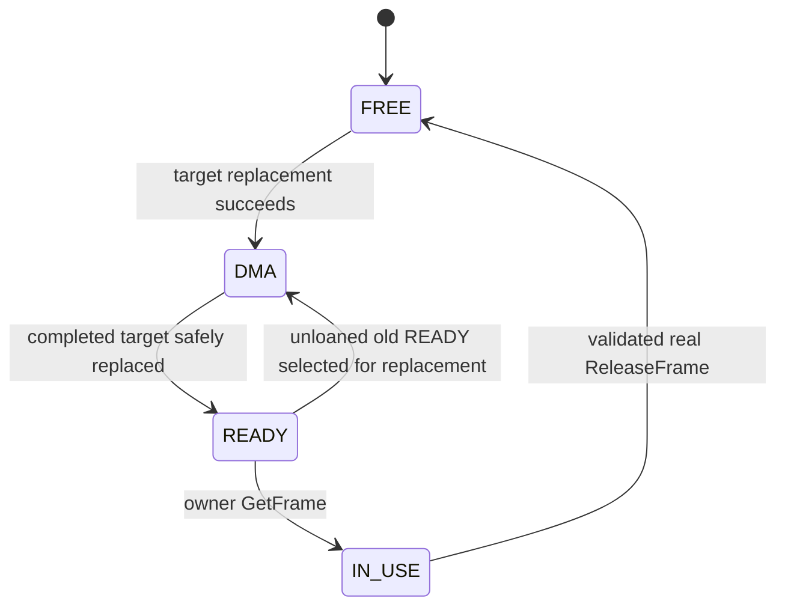
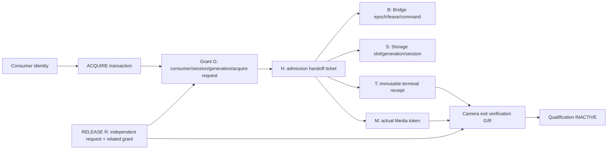
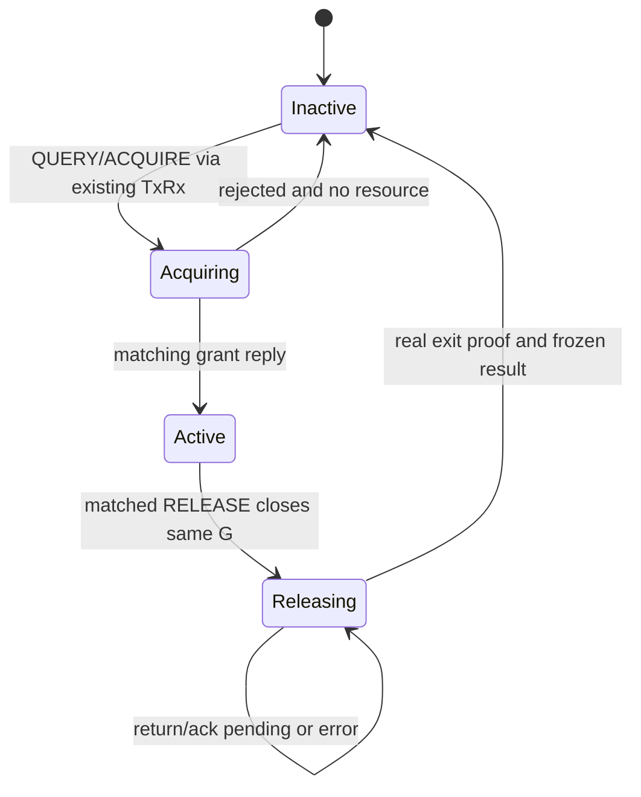
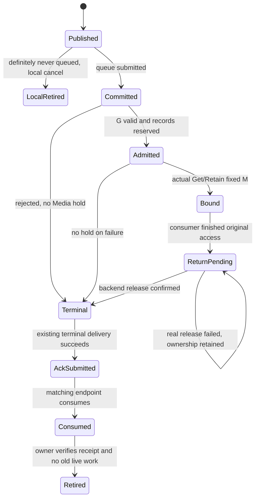
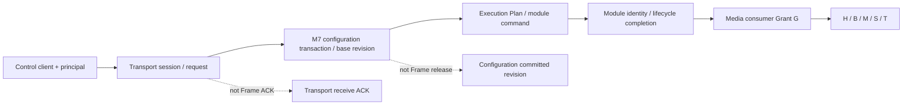

# Application V2 R3 — Resource Ownership Architecture

## 1. 基线、范围与证据等级

输入HEAD `54718ee7584089faf88bbd22237072c7f483023d`，分支`codex/architecture-media-graph-lifecycle`，main `f0ce45fd9ab7250b1e22260e087d606ee5ed9ecb`。开始工作区干净。生产事实以该研究分支实际文件为准，不引入C2.2B文档/代码支线WIP；main有Qualification工具，但没有真实consumer接入的完整闭环。既有M4 OLED稳定延时保留。

标签：SOURCE_CONFIRMED＝本工程源码事实；EXTERNAL_SOURCE_CONFIRMED＝固定外部版本源码事实；DESIGN_PROPOSED＝H7候选设计；IMPLEMENTATION_REQUIRED＝仍缺生产适配；RUNTIME_NOT_PROVEN＝未由本轮运行证明。以下状态名、接口和预算不构成实施批准。全部ADR仍UNRESOLVED。**Grant→Frame Lease：NOT_PROVEN；Stable Admission Closure：NOT_PROVEN。**

本轮只读源码、读取官方源码和编辑文档；测试、编译、实板统一NOT_RUN。设计证明义务与运行证据分别记录，不以设计推导宣布安全证明关闭。

## 2. 成熟实现：对象、交接、停止与不直接移植部分

研究固定Linux v6.12、GStreamer 1.24.10，不引用滚动master。下列文件本轮重新读取，其SHA256与OpenSourceArchitectureStudy第7节一致。保留原框架术语，H7适配不冒充原项目现成协议。

| 官方源码 | 关键结构/函数（原始源码1-based行） | 已有机制及H7取舍 |
|---|---|---|
| [Linux videobuf2-core.h](https://github.com/torvalds/linux/blob/v6.12/include/media/videobuf2-core.h) | vb2_buffer_state:226、vb2_buffer:252、vb2_ops:434、vb2_queue:611 | Buffer状态、Queue、内存Ops和驱动Ops分离；采纳角色分离，不移植MMAP/DMABUF/用户空间模型 |
| [Linux videobuf2-core.c](https://github.com/torvalds/linux/blob/v6.12/drivers/media/common/videobuf2/videobuf2-core.c) | __enqueue_in_driver:1537、vb2_buffer_done:1182、vb2_core_qbuf:1831、vb2_core_dqbuf:2131、vb2_start_streaming:1775、__vb2_queue_cancel:2195 | QBUF/驱动ACTIVE/完成/DQBUF为不同边界；done更新驱动持有事实。启动失败、streamoff要求驱动归还；本版也有警告后防御性强收。H7采纳完成/排空契约，禁止照搬强收及owned计数覆盖现有所有权 |
| [GStreamer gstbuffer.c](https://github.com/GStreamer/gstreamer/blob/1.24.10/subprojects/gstreamer/gst/gstbuffer.c#L777) | _gst_buffer_dispose:777、gst_buffer_new:860 | 无pool时允许销毁，有pool时dispose交回pool；H7只借鉴视图/池回收分离，不引入GObject或第二份Buffer |
| [GStreamer gstmemory.h](https://github.com/GStreamer/gstreamer/blob/1.24.10/subprojects/gstreamer/gst/gstmemory.h#L161) | GstMemory:161 | 内存allocator、parent、容量/offset/size与Buffer分离；H7使用既有FrameView/span，无动态allocator |
| [GStreamer gstminiobject.c](https://github.com/GStreamer/gstreamer/blob/1.24.10/subprojects/gstreamer/gst/gstminiobject.c#L648) | gst_mini_object_ref:464、unref:648 | 原子引用和dispose/free控制对象生命；其计数不是H7资格身份、ACK消费或DMA安全凭据，不再包一层refcount |
| [GStreamer gstbufferpool.c](https://github.com/GStreamer/gstreamer/blob/1.24.10/subprojects/gstreamer/gst/gstbufferpool.c) | set_active:507、default_acquire_buffer:1109、dec_outstanding:1197、release_buffer:1378附近、default_release_buffer:1315 | 停池先flushing，active=false可仍有outstanding，归还后再完成stop；回收核验内存条件。H7采用先关入口再等真实归还，不移植阻塞poll、动态池或另一份outstanding计数 |

EXTERNAL_SOURCE_CONFIRMED只覆盖上述固定实现。Linux buffer request不等于Camera ACQUIRE；GStreamer acquire_buffer不等于资格ACQUIRE；二者都没有本项目完整G/R/B/S/ACK协议。Linux驱动完成由驱动承担，框架状态本身不能额外证明H7 DMA已停止。H7的Grant关联、终结收据、单owner关闭及异步命令兼容是自行提出的适配，待审/待实现。

## 3. H7实际资源路径及唯一权威

| 路径 | 生产文件、函数及位置 | 已确认事实 / 尚未提供的能力 |
|---|---|---|
| Raw池 | `CM7/Media/Src/camera_capture.c::CameraStream_FindReplaceable`1018、Rotate1051、GetFrame1107、ReleaseFrame1184 | 7个描述槽、M0/M1与单IN_USE；替换目标成功后才READY；临界区Get改IN_USE，归还改FREE。不提供消费者G或公开完整Raw令牌查询 |
| JPEG获取/保留 | `CM7/Media/Src/camera_mjpeg_fifo.c::GetFrame`325、RetainFrame377 | 从READY建Loan，原始持有记usb_owned；Retain校验当前帧完整描述后置sd_owned，返Media session/id。两owner位共享该Loan的帧块引用，不在每次Retain另加整帧块计数 |
| JPEG归还 | 同文件ReleaseFrame405、ReleaseLease424、Mjpeg_ReleaseLoan840 | 独立清原始/SD持有；最后owner离开才减块引用；异常不假装成功。ReleaseFrame是无参当前原始持有释放，必须由上层先匹配真实身份 |
| JPEG解析/写目标 | 同文件Mjpeg_Publish784、Mjpeg_BlockComplete491、块引用辅助 | 完成块/输入FRAME证据组合才发布；DMA目标/解析/READY/Loan不同。Get/Retain没有G，原始usb_owned也可用于Camera内部SD-only |
| Camera/USB桥 | `CM7/Application/app_uvc_bridge.c::App_UvcBridgeCameraProcess`137、UsbProcess268、Bridge_CameraFlush432、Bridge_CameraRelease456 | USB请求/Offer/Return/ACK，Camera实际Release成功后固化ACK，重复Return匹配last_ack不再Release。Camera ack_pending清除只证明入队；USB匹配消费后才清lease |
| Storage槽 | `CM7/Application/app_storage.c::App_StorageOfferFrame`237、ProcessReturns334、Storage_Release988 | Camera端RESERVING/Retain/提交槽；StorageTask读写文件后只置RETURN_PENDING；Camera实际ReleaseLease后同generation槽才FREE。现槽未绑定完整G |
| 资格/停止 | `app_camera_qualification.c::Qual_Execute`248、Qual_Decide139、Qual_Submit174；`app_camera.c::App_CameraFinishRound` | Qualification保存grant_session/generation/request，RELEASE以consumer/session/generation核对旧grant，并从表内grant_request构造原ACQUIRE身份；不直接证明related_request_id等于该ACQUIRE。released/idle仍NULL；普通STOP唯一推进在Camera收尾，不让Resource另控硬件 |
| 运行顺序 | `CM7/Application/Tasks/camera_task.c::CameraTask_Process`、`usb_task.c::UsbTask_Process`、`storage_task.c::StorageTask_Run`（调用App_StorageProcess） | 保留实际BeginRound/Media Process/Bridge Process/FinishRound与独立ACK/FAULT交付；未来端口插入点需审，当前没有完整消费者退出协商接入 |

完整调用链：CameraTask→App_CameraProcess/CameraCapture→Bridge Camera→Media StreamGetFrame→（Storage需求时Dispatcher Publish→StorageOffer→Retain）→USB Offer；USB Task→UVC Process/Bridge→Return→Camera Bridge→StreamReleaseFrame→ACK入队→USB消费。SD-only：Camera内部原始Get→Storage独立Retain→内部原始Release，不创建USB grant。Storage Task→写入/文件收尾→ReturnPending→Camera ProcessReturns→ReleaseLease→槽FREE。

上述是SOURCE_CONFIRMED调用结构，不是新架构已安全运行的证明。尤其Camera Bridge Idle不含USB ACK已消费的事实；Storage IDLE不证明槽已FREE；全局HasLoan不说明某个G。

### 3.1 物理后端状态与上层交接不是一个状态机



此图仅为Raw连续流状态摘要；Init会给M0/M1初始目标，错误可冻结资源，不能从ERROR直接跳FREE。JPEG以块状态和Loan owner分别管理：FREE→DMA→SEALED→解析持有/READY→Loan；最后合法owner归还后才可能释放相应块引用，仍须满足parsed/非DMA复用条件。JPEG一个Frame可跨块/双span，块与Frame不是1:1，不能直接套上述Raw enum或新建统一Pool重写它们。SOURCE_CONFIRMED依据第3节S1/S2函数。

## 4. 对象与身份：禁止互换

### 4.1 对象契约

| 对象 | 权威 | R3设计职责 | 不允许 |
|---|---|---|---|
| Buffer/FrameView | Media完成帧及其描述 | 只读格式、长度、时间和span视图；不独立延长有效期 | 仅保存指针就声称持有；复制描述符当复制像素 |
| Pool/Provider | Raw固定池或JPEG FIFO | 原物理状态与资源复用权威 | Resource/Graph新增Frame Pool；普通refcount替代DMA/owner事实 |
| Lease/Loan | 后端真实持有 | 指定资源在有效期内可读的授权；不同后端不同令牌 | 将消费者资格当已取得Frame |
| Qualification ACQUIRE/RELEASE | Camera资格核心 | 业务使用资格与撤销事务 | 直接释放Media、操作UVC或文件 |
| Association | Camera owner的有界端口记录 | 不可变关联G/H与实际M/B/S，记录交接/终结事实 | 镜像引用数量，自己决定物理回收 |
| Terminal Receipt T | Camera端固定终结结果 | 不持有Frame，保留可重放身份和确认条件 | ACK未消费就覆盖；长期占住公共Media帧记录 |
| ACK | 既有消息协作 | 分别证明原命令、帧归还、资格结果及消费 | 任意ACK成功推导所有资源释放 |

### 4.2 身份关系图（DESIGN_PROPOSED）



Consumer ID不是Task handle或Graph Entity ID。A/G的request是建立资格的ACQUIRE request；R.request为另一次事务，R的资源核验记录必须显式关联原G。SOURCE_CONFIRMED：现Core按consumer/session/generation定位grant，related字段进入请求/回复匹配，但RELEASE分支不直接比对related与grant_request。V2应由Camera权威表提供完整原G；是否将非零related的严格一致检查加入后续适配须单独审核，不能把线上的0/可选字段静默变成C1新必填规则。B.stream_epoch/lease_id、Media loan_session/id、S.session/generation不等于Qualification session/generation。H是帧交接票据，不能拿Lifecycle request_id直接代用；T绑定原G/H/B或S和实际终结结果。

生命周期身份继续用既有Tx/Rx/Replay，单调编号不回绕，跨session/generation不清高水位，无新增配额。Media和Bridge字段继续原语义。未来适配若需新的Raw实例代次或其他端点交接标识，单调耗尽拒绝，不用地址、时间戳或复位计数冒充唯一性；第二轮候选字段见第13.2节，API仍待审。

## 5. Grant→Lease关联：承接原后端，不创建另一引用系统

### 5.1 USB：单未完成请求的受保护描述D

DESIGN_PROPOSED：沿Scheme A思路，USB owner先完成D的不可变G/H及原FrameRequest路由键发布，再把原52B请求入队。D由双端单写对象组成：USB端写publication/commit/本地取消与ACK消费记录；Camera端写accept/bind/terminal/退休确认。不要两端写一个共享phase。发布/快照使用既有Platform PRIMASK嵌套恢复和屏障；禁止仅靠volatile。队列提交与Camera抢先消费并发时，D完整PUBLISHED已可读；生产者提交结果未登记不妨碍Camera按匹配消息接受，不允许把已被Camera接受记录误判本地未提交。

原消息不带G，因此必须核验D.G等于Qualification权威grant，并把收到消息的完整可用路由键绑定同一D。**SOURCE_CONFIRMED**：`app_uvc_bridge.c::App_UvcBridgeUsbProcess`378～386在next_request==UINT32_MAX时拒绝，再以++next_request生成FrameRequest.command_id；当前Configure一次性、没有清该计数的运行期代码，CameraBegin只重置next_lease并推进epoch。该启动期非回绕wire ticket可直接复用，优先不增加第二套Frame请求编号器。

H是关联层的交接身份，可由consumer/端口和该wire ticket构成，B再绑定实际stream_epoch/lease_id/command_id；二者不是完整身份等同，更不等于Lifecycle request。D.G/H/路由键的受保护匹配及退休尚未实现；后续V2迁移必须保留原票据不重置规则，不能只把新H放sideband而让旧消息匹配到被复用command_id。现有票据机制的源码事实可以确认，**G绑定和D接替的整体安全性仍NOT_PROVEN**。

Camera同owner验证G准入后才调用StreamGetFrame。成功后在同一不可重入动作中固定M与B；如绑定提交发生内部故障，仍需保留“已经实际Get”的补偿记录并排空，不能先清D；无记录空间则在Get之前拒绝。Offer发送失败保留同一D/G/H/M/B。USB收到迟到Offer必须先核对所属旧D；有真实持有的Offer走原Return，不以STOP为由丢弃。无真实Get的取消只负向终结，不产生Media release。

Raw M候选为捕获实例代次、实际in_use槽及其sequence，与H共同校验；sequence现有回绕不能独自作永久令牌。JPEG M为实际Media loan_session/id及原始持有用途。现无完整公开只读Loan/Raw快照，不能仅凭frame地址/尺寸构造M。需最小纯查询适配，见第8节；所有查询均不Get、不Retain、不Release。

### 5.2 Storage：在原槽RESERVING窗口绑定

Camera→选中Storage端口/旧Dispatcher承接适配传入不可变G；StorageTask不得裸读Camera上下文推导它。Camera在准入核验及预留关联空间后，原slot转RESERVING时绑定G/H/S；Retain成功再写真实M=(loan_session,id)。若STOP在Retain过程中关闭本地accepting，仍按现有逻辑把已取得Lease置RETURN_PENDING，不丢失归还责任；失败且未Retain则可释放预留。环中只传原S路由键时必须匹配槽当前G/H/S，旧generation不触及新槽。

Camera实际ReleaseLease成功后才记录RELEASED并由原槽协议变FREE。不能将新的G/关联字段当作第二套sd_owned；后端仍唯一决定是否持有。相同媒体的USB和Storage关联各自G/H，但M可指同Loan不同owner用途，任何一方只归还自己的权限。

### 5.3 SD-only内部持有

Camera内部原始Get不是USB ACQUIRE，标用途INTERNAL_DISPATCH而非绑定USB G。先为Storage保留独立Lease，再释放内部原始持有。该原始持有的失败归还必须继续记账；不会因为USB不存在就强清。USB终结收据与该内部公共记录分开，USB ACK未消费不应永久阻塞Storage；Receipt满只对相关USB新交接背压，不占物理帧、不扩大FIFO计数。Camera最终停止还要核验内部原始持有和DMA，不能只看两张资格表。

## 6. 关闭线性化与稳定核验（DESIGN_PROPOSED）

| 位置 | 唯一执行者/动作 | 条件及不可推导事项 |
|---|---|---|
| L_stop_local(G) | USB/Storage各自owner关闭新帧需求，处理pending START及STOP先后 | 本地停止不是Camera全局关闭；待授权START不得在STOP后无条件重开 |
| L_publish(G,H) | 消费者提交完整不可变D/槽预留 | 不代表消息入队或Media持有 |
| L_admit(G,H) | Camera owner在G仍ACTIVE时受理并预留足够记录，成功Get/Retain后固定M | 与L_close串行；记录受理中失败/补偿，不把Get前的意向当实际Lease |
| L_close_camera(G,R) | 同Camera owner核对R关联G，Qualification ACTIVE→RELEASING并关闭该G准入 | 不是额外第二张active表；适配器只查询/使用该权威门，不独立重新开放 |
| L_verify(G,R) | 同owner核验入口关闭、未消费请求处置、M真实归还、端点终结消费证明 | 输出只对该G/R有效；不可跨任务拼debug；不证明其他G或硬件已停 |

同owner执行的Get/Retain与绑定过程禁止回调重入；合法排在L_close前的受理允许排空，排在后面的新Get/Retain一律拒绝。不能只在USB本地检查一次，再让Camera按陈旧状态Get。所有入口均覆盖：USB正常Request、队列延迟Request、Camera pending request、offer_pending重试、SD-only Publish、Storage Retain、旧通知触发的数据面轮次。Return永远允许在RELEASING排空，不能把关闭入口实现为停止处理整个Bridge。

**offer_pending特例**：若已有真实M，关闭后可继续交付/取消并通过Return结束，不再创建新M；若只是无持有的拒绝结果则发送原终结；未Get的request_pending在关闭后不再Get。对队列内未消费请求逐条匹配/负向终结，禁止清空队列。通知合并只影响唤醒，所有事实仍由队列和pending保存。

避免“核验刚通过又有旧请求”必须同时成立：该G永久RELEASING直到退出；生产者本地不再发新请求；旧D/槽不能换成新G；所有已发布/提交/受理记录有终结或无持有的可验证结果；迟到消息不匹配当前有效ticket便拒绝；下一G重新ACQUIRE必须新代次且旧G无未完成资源。新grant不继承旧入口，不能因新业务START把旧G标ACTIVE。

当前Core在Qual_Execute的RELEASE分支已置RELEASING再调released，但生产Frame路径不查G，且回调NULL。故这是合适候选线性化点，**不是现有稳定关闭已经成立**。资格状态本身不能代替实际入口改造、全部队列/sideband覆盖和运行交错测试。

## 7. ACK、终结消息、退休及失败提交

### 7.1 四种独立完成

命令STOP ACK只冻结该次业务结果；Frame Return ACK表示Camera对B匹配后实际释放；Lifecycle RELEASE回复表示G/R资格撤销；USB消费ACK才表示USB清掉该B等待。这四者不得合并。文件Finish/Close/Unmount、Media归还、Camera硬件Stop又是独立事实。

SOURCE_CONFIRMED：Bridge_CameraRelease成功才生成last_ack，Bridge_CameraFlush清ack_pending只表示APP_CHANNEL_TO_USB入队；UsbProcess在RETURN、return_sent、Bridge_SameLease且SYS_OK时消费并清lease。Camera端Idle本身不知道USB已经消费；现有released/idle=NULL不能当作默认成功。

### 7.2 终结收据与安全退休

推荐有界T，不持有Frame；其key至少G/H和B或S，payload为原冻结结果/真实M已归还事实。Camera只写terminal/reply提交记录；USB只写同身份的consume确认，双方字段分开，屏障保护发布/一致读取。优先复用现有Return ACK消息与端点同步元数据，不新增平行ACK队列。**消费证明接口当前缺失**；候选为原USB ACK消费位置发布完整G/H/B消费收据，Camera owner读取匹配快照，禁止用USB_IDLE裸读替代。也可用严格约束且带关联的后继事务作为因果证据，但当前RELEASE字段本身不足以替代H/B核验，不直接采用。

- LOCAL_UNCOMMITTED：QueueSend确定失败、无Camera接收/持有；USB可取消并本地退休D，无伪Camera ACK。H/wire ticket消耗不回退。若曾成功入队或提交结果不明，禁止走此分支。
- COMMITTED未Get：Camera核验并固定负向Offer；生产者消费对应终结后，双端确认可以退休，无Media Release。
- COMMITTED已绑定M：全部原始CPU/DMA访问结束→Return→Camera真实后端Release→T固定→ACK入队→USB匹配消费→Camera消费证明核验→退休T/旧D。ACK队列满停在原T，不再Release。
- Storage原槽终结：真实ReleaseLease成功后Camera发布FREE/generation确认，Storage只消费匹配槽的完成；不得在Camera仍RETURNING时复用。关联退休必须跟随该原槽协议及旧环项失效检查，不要求伪USB ACK。

双端退休必须有最后一步：Camera验证匹配consume及真实资源事实后，以自身单写字段发布retired(G,H,key)；USB观察同一退休确认后才可重用单D发布下一个请求，不能只因本地USB_IDLE就覆盖旧D。这是受保护端点元数据的发布，不是另开ACK队列/协议；当前仍IMPLEMENTATION_REQUIRED。Camera每轮先处理终结消费/退休，再处理新交接，等待不阻塞任务，继续处理另一消费者及Return。若退休确认未被观察，新请求保留本地pending并背压，不改票据。

退休后旧请求因不复用wire ticket、D/H/当前G及S全身份不匹配而拒绝，不能重新Get；旧Return不得再调用无参Release。若原B仍被合法重复，T保留期内只重放同一结果；退休后可拒绝旧消息，不保证无限重放。重放缓存不拥有Frame。T/D复用所需端点ticket耗尽拒绝新交接，不回绕、不加Replay配额。这里是帧端点失效边界，不重新实现Lifecycle Replay、不修改其容量/高水位/合法后继/ReplayRetire禁令。

相同H相同正文只返回原进度；同H不同正文、错误G或不同H冲突拒绝且不覆盖当前D/T，不推进任何Lifecycle退休边界。合法取消按原请求终结；未知/已退休请求可诊断拒绝，无资源操作，不为恶意/违例消息无限分配T。合法请求失败终结必须保留原结果直至规定消费，不能把内部容量背压伪装成已完成释放。

### 7.3 业务事实已发生、可靠回复失败

Qualification保留DECIDED/BLOCKED和原Rx；真实Release后不恢复grant/owner假装未发生，真实错误不被后台成功覆盖。RxComplete BUSY（api_busy）是重入/所有权问题，回任务调度边界检查原Rx窗口、完整身份、冻结状态，不重做Get/Release/Device操作，不Reset；RxFlushReply NO_RESOURCE才是正常运输背压。T发布/关联空间应在资源操作前预留；若事后仍发生内部错误则保留补偿事实并BLOCKED，不能为完成协议清掉资源。生命周期Pending的READY取消与WAIT_REPLY禁止超时强清仍沿用原机制。

## 8. 最小接口草案及所有者

所有接口均DESIGN_PROPOSED、未新增生产头文件、消息或任务：

| 候选公开契约 | 调用者/执行上下文 | 输入输出与限制 |
|---|---|---|
| Resource_RequestFrame(G,H,endpoint_key) | consumer owner发布→Camera owner消费 | 固定D；接收成功不是Get成功；保留原52B运输，sideband匹配必须防ABA |
| Resource_Return(G,H,M,endpoint_key) | consumer完成访问→Camera owner消费 | 只请求，不能跨任务直接Release |
| Resource_CloseAdmission(G,R) | Camera资格事务串行边界 | 只关闭原G，不能重开，不停其他消费者 |
| Resource_QueryExit(G,R,out) | Camera owner | 只读同一序列点事实；complete/hold/pending/terminal未消费/错误分别给出，不改变账本 |
| Resource_PublishAckConsumed(G,H,B) | USB owner在真实ACK消费位置 | 单写有界消费记录；Camera只读，不能伪造ACK消息 |
| Media_ReadOwnershipSnapshot(backend,out) | Camera owner，通过Media公开端口 | Raw目标/IN_USE与令牌、JPEG原始/SD实际M及用途；纯读、不创建Loan、不修改owner/引用/DMA |

快照尺寸应有界，Raw最多7描述，JPEG最多7Loan/64块；优先仅取退出所需标识而非复制所有帧或整块表。Raw IRQ更新期间使用原PRIMASK短临界区或受审序列快照；JPEG同owner主循环数据与IRQ字段分别保护。快照只在Camera owner当前验证动作内有效，不能缓存到另一轮当永久证明。单核PRIMASK不证明另核/外设访问终止，Memory Barrier不能代替DMA完成。

资格表必须仍在App_Camera/Qualification；Resource只获得只读grant验证端口，不能重建第二张资格表。现released callback只有G，完整退出结果还需绑定R；推荐后续接口审查明确传入G/R到资源核验（或Camera owner传递不可变当前R的受控适配），不能由Resource私读Core rx或把当前全局STOPPED当结果。本轮不调整Ops签名；实际API/布局待单独审批。

### 8.1 所有者调度与排空活性（候选插入契约）

当前CameraTask实际顺序保持事实：BeginRound→回复/至多一条旧控制命令→Camera Media Process→Bridge Camera Process（含Storage returns）→FinishRound→回复。V2候选生命周期受理/关闭可放在该轮Media/新交接之前的控制边界，每轮至多一条生命周期输入、预算有界；不在IRQ执行，不让其等待阻塞原Return。Camera端Resource先处理consume/退休和Return，再考虑新Get/Retain；L_close与L_admit必须在同owner串行，不在两个Task分别判定。

真实停止结果由FinishRound产生，资格事务可到下一轮再读取该请求结果；不要为了当轮答复再调一次普通停止或反复调用整个Camera Process。资源归还在Bridge阶段完成时，释放确认也允许下一轮生成，额外一轮延迟不能被当作失败或用超时强清。USB仍显式Mode→UVC→Bridge推进及原收尾；匹配ACK消费时发布consume、读取Camera退休确认后才发下一D。StorageTask独占FS，Camera继续独占真实Media归还；所有异步pending期间都返回调度器。

这是待审执行契约，尚未修改Task循环/优先级/栈/等待/队列容量；每轮时间预算需后续O0/O2轨迹、最大积压和DWT验证。若控制消息淹没Return或已终结T永远无法退休，视为活性违例，不能用扩大队列或强制回收解决。

## 9. DMA不再访问原帧：逐路径证据

| 访问者 | SOURCE_CONFIRMED调用依据 | 必需设计/实测条件，不能替代的证据 |
|---|---|---|
| DCMI写Raw | CameraStream_Rotate1051先BSP_DCMI_ReplaceTarget成功再READY；FindReplaceable排除M0/M1/IN_USE；BSP检查CT/目标 | 正确IRQ/双缓冲切换且地址/状态一致才可交付；TC位单独不是永久无访问；真实硬件错误/抢占仍RUNTIME_NOT_PROVEN |
| DCMI写JPEG | FIFO选块检查状态/引用、完成块解析、Mjpeg_Publish输入FRAME+EOI；BSP目标轮换 | Loan块不得再次作为DMA目标；EOI/FRAME IRQ单独不足；后端块/IRQ/错误路径联合验证，不靠Graph格式合法 |
| UVC读帧 | usb_uvc_payload.c::USB_UVC_PayloadBuildPacket逐包复制，class.c Process匹配token，取消先PayloadCancel再AbortEp/AbortPacket | 当前不是一次Submit复制整帧；还会为后续包读原Frame。最后包/取消过程全部读取结束且无旧token可继续读取才Return；frame_owned=false仅USB端必要条件 |
| SD写卡 | Storage写入同步调用→StorageFS中转→SD Block→BSP_SDMMC AXI/IDMA | 原Frame可能先被CPU复制/CRC/校验读取；完成前不能归还。IDMA访问私有AXI不等于仍读原Frame；Abort失败要按实际原始读取是否结束分别保留错误/私有缓冲占用，不自动强退Frame |
| 未来复制Network/AI | 当前无实现 | 所有原帧CPU/DMA复制读取完成进入独立私有缓冲后才能Return，后续私有发送独立管理 |
| 未来零拷贝Network/AI | 当前无实现 | 所有并行DMA/驱动令牌逐一完成/取消确认且不再访问原Frame；TCP接受、驱动接收或任一DMA完成不能替代全部完成 |

USB实际实现参考`CM7/Service/usb_uvc_class.c::USB_UVC_Process`、`USB_UVC_CancelFrame`315、`USB_UVC_GetStreamStatus`335、`UVC_DataIn`与`UVC_ReleaseFrame`（后者由成功Close/Abort路径调用）；`usb_uvc_payload.c`的BuildPacket/CompletePacket/AbortPacket。SD依据`CM7/BSP/bsp_sdmmc.c::BSP_SDMMC_PrepareWriteInput`849、`Sdmmc_Quiescent`957、`Sdmmc_StopIo`1054、`Sdmmc_Transfer`1083；具体符号与行号在验收矩阵源码表复核。函数返回成功、寄存器单一位为0、日志显示STOP任一项都不能独立证明整条访问链结束。

硬件必要保护可先停DMA，但不清consumer Lease。CameraCapture_Stop实际BSP停止结果、Media DRAINING、Bridge终结及Device_Stop四条件分开；普通STOP继续唯一FinishRound推进。超时只形成未完成/错误，禁止强制回收或自动硬件重启策略。

## 10. 状态机与独立停止



上图是资格语义；模块业务Stopping、关联ReturnPending、后端IN_USE/DRAINING不是该enum的别名。资格申请失败但已有本地资源由模块清理；Camera已启动但回复提交失败保留真实事实，不重复Start。



这是两端事实的联合观察图，不是跨任务共写phase。Bound失败补偿仍保留实际M；LocalRetired不产生Camera ACK；Terminal负向结果可无M；Storage以槽确认代替USB ACK。任何阶段发生内部一致性错误都保留原事实/BLOCKED，不画一条“错误直接FREE”的捷径。

USB自主停：关本地需求→UVC完成/取消且原始访问结束→Bridge Return→Camera实际Release→USB消费ACK→关闭并核验G/R→撤销USB资格。Storage仍ACTIVE则Camera继续；STOP_IF_IDLE BUSY不把USB自身已完成停止改成失败。

Storage自主停：关入口及pending START闸门→处理已接收完整帧→Finish/Close/Unmount各记录真实结果→ReturnPending→Camera实际SD Release→核验G/R→资格撤销。文件失败但无帧/交接且入口关可允许资格释放，文件错误/卷清理仍由Storage保存，不计正常AVI完成。USB仍ACTIVE不能被停。

最后消费者退出后也需检查内部SD-only持有、未决资格/交接、全部终结退休条件、Media/DMA安全，再由Camera普通停止路径处理；Camera从未启动不为STOP_IF_IDLE初始化传感器。主动Shutdown异步要求各模块退出，先必要保护也不伪造归还。新的START须新G且旧资源安全；B2 ID23有界BUSY、ID31未退出拒绝/合法成功START后故障复位的批准语义不变。

## 11. 未来Network及资源成本

AC-01～06保持。消费者端口按身份和后端能力描述，不在Camera核心增加USB/SD/Network专用核验函数。当前JPEG只有两类owner、Raw只有单IN_USE，不能仅注册一个Network ID就宣称零拷贝多路：可先走完成复制的私有端口，或另审后端真实所有权扩展。复制需要的RAM/CPU/缓存/DMA完成独立预算；本轮不实现网络或增加Task。

Graph FrameRoute只声明可选边，Configuration装配选中端口；Resource不解释业务拓扑，不新增Dispatcher。适配继续复用固定池4300800B、JPEG FIFO/drop540672B，无新整帧池设计。预估关联记录的容量至少覆盖USB单交接、Storage slot1及SD-only内部；未消费T独立占描述RAM，不占Frame。候选每记录64～128B只是范围，不是冻结layout；T每64～96B，具体容量由队列4深/合法重复/消费窗口推导，不能直接取队列数当已证明的同时在途数量。

预算方法：按各端单写字段分别求sizeof/offsetof，计算D端点发布+Camera绑定+Storage槽新增G/H+T+纯查询workspace，扣除被替代旧记录；不把已有824B资格或144/332B Tx/Rx再加一遍。第一轮范围估算由第13节单端点候选布局深化；容量前提/Raw快照API/ARMCC5对齐和Flash仍待批或未测，不将范围估算与新布局重复相加。Graph CoreMediaFormat别名调整预计不改R2的56B布局；没有实际编译/Map故不报告真实RAM增量0或栈PASS。静态scratch不放高优先级栈，所有临界区有界，无新任务/队列/动态内存提案。

## 12. 推荐、阻塞与分阶段设计门禁

推荐采用“原后端唯一所有权 + 有界G/H/M关联 + 关闭入口/终结退休”的统一端口；拒绝普通统一refcount、每消费者私建Media池、Graph自动Retain和超时强清。成熟机制提供的是排队/完成/池关闭思想，完整事务安全由本项目原协议及待审交接契约承担。

1. 先审Core中立格式、各后端能力、D/T字段/单写/不复用ticket及最低容量；R2-06接口仍待复核。
2. 再审Media最小只读快照、G/R绑定与关闭全部入口覆盖；不得改原引用算法或普通停止所有者。
3. 然后才可另行授权纯软件测试/适配实现；本轮只给测试设计。先后端、再关联/受理、再关闭/消费/退休，避免临时假成功。
4. 通过逐交错负对照及原回归后，实板验证DMA、双路独立停止与长期启停，才有关闭NOT_PROVEN的证据条件。

Grant→Frame Lease现缺完整G进入Frame路径、可核验M/Raw令牌及sideband长期身份拒绝；Stable Admission Closure现缺入口接入、全部未消费消息的终结、USB消费证明、真实released/idle适配。两项继续NOT_PROVEN；不能因为本报告覆盖了设计义务就改为PASS。ADR-03/04也继续UNRESOLVED。

并发/可测试契约和硬件门禁详见[H7_V2_ResourceOwnershipAcceptance.md](H7_V2_ResourceOwnershipAcceptance.md)。完成本轮文档后停止，不开始Phase1/C2.2C或任何生产修改。

## 13. R3第二轮精确契约（输入c52490b）

本节细化并优先于前文“字段/容量尚待设计”的占位表述；字段已有可审阅候选，**批准、实现和运行证明仍未完成**。全部声明只存在于文档。EXTERNAL_SOURCE_CONFIRMED仍限第2节所列固定源码，以下G/R/D/T协议是H7 DESIGN_PROPOSED，不是vb2或GStreamer原生功能。

### 13.1 R3-01：物理能力与消费者组合矩阵

| 格式/组合 | SOURCE_CONFIRMED后端与格式能力 | 目标使用与限制 |
|---|---|---|
| Raw Y8/RGB565/YUY2单消费者 | 固定池单IN_USE；当前UVC只YUY2，Storage只JPEG | 保留各格式原采集能力；不支持的Sink显式拒绝，不能为统一接口删除Raw能力 |
| Raw USB+Storage | Storage纯/运行接收均只JPEG | 先格式拒绝，不用它证明“所有权多持有”测试；无隐式JPEG编码 |
| Raw同格式多零拷贝消费者 | 无多owner/refcount，单IN_USE | Graph可描述分支但Resource使用能力应拒绝；不得靠前端refcount承诺共享 |
| Raw复制到独立私有缓冲 | 原始帧仍单IN_USE | 未来复制读全部完成才归还原帧；私有副本另管异步发送，不新增原Frame Pool；RAM/CPU另审 |
| JPEG USB单路 | GetFrame产生当前原始Loan，原始位名usb_owned | G/H绑定该实际M，完成Return只释放原始权利 |
| JPEG USB+Storage | Retain为同Loan置独立sd_owned，返回session/id | 两G可关联同Loan不同owner_kind；最后owner离开才减Loan块引用，不额外加整帧块计数 |
| JPEG SD-only | Camera内部Get+Storage Retain+内部原始Release | 原始用途INTERNAL_DISPATCH，不创建USB grant；USB无资格也可保存SD，但真实授权接入仍待实现 |
| JPEG USB先退出 | SD权利仍可持有同Loan | 仅清原始位/USB G；T留在USB端点记录、内部借帧记录可继续服务SD |
| JPEG Storage先退出 | USB原始位仍有效 | 仅清SD位；文件失败与帧归还分开，不停USB |
| Network复制/零拷贝 | 当前无Network consumer及独立第三owner | 复制可作为未来适配；零拷贝第三owner必须另审Media实际能力，不能借USB/SD位或只加consumer ID |

Graph验证类型/路由，Resource只接受Configuration派生的中立使用需求，如`ConsumerUseSet{consumer_id, endpoint, ownership_mode}`（有界数组、容量另审），并按后端公开能力拒绝不能满足的组合。该纯预检不Get/Retain，不管理拓扑；通过也不是未来每次准入的授权，L_admit仍查当前G与资源。Raw捕获DMA与单消费者读取的并发由原池保证，不与多消费者读取混为一谈。

### 13.2 R3-02：完整身份字段与失败关闭规则

以下候选Core值全部使用固定32位字段，码域经验证，不泄漏CameraConfig_t、AppMessage_t、USB私有ctx或StorageSlot_t到Resource公共接口。现52B/56B运输在Ports显式映射；这些不是新的队列载荷。

```c
typedef struct CoreGrantKey {
    uint32_t consumer_id, session_id, consumer_generation, acquire_request_id;
} CoreGrantKey;                    /* 预测16B */
typedef struct CoreReleaseKey {
    CoreGrantKey grant;
    uint32_t release_request_id;
} CoreReleaseKey;                  /* 20B */
typedef struct CoreHandoffKey {
    uint32_t consumer_id, endpoint_id, scope, ticket;
} CoreHandoffKey;                  /* 16B */
typedef struct CoreBridgeKey {
    uint32_t stream_epoch, lease_id, command_id;
} CoreBridgeKey;                   /* 12B */
typedef struct CoreStorageKey {
    uint32_t slot_index, slot_generation, storage_session;
} CoreStorageKey;                  /* 12B */
typedef struct CoreMediaToken {
    uint32_t backend, instance_epoch, record_index;
    uint32_t frame_sequence, loan_id, owner_kind;
} CoreMediaToken;                  /* 24B */
```

| 身份 | 创建/权威、单调性及关联 | 退休/ABA/耗尽 |
|---|---|---|
| G | Camera资格表ACQUIRE产生；consumer/session/generation/acquire request全匹配 | 真实R核验才失效；generation/session/request沿原协议耗尽拒绝，不回绕 |
| R | consumer新RELEASE事务，其identity匹配原G的consumer/session/generation；独立request。Camera从权威表补入原acquire request | CoreReleaseKey含完整G，不能以R.request等于G.request匹配。related非零如何严格检查需审批，不静默将原可选0变为C1必填 |
| H USB | 复用现有非回绕FrameRequest.command_id为ticket；endpoint固定USB帧端口，scope=0（本启动周期），consumer=USB | 不随START/STOP/ACK清计数；UINT32_MAX拒新；D复用必须有Camera退休确认；不是Lifecycle request |
| H Storage | endpoint标识原slot；ticket取已有slot_generation，scope=0（原generation启动期不重置），consumer=Storage | slot已在耗尽时拒绝复用；原S还含storage_session，H与S显式绑定，不额外增加编号器 |
| B | Camera对成功Offer赋stream_epoch/lease_id，command_id关联原H票据 | epoch跨CameraBegin不回退；lease在新epoch内从原规则生成，不能仅按lease单字段拒迟到 |
| M Raw | 实际IN_USE index/sequence，加候选只读实例epoch；loan_id=0、owner_kind=RAW_EXCLUSIVE | sequence允许原算法回绕，不能独自作永久身份；H/G先验证再查M；epoch仅安全重新准备时消耗，耗尽拒绝，不在query内推进 |
| M JPEG | instance_epoch=真实loan_session，loan_id=实际id，record_index=Loan槽；frame_sequence=0、owner_kind=ORIGINAL或SD | 原始与SD分别验证；Loan id在session内不复用，不能用槽index/指针单独释放；用途USB/内部由关联记录判断 |
| S | 原Storage槽及队列凭据的index/generation/session | 旧环项或归还必须全匹配；FREE不允许改变尚被引用旧身份的含义 |
| T | 复用下述Camera端点记录的不可变G/H/B/M/S及终结result/kind，不增加Frame持有 | 无M的合法拒绝也可终结；非匹配/冲突请求不覆盖T。消费与Camera退休确认前不可复用 |

INTERNAL_DISPATCH不是新Lifecycle consumer：其关联不含有效G，不伪造USB身份；JPEG内部交接可用consumer_id=0的内部端口、scope=loan_session、ticket=loan_id，仅在Media内部借用用途有效，不可送入ACQUIRE/RELEASE通道。Raw capture-only或未来内部复制按原独占记录管理，若需新内部票据必须另审，不能借未授权consumer ID。

任何M释放前必须先验证当前完整G/H和端点B/S，再由Camera owner查询实际M并执行原后端释放；不能把CoreMediaToken直接当可任意调用Release的能力。重复Return只读取匹配T重放结果，旧/错误owner身份不得触及无参原始Release。当前G→M尚未绑定，因此规则仍IMPLEMENTATION_REQUIRED/NOT_PROVEN。

### 13.3 R3-03：ACK消费与双端退休的单写布局

USB单未完成Frame请求保持；下面是一个USB端点的候选描述，不是为每个消费者另建引用系统：

```c
typedef struct ResourceUsbPublication {
    CoreGrantKey grant;            /* USB写，当前D存活期不可改 */
    CoreHandoffKey handoff;        /* USB写 */
    uint32_t published;            /* 0/1，最后发布 */
    uint32_t queue_commit;         /* UNKNOWN/NOT_SUBMITTED/COMMITTED */
    uint32_t local_cancel;         /* USB写，不能假装取消已提交资源 */
    CoreBridgeKey consumed_bridge; /* USB仅在匹配原Return ACK时写 */
    int32_t consumed_result;
    uint32_t consume_valid;        /* USB最后发布 */
} ResourceUsbPublication;          /* 预测64B */

typedef struct ResourceCameraEndpoint {
    CoreGrantKey grant;            /* Camera写，从pub/资格表核验固定 */
    CoreHandoffKey handoff;
    CoreMediaToken media;
    CoreBridgeKey bridge;
    CoreStorageKey storage;        /* USB端点填0；类型保持通用 */
    uint32_t phase;                /* ACCEPTED/BOUND/RETURN_WAIT/TERMINAL/RETIRED */
    int32_t result;                /* TERMINAL后不可变 */
    uint32_t fact_flags;           /* 实际绑定/归还/负向终结等，不是completion推断 */
    uint32_t reply_enqueued;       /* 运输事实，Camera写 */
    uint32_t retired;              /* Camera最后发布，保留旧G/H退休cookie */
} ResourceCameraEndpoint;          /* 预测100B；TERMINAL部分就是T，不再复制T */
```

双方只写各自对象。published、consume_valid、reply_enqueued、retired均只允许0/1，其余phase/owner/commit使用明确定义的中立码域，未知值拒绝，不直接cast旧短enum。完整G/H写入后再以屏障发布published；读取端在原Platform PRIMASK保存/恢复与短临界区内复制一致视图。queue_commit可能晚于Camera合法接收，因此UNKNOWN在“真实队列已交付匹配消息”条件下可受理；明确NOT_SUBMITTED不能凭无消息旁路受理。若队列报告失败却已存在相同Camera受理，属内部违约，保留事实/BLOCKED，不能当LOCAL_UNCOMMITTED清除。临界区禁止队列发送、FS、Abort和等待，volatile本身不作锁。

重试前USB必须先在短临界区把尚未提交的queue_commit置UNKNOWN，再离开临界区调用原QueueSend；返回明确失败且从未成功入队才记NOT_SUBMITTED，成功记COMMITTED。COMMITTED为该D的粘滞事实，后续重复发送失败也不得回退。否则NOT_SUBMITTED状态下第二次发送被Camera抢先消费，会错误拒绝合法请求。COMMITTED或UNKNOWN的取消不能伪装成未入队本地退休。

既有Frame Request票据在Bridge USB端私有分配，因此迁移端口必须在**同USB owner、原票据分配之后/首次发送之前**提供中立D发布适配；不能让Resource裸读next_request或另分配编号，也不能等QueueSend后才补G/H。可作为USB Frame Port显式阶段接口，具体内部签名另审，不向Resource暴露Bridge私有struct。Storage端同理由原RESERVING窗口传入中立G/H，不从外部猜generation。

严格顺序：

1. USB发布D→原FrameRequest入队；Camera先完整核验G/H/路由键，再预留记录/取M/发Offer。
2. USB不再访问原Frame→提交原Return；Camera真实后端Release成功才将结果冻结TERMINAL并生成既有ACK。Release失败保留M，不生成成功结果。
3. Camera ACK入队后仅reply_enqueued=1，**不置consume_valid或retired**；队列满重试同ACK，不再Release。
4. USB在原UsbProcess匹配RETURN状态、return_sent、完整B、SYS_OK后，将当前D的G/H和匹配B关联；先写consumed_bridge/result，再发布consume_valid，随后才清原USB lease。该位置必须留在原ACK消费分支，不能从USB_IDLE/Debug推导。终结负向Offer也按对应D及原结果发布消费，不伪造Return ACK。
5. Camera每轮先处理消费/终结：同一完整G/H/B、已固定结果/无实际持有、无未决补偿都满足，才发布retired=1。结果不匹配保持原T、报错误；不清api_busy或Replay。
6. USB经受保护只读端口观察到相同G/H的retired=1后才可复用publication。Camera旧退休cookie保持到接受下一完整D；不能先清cookie让USB永远等不到确认。新D ticket不同，旧ACK/Return不得匹配新记录。

此消费记录是原ACK的端点元数据，不新增平行ACK队列。Camera只读USB消费字段，USB只读Camera退休cookie，不共享写phase。USB T/CameraEndpoint与现Camera公共内部借帧记录分离，T不持有Frame；ACK未消费期间SD-only可继续使用内部记录，不覆盖T。一个USB端点按单请求限制只需一个当前CameraEndpoint/T；这要求“下一D等待退休”闸门真实实现，不能既允许无界新请求又声称1槽足够。合法重复可用当前T重放；退休后迟到报文仅拒绝，不承诺无限旧回复。

T中的M是历史身份，不继续占有Frame，也不要求原Loan槽在退休前不能复用。后端已为SD-only/另一G复用相同index但session/id不同，不代表旧M仍持有；核验结合T中的真实Release确认和当前实际M身份，不按同地址/index误判。历史M只能用于匹配/证明，绝不能据它再次调用Release。已被释放的Raw槽也允许按原池规则供DMA使用；T不能成为隐式Frame引用。

LOCAL_UNCOMMITTED仅在所有发送均明确失败、无匹配Camera受理时可由USB本地清publication，不生成Camera ACK；已消耗ticket不回退。COMMITTED/已受理取消仍等Camera终结与消费，超时只报未完成。处于TERMINAL的负向回复与正向归还各保留原result，不让内部背压伪装成业务成功。所有等待异步返回调度器。

Storage不再建立另一份100B CameraEndpoint：优先在原StorageSlot中新增G/H两个不可变身份（预测32B），S与实际Media lease仍用原字段，M由该lease和纯快照构造。真实ReleaseLease成功→原槽FREE/generation确认即归还终结，原队列项全S核验；没有USB ACK或额外引用计数。Storage退出入口已关时槽身份保持到资格核验完成；若仍ACTIVE正常复用，新generation使旧项失效。当前本地FS失败/RETURN_PENDING、FREE写入顺序保持原权威，不凭新增字段清资源。

### 13.4 R3-04：所有入口与L_admit/L_close串行边界

| 入口 | L_close前 | L_close后 | 唯一处理者 |
|---|---|---|---|
| USB FrameRequest入队但未消费 | 仅运输，不拥有M | Camera消费时拒旧G，终结原D，不清队列 | Camera owner |
| Camera request_pending | 同G ACTIVE可预留记录并Get | 尚无M不得Get；冻结负向终结 | Camera owner |
| offer_pending，有M | 原B/M重试，不再次Get | 继续原Offer/Return排空，不绑定新G | Camera owner，USB负责结束自身访问 |
| offer_pending，无M | 发送已固定负向结果 | 同样发送原结果，不借资源 | Camera owner |
| Dispatcher/Storage Publish | 显式携带该G，进入原槽RESERVING | 不再为旧G创建新预留/Retain | Camera owner |
| Storage Retain/提交 | 同owner已核验G，预留G/H/S及记录空间，再Retain | 与L_close不能重入交错；此前真实Retain必须走归还，不能丢槽 | Camera owner；本地STOP可影响accepting但不是L_close |
| Storage Return / USB Return | 无论是否仍Active都匹配身份排空 | 继续真实Release，不被关闭入口禁止 | 原consumer提交；Camera实际释放 |
| 队列迟到/旧通知 | 通知只是唤醒，按pending身份推进 | 不创造新G/H；不匹配D或已退休即拒绝，无资源调用 | 对应owner任务 |

L_admit与L_close都由Camera任务串行：受理检查→预留元数据→成功绑定实际M的过程禁止重入/异步分裂；Get/Retain无阻塞外部业务回调。L_close采用Qualification ACTIVE→RELEASING这一权威转换，不维护第二张Resource active表。旧G永不重开，新G必须通过新ACQUIRE；是否有新消费者不影响旧G拒绝条件。

L_verify(G,R)只在入口已关、相应发布/提交/受理均终结、实际M无该权利、消费/退休条件满足的同owner一致点产生。其他consumer有帧不阻止本G的释放；但最后Camera停止还需全局内部借用/后端/DMA安全。核验结果按完整R和G使用，不能缓存一个bool用于下一会话。准入所需中立纯MatchesGrant/GetGrant接口也尚缺：应由Qualification公开Ops/Camera owner适配提供完整G核对，不让Resource取App_CameraQualificationAccess返回core后裸读entries。现released只有G参数，完整R应由Camera适配显式传入或受控上下文绑定；具体Ops修订仍待审批，不私读rx。生产released/idle仍NULL，稳定关闭仍NOT_PROVEN。

### 13.5 R3-05：Raw/JPEG只读Snapshot精确草案

中立snapshot头归Media公开能力/Ports契约，不能include Application私有状态。原状态码由适配显式映射；数组容量引用现有后端唯一常量（当前Raw7、JPEG Loan7），若将常量移为公开别名不得另立一个可独立变化的池容量。示例数组尺寸仅为本基线预测，未来超限必须拒绝/重新审核schema，不截断漏报。

```c
typedef struct RawOwnershipSnapshot {
    uint32_t schema, instance_epoch, capture_state, has_in_use;
    int32_t media_result;
    uint32_t in_use_index, in_use_sequence;
    uint32_t dma_target_index[2];
    uint32_t buffer_states[7];     /* 实施时用原池容量的公开别名 */
} RawOwnershipSnapshot;            /* 预测64B */

typedef struct JpegLoanSnapshot {
    uint32_t record_index, loan_id, owner_flags;
    uint32_t frame_offset, frame_length;
    uint32_t blocks_low, blocks_high, reserved;
} JpegLoanSnapshot;                /* 32B，避免uint64对齐假设 */
typedef struct JpegOwnershipSnapshot {
    uint32_t schema, loan_session, running;
    int32_t media_result;
    uint32_t current_original_index, loan_capacity;
    uint32_t dma_target_index[2];
    JpegLoanSnapshot loans[7];
} JpegOwnershipSnapshot;           /* 预测256B */

SysResult_t Media_ReadRawOwnership(uint32_t schema,
    RawOwnershipSnapshot *out);
SysResult_t Media_ReadJpegOwnership(uint32_t schema,
    JpegOwnershipSnapshot *out);
```

Raw has_in_use=0时index按INVALID编码，sequence不得作有效令牌；有效时index必须在池内、不在M0/M1且state=IN_USE。instance_epoch是**尚未存在的最小ADAPT元数据**，由Media在已安全排空、准备重建Raw实例前消耗（启动失败也不回退），不由查询生成、不镜像running/stopping；预测持久增加4B。当前sequence是帧序号、允许原算法回绕，必须连同G/H和instance/index验证，不能用它独立拒绝所有旧事务。

JPEG owner_flags只表示后端实际ORIGINAL/SD位，不会神奇地知道原始位是USB还是SD-only内部持有；用途由Camera关联端口的G/内部用途与M精确连接。loan_session/id来自真实s_loan_session/Loan，不由query分配；record_index只是定位。snapshot只复制Loan/块mask/当前目标元数据，不改引用数，不解析新JPEG，不决定回收；即使snapshot显示没有某owner也不能绕过D/T及R身份核验。

单写/原状态责任：snapshot out仅由Camera query写；Raw实例epoch仅Media安全准备路径写，in_use由Camera Get/Release写；原Raw buffer state涉及IRQ轮换与任务获取/归还，沿用原临界区而非虚构单任务独写。JPEG Loan/owner由Camera任务写，DMA目标/完成块由IRQ写、解析/READY由Camera任务推进；只读快照统一在受保护窗口采样，不改变这些原所有者。

调用契约：Camera owner在Media/Bridge安全调度边界调用；Runtime/Resource Port验证任务所有者，Media层不反向依赖App_Events。Media纯查询拒绝ISR；任务权限错误在Port返回INVALID_STATE。用原PRIMASK保存/嵌套恢复及屏障在有限区间复制（Raw最多7项，JPEG最多7Loan与两个目标），不关DMA、不发HAL/BSP调用；不能拿单核屏蔽当DMA或CM4同步。snapshot不能被其他任务裸读私有表拼接。

错误契约：调用者提供生命周期足够且与Media对象/数据区不重叠的静态out；Port按既定scratch范围验证，不能宣称任意伪造指针都可安全探测。NULL/未知schema/可检测输出别名非法→INVALID_ARG；后端不适用→NOT_SUPPORTED；未初始化/状态不一致→INVALID_STATE；容量无法完整表示→NO_RESOURCE；已存在Media IO错误仍完整返回它对应的事实，不把原错误覆盖OK。SysResult成功只表示快照复制一致，out.media_result/状态、D/T和实际访问结束证据仍要独立解释。失败out不变。若Media从未创建实例，不能用错误返回推断空资源；由Camera初始化事实和UNSTARTED分支单独核验。现没有这两个纯query，均IMPLEMENTATION_REQUIRED。

快照只在同Camera owner当前核验动作内有效；Raw IRQ/目标可能继续变化，但单IN_USE与Loan权利必须保持原后端保护。未来纯查询实现需证明采样字段的一致区间；IRQ恢复后，不能将整张DMA目标快照当作稍后仍不变的硬件事实。消费证明和资格关闭稳定条件才允许将核验结论提交到匹配G/R，不把snapshot当永久Release证书，更不提供Snapshot_Release之类能力。

### 13.6 中立资源接口、预算与最终结论

候选公共签名只使用CoreGrantKey/ReleaseKey/HandoffKey/MediaToken及中立结果：`Resource_RequestFrame(G,H)`、`Resource_Return(G,H,M)`、`Resource_CloseAdmission(R)`、`Resource_QueryExit(R,out)`。B/S映射由相应Ports完成；Resource端口内部记录使用中立B/S值，不include Bridge/Storage私有头。媒体快照有独立Media公开schema，Camera owner负责通过端口核验，Snapshot不提供Release入口。Configuration生成ConsumerUseSet不使Resource成为拓扑管理者；Lifecycle不接管Frame引用。

ExitProof候选含CoreReleaseKey20B、flags4B、backend_result4B、pending_handoffs4B、pending_terminals4B、unresolved_binding4B，共40B。pending数是本次有界扫描诊断，不是新的持久引用计数；只针对该G/R，不拿另一个消费者的内部持有阻塞本G。完整硬件idle单独查询，不与消费者退出混成一个bool。

候选新增持久元数据：USB Publication64+Camera Endpoint/T100+原Storage slot新增G/H32+Raw instance epoch4=200B；snapshot union max(64,256)=256B与ExitProof40共296B调用者静态workspace，合计候选496B。T不再次加一份，原Storage lease/队列S及既有Media refcount不重复计。该数字仅此最小单USB请求/slot1模型的DESIGN_PROPOSED布局估算，不含新增代码、对齐填充或未来端口，不能当实际RAM/栈测量。现有旧记录是否可抵扣须后续链接净增减审核；ARMCC5 sizeof/offset/Map、高水位和DWT均NOT_RUN。

R3-01～05设计已形成独立契约；字段候选不等于API获批。第3节源码事实与第2节外部机制支持取舍，不证明H7 G→M或关闭屏障已实现。Grant→Frame Lease及Stable Admission Closure继续NOT_PROVEN。原32项场景保持NOT_RUN，新增R2/R3联合矩阵只设计不执行；所有ADR仍UNRESOLVED，不授权Phase1/C2.2C。

## 14. R3-06：Control / Media / Cross-Core Ownership Boundary

本节DESIGN_PROPOSED；完整控制/配置契约见[ControlPlaneArchitecture](H7_V2_ControlPlaneArchitecture.md)，静态注册/运行时解析见[ModuleDependencyDesign](H7_V2_ModuleDependencyDesign.md)。新增控制平面不能弱化第13节资源证明，也不能借“配置已提交”提前归还Frame。

### 14.1 身份域与ACK域



箭头表示因果/关联，不表示相同编号。Control Client、Transport Session、ConfigTx、Module ID、Media Consumer ID、G/R/H/B/M/S/T不能互换。用户启用USB不直接拥有USB Frame；同一个Wi-Fi物理连接上的控制服务与媒体服务也不能共用资源身份。只有实际持Frame的媒体consumer通过原资格协议参与归还。

| 事件 | 唯一证明 | 不证明 |
|---|---|---|
| IPC/USB/BLE/Network控制接收ACK | 传输请求已接收/解析，绑定该连接身份 | Manager已接受/应用，Frame或DMA已释放 |
| Configuration ACCEPTED | M7固定事务和期望配置 | 模块已ACTIVE或达到FPS |
| Configuration COMMITTED | 必需实际配置/生命周期步骤成功，revision发布 | 某未来Frame自动归还，性能已实测 |
| Frame Return ACK | Camera匹配B/M后实际执行后端归还 | USB已经消费ACK或其他consumer也归还 |
| USB ACK消费证明 | 原端点匹配并消费指定D/B终结 | 新配置事务成功、全部硬件停止 |
| Lifecycle RELEASE回复 | 指定G/R资格退出条件真实满足 | 全局Camera已停止或文件必然正常完成 |

### 14.2 M4/M7与IPC实际边界

SOURCE_CONFIRMED：Common/Inc/ipc_shared.h的V3为320B共享布局，Common/Inc/ipc_application.h的80B应用状态由M7生产、CM4状态受空值约束；现HSEM与SRAM4 4KiB基础保留。该源码不能证明M4已能提交全部统一配置操作，不能将reserved当Command或共享M7 ctx指针。

目标M4仅客户端：提交期望配置、读能力/状态、订阅；不Get/Retain/Release、不读写Raw/FIFO/D/T/资格表，不操作DCMI/DMA，不直接执行M7模块转换。Adapter可在硬件owner核解析/转发，但M7 Gateway最终鉴权、Manager唯一写配置、Camera owner最终执行Media交接；Media后端持有事实仍唯一权威。现Control IPC wire schema/完整会话与ACK需另行审批，本轮没有IPC ABI/代码变更。

单核PRIMASK不使跨核读写原子；HSEM通知也不是Lease归还证明。原共享状态以既有两核单写/屏障/seqlock契约读取，M4获得的是带age/错误的状态副本而非可用作退出证明的私有快照。Snapshot API始终在M7 Camera owner核验当前G/R，不允许M4隔空调用或从状态报告拼接“归还成功”。

### 14.3 断线、重配置与未来请求入口

Control客户端断线/M4重启/IPC心跳超时不等于Media STOP，不清G/M。M7保留已接受ConfigTx，按事务明确策略继续/安全取消；媒体消费者由模块独立完成原始访问/Return/ACK/释放。若Network视频连接断线导致模块业务停止，也必须逐DMA完成及真实归还，不能从TCP断开就撤资格。

未来Network/AI Request同USB/Storage一样进入Camera owner的L_admit，必须有独立有效G/H/后端能力；L_close后旧G不得因控制重连、新Desired或旧通知重新取得资源。已绑定M继续排空，控制事务取消/回滚不能强清。新配置所需新的G只能在其合法ACQUIRE后产生；旧M/收据未终结时不能因configuration revision变化覆盖身份。

Cold boot时所有内部票据仅在真实本地初始化边界建立，后端未安全停止不能假装“干净启动”；Control boot/session handshake的持久失效源仍UNRESOLVED，不能把当前IPC版本或M4重启当新M7 session证明。重配置沿用第13节不复用command票据，配置Revision不是Media/Bridge epoch，不重置Replay。

若未来网络硬件归M4，Adapter/驱动核心归属不等于将原Frame Lease交给M4：原始Frame仍由M7 owner管理，可研究M7先完成读取到独立传输私有缓冲，再由另一核驱动使用该副本；副本/跨核完成/缓存一致性和容量必须另审，不复用IPC状态窗口当Frame池。本轮不实现该数据通路。

控制恢复根与媒体根依赖分离：停Pipeline应保留已声明控制服务及共享基础设备；当前USB_Mode_Stop实际停USB Device，未来需受审的基础设备/Class契约适配。Registry/Resolver静态能力不能让不具备此能力的硬件接口“自动”维持连接；未实现即拒绝相关组合/明确缺口。控制流不承载Frame所有权，媒体端口不处理用户权限策略。

### 14.4 独立结论

R3-01～05第13节精确草案完成供审；R3-06的控制身份/跨核/多传输边界已设计，生产适配IMPLEMENTATION_REQUIRED。原32场景及联合J/C矩阵均NOT_RUN；Grant→Frame Lease与Stable Admission Closure继续NOT_PROVEN。原AC-01～06、B2 ID23=A/ID31=B、Raw单IN_USE/JPEG FIFO和所有Replay约束保持，不因新增Composition Plane改变资源算法或授权。

## 15. 冻结架构内的归属与阶段限制

Media Resource是既定五核心之一；本文Resource Manager仅其内部端口/关联职责，不另加顶层管理器。控制适配内属Control Service，配置事务/候选解析内属Composition Manager，计划/生命周期协调内属Execution Manager，真实Camera/USB/Storage业务仍在Application Modules。Core中立身份不因此成为新的状态总控。

Phase0～10原路线及总体目录不改，仅提前定义Phase7/8有关帧/模块接口，不实施后续功能。静态注册、依赖候选、图选择均不等于真实Pipeline切换；后者仍需实际Drain/配置/完成证明。Client断线和Network发送完成分别不能代替Lease归还与Camera Release ACK，Replay和两个NOT_PROVEN不变。
