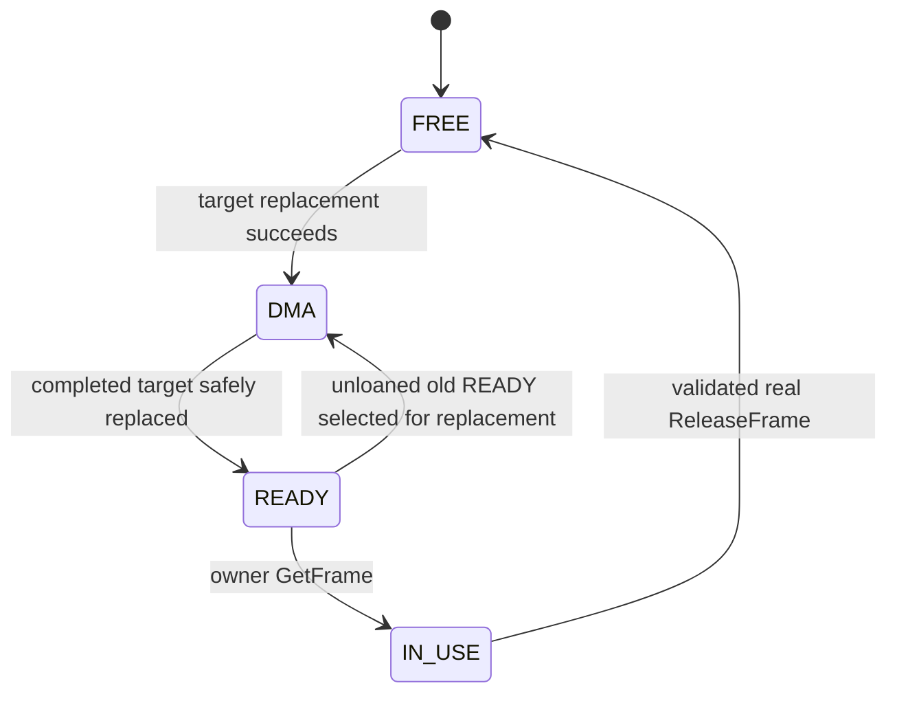
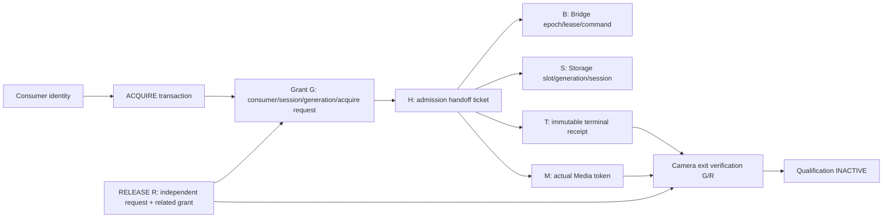
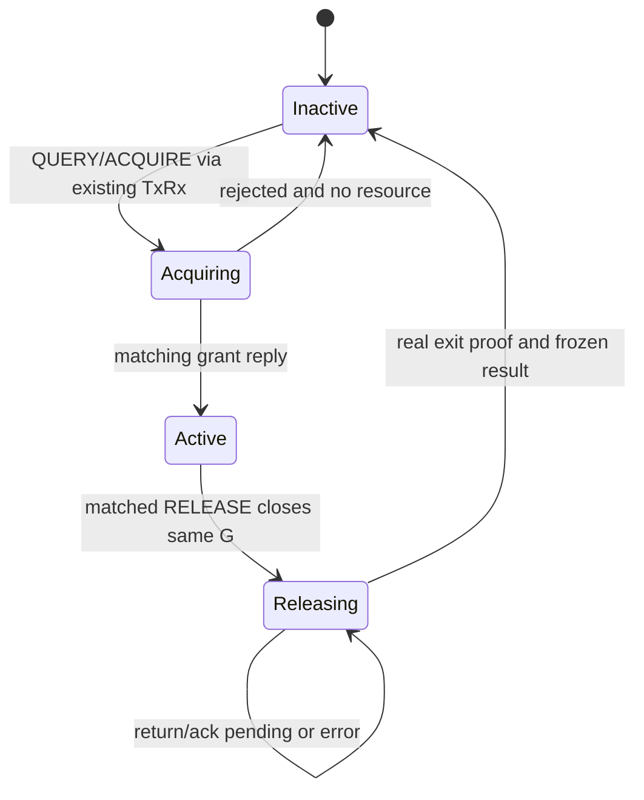
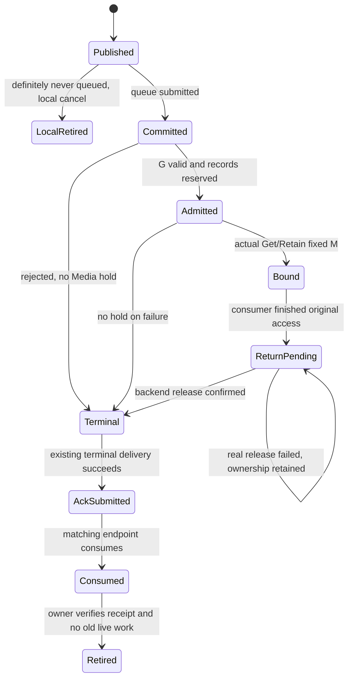

# Application V2 R3 — Resource Ownership Architecture

## 1. 基线、范围与证据等级

输入HEAD `54718ee7584089faf88bbd22237072c7f483023d`，分支`codex/architecture-media-graph-lifecycle`，main `f0ce45fd9ab7250b1e22260e087d606ee5ed9ecb`。开始工作区干净。生产事实以该研究分支实际文件为准，不引入C2.2B文档/代码支线WIP；main有Qualification工具，但没有真实consumer接入的完整闭环。既有M4 OLED稳定延时保留。

标签：SOURCE_CONFIRMED＝本工程源码事实；EXTERNAL_SOURCE_CONFIRMED＝固定外部版本源码事实；DESIGN_PROPOSED＝H7候选设计；IMPLEMENTATION_REQUIRED＝仍缺生产适配；RUNTIME_NOT_PROVEN＝未由本轮运行证明。以下状态名、接口和预算不构成实施批准。全部ADR仍UNRESOLVED。**Grant→Frame Lease：NOT_PROVEN；Stable Admission Closure：NOT_PROVEN。**

本轮只读源码、读取官方源码和编辑文档；测试、编译、实板统一NOT_RUN。设计证明义务与运行证据分别记录，不以设计推导宣布安全证明关闭。

## 2. 成熟实现：对象、交接、停止与不直接移植部分

研究固定Linux v6.12、GStreamer 1.24.10，不引用滚动master。下列文件本轮重新读取，其SHA256与OpenSourceArchitectureStudy第7节一致。保留原框架术语，H7适配不冒充原项目现成协议。

| 官方源码 | 关键结构/函数（原始源码1-based行） | 已有机制及H7取舍 |
|---|---|---|
| [Linux videobuf2-core.h](https://github.com/torvalds/linux/blob/v6.12/include/media/videobuf2-core.h) | vb2_buffer_state:226、vb2_buffer:252、vb2_ops:434、vb2_queue:611 | Buffer状态、Queue、内存Ops和驱动Ops分离；采纳角色分离，不移植MMAP/DMABUF/用户空间模型 |
| [Linux videobuf2-core.c](https://github.com/torvalds/linux/blob/v6.12/drivers/media/common/videobuf2/videobuf2-core.c) | __enqueue_in_driver:1537、vb2_buffer_done:1182、vb2_core_qbuf:1831、vb2_core_dqbuf:2131、vb2_start_streaming:1775、__vb2_queue_cancel:2195 | QBUF/驱动ACTIVE/完成/DQBUF为不同边界；done更新驱动持有事实。启动失败、streamoff要求驱动归还；本版也有警告后防御性强收。H7采纳完成/排空契约，禁止照搬强收及owned计数覆盖现有所有权 |
| [GStreamer gstbuffer.c](https://github.com/GStreamer/gstreamer/blob/1.24.10/subprojects/gstreamer/gst/gstbuffer.c#L777) | _gst_buffer_dispose:777、gst_buffer_new:860 | 无pool时允许销毁，有pool时dispose交回pool；H7只借鉴视图/池回收分离，不引入GObject或第二份Buffer |
| [GStreamer gstmemory.h](https://github.com/GStreamer/gstreamer/blob/1.24.10/subprojects/gstreamer/gst/gstmemory.h#L161) | GstMemory:161 | 内存allocator、parent、容量/offset/size与Buffer分离；H7使用既有FrameView/span，无动态allocator |
| [GStreamer gstminiobject.c](https://github.com/GStreamer/gstreamer/blob/1.24.10/subprojects/gstreamer/gst/gstminiobject.c#L648) | gst_mini_object_ref:464、unref:648 | 原子引用和dispose/free控制对象生命；其计数不是H7资格身份、ACK消费或DMA安全凭据，不再包一层refcount |
| [GStreamer gstbufferpool.c](https://github.com/GStreamer/gstreamer/blob/1.24.10/subprojects/gstreamer/gst/gstbufferpool.c) | set_active:507、default_acquire_buffer:1109、dec_outstanding:1197、release_buffer:1378附近、default_release_buffer:1315 | 停池先flushing，active=false可仍有outstanding，归还后再完成stop；回收核验内存条件。H7采用先关入口再等真实归还，不移植阻塞poll、动态池或另一份outstanding计数 |

EXTERNAL_SOURCE_CONFIRMED只覆盖上述固定实现。Linux buffer request不等于Camera ACQUIRE；GStreamer acquire_buffer不等于资格ACQUIRE；二者都没有本项目完整G/R/B/S/ACK协议。Linux驱动完成由驱动承担，框架状态本身不能额外证明H7 DMA已停止。H7的Grant关联、终结收据、单owner关闭及异步命令兼容是自行提出的适配，待审/待实现。

## 3. H7实际资源路径及唯一权威

| 路径 | 生产文件、函数及位置 | 已确认事实 / 尚未提供的能力 |
|---|---|---|
| Raw池 | `CM7/Media/Src/camera_capture.c::CameraStream_FindReplaceable`1018、Rotate1051、GetFrame1107、ReleaseFrame1184 | 7个描述槽、M0/M1与单IN_USE；替换目标成功后才READY；临界区Get改IN_USE，归还改FREE。不提供消费者G或公开完整Raw令牌查询 |
| JPEG获取/保留 | `CM7/Media/Src/camera_mjpeg_fifo.c::GetFrame`325、RetainFrame377 | 从READY建Loan，原始持有记usb_owned；Retain校验当前帧完整描述后置sd_owned，返Media session/id。两owner位共享该Loan的帧块引用，不在每次Retain另加整帧块计数 |
| JPEG归还 | 同文件ReleaseFrame405、ReleaseLease424、Mjpeg_ReleaseLoan840 | 独立清原始/SD持有；最后owner离开才减块引用；异常不假装成功。ReleaseFrame是无参当前原始持有释放，必须由上层先匹配真实身份 |
| JPEG解析/写目标 | 同文件Mjpeg_Publish784、Mjpeg_BlockComplete491、块引用辅助 | 完成块/输入FRAME证据组合才发布；DMA目标/解析/READY/Loan不同。Get/Retain没有G，原始usb_owned也可用于Camera内部SD-only |
| Camera/USB桥 | `CM7/Application/app_uvc_bridge.c::App_UvcBridgeCameraProcess`137、UsbProcess268、Bridge_CameraFlush432、Bridge_CameraRelease456 | USB请求/Offer/Return/ACK，Camera实际Release成功后固化ACK，重复Return匹配last_ack不再Release。Camera ack_pending清除只证明入队；USB匹配消费后才清lease |
| Storage槽 | `CM7/Application/app_storage.c::App_StorageOfferFrame`237、ProcessReturns334、Storage_Release988 | Camera端RESERVING/Retain/提交槽；StorageTask读写文件后只置RETURN_PENDING；Camera实际ReleaseLease后同generation槽才FREE。现槽未绑定完整G |
| 资格/停止 | `app_camera_qualification.c::Qual_Execute`248、Qual_Decide139、Qual_Submit174；`app_camera.c::App_CameraFinishRound` | Qualification保存grant_session/generation/request，RELEASE以consumer/session/generation核对旧grant，并从表内grant_request构造原ACQUIRE身份；不直接证明related_request_id等于该ACQUIRE。released/idle仍NULL；普通STOP唯一推进在Camera收尾，不让Resource另控硬件 |
| 运行顺序 | `CM7/Application/Tasks/camera_task.c::CameraTask_Process`、`usb_task.c::UsbTask_Process`、`storage_task.c::StorageTask_Run`（调用App_StorageProcess） | 保留实际BeginRound/Media Process/Bridge Process/FinishRound与独立ACK/FAULT交付；未来端口插入点需审，当前没有完整消费者退出协商接入 |

完整调用链：CameraTask→App_CameraProcess/CameraCapture→Bridge Camera→Media StreamGetFrame→（Storage需求时Dispatcher Publish→StorageOffer→Retain）→USB Offer；USB Task→UVC Process/Bridge→Return→Camera Bridge→StreamReleaseFrame→ACK入队→USB消费。SD-only：Camera内部原始Get→Storage独立Retain→内部原始Release，不创建USB grant。Storage Task→写入/文件收尾→ReturnPending→Camera ProcessReturns→ReleaseLease→槽FREE。

上述是SOURCE_CONFIRMED调用结构，不是新架构已安全运行的证明。尤其Camera Bridge Idle不含USB ACK已消费的事实；Storage IDLE不证明槽已FREE；全局HasLoan不说明某个G。

### 3.1 物理后端状态与上层交接不是一个状态机

此图仅为Raw连续流状态摘要；Init会给M0/M1初始目标，错误可冻结资源，不能从ERROR直接跳FREE。JPEG以块状态和Loan owner分别管理：FREE→DMA→SEALED→解析持有/READY→Loan；最后合法owner归还后才可能释放相应块引用，仍须满足parsed/非DMA复用条件。JPEG一个Frame可跨块/双span，块与Frame不是1:1，不能直接套上述Raw enum或新建统一Pool重写它们。SOURCE_CONFIRMED依据第3节S1/S2函数。

## 4. 对象与身份：禁止互换

### 4.1 对象契约

| 对象 | 权威 | R3设计职责 | 不允许 |
|---|---|---|---|
| Buffer/FrameView | Media完成帧及其描述 | 只读格式、长度、时间和span视图；不独立延长有效期 | 仅保存指针就声称持有；复制描述符当复制像素 |
| Pool/Provider | Raw固定池或JPEG FIFO | 原物理状态与资源复用权威 | Resource/Graph新增Frame Pool；普通refcount替代DMA/owner事实 |
| Lease/Loan | 后端真实持有 | 指定资源在有效期内可读的授权；不同后端不同令牌 | 将消费者资格当已取得Frame |
| Qualification ACQUIRE/RELEASE | Camera资格核心 | 业务使用资格与撤销事务 | 直接释放Media、操作UVC或文件 |
| Association | Camera owner的有界端口记录 | 不可变关联G/H与实际M/B/S，记录交接/终结事实 | 镜像引用数量，自己决定物理回收 |
| Terminal Receipt T | Camera端固定终结结果 | 不持有Frame，保留可重放身份和确认条件 | ACK未消费就覆盖；长期占住公共Media帧记录 |
| ACK | 既有消息协作 | 分别证明原命令、帧归还、资格结果及消费 | 任意ACK成功推导所有资源释放 |

### 4.2 身份关系图（DESIGN_PROPOSED）

Consumer ID不是Task handle或Graph Entity ID。A/G的request是建立资格的ACQUIRE request；R.request为另一次事务，R的资源核验记录必须显式关联原G。SOURCE_CONFIRMED：现Core按consumer/session/generation定位grant，related字段进入请求/回复匹配，但RELEASE分支不直接比对related与grant_request。V2应由Camera权威表提供完整原G；是否将非零related的严格一致检查加入后续适配须单独审核，不能把线上的0/可选字段静默变成C1新必填规则。B.stream_epoch/lease_id、Media loan_session/id、S.session/generation不等于Qualification session/generation。H是帧交接票据，不能拿Lifecycle request_id直接代用；T绑定原G/H/B或S和实际终结结果。

生命周期身份继续用既有Tx/Rx/Replay，单调编号不回绕，跨session/generation不清高水位，无新增配额。Media和Bridge字段继续原语义。未来适配若需新的Raw实例代次或其他端点交接标识，单调耗尽拒绝，不用地址、时间戳或复位计数冒充唯一性；精确字段/API待审。

## 5. Grant→Lease关联：承接原后端，不创建另一引用系统

### 5.1 USB：单未完成请求的受保护描述D

DESIGN_PROPOSED：沿Scheme A思路，USB owner先完成D的不可变G/H及原FrameRequest路由键发布，再把原52B请求入队。D由双端单写对象组成：USB端写publication/commit/本地取消与ACK消费记录；Camera端写accept/bind/terminal/退休确认。不要两端写一个共享phase。发布/快照使用既有Platform PRIMASK嵌套恢复和屏障；禁止仅靠volatile。队列提交与Camera抢先消费并发时，D完整PUBLISHED已可读；生产者提交结果未登记不妨碍Camera按匹配消息接受，不允许把已被Camera接受记录误判本地未提交。

原消息不带G，因此必须核验D.G等于Qualification权威grant，并把收到消息的完整可用路由键绑定同一D。**SOURCE_CONFIRMED**：`app_uvc_bridge.c::App_UvcBridgeUsbProcess`378～386在next_request==UINT32_MAX时拒绝，再以++next_request生成FrameRequest.command_id；当前Configure一次性、没有清该计数的运行期代码，CameraBegin只重置next_lease并推进epoch。该启动期非回绕wire ticket可直接复用，优先不增加第二套Frame请求编号器。

H是关联层的交接身份，可由consumer/端口和该wire ticket构成，B再绑定实际stream_epoch/lease_id/command_id；二者不是完整身份等同，更不等于Lifecycle request。D.G/H/路由键的受保护匹配及退休尚未实现；后续V2迁移必须保留原票据不重置规则，不能只把新H放sideband而让旧消息匹配到被复用command_id。现有票据机制的源码事实可以确认，**G绑定和D接替的整体安全性仍NOT_PROVEN**。

Camera同owner验证G准入后才调用StreamGetFrame。成功后在同一不可重入动作中固定M与B；如绑定提交发生内部故障，仍需保留“已经实际Get”的补偿记录并排空，不能先清D；无记录空间则在Get之前拒绝。Offer发送失败保留同一D/G/H/M/B。USB收到迟到Offer必须先核对所属旧D；有真实持有的Offer走原Return，不以STOP为由丢弃。无真实Get的取消只负向终结，不产生Media release。

Raw M候选为捕获实例代次、实际in_use槽及其sequence，与H共同校验；sequence现有回绕不能独自作永久令牌。JPEG M为实际Media loan_session/id及原始持有用途。现无完整公开只读Loan/Raw快照，不能仅凭frame地址/尺寸构造M。需最小纯查询适配，见第8节；所有查询均不Get、不Retain、不Release。

### 5.2 Storage：在原槽RESERVING窗口绑定

Camera→选中Storage端口/旧Dispatcher承接适配传入不可变G；StorageTask不得裸读Camera上下文推导它。Camera在准入核验及预留关联空间后，原slot转RESERVING时绑定G/H/S；Retain成功再写真实M=(loan_session,id)。若STOP在Retain过程中关闭本地accepting，仍按现有逻辑把已取得Lease置RETURN_PENDING，不丢失归还责任；失败且未Retain则可释放预留。环中只传原S路由键时必须匹配槽当前G/H/S，旧generation不触及新槽。

Camera实际ReleaseLease成功后才记录RELEASED并由原槽协议变FREE。不能将新的G/关联字段当作第二套sd_owned；后端仍唯一决定是否持有。相同媒体的USB和Storage关联各自G/H，但M可指同Loan不同owner用途，任何一方只归还自己的权限。

### 5.3 SD-only内部持有

Camera内部原始Get不是USB ACQUIRE，标用途INTERNAL_DISPATCH而非绑定USB G。先为Storage保留独立Lease，再释放内部原始持有。该原始持有的失败归还必须继续记账；不会因为USB不存在就强清。USB终结收据与该内部公共记录分开，USB ACK未消费不应永久阻塞Storage；Receipt满只对相关USB新交接背压，不占物理帧、不扩大FIFO计数。Camera最终停止还要核验内部原始持有和DMA，不能只看两张资格表。

## 6. 关闭线性化与稳定核验（DESIGN_PROPOSED）

| 位置 | 唯一执行者/动作 | 条件及不可推导事项 |
|---|---|---|
| L_stop_local(G) | USB/Storage各自owner关闭新帧需求，处理pending START及STOP先后 | 本地停止不是Camera全局关闭；待授权START不得在STOP后无条件重开 |
| L_publish(G,H) | 消费者提交完整不可变D/槽预留 | 不代表消息入队或Media持有 |
| L_admit(G,H) | Camera owner在G仍ACTIVE时受理并预留足够记录，成功Get/Retain后固定M | 与L_close串行；记录受理中失败/补偿，不把Get前的意向当实际Lease |
| L_close_camera(G,R) | 同Camera owner核对R关联G，Qualification ACTIVE→RELEASING并关闭该G准入 | 不是额外第二张active表；适配器只查询/使用该权威门，不独立重新开放 |
| L_verify(G,R) | 同owner核验入口关闭、未消费请求处置、M真实归还、端点终结消费证明 | 输出只对该G/R有效；不可跨任务拼debug；不证明其他G或硬件已停 |

同owner执行的Get/Retain与绑定过程禁止回调重入；合法排在L_close前的受理允许排空，排在后面的新Get/Retain一律拒绝。不能只在USB本地检查一次，再让Camera按陈旧状态Get。所有入口均覆盖：USB正常Request、队列延迟Request、Camera pending request、offer_pending重试、SD-only Publish、Storage Retain、旧通知触发的数据面轮次。Return永远允许在RELEASING排空，不能把关闭入口实现为停止处理整个Bridge。

**offer_pending特例**：若已有真实M，关闭后可继续交付/取消并通过Return结束，不再创建新M；若只是无持有的拒绝结果则发送原终结；未Get的request_pending在关闭后不再Get。对队列内未消费请求逐条匹配/负向终结，禁止清空队列。通知合并只影响唤醒，所有事实仍由队列和pending保存。

避免“核验刚通过又有旧请求”必须同时成立：该G永久RELEASING直到退出；生产者本地不再发新请求；旧D/槽不能换成新G；所有已发布/提交/受理记录有终结或无持有的可验证结果；迟到消息不匹配当前有效ticket便拒绝；下一G重新ACQUIRE必须新代次且旧G无未完成资源。新grant不继承旧入口，不能因新业务START把旧G标ACTIVE。

当前Core在Qual_Execute的RELEASE分支已置RELEASING再调released，但生产Frame路径不查G，且回调NULL。故这是合适候选线性化点，**不是现有稳定关闭已经成立**。资格状态本身不能代替实际入口改造、全部队列/sideband覆盖和运行交错测试。

## 7. ACK、终结消息、退休及失败提交

### 7.1 四种独立完成

命令STOP ACK只冻结该次业务结果；Frame Return ACK表示Camera对B匹配后实际释放；Lifecycle RELEASE回复表示G/R资格撤销；USB消费ACK才表示USB清掉该B等待。这四者不得合并。文件Finish/Close/Unmount、Media归还、Camera硬件Stop又是独立事实。

SOURCE_CONFIRMED：Bridge_CameraRelease成功才生成last_ack，Bridge_CameraFlush清ack_pending只表示APP_CHANNEL_TO_USB入队；UsbProcess在RETURN、return_sent、Bridge_SameLease且SYS_OK时消费并清lease。Camera端Idle本身不知道USB已经消费；现有released/idle=NULL不能当作默认成功。

### 7.2 终结收据与安全退休

推荐有界T，不持有Frame；其key至少G/H和B或S，payload为原冻结结果/真实M已归还事实。Camera只写terminal/reply提交记录；USB只写同身份的consume确认，双方字段分开，屏障保护发布/一致读取。优先复用现有Return ACK消息与端点同步元数据，不新增平行ACK队列。**消费证明接口当前缺失**；候选为原USB ACK消费位置发布完整G/H/B消费收据，Camera owner读取匹配快照，禁止用USB_IDLE裸读替代。也可用严格约束且带关联的后继事务作为因果证据，但当前RELEASE字段本身不足以替代H/B核验，不直接采用。

- LOCAL_UNCOMMITTED：QueueSend确定失败、无Camera接收/持有；USB可取消并本地退休D，无伪Camera ACK。H/wire ticket消耗不回退。若曾成功入队或提交结果不明，禁止走此分支。
- COMMITTED未Get：Camera核验并固定负向Offer；生产者消费对应终结后，双端确认可以退休，无Media Release。
- COMMITTED已绑定M：全部原始CPU/DMA访问结束→Return→Camera真实后端Release→T固定→ACK入队→USB匹配消费→Camera消费证明核验→退休T/旧D。ACK队列满停在原T，不再Release。
- Storage原槽终结：真实ReleaseLease成功后Camera发布FREE/generation确认，Storage只消费匹配槽的完成；不得在Camera仍RETURNING时复用。关联退休必须跟随该原槽协议及旧环项失效检查，不要求伪USB ACK。

双端退休必须有最后一步：Camera验证匹配consume及真实资源事实后，以自身单写字段发布retired(G,H,key)；USB观察同一退休确认后才可重用单D发布下一个请求，不能只因本地USB_IDLE就覆盖旧D。这是受保护端点元数据的发布，不是另开ACK队列/协议；当前仍IMPLEMENTATION_REQUIRED。Camera每轮先处理终结消费/退休，再处理新交接，等待不阻塞任务，继续处理另一消费者及Return。若退休确认未被观察，新请求保留本地pending并背压，不改票据。

退休后旧请求因不复用wire ticket、D/H/当前G及S全身份不匹配而拒绝，不能重新Get；旧Return不得再调用无参Release。若原B仍被合法重复，T保留期内只重放同一结果；退休后可拒绝旧消息，不保证无限重放。重放缓存不拥有Frame。T/D复用所需端点ticket耗尽拒绝新交接，不回绕、不加Replay配额。这里是帧端点失效边界，不重新实现Lifecycle Replay、不修改其容量/高水位/合法后继/ReplayRetire禁令。

相同H相同正文只返回原进度；同H不同正文、错误G或不同H冲突拒绝且不覆盖当前D/T，不推进任何Lifecycle退休边界。合法取消按原请求终结；未知/已退休请求可诊断拒绝，无资源操作，不为恶意/违例消息无限分配T。合法请求失败终结必须保留原结果直至规定消费，不能把内部容量背压伪装成已完成释放。

### 7.3 业务事实已发生、可靠回复失败

Qualification保留DECIDED/BLOCKED和原Rx；真实Release后不恢复grant/owner假装未发生，真实错误不被后台成功覆盖。RxComplete BUSY（api_busy）是重入/所有权问题，回任务调度边界检查原Rx窗口、完整身份、冻结状态，不重做Get/Release/Device操作，不Reset；RxFlushReply NO_RESOURCE才是正常运输背压。T发布/关联空间应在资源操作前预留；若事后仍发生内部错误则保留补偿事实并BLOCKED，不能为完成协议清掉资源。生命周期Pending的READY取消与WAIT_REPLY禁止超时强清仍沿用原机制。

## 8. 最小接口草案及所有者

所有接口均DESIGN_PROPOSED、未新增生产头文件、消息或任务：

| 候选公开契约 | 调用者/执行上下文 | 输入输出与限制 |
|---|---|---|
| Resource_RequestFrame(G,H,endpoint_key) | consumer owner发布→Camera owner消费 | 固定D；接收成功不是Get成功；保留原52B运输，sideband匹配必须防ABA |
| Resource_Return(G,H,M,endpoint_key) | consumer完成访问→Camera owner消费 | 只请求，不能跨任务直接Release |
| Resource_CloseAdmission(G,R) | Camera资格事务串行边界 | 只关闭原G，不能重开，不停其他消费者 |
| Resource_QueryExit(G,R,out) | Camera owner | 只读同一序列点事实；complete/hold/pending/terminal未消费/错误分别给出，不改变账本 |
| Resource_PublishAckConsumed(G,H,B) | USB owner在真实ACK消费位置 | 单写有界消费记录；Camera只读，不能伪造ACK消息 |
| Media_ReadOwnershipSnapshot(backend,out) | Camera owner，通过Media公开端口 | Raw目标/IN_USE与令牌、JPEG原始/SD实际M及用途；纯读、不创建Loan、不修改owner/引用/DMA |

快照尺寸应有界，Raw最多7描述，JPEG最多7Loan/64块；优先仅取退出所需标识而非复制所有帧或整块表。Raw IRQ更新期间使用原PRIMASK短临界区或受审序列快照；JPEG同owner主循环数据与IRQ字段分别保护。快照只在Camera owner当前验证动作内有效，不能缓存到另一轮当永久证明。单核PRIMASK不证明另核/外设访问终止，Memory Barrier不能代替DMA完成。

资格表必须仍在App_Camera/Qualification；Resource只获得只读grant验证端口，不能重建第二张资格表。现released callback只有G，完整退出结果还需绑定R；推荐后续接口审查明确传入G/R到资源核验（或Camera owner传递不可变当前R的受控适配），不能由Resource私读Core rx或把当前全局STOPPED当结果。本轮不调整Ops签名；实际API/布局待单独审批。

### 8.1 所有者调度与排空活性（候选插入契约）

当前CameraTask实际顺序保持事实：BeginRound→回复/至多一条旧控制命令→Camera Media Process→Bridge Camera Process（含Storage returns）→FinishRound→回复。V2候选生命周期受理/关闭可放在该轮Media/新交接之前的控制边界，每轮至多一条生命周期输入、预算有界；不在IRQ执行，不让其等待阻塞原Return。Camera端Resource先处理consume/退休和Return，再考虑新Get/Retain；L_close与L_admit必须在同owner串行，不在两个Task分别判定。

真实停止结果由FinishRound产生，资格事务可到下一轮再读取该请求结果；不要为了当轮答复再调一次普通停止或反复调用整个Camera Process。资源归还在Bridge阶段完成时，释放确认也允许下一轮生成，额外一轮延迟不能被当作失败或用超时强清。USB仍显式Mode→UVC→Bridge推进及原收尾；匹配ACK消费时发布consume、读取Camera退休确认后才发下一D。StorageTask独占FS，Camera继续独占真实Media归还；所有异步pending期间都返回调度器。

这是待审执行契约，尚未修改Task循环/优先级/栈/等待/队列容量；每轮时间预算需后续O0/O2轨迹、最大积压和DWT验证。若控制消息淹没Return或已终结T永远无法退休，视为活性违例，不能用扩大队列或强制回收解决。

## 9. DMA不再访问原帧：逐路径证据

| 访问者 | SOURCE_CONFIRMED调用依据 | 必需设计/实测条件，不能替代的证据 |
|---|---|---|
| DCMI写Raw | CameraStream_Rotate1051先BSP_DCMI_ReplaceTarget成功再READY；FindReplaceable排除M0/M1/IN_USE；BSP检查CT/目标 | 正确IRQ/双缓冲切换且地址/状态一致才可交付；TC位单独不是永久无访问；真实硬件错误/抢占仍RUNTIME_NOT_PROVEN |
| DCMI写JPEG | FIFO选块检查状态/引用、完成块解析、Mjpeg_Publish输入FRAME+EOI；BSP目标轮换 | Loan块不得再次作为DMA目标；EOI/FRAME IRQ单独不足；后端块/IRQ/错误路径联合验证，不靠Graph格式合法 |
| UVC读帧 | usb_uvc_payload.c::USB_UVC_PayloadBuildPacket逐包复制，class.c Process匹配token，取消先PayloadCancel再AbortEp/AbortPacket | 当前不是一次Submit复制整帧；还会为后续包读原Frame。最后包/取消过程全部读取结束且无旧token可继续读取才Return；frame_owned=false仅USB端必要条件 |
| SD写卡 | Storage写入同步调用→StorageFS中转→SD Block→BSP_SDMMC AXI/IDMA | 原Frame可能先被CPU复制/CRC/校验读取；完成前不能归还。IDMA访问私有AXI不等于仍读原Frame；Abort失败要按实际原始读取是否结束分别保留错误/私有缓冲占用，不自动强退Frame |
| 未来复制Network/AI | 当前无实现 | 所有原帧CPU/DMA复制读取完成进入独立私有缓冲后才能Return，后续私有发送独立管理 |
| 未来零拷贝Network/AI | 当前无实现 | 所有并行DMA/驱动令牌逐一完成/取消确认且不再访问原Frame；TCP接受、驱动接收或任一DMA完成不能替代全部完成 |

USB实际实现参考`CM7/Service/usb_uvc_class.c::USB_UVC_Process`、`USB_UVC_CancelFrame`315、`USB_UVC_GetStreamStatus`335、`UVC_DataIn`与`UVC_ReleaseFrame`（后者由成功Close/Abort路径调用）；`usb_uvc_payload.c`的BuildPacket/CompletePacket/AbortPacket。SD依据`CM7/BSP/bsp_sdmmc.c::BSP_SDMMC_PrepareWriteInput`849、`Sdmmc_Quiescent`957、`Sdmmc_StopIo`1054、`Sdmmc_Transfer`1083；具体符号与行号在验收矩阵源码表复核。函数返回成功、寄存器单一位为0、日志显示STOP任一项都不能独立证明整条访问链结束。

硬件必要保护可先停DMA，但不清consumer Lease。CameraCapture_Stop实际BSP停止结果、Media DRAINING、Bridge终结及Device_Stop四条件分开；普通STOP继续唯一FinishRound推进。超时只形成未完成/错误，禁止强制回收或自动硬件重启策略。

## 10. 状态机与独立停止

上图是资格语义；模块业务Stopping、关联ReturnPending、后端IN_USE/DRAINING不是该enum的别名。资格申请失败但已有本地资源由模块清理；Camera已启动但回复提交失败保留真实事实，不重复Start。

这是两端事实的联合观察图，不是跨任务共写phase。Bound失败补偿仍保留实际M；LocalRetired不产生Camera ACK；Terminal负向结果可无M；Storage以槽确认代替USB ACK。任何阶段发生内部一致性错误都保留原事实/BLOCKED，不画一条“错误直接FREE”的捷径。

USB自主停：关本地需求→UVC完成/取消且原始访问结束→Bridge Return→Camera实际Release→USB消费ACK→关闭并核验G/R→撤销USB资格。Storage仍ACTIVE则Camera继续；STOP_IF_IDLE BUSY不把USB自身已完成停止改成失败。

Storage自主停：关入口及pending START闸门→处理已接收完整帧→Finish/Close/Unmount各记录真实结果→ReturnPending→Camera实际SD Release→核验G/R→资格撤销。文件失败但无帧/交接且入口关可允许资格释放，文件错误/卷清理仍由Storage保存，不计正常AVI完成。USB仍ACTIVE不能被停。

最后消费者退出后也需检查内部SD-only持有、未决资格/交接、全部终结退休条件、Media/DMA安全，再由Camera普通停止路径处理；Camera从未启动不为STOP_IF_IDLE初始化传感器。主动Shutdown异步要求各模块退出，先必要保护也不伪造归还。新的START须新G且旧资源安全；B2 ID23有界BUSY、ID31未退出拒绝/合法成功START后故障复位的批准语义不变。

## 11. 未来Network及资源成本

AC-01～06保持。消费者端口按身份和后端能力描述，不在Camera核心增加USB/SD/Network专用核验函数。当前JPEG只有两类owner、Raw只有单IN_USE，不能仅注册一个Network ID就宣称零拷贝多路：可先走完成复制的私有端口，或另审后端真实所有权扩展。复制需要的RAM/CPU/缓存/DMA完成独立预算；本轮不实现网络或增加Task。

Graph FrameRoute只声明可选边，Configuration装配选中端口；Resource不解释业务拓扑，不新增Dispatcher。适配继续复用固定池4300800B、JPEG FIFO/drop540672B，无新整帧池设计。预估关联记录的容量至少覆盖USB单交接、Storage slot1及SD-only内部；未消费T独立占描述RAM，不占Frame。候选每记录64～128B只是范围，不是冻结layout；T每64～96B，具体容量由队列4深/合法重复/消费窗口推导，不能直接取队列数当已证明的同时在途数量。

预算方法：按各端单写字段分别求sizeof/offsetof，计算D端点发布+Camera绑定+Storage槽新增G/H+T+纯查询workspace，扣除被替代旧记录；不把已有824B资格或144/332B Tx/Rx再加一遍。关联上限/收据条数、Raw快照API、ARMCC5对齐和Flash仍UNRESOLVED。Graph CoreMediaFormat别名调整预计不改R2的56B布局；没有实际编译/Map故不报告真实RAM增量0或栈PASS。静态scratch不放高优先级栈，所有临界区有界，无新任务/队列/动态内存提案。

## 12. 推荐、阻塞与分阶段设计门禁

推荐采用“原后端唯一所有权 + 有界G/H/M关联 + 关闭入口/终结退休”的统一端口；拒绝普通统一refcount、每消费者私建Media池、Graph自动Retain和超时强清。成熟机制提供的是排队/完成/池关闭思想，完整事务安全由本项目原协议及待审交接契约承担。

1. 先审Core中立格式、各后端能力、D/T字段/单写/不复用ticket及最低容量；R2-06接口仍待复核。
2. 再审Media最小只读快照、G/R绑定与关闭全部入口覆盖；不得改原引用算法或普通停止所有者。
3. 然后才可另行授权纯软件测试/适配实现；本轮只给测试设计。先后端、再关联/受理、再关闭/消费/退休，避免临时假成功。
4. 通过逐交错负对照及原回归后，实板验证DMA、双路独立停止与长期启停，才有关闭NOT_PROVEN的证据条件。

Grant→Frame Lease现缺完整G进入Frame路径、可核验M/Raw令牌及sideband长期身份拒绝；Stable Admission Closure现缺入口接入、全部未消费消息的终结、USB消费证明、真实released/idle适配。两项继续NOT_PROVEN；不能因为本报告覆盖了设计义务就改为PASS。ADR-03/04也继续UNRESOLVED。

并发/可测试契约和硬件门禁详见[H7_V2_ResourceOwnershipAcceptance.md](H7_V2_ResourceOwnershipAcceptance.md)。完成本轮文档后停止，不开始Phase1/C2.2C或任何生产修改。
