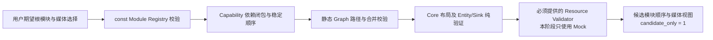

# Application V2 Phase 1 — Core + Composition 实施报告

输入提交：`ce33d0714211c237009d63f36c26bafe1ed47804`。研究分支：`codex/architecture-media-graph-lifecycle`。main 保持 `f0ce45fd9ab7250b1e22260e087d606ee5ed9ecb`。本轮依据用户的 Phase 1 Complete Implementation 授权实现纯基础能力；不进入 Phase 2 或 C2.2C。

## 1. 实际交付与边界

六项均有可运行的 C 实现和 ARMCC5 O0/O2 测试，并非只有声明：Core、Registry、Resolver、Static Typed Graph、Format Validation、Composition。新代码只在 `CM7/ApplicationV2/{Core,Configuration,MediaGraph}`。保持冻结目录及五个核心子系统，不增加顶层管理器。

所有新函数均未接入旧启动入口。测试中的 Camera、USB、Storage 是 **Mock 描述符与纯能力函数**，不是真实业务模块。新增代码不启动设备、不分配 Frame、不发送消息、不建任务、队列或计时器。生成候选配置成功不表示可安全执行或运行时重配置成功。

## 2. 文件与主要函数

| 文件（仓库相对路径） | 职责 / 主要入口 |
|---|---|
| CM7/ApplicationV2/Core/v2_types.h | uint32 模块/能力/消费者/请求身份包装；uint16 Graph 身份包装；固定宽度 Status；统一 SysResult 别名；范围重叠检查 |
| CM7/ApplicationV2/Core/media_format.h/.c | 唯一 CoreMediaFormat、CoreFrameRate；CoreMedia_Validate、CoreRate_Validate |
| CM7/ApplicationV2/Configuration/v2_registry.h/.c | V2Registry_Validate、Get、Providers；V2Resolver_Resolve；无运行时模块实例 |
| CM7/ApplicationV2/MediaGraph/media_graph.h/.c | const Entity/Pad/Link/Pipeline/Caps；Graph_ValidateCatalog、ValidateSet、GetEntity/GetLink/GetPipeline |
| CM7/ApplicationV2/Configuration/v2_composition.h/.c | V2Composition_Validate；Entity→Module 显式绑定及资源纯验证；只生成候选 |
| Tests/V2Phase1/phase1_test.c | 正负 Mock 场景及 ARM sizeof/ABI 断言，未修改历史测试 |
| Tests/V2Phase1/run_tests.py | ARMCC5 编译/链接、Cortex-M7 指令仿真、O0/O2 原始结果与内存证据 |
| Tests/V2Phase1/run_build.py | 原工程两核完整 Rebuild；先备份既有 MDK 输出；独立目录保存日志、Map、镜像及 SHA256 |

公共接口为 V2 本地接口，不新增现有消息字段，不替代 Device Registry。Core 只依赖 C 标准头和既有 `sys_result.h`，没有 HAL/FreeRTOS/具体业务依赖。

## 3. Core 契约

Module/Capability/Consumer/Request 各自是 uint32 包装，0 无效；不定义 Consumer Session/Grant 或编号分配器。Entity/Link/Pipeline/Caps 是独立 uint16 包装，合法值为所属表的 1..count；Pad 是 Entity 内 0..pad_count-1，因此 **Pad 0 合法**。Module ID 不要求稠密，Graph 的全局 ID 要求稠密且和静态表位置一致。唯一性在所属表中校验。

V2Status 固定 uint32，表示 IDLE/PENDING/DONE/FAILED 的操作投影，不是 Managed Lifecycle 状态。SysResult_t 保持 int32：0 成功、负值失败。BUSY、INVALID_ARGUMENT、NOT_FOUND、NOT_SUPPORTED、RESOURCE_EXHAUSTED、TIMEOUT、INVALID_STATE、IO_ERROR 复用原类别；CONFLICT 映射既有 ALREADY_EXISTS(-3)，详细身份在 Issue 中。V2_INTERNAL_ERROR(-11) 仅定义在 V2 命名空间，不修改 Common 或旧协议。回调必须遵守相同 0/负值契约；其真实错误不得被后续成功清除。

所有描述表及回调是可信静态 C 对象，调用者保证实际数组长度、有效指针及生命周期。不能把协议字节直接解释为这些指针。输入、scratch、out、issue 必须独立；入口检查主要对象的重叠，但不声称能够识别任意伪造指针。scratch 属于调用者，不分配堆；Graph/Composition scratch 首次使用前零初始化，单所有者使用，同一 scratch 重入返回 BUSY。该保护不是跨任务互斥锁。多任务若要复用，后续必须由外层协调；本阶段不创建同步协议。

## 4. 静态 Registry 与运行期 Resolver

Registry 是调用者提供的 `static const V2ModuleDesc[]` 和 `V2Registry {modules,count}`，不是动态注册容器。验证通过即注册表可查询；Get 返回借用指针。描述符包括 ID、版本、provided/required/optional/conflict 常量列表，以及不执行的 Module/Lifecycle Ops 不透明指针。Phase 1 Mock 用 DESCRIPTOR_ONLY，FUTURE 不能选入候选。

能力 ID 表示能力类型；版本采用显式 major.minor 闭区间。Required 自动加入依赖闭包。Optional 默认只绑定已经选中的唯一 Provider；显式 AUTO 才允许补入。两种 Optional 缺失都会记录 optional_missing。多个 Provider 时只有显式 preferred 可消除歧义；没有唯一合法 Provider 就拒绝，不凭表顺序猜测。无等价替代声明时不进行隐式回溯/降级搜索。

处理流程：校验整个 Registry → 根去重及存在性 → 最多 16 轮闭包 → 绑定 Optional → 检查所选能力冲突 → 有界依赖排序。每轮选择就绪模块中 Module ID 最小者，Provider 先于使用者。循环、歧义、缺少 Provider、Future、容量或输入错误不覆盖原 out。选中位图/依赖矩阵只是候选解析结果，不是消费者资格或引用计数。

ADR-08 的静态 Registry 与有界解析直接涉及本阶段，已实现其安全基础子集：固定容量、显式 pin、无隐式替代。文档中的产品 rank、多方案搜索、每轮比较 cursor 没有获得具体策略授权，本轮不引入；这是同步纯 API，尚未挂入实时任务。ADR-09 Control Service 和 ADR-10 写事务不属于本阶段，未实施。原 ADR-01～10 文档状态仍 UNRESOLVED，不自行签为 APPROVED。

## 5. Static Typed Graph

const 描述支持 Entity、方向 Pad、类型协议、能力 Caps、独立 Link、固定 Backend Pipeline。16 Entity / 32 Pad / 32 Link / 8 Pipeline / 32 Caps / 5 Sink / 4 Pipeline 依赖均有边界检查。Link 描述可用性而非正在运行；选择通过 Selection 及候选 mask 表示，不修改原表。

Catalog 验证 ID、方向、协议、内部类型转换、能力、名称有界终止、引用/未用零槽、重复连接、完整图 DAG、Pipeline 路径、默认格式和依赖 DAG。Capture 内部表达 SENSOR_BYTES→DMA_CHUNKS，Provider DMA_CHUNKS→FRAME_VIEW，FrameRoute FRAME_VIEW→FRAME_VIEW；不新增可独立启停的 DCMI/DMA。FrameRoute 只有拓扑含义，无数据交接或资源账本。

ValidateSet 每次先校验 Catalog，随后检查请求集合：每条 Pipeline 的 Source/Sink/可达性、每条边位于有效路径、必需输入、终端、Pad 度数、显式 fan-out、互斥组、依赖与规范格式；再对合并图重复验证。Raw/JPEG 各 Pipeline Backend 固定，不能同时启用互斥后端。同 Source 同完整媒体格式可合并公共边；不同 Sink 可有不同 rate，相同 Sink 只能有相同的规范化策略。FUTURE/TEMPLATE 不能进入可执行候选。

路径 helper 用独立的有界前向/反向扫描、一次 Link degree 统计及 Kahn；复用最后一次合并的 Kahn 顺序，不另加一次遍历。Catalog 最多 9 个 helper 槽位，选择/合并最多 9 个，符合原 R2 的最多 18 槽位；33408 是原定义的边探测/ready/建度单位上界，不是完整 CPU 指令数或实测 WCET。互斥、字段、版本、别名和回调成本另计。算法无递归、无堆。

所有结构及粗能力通过后，按 Entity ID 调 validate_format，再按 Sink ID 调 validate_sink_config，最多 16+5 次。每层保留否决权，Issue 保留原始错误/诊断。Raw/JPEG Provider 可作为 capture-only 终端，但仍要求格式验证回调，避免终端能力绕过后续路由的格式检查。只在全部成功后复制候选到 out；失败原 out 不变。一次结构复制不是跨任务原子发布。

## 6. 中立格式与组合入口

CoreMediaFormat 是 14 个 uint32，共 56B。支持值类型 Y8/RGB565/YUY2/JPEG；MJPEG 采用 JPEG_FRAMES 表示一系列 JPEG，不增造 Sensor 像素码。Raw 检查偶数 YUY2 宽度、行长、乘法溢出、尺寸、单 Plane/Span 及对齐；JPEG 检查可变长度、双 Span 单 Plane、Backend/stream 对应等。GraphFormat 是 Core 类型别名，没有 CameraConfig_t 泄漏。

格式合法、模块声明支持、板卡实测支持是三种证据。Sink rate 独立于媒体布局，采用 uint32 有理数并规范化；USB Delivery 与 Storage Sampling 可不同。没有 Source 时钟配置或实测器，不能把 rate 目标当作 Capture Rate。160×120 YUY2@10FPS 仅沿用用户已确认历史输出基线，25FPS 仍目标。本阶段 Mock 能接受 JPEG 不证明实板连续 JPEG 支持。

Composition 显式接收 Registry、Graph、Entity→Module 绑定、Desired 和必需的 ResourceValidator。全部入图 Entity 必须对应所选模块；纯逻辑 PROCESSOR 可用 Module 0。没有 ResourceValidator 就拒绝；Mock 拒绝也保留错误且 out 不变。资源预检不与格式交集混为一谈。

Storage 验证回调只接收中立 GraphFormat/CoreMediaFormat、Sink rate 和不可变 CheckContext，不调用 App_StorageOfferFrame。真实 StorageFormat_GetCaps/Validate 适配尚未建立，不复制旧业务的 70000B 权威限制。阶段后续 Port 必须复用原层的单一限制源。

## 7. 构建集成的实际处理

新增四个 C 已通过 ARMCC5 Cortex-M7 C99 O0/O2 独立编译、链接及执行。曾尝试仅向 CM7 XML 增加文件组，但实测 Keil 在 CM4 构建中也隐式引入该组。为保证 CM4 旧工程原状，**已撤回全部工程变更**；最终 `.uvprojx` 与输入提交逐字节相同，SHA256 见 ScopeAudit。

最终两核正式 Rebuild 使用原项目，旧启动入口、任务、业务和链接保持原样；V2 独立库尚未登记到活动工程。后续真正启用 V2 时必须单独审查每 Target 的源表，不能把本阶段候选校验误写成已运行 V2。工具链、完整日志、大小、镜像 SHA256 见测试/资源报告。

## 8. 保留与停止条件

没有改动 Legacy、Replay、52B/56B 旧协议、Device/Media/FIFO、任务优先级/栈、M4 的 `//等OLED稳定` 和 `HAL_Delay(500);`。没有新增网络消费者、控制传输或运行期 Apply。USB/IPC/BLE/Wi-Fi/Ethernet 的统一控制入口设计不变，但不在此实施。

Grant→Frame Lease 与 Stable Admission Closure 两项继续 NOT_PROVEN。72 项 R3 场景保持 NOT_RUN；本轮不升级历史 FAIL/BLOCKED。Phase 1 软件基础完成后停止等待审核。Phase 2 前置：人工审核本交付、确认后续 Resource 接口及所有权方案；真实 Source/Consumer 适配、硬件速率、WCET、目标任务栈及资源安全闭环均需各自阶段验收。
