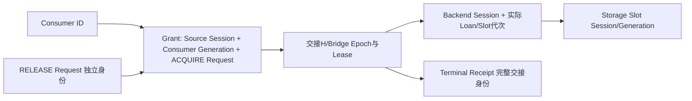

# Media Resource 模块接口契约草案（Phase4前置 / PROPOSED）

## 1. 实际资源基础

Raw不是独立camera_stream.c：它是CM7/Media/Src/camera_capture.c中的CameraStream_t。CameraStream_GetFrame:1107在PRIMASK保存/屏蔽/恢复区内把READY改IN_USE，确认不为DMA M0/M1且只有一个in_use_index。CameraStream_ReleaseFrame:1184验证owner状态和DMA目标后才改FREE。7个物理slot不等于能借出7个consumer；当前无多consumer独立Retain接口。

JPEG见CM7/Media/Inc/camera_mjpeg_fifo.h及Src/camera_mjpeg_fifo.c：GetFrame:325生成loan id并设置usb_owned，RetainFrame:377只给当前原始loan增加sd_owned；ReleaseFrame:405与ReleaseLease:424分别归还。其块引用和usb_owned/sd_owned是真实权威，外层不得另加平行引用计数。SD-only的原始USB命名位不意味着真实USB grant，必须标为Camera内部持有。

CameraCapture继续封装DCMI/DMA、选择CameraStream或FIFO，Buffer Source借用其真实端口，不另建摄像头控制器或重复池。Raw Y8/RGB565/YUY2布局保留，JPEG可双span；统一资源视图不得把JPEG说成连续固定slot或Raw自带独立双owner。

## 2. 身份图与单写责任

不得把ACQUIRE/RELEASE/Frame Request的request_id相等视为关联。Source session、consumer generation及H均不可回绕；耗尽拒绝。Grant生成由后续Camera/资格owner，Media Resource只验证/关联，不建立第二套资格状态机。物理M只由Backend确认，禁止根据地址推测。生命周期协议仍用原Tx/Rx/Replay，不新增消息ABI或配额。

Camera资源owner串行执行准入/真实Get/Retain/Release；消费者owner关闭本地入口、停止自身DMA并推进Return；Camera侧与消费者侧关联字段分别单写，受保护发布不可变身份。队列复制描述符后才通知；通知可合并，不能当消息。禁止跨任务裸读Debug或拼接私有快照。沿用既有PRIMASK嵌套/恢复和屏障语义，临界区仅提交小记录，不包围SD/USB阻塞操作。

## 3. 候选本地API（不是现有符号）

| 草案接口 | 所有者/输入输出/副作用 |
|---|---|
| BufferSource_QueryCaps(source,out) | 读取Backend公开能力，固定slot/双span/支持owner集合；只读，不GetFrame |
| Resource_Admit(G,H,request,out) | Camera owner在同一关闭序列上检查有效G，提交在途交接记录；不把入队当成获得Frame |
| Resource_Bind(G,H,M,view) | 真实Backend Get/Retain成功后绑定不可变M；失败保留真实资源事实和待处理交接 |
| Resource_CloseAdmission(G,R) | 原子提交该G关闭代次；只关新准入，不释放物理Frame，不影响其他G |
| Resource_Return(G,H,M,operation) | 校验完整身份/owner和DMA静止事实，实际释放由Camera owner调用Backend；失败保留记录 |
| Resource_ReadExitEvidence(G,R,out) | 只读一致核验：入口关闭、所有已准入交接终结、真实M无该消费者owner、ACK消费/Receipt退休满足；不改变资格 |
| Resource_ConfirmTerminalConsumed(T) | 匹配完整收据身份，记录消费，不创建第二个ACK运输；旧/重复确认不得作用新槽 |

参数具体C布局与签名待审核，不能写进生产头。查询能力≠实际退出证明；Graph只获得纯资源可行性Validator，不接触Frame或上述变更端口。Lifecycle只依据模块真实结果协调，Supervisor只调用模块公开生命周期，不直接BSP/Device/Backend Release。

## 4. 线性化与状态

本地停止L_stop_local只关闭消费者请求；L_close_camera(G,R)由Camera权威串行关闭准入；L_admit(G,H)必须与后者同一顺序。先准入的交接排空，后到旧G一律拒绝，不得借新G重贴标签。G关闭后不重新开放；新业务需要新grant，旧身份未安全排空不得复用源存储。

交接：LOCAL_UNCOMMITTED→COMMITTED→ACCEPTED→FRAME_BOUND→RETURN_PENDING→PHYSICALLY_RETURNED→TERMINAL_CONSUMED→RETIRED。未提交可本地取消且H不回退；已入队必须获得对端终结，不能伪造ACK。PHYSICALLY_RETURNED不代表ACK已消费。Qualification INACTIVE必须等指定G退出证据和独立RELEASE结果，不能据IDLE或全局HasLoan判断。

Receipt独立有界、不持Frame；USB ACK入队未消费时保留旧T，不能被SD-only记录覆盖，也不永久卡住Storage。容量满必须背压/停止受理，不覆盖；安全退休要求运输中无可重新受理的旧身份、终结已消费或经批准的不可逆失效边界。Replay仍沿用高水位/合法后继接替，不因T退休清Replay。

## 5. DMA与多消费者

采集DMA对Raw必须排除M0/M1，JPEG块回收必须服从原Backend写目标/块引用；外围视图不证明硬件停。USB异步端点/Abort确认、SDMMC IDMA完成/成功Abort及CPU复制均各自证明不再读原Frame。复制式发送仅在最后一次原Frame读取完成且无其它异步读取者后才可归还；零拷贝等待驱动真实完成/成功Abort。函数返回成功、网络/TCP接受、客户端断线均不是释放证据。异常超时保留Lease，不强收。

USB退出不碰SD owner，反之亦然；最后消费者退出还须内部SD-only持有和采集DMA安全证明。当前Raw双消费者零拷贝、JPEG第三owner均NOT_PROVEN/UNSUPPORTED，真实资源能力应拒绝，不能因图fan-out合法就放行。未来Network仅在真的持Frame时参与，需先扩展真实Backend权威，不添加第二套全局计数。
