# Phase 2 Media Resource 软件基础实施与验收报告

输入399f86a；分支codex/architecture-media-graph-lifecycle。用户本轮正式授权MR-A～MR-F软件实施，替代上一轮“只设计/尚未授权编码”的历史前提；本轮不批准Phase3、BOOT切换或Legacy适配。五核心、冻结路线不变。

## 1. 工作包与实际代码

| 工作包 | 提交/位置 | 实际软件能力 |
|---|---|---|
| MR-A | 0071a6b，Resource/media_source.h/.c | 有界只读caps、owner校验、Backend端口完整性、Raw/JPEG能力差异；不是空接口 |
| MR-B | 1b3f6d3，Resource/media_resource.h/.c | G/R/H/B/M/S/T值类型、Grant关联、单调H、Stage/Commit/未提交取消、拒绝旧代次 |
| MR-C | d6e6fba，同文件 | 同Camera owner的Admit/Close/Obtain；关闭不可重开，未获M的旧请求负向终结 |
| MR-D | 10d47fa，同文件 | 物理归还、独立有界Receipt、入队/消费/退休分离；原失败冻结 |
| MR-E | 17562b6，同文件 | 完整R匹配，逐G排空记录与Receipt后只读Backend exit_safe核验 |
| MR-F | 本轮最终提交 | O0/O2、负对照、原协议回归、隔离双核构建、ROM/RAM/Stack证据；修正重试物理事实核验等测试发现问题 |

MR-F对前述工作包做统一格式化及验证修正，包括：物理Release返回错误后不假定资源仍持有；下一次调用先权威validate/released核对，实际已释放则不重复Release。Consumer ID与Backend role分离，由role回调映射，不把ID数值当USB/SD位。内部原始持有不注册成第三个Qualification；INTERNAL角色禁止AssociateGrant，只由Backend查询/exit_safe核验。JPEG concurrent是有界交接预算1..7，不是复制的物理引用数；Raw必须1。接口与注释最终以源码头为准。

只新增ApplicationV2/Resource及独立测试，未更改Phase1、Legacy、Media/FIFO、Bridge、Storage、BSP、Replay、旧ABI或原测试。没有池、堆、TCB、Queue或硬件控制器实例。未接旧BOOT，真实资源操作只在受信任Camera owner回调执行。

## 2. 身份与状态

G={source session,consumer ID,consumer generation,ACQUIRE request}；R={原G,独立RELEASE request}；H={session,全局单调sequence}；B={epoch,lease,command}；M={backend,backend session,真实id,generation}；S={session,slot,generation}；T={G,H,M,单调serial,冻结result,实际B,physical_returned}。S及USB请求ticket固定在完整MRRequest，T经同G/H绑定该不可变请求；不是把各request_id设为相同。H/T耗尽拒绝不回绕；READY取消不退H。G注册调用grant_valid权威端口，不生成Qualification或复制它的状态机。Source session/generation旧记录拒绝；新G替代同consumer旧记录必须已关闭、全部记录退休且Backend exit_safe，最后还由grant_valid确认新授权。

```mermaid
flowchart LR
 G[真实Grant权威回调] --> A[关联G]
 A --> H[Stage H+B+S]
 H --> C[运输成功后Commit]
 C --> AD[L_admit]
 AD --> M[真实obtain后绑定M与View]
 M --> RP[Return Pending]
 RP --> Q[所有原始CPU/DMA读者静止]
 Q --> R[实际Backend Release]
 R --> P[权威released确认]
 P --> T[不持Frame的T]
 T --> E[原ACK运输成功入队]
 E --> CO[匹配ACK消费证据]
 CO --> RE[安全退休]
 RE --> V[L_verify指定G/R]
```

LOCAL可取消不生成Camera终结；COMMITTED不能本地强清。ACCEPTED尚无M，Close后Obtain会生成负向T，不新增Get。BOUND允许关闭后归还；Return调用即结束调用者继续使用该视图的权利，失败时也不得恢复读取。RETURN_PENDING保持真实M；RELEASED记录“真实Release已成功但确认未完成”，后续不重复Release。TERMINAL才可ReadReceipt/Flush；队列满不改身份/结果，入队未消费不得Retire。BLOCKED保存已取得但未能验证的M/View及冻结错误，重复请求不重新obtain，拒绝退出/重取，不新增自动恢复或强制释放策略。

新G不会复活旧G；旧H即使槽位复用也找不到完整MRRequest；旧T在匹配serial/G/H/M/result时才可消费；退休删除记录后旧请求不再受理。数据H/T单调编号与C2.1.1请求编号/Replay水位是不同编号域，原Replay实现、容量、退休规则和无额外配额约束完全未动。

## 3. API与端口责任

MRSource_Query只校验caps/必需ops与调用者owner；MR_AssociateGrant、Stage、Commit、CancelLocal、Admit、Close、Obtain、Return、ReadReceipt、FlushReceipt、ConfirmConsumed、Retire、VerifyExit均有实际C实现。Source端口包括is_owner、caps、role、grant_valid、obtain、validate、readers_quiescent、release、released、exit_safe。MRNumber_Advance是局部非回绕计数基础，不能替代原Replay分配器。

所有参数是本地C对象，不是52B/56B线格式。调用者一次性零初始化Context、保证输入/输出/Context互不重叠及Ops生命周期；每物理Source只允许唯一Context（装配/端口责任，不是MR_Init全局登记），不允许以第二Context或直接Backend入口绕过Close；单owner、不重入、不阻塞回调。busy是重入检测，不是跨任务锁。没有重新Init/Reset/清高水位API。Context公开布局供静态分配，不授权跨任务直接改内部状态。

**端口为受信任证明边界**：validate须对真实M及该G物理权利做只读核对；release出错可能有副作用，因此后续必须重新validate/released；readers_quiescent必须证明并冻结该交接不再新增原始读者，而非瞬时采样一个busy位；released/exit_safe按指定consumer/M查询，不用全局HasLoan或Debug。实际有新异步操作可启动的端口不符合契约。

ConfirmConsumed只处理Camera owner已验证的消费证据，本库未读取USB任务/队列本身；调用成功不自动证明USB真的消费。未来适配器必须将原队列ACK匹配、消费发布及Camera观察关联到T。Flush回调接T是本地适配输入，不能直接作为新线协议发送，也不新建平行ACK队列；运输仍需映射原B。此处的软件单元不能冒充真实ACK消费闭环。

## 4. 实际测试与负对照

最新Resource：56个独立软件ID×O0/O2，共112次执行，112/112 PASS（不是原72+32项汇总）。覆盖Raw单持有/不支持并发、JPEG双owner/双span、双向独立退出、SD-only内部持有、完整身份、L_close前后交错、未提交取消、入队/消费区分、满容量、重复/迟到/ABA、Release失败及部分完成、两个异步读者、Abort失败、编号末值/耗尽、BLOCKED保留及100轮循环。

6个负对照（O0/O2各3）：故意去掉DMA静止门禁、关闭提交、ACK已入队条件，均以原断言失败被检测，6/6有效。它们不是生产代码FAIL，也不是修改真实断言制造PASS。变异副本仅在output中编译，生产源码未被改成负对照。

原测试代码未动：Phase1 250/250、C2.1.1 Replay主体648/648（含长期循环、旧请求、满队列、编号耗尽）、C2 ABI布局2/2；C1 419/419（旧队列基线/当前轨迹比较）、C1.1 24/24。Phase1/C2为O0/O2；C1/C1.1按原O0入口，未声称其O2重跑。原历史results/output不覆盖，所有本轮原始结果写Tests/V2Phase2及output/V2Phase2。

Source是可控测试Backend，真实执行新Resource生产函数和端口调用协议，不是实际CameraStream/FIFO/任务/驱动。Frame内容、真实USB/SD DMA、真实RTOS帧运输和消费者业务仍NOT_RUN。结果、事件轨迹、对象/源码hash见Tests/V2Phase2/results.json、resources.json和Evidence；不能根据Mock获得的M改写总体NOT_PROVEN。

## 5. 实际构建与资源

ARMCC5 5.06u7 build960，C99/Cortex-M7，两个新增C单元O0/O2均真实编译、链接和执行，最终编译命令0诊断。首版测试夹具有unused sr警告；补齐Storage独立退出场景后最终无此警告，原输出保留。

双核完整Rebuild采用隔离快照：git archive提交源、叠加Resource工作树，以及现有外部uvprojx/uvoptx原字节；没有restore/stash/clean或写原工程。CM7/CM4均退出0、0 Error、0 Warning。该工程未登记最终Resource库，故双核镜像验证现有工程可构建，不声称已绑定新库；最终Resource由独立ARMCC目标构建验证。快照构建记录其真实输入HEAD；后续新Resource修正不改变未引用它的原Target，最终Source hash绑定在独立测试结果。镜像/Map/hash见Evidence/build_results.json，真实AXF/MAP/HTM/HEX保留output。

| ARM目标对象 | 字节 |
|---|---:|
| MRContext | 1404 |
| MRRequest | 48 |
| MRReceipt | 64 |
| MRRecord | 100 |
| MRReceiptRecord | 76 |
| MRAdmission | 44 |
| MRSourceOps | 40 |
| MRView | 16 |

O0：新增生产对象RO合计4764B，RW/ZI均0；选定Mock路径SP最大下降416B；静态调用图Maximum Stack Usage =        416 bytes + Unknown(Untraceable Function Pointers)。

O2：新增生产对象RO合计3560B，RW/ZI均0；选定Mock路径SP最大下降416B；静态调用图Maximum Stack Usage =        416 bytes + Unknown(Untraceable Function Pointers)。

Context为调用者持有1404B，不是本库全局实例；7条关联、7条Receipt、3条准入关联槽，物理容量仍由Backend权威决定，不把这些槽当Frame或物理refs。另计调用者输入/输出、任务与实际端口状态；测试的大trace/fake存储不计生产RAM。旧576B只是初步估算，现用真实1404B替代软件Context预算，不伪装新增Frame空间。已有Raw4300800B和JPEG540672B物理区原样复用，新增SDRAM池0。间接回调栈Unknown、真实任务high-water/WCET、总线竞争仍未测，未更改任务栈/优先级。

## 6. 交付边界及阻塞

MR-A～MR-F的独立软件模型、可控端口调用验证与构建证据已交付，但不能宣布完整Phase2生产兼容验收；**真实Legacy Backend适配/所有帧入口准入及ACK消费发布未接入**。最小待审差异见BackendAdaptationGate。真实Get/Retain/Release的全路径身份及关闭证明没有运行，Grant→Frame Lease、Stable Admission Closure两个总体状态继续NOT_PROVEN。72项与32项原清单保持NOT_RUN；覆盖表只记软件子契约结果，不相加成104项独立通过。

未改Phase1、旧业务、Media/FIFO算法、Replay、ABI、M4延时或main；外部Keil两文件的初始/结束hash完全一致，用户已有未提交修改保留，output全部保留。本轮不进入Phase3、不合并。后续需人工审核此软件接口及最小ADAPT方案后才能绑定真实路径；真实资源未知时保持安全拒绝/BLOCKED，不“补成功回调”。

补充运输边界：Stage/Commit是Camera owner内的逻辑提交接口，不实现USB任务中的D受保护发布、实际请求入队与抢先消费同步。此实际双端适配仍NOT_RUN，不把顺序调用夹具称为真实RTOS发布证明。代码中T消费确认仍依赖可信适配器证据，不能据返回0关闭总体缺口。

### 接入审计发现与本轮局部修正

Legacy app_uvc_bridge.c:241～255先Get再分配lease；最初预先完整B假设与其冲突。本轮在授权的Resource文件内改为：Stage保存不可变请求ticket（epoch/command，lease允许0），Admit后Obtain获得M，再由Camera owner调用MR_BindBridge一次性绑定实际B，之后才允许发布Offer。MR_LookupBridge按完整实际B返回原请求和M，不从当前Grant重建旧身份。测试52～55验证真实分配顺序模型、错误ticket、重复绑定/冲突、Get后尚未发布便Close的归还。没有移动Legacy分配点或修改其调用次数。

实际D受保护发布、ACK消费回传、所有入口接入以及Backend只读身份查询仍未实施，维持BLOCKED/NOT_RUN；本地API顺序兼容不能代替真实桥接和并发证据。无B终结不得伪造帧ACK。原52B/56B线协议不变。

Source.obtain只有NOT_FOUND且无M时可表示明确未取得资源；其余无M错误也进入BLOCKED，防止把异常解释为没有真实持有。新增两项分别验证无帧负向终结与“无token但可能已持有”的保留路径。这两个软件模型测试不替代真实Backend查询。

T中result是冻结操作错误，physical_returned独立记录已确认的物理归还事实；两者不可合并为一个成功标志。真实ACK适配不能直接照搬T.result，应按已确认归还事实与原协议构造帧ACK，同时保留原操作IO；无M的负向终结physical_returned=0。MR_Return的IO也不等于没有T，调用者需独立读取终结事实。该映射尚未绑定Legacy，不改变任何旧STOP ACK结果；标志本身在缺真实Backend证据时不能关闭总体证明。

### 可复现入口与正式构建对照

依次执行Tests/V2Phase2/run_tests.py、run_negative.py、run_regression.py、run_protocol.py、run_build.py。需要本机ARMCC5/UV4以及现有output/V2Phase1/python_deps中的Unicorn/pyelftools；缺依赖应失败，不标PASS。原始命令、退出码、trace及最终Source SHA256随Evidence保存。

本轮最终快照双核大小与前次兼容构建相同：CM7 Code137690、RO3114、RW1340、ZI100932；CM4 Code26350、RO1438、RW936、ZI3576。新增库未登记旧Target，镜像RAM增量0不能表示真实集成后RAM无需预算。独立生产对象和1404B调用者Context为另外的实测预算；HTM间接回调栈仍Unknown，不是WCET或实板栈余量。全部既有任务优先级、栈配置和等待参数未改。
