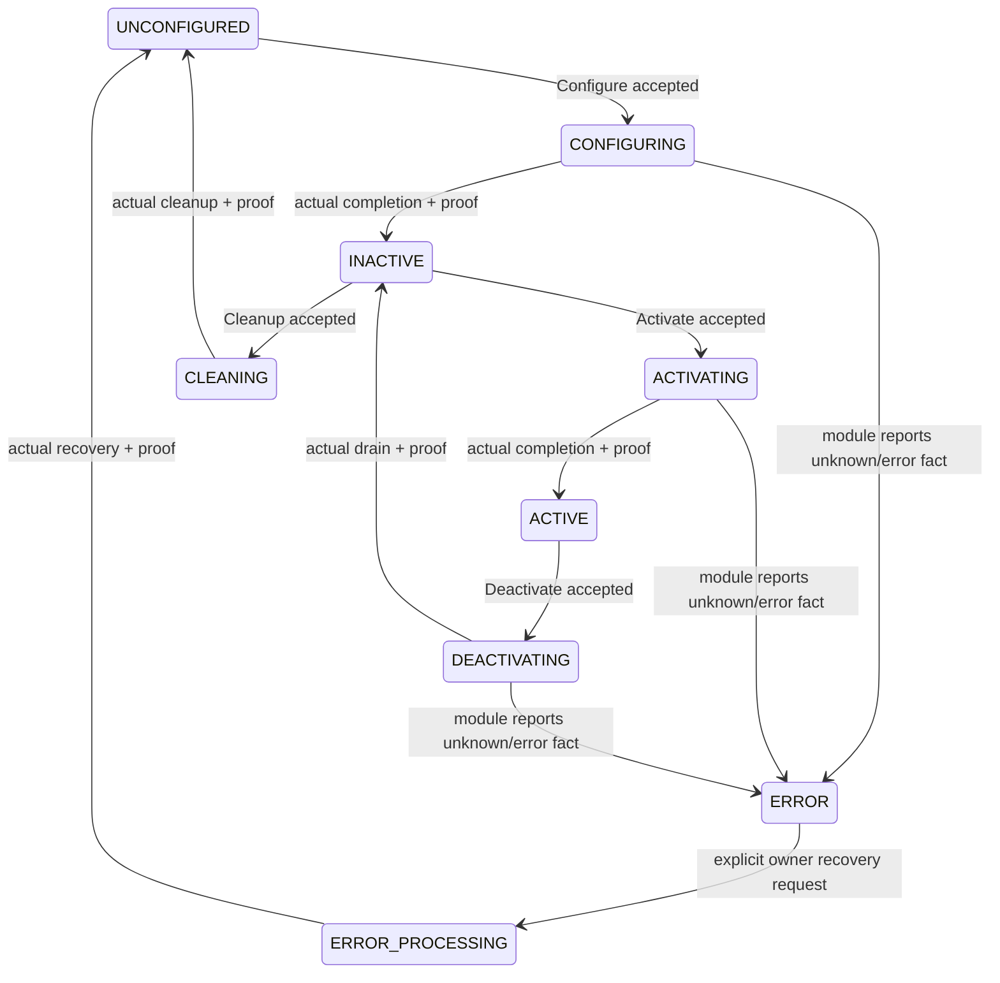

# Phase 3 Execution Manager：实现契约

基线cbabe23；本轮正式授权独立软件实现。Execution Manager内部仍只有Managed Lifecycle和Supervisor两项职责，复用冻结的Lifecycle/、Supervisor/目录。不新增顶层管理器、任务或Frame所有者。本文描述已实现的本地C API，不授权Phase4，不改变现有52B/56B ABI。

## 1. 成熟机制与H7适配

重新读取ROS2 rcl固定提交24eab4efb5043025bc5eac4ef408fa94867b283c：rcl_lifecycle/include/rcl_lifecycle/data_types.h、src/default_state_machine.c、src/rcl_lifecycle.c（完整URL/hash见Tests/V2Phase3/ros_source_evidence.json，与Phase0研究hash一致）。采用稳定/过渡状态、合法转换表、状态机与通知分离思想；没有移植DDS、executor、动态allocator、ROS通信或其同步调用流程。

rcl_lifecycle.c::_trigger_transition先写current_state=transition->goal，再尝试publish notification；发布失败不表示状态事实未发生。H7独立适配为：实际模块完成、资源证明、冻结完成记录、可靠交付消费分别发生，交付错误不撤销事实。H7新增的单owner、单调身份、异步模块端口、超时保留、依赖补偿不是ROS原实现已有的MCU能力。相关ADR不因本轮编码自行标APPROVED。

## 2. Managed Lifecycle状态和唯一权威

LCContext由一个模块owner独占；state是该V2模块的生命周期唯一权威，不覆盖Device、Media、USB_Mode、文件状态或Qualification。UNCONFIGURED=1、INACTIVE=2、ACTIVE=3、ERROR=4；过渡状态为16+operation：17 CONFIGURING、18 ACTIVATING、19 DEACTIVATING、20 CLEANING、21 ERROR_PROCESSING。

失败也可能准确报告原稳定态或目标稳定态；它们经过prove后发布，不能强制把所有失败映射为ERROR或UNCONFIGURED。ERROR不代表已排空。result保存本操作首个错误，actual_result保存原模块操作结果，fact保存证明后的稳定事实。操作超时后实际成功仍可fact=目标且result=TIMEOUT；不能把它改回成功。每个后继请求开始新的操作错误记录，之前冻结回复必须已确认交付；跨计划历史审计由调用方保存。Supervisor另有全计划first_error。

## 3. 身份与API

V2ExecId={execution session,monotonic request,module,operation}，独立于G/R/H、原Camera session和Replay编号。session由唯一装配者一次性供应，要求无旧运行消息可复用；同模块只允许一个发行者，跨计划request单调不回绕。本库无Init覆盖、Reset、清高水位接口，耗尽拒绝。不同完整身份不能匹配回复；同编号不同正文拒绝；单条已消费回复保留至合法更大请求接替，旧编号之后拒绝。它是模块命令完成缓存，不重新实现/替代C2.1.1资格Replay。

| API | 调用者/副作用 |
|---|---|
| LC_Init | bootstrap模块owner，一次性零初始化对象，绑定const Ops |
| LC_Request | 模块owner受理完整命令；expected必须等于真实稳定态，合法转换后登记过渡态；不调用硬件 |
| LC_Process | 模块owner每轮推进；can_begin→begin最多一次受理，随后等异步Complete与prove；无同步等待 |
| LC_Complete | 模块owner在Ops回调之外交付真实结果，完整身份/事实校验；重复相同结果幂等，冲突拒绝 |
| LC_Read | 模块owner只读匹配的冻结完成，缺失时out不变；不是跨任务裸读接口 |
| LC_Confirm | 模块owner确认可靠交付已消费完整完成，释放下一命令准入，不释放Frame |
| LC_Seal | 永久拒绝本Context今后的Configure/Activate，不撤销已受理动作；不释放资源、不重置状态 |
| LC_Status | owner只读生命周期事实及本操作首错，不采样/修改硬件 |

普通Deactivate/Cleanup不自动Seal，允许资源安全后的正常重启；Seal不是Resource L_close，也不能代替Grant关闭。操作已受理仍不能被新请求覆盖。所有对象、指针、输出、上下文需有有效且互不重叠的C存储，端口/描述符有效期覆盖Context；公开布局仅用于静态分配，不授权外部改字段。

## 4. Ops与真实操作边界

V2Registry原来的struct V2LifecycleOps前向声明现在绑定实际is_owner/can_begin/begin/prove函数表，未改Registry字段/大小。is_owner必须识别合法任务且禁止ISR；can_begin纯检查格式/资格/旧资源退休等真实前提；begin只登记或提交动作；prove纯检查报告事实的完成门禁。

begin返回0仅表示提交，后续必须LC_Complete。BUSY/NO_RESOURCE均是未提交无副作用，可以用原身份重试；其他错误也必须是未提交无副作用。若原驱动开始后部分失败，适配器必须先按“已受理”保留身份，再异步报告失败与真实fact，不能以begin IO假装没发生操作。can_begin/prove不释放资源，资源证明必须通过Resource与原owner；ACTIVE事实不要求无Frame，而Deactivate/Cleanup事实必须满足该模块退出契约。证明必须稳定关闭相关入口，不能把瞬时busy=0作为证明。

prove BUSY/NO_RESOURCE不终结；其他证明错误冻结首错并保留DECIDED事实继续只读核验，不重执行动作。失败fact=ERROR可以发布错误事实，但不表明资源退出。原Resource的BLOCKED无强制恢复接口，本层不会清它。回调禁止重入/阻塞；busy只检测owner内重入，不是FreeRTOS互斥锁。跨任务必须由消息适配器交付，不能共享Context裸读。

## 5. 超时与交付

时间为调用方单调uint32 tick，timeout在1..INT32_MAX，同一次未完成动作两次观察不能间隔一个完整计数周期。unsigned elapsed支持一次wrap，不是持久化时钟。未dispatch超时不再调用begin，报告原稳定事实；已dispatch超时继续保留在途身份，不伪造终结、不强制释放，允许之后真实完成。超时并不提供安全强制取消。

LC完成可读→运输入队→对端消费→LC_Confirm是三个不同事件。模拟器把这些分开测试；生产运输适配未实现。LC_Confirm返回0本身不能证明真实对端已消费。端口必须提交真实消费证据，客户端断线不能代替。没有新增平行Frame ACK协议。

## 6. Supervisor计划

EM_BuildPlan是纯函数：以不可变Composition Candidate及模块owner提供的稳定snapshot计算，重用V2Resolver复核整个已选依赖与顺序。Candidate还必须覆盖snapshot中所有非UNCONFIGURED模块，防止隐藏仍在使用Provider的消费者；本轮不实现Phase8增量live/target协调。输出只包含模块/操作/expected，不包含Frame或资源账本，不等于候选配置已应用。配置快照仍由Composition所有；端口必须把本次计划绑定到那个不可变配置，不得在计划期间偷换配置。Graph Validation由Phase1负责，candidate_only不是防伪签名，调用者必须提供真实校验来源。

START：拓扑序Configure未配置模块，再拓扑序Activate未激活模块。STOP：子集逆依赖Deactivate，可选再逆依赖Cleanup。子集外仍配置/运行的依赖者固定其Provider；不能只停Camera而保留USB依赖。USB-only/Storage-only STOP只触及声明子集。已ACTIVE模块去重，不重复Activate；新增模块靠描述符、Lifecycle Ops和运输Endpoint，不修改核心业务分支。

EM_Load复制计划，IDLE/DONE才可装载；active/blocked计划不被覆盖。没有任意图重配、Frame释放或配置提交接口。每轮EM_Process最多一次submit/read/consume端口动作；无递归、忙等和跨任务同步等待。模块owner继续独立Process，包括故障排空。EM_Status只读计划状态、首错及补偿错误。

Endpoint submit=0表示可靠受理；队列满不递增身份重发新请求。read必须返回完整匹配冻结结果；consume确认消费而非业务完成。read异常/身份冲突或consume非背压错误进入BLOCKED，保留事实；不得偷偷补偿未确认的交付。正常BUSY/NO_RESOURCE背压可重复原请求。Endpoint是消息适配，不授权Supervisor调用模块私有硬件函数。

## 7. 有界补偿与失败

计划状态IDLE→RUNNING→DONE；启动失败可进入COMPENSATING→DONE或BLOCKED。STOP失败进入BLOCKED，不继续停Provider。最多32正向步骤与32逆向记录；每个已证明发生的Configure用Cleanup补偿，Activate用Deactivate补偿，严格逆序且每条最多一次受理。既有ACTIVE/INACTIVE状态不会被当成本计划新创建资源而撤销。

失败但真实fact已达目标也记录对应补偿；失败且fact仍原态不伪造动作；fact=ERROR表示未知部分状态，阻塞自动补偿，避免停止仍被依赖的Provider。补偿本身失败立即BLOCKED，读到业务失败的当轮即冻结first_error，不等待消费确认，防止后续运输超时覆盖它；first_error仍是原失败，recovery_error单独保留。超时在途先等待真实结果，不能先撤销Provider；之后依据实际fact决定补偿。DONE可以携带失败，必须读取first_error，不能把DONE当业务成功。BLOCKED没有强行Reset/恢复API；后续模块owner的显式恢复与运输恢复要单独审核。

LC_Process/EM_Process返回SYS_OK只表示该轮推进或无工作；操作/计划成功必须分别读取LC_Read的冻结result、EM_Status的first_error。模块失败状态和Process调用结果不能互相替代。ACK消费与资源退出也不因此等同。
