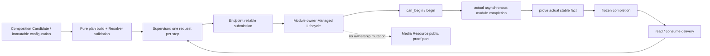

# Application V2 Phase 3 — Execution Manager软件基础交付

输入cbabe23e28325e9fa37821951387ce6763f6db5c；研究分支codex/architecture-media-graph-lifecycle；实际目录D:/32/STM32H7/h7_mac。本轮正式授权Phase3独立软件实现，未改五核心和Phase0～10路线，未进入Phase4。

## 工作包与生产代码

| 提交 | 内容 |
|---|---|
| fae7a40 | Lifecycle/managed_lifecycle.c/.h：合法状态转换、owner Ops、异步完成、完整身份、操作前资源门禁/完成后证明、超时保留与交付消费 |
| 662aa58 | Supervisor/execution_plan.c、execution_manager.c/.h：Resolver复核、声明式计划、异步端口、事实补偿与首错 |
| 21ad1b5 | 消费确认非背压错误保留现场，阻塞补偿未知交付 |
| 6aca9ef | Candidate必须覆盖所有当前非UNCONFIGURED模块，不能隐藏活动依赖者 |
| 69415e0 | 读到业务失败即冻结首错，不被后续消费运输超时覆盖 |
| 最终验收提交 | Tests/V2Phase3、接口/预算/测试报告及Phase4门禁 |

没有Camera/USB/Storage专用业务分支。描述符/能力/端点声明驱动计划，最多16模块、32步骤；不需要给Supervisor增加模块ID判断。Phase1 Core/Registry/Resolver/Graph/Format/Composition与Phase2 Resource源码不变；Registry原Lifecycle Ops前向声明现在有具体实现，未改变描述符ABI。

## 状态、结果及恢复

[接口契约](ExecutionManager_InterfaceContract.md)给出全部API、状态图、身份和端口条件。各模块唯一LCContext管理运行事实；Supervisor只拥有计划、步骤、完整请求、冻结完成和补偿记录，不建第二份业务running/stopping或物理账本。稳态/过渡态与资源所有权分离。

Request accepted不是完成；实际Complete、只读prove成功、完成记录可靠交付消费分别确认。can_begin阻止旧资源未退休时开始新动作。已dispatch超时保留身份和过渡态，等待真实完成；无强制Clear/Reset。失败后只对本计划已证明改变的步骤逆序补偿；未知ERROR阻塞，补偿失败保留原first_error并另存recovery_error。DONE仍可带原始失败，必须读结果。

计划不是运行配置提交。纯Graph不持Frame；Resource不决定业务拓扑；模块Ops负责合法owner上下文的真实动作；Supervisor无HAL/DCMI/USB/SDMMC依赖。原Camera、USB、Storage任务未被接管，BOOT未切换。

## 验证结果与交付边界

[专项报告](Phase3_TestReport.md)：79 ID×O0/O2=158/158 PASS，负对照8/8有效；Phase1 250、Resource112、Replay648、ABI2、C1 419、C1.1 24均通过。不同集合分开报告，不累计为硬件验收。

[资源预算](Phase3_ResourceBudget.md)：ARM目标LCContext112B、EMContext1212B、EMPlan392B；新生产库全局RW/ZI=0，实例由调用者持有；真实ROM与链接/运行栈报告已保存。间接回调栈与实测WCET未知，未调整任务栈/优先级。

原Keil完整CM7/CM4均0 Error、0 Warning；隔离源快照叠加原工程字节和本轮V2源码，未改原工程。因为旧Target未登记V2，新模块实际编译/链接/执行由独立ARMCC5 O0/O2目标证明；不能据旧镜像声称新启动流程通过。AXF/MAP/HTM/HEX和SHA256保留output，文本日志/输入hash随Evidence提交。

真实模块/运输适配、实际DMA/Frame退出与硬件故障仍NOT_RUN；Grant→Frame Lease和Stable Admission Closure两个NOT_PROVEN保持。未发现需要修改Resource来使本阶段测试通过的缺口；具体Backend/ACK消费证明缺失仍按原Phase2适配门禁安全阻塞。

## Phase4前置条件

见[Camera Module接入门禁](Phase4_CameraModule_AdmissionGate.md)：真实owner绑定、不可变配置来源、原普通Stop唯一推进入口、保护性Stop、G/R/M/ACK/DMA证明、现有52B/56B运输适配、真实栈及故障验收均需单独授权。不能把LC状态当资源释放证明。

## Git与保护范围

仅新增Lifecycle、Supervisor、Tests/V2Phase3和Docs/Architecture/V2/Phase3。Legacy、Media、BSP、Replay、Phase1/2、旧测试和M4源码无改动；用户uvprojx/uvoptx已有修改的开始/结束hash相同，原output保留。main不动，不合并，不自动进入Phase4。完整Diff在output/V2Phase3/Phase3_Full.diff，提交后正常推送并单独核对远端SHA；网络失败不虚报成功。
