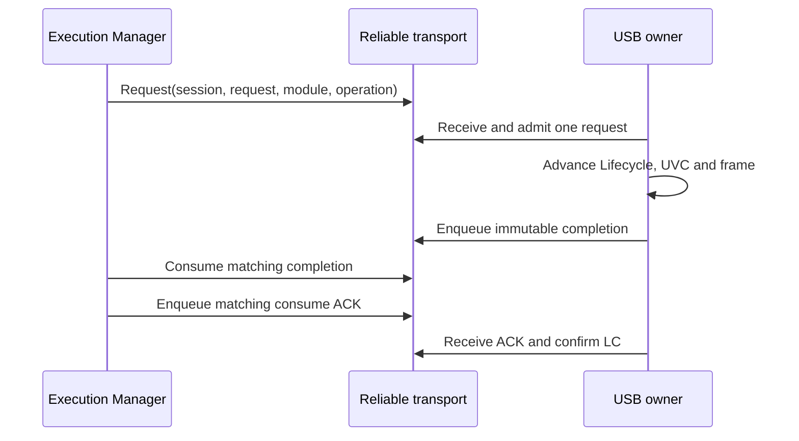
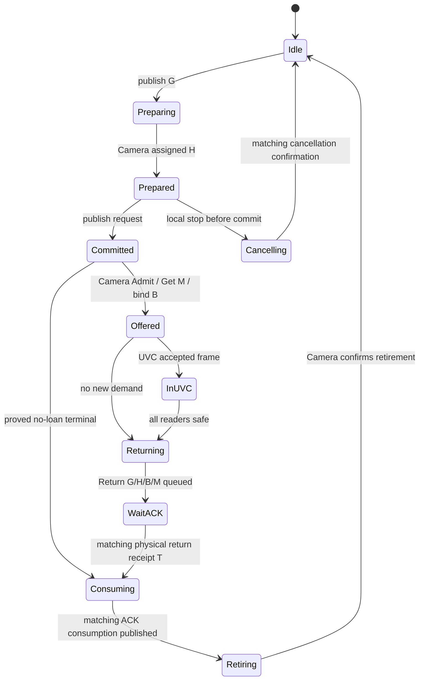

# Phase 5 USB Module 接口契约

## 执行和事实来源

- USB owner 调用 `VUSB_BindCandidate`、`VUSB_Request`、`VUSB_RunRound` 和查询接口。产品接入时，Endpoint 和直接请求接口只能选一个命令入口。所有 Context 初次使用前清零，Ops 和端口在 Context 生命周期内保持有效。busy 防同所有者重入。跨任务同步由实际队列承担。
- Configure 绑定所选 Composition Candidate 的中立格式和 UVC delivery rate。Camera 格式转换复用 Phase 4，UVC 验证复用 `USB_UVC_ValidateFSConfig`。Configure 无硬件动作，派生的 VideoStreamConfig 在激活及停止期间冻结。协商不得重配采集。
- UVC Activate 先通过旧 C1/C2 通道完成 QUERY、ACQUIRE，再提交 USB 启动。start 返回 OK 后继续观察 MODE_STARTED 和 CLASS_READY。交付帧还要求 HOST_CONFIGURED、CAN_SUBMIT 及有效 grant。Reset、Disconnect、Suspend 影响传输条件，不触发 RELEASE。TEST 和 NONE 不申请 Camera。NONE 无 USB 开关硬件。
- Deactivate 命令受理即退出 LC_ACTIVE，先关闭新帧需求。USB 轮次依次推进 mode、Cancel、UVC、Frame、再次 UVC、观测及 Stop。Cancel 返回成功或 BUSY 均不构成读者排空证明。硬错误完成原命令的 ERROR 回执，排空意图继续有效。
- `VUSB_QueryExitEvidence` 仅由 USB owner 读取本地停止证据，需要匹配当前 G、Stop 已调用或有明确冷态，以及 UVC owned、所有原帧读者、Bridge、交接退休均已核验。最终资格回复由 Camera owner 调用 Phase 4 退出检查，依据同一原 G 和独立 R。
- USB 自身 STOP 成功需要本地真实停止以及匹配的 RELEASE 成功回复；Camera STOP_IF_IDLE 单独推进，BUSY 或等待回复不延迟已安全退出的 USB STOP。原 Tx 未消费全局回复时，重启或 Cleanup 仍等待事务退休。Cleanup 和 ErrorProcessing 都在资源门禁后运行，保留最近失败事实，不重建 Context。
- 同一个 STOP 的首错与后续恢复分别记录。恢复后的合法成功 START 清除 active_fault。first_fault 及已投递操作结果仍保留。ID23 在在途执行窗口提交新 START 返回有界 BUSY，ID31 安全退出前拒绝重启的映射及真正成功启动后的诊断复位只通过 V2 接口软件验收。Legacy AppMessage ACK/FAULT 的最终映射仍待集成。

## Endpoint

Supervisor owner 的 `VUSBClient_Endpoint()` 将独立 Context 导出为 EMEndpoint。USB owner 推进 `VUSBEndpoint_RunRound()`。队列复制的是执行请求、终结回复和消费确认。通知是唤醒提示，集成任务需在积压时重新自唤醒或由有界周期继续轮询。

传输 full/BUSY 必须表示当前调用未提交。请求尚未成功入队时允许同一身份重试，成功后相同文档的重复请求幂等。接收方以业务模块、session、单调 request 核验。同一个窗口完整匹配 operation 及回复内容；晚到的旧回复或 ACK 只丢弃，不推进当前窗口。终结回复在 USB owner 收到匹配消费确认前不退休。执行回复与 Camera 资格回复、帧 Return ACK 分属不同通道。

## 帧交接

一次只推进一个 USB 交接，USB owner 保存本地进度。Camera owner 承担实际 MR/媒体调用。物理 Backend 归属由 Raw 固定池或 JPEG FIFO 决定。

`VUSBFrameOps` 的提交、取消、Offer、归还及消费确认均以不可变身份绑定。Camera 要先 Get 一次，再分配并绑定 B，未取得帧仍可由 Camera 提交无持有终结。提交 UVC 返回非 OK 时端口必须保证未转移帧。提交后直到回调证明异步 CPU 和 DMA 均不再读取原帧才归还。旧 H/B/M 或错误 Terminal Receipt 不能退休当前交接。不可核验的匹配消息进入安全阻塞，不强制释放。USB 和 Storage 的真实引用由同一个物理 Backend 追踪。
