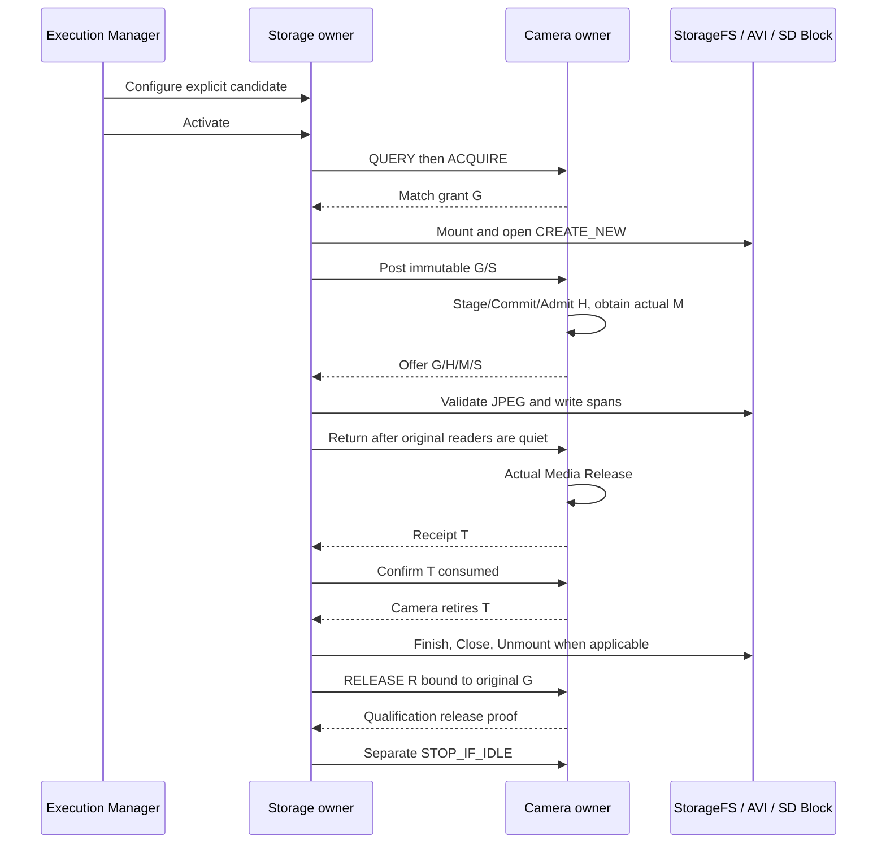

# Phase 6 Storage Module 实施报告

输入 `aea46f2`，按 Frozen Roadmap Phase 6 实施。生产源码全部在 `CM7/ApplicationV2/Modules/Storage`。未为已验收模块增添选项或改写接口。

| 文件 | 职责 |
| --- | --- |
| storage_format.c/.h | 中立 JPEG 格式、AVI/抓拍能力、8.3 CREATE_NEW 目标、采样间隔校验 |
| storage_module.c/.h | Configure / Activate / Deactivate / Cleanup / ErrorProcessing，协调帧和文件 |
| storage_endpoint.c/.h | 公开 EMEndpoint，Supervisor 与 Storage 分别持有运输 Context |
| storage_consumer.c/.h | 复用 C1/C2 Tx、QUERY、ACQUIRE、独立 R、RELEASE 和 STOP_IF_IDLE |
| storage_frame.c/.h | 单 S 槽、信用消息、Offer/Return、T 消费和退休 |
| storage_backend.c/.h | 复用 StorageFS、MjpegAvi、JpegFrame、SD Block 的 owner-local 端口 |

## Camera → Storage

真实 Composition 选定 JPEG Pipeline、Storage Sink 和采样率。Storage 校验所选模块及 sink，绑定不可变配置，复用 Phase 4 的格式验证；能力配置的 payload、AVI fps 上限必须来自集成目标的既有约束。AVI 服务仍执行自己的硬限制。Source Capture Rate、USB Delivery Rate、Storage Sampling Rate 独立，采样间隔无实测吞吐含义。真实 EM_BuildPlan 的依赖顺序先准备 Camera Provider。只停 Storage 的计划不包含 Camera；仍有其依赖者时不能单独停止 Provider。

## 停止、故障与运输

Deactivate 关闭本地新需求，已提交的 G/S 需要匹配终结，Camera 已准入帧可以排空。没成功提交的 S 可本地取消，代次不回退。有在途 Offer、未确认 DMA、未归还 M 或已入队未消费 T 时不撤销资格。Cam owner 必须继续推进 Camera 回合并独立核验 R 和 G。Storage 本地查询只提供局部证据。

录像在排空后调用真实 AVI Finish，然后 Close、Unmount。抓拍写双 Span、Sync、关闭并重新打开、检查长度和内容 CRC/字节，再关闭。两者使用原文件句柄和静态 AVI 索引。Finish/Close/Unmount 的状态各自记录。发生文件故障但帧和 IO 已安全排空时，允许按原协议释放 Camera 资格，同时保留文件失败、打开句柄或卷占用。显式 ErrorProcessing 调用现有 StorageFS_Recover，不能伪造已保存文件。失败后仍保留首错，运输满不改写业务结果。后台恢复是否已真实释放与原命令结果分离。

每轮模块最多推进一个本地帧槽，文件系统由 Storage owner 同步调用。单操作内部 JPEG/AVI/FatFS 读取与等待可能耗时，绝对延迟需实测。配置不自动创建任务、队列或接入 BOOT。跨任务只经复制队列，通知仅唤醒提示。执行完成入队、对端消费确认、资格回复、帧 Return ACK 的身份和所有权分开。超时不丢失在途身份或清理资源。

独立模块每轮一条帧槽、每次激活一个显式文件，抓拍自动排空一次，Lifecycle 稳定转换由原协调入口提交。自动分段轮转和旧文件名递增须在 Legacy 适配时承接，当前不以此报告宣称替代旧业务。
