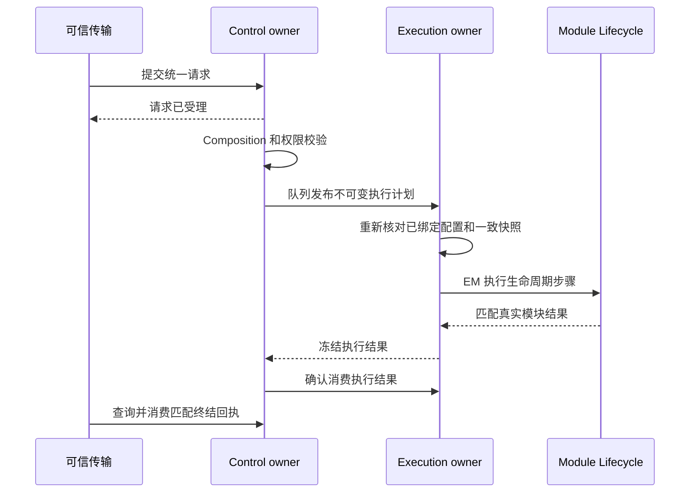

# Phase 7 Control Service 实施报告

输入为已审核并与 GitHub 一致的 Phase 6 `6b1a835`。Phase 5 `aea46f2` 是其祖先。既有五核心和冻结 Phase 0～10 保持。新增生产文件位于 `CM7/ApplicationV2/Core/Runtime`。

| 文件 | 职责 |
| --- | --- |
| control_service.c/.h | 统一请求、认证连接绑定、权限校验、有限结果、去重及 Composition/Execution 协调 |
| control_transport.c/.h | 各传输使用同一 typed 值入口，按本端交换号可靠回送 |
| control_execution.c/.h | Execution owner 核对同一配置/模块状态快照，调用既有 EM_Load / EM_Process |
| control_execution_link.c/.h | Control/Execution 两端复制工作、冻结结果与消费确认，保留队列背压 |

## 命令和权限

- `CS_VALIDATE` 对受信任目录中的 profile 运行真实 Composition，完成效果为 CANDIDATE。不能发布为硬件配置已应用。
- `CS_START` / `CS_STOP` 仅接受已绑定 profile 和匹配 revision。计划使用真实 EM_BuildPlan。STOP 显式给出 Registry 位图及可选 Cleanup，依赖者仍活动时保留 Provider。Execution owner 装载前再核对完整快照。带新格式重新绑定、重配置、Applied revision 写事务归 Phase 8。
- 入口提供从可信适配端提取的 `{transport, principal, client}`。Control 独立检查连接、命令、所涉模块、Lifecycle 步骤及 START 的可能补偿。实际角色映射由受审的授权 port 注入。M4 IPC、USB、BLE、Wi-Fi、Ethernet 各自发起身份绑定，使用同一个业务协调者。
- `{boot, session, sequence, ticket}` 是控制请求身份。它与 Lifecycle ID、相机资格和帧身份独立。boot 必须来自可信启动会话，当前库不生成持久化身份。计数饱和后拒绝分配。
- 一个活动请求、8 连接槽、4 结果记录。完整请求相同则返回原进度，不重新执行。较旧序号或跳过的序号在缓存淘汰后仍拒绝。只有客户端确认消费后的终结记录可淘汰，满时返回背压。关闭会话需要完成该会话的结果消费，传输断开本身不取消在途动作。

## 异步完成

执行计划一旦提交，取消返回 BUSY，超时只冻结首错并继续等待。已完成的执行结果在 Control 消费确认排队后可供客户端查询，Execution owner 可在自己的后续轮次消费该确认。EM_BLOCKED 保留业务首错和独立补偿错误，拒绝新 START/STOP。运输失败不会代替 Lifecycle 或 Media 释放。明确的接收端拒绝标为 REFUSED，保留错误和未执行事实。

所有公开接口以 owner 串行调用，busy 只拦同 owner 重入。进度调用只处理有限本地操作。没有定时器、动态存储、活动任务或原工程入口变更。IPC V3 能力审计和真实适配见 [Legacy 适配计划](Phase7_LegacyAdaptationPlan.md)。
