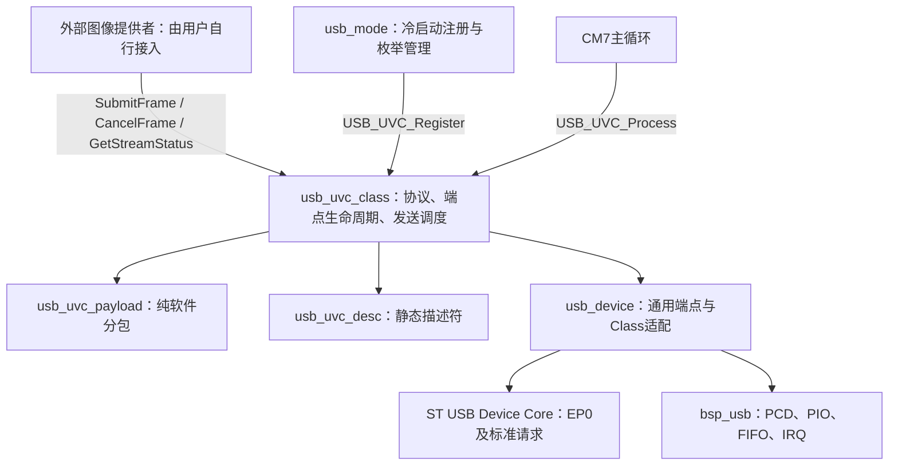
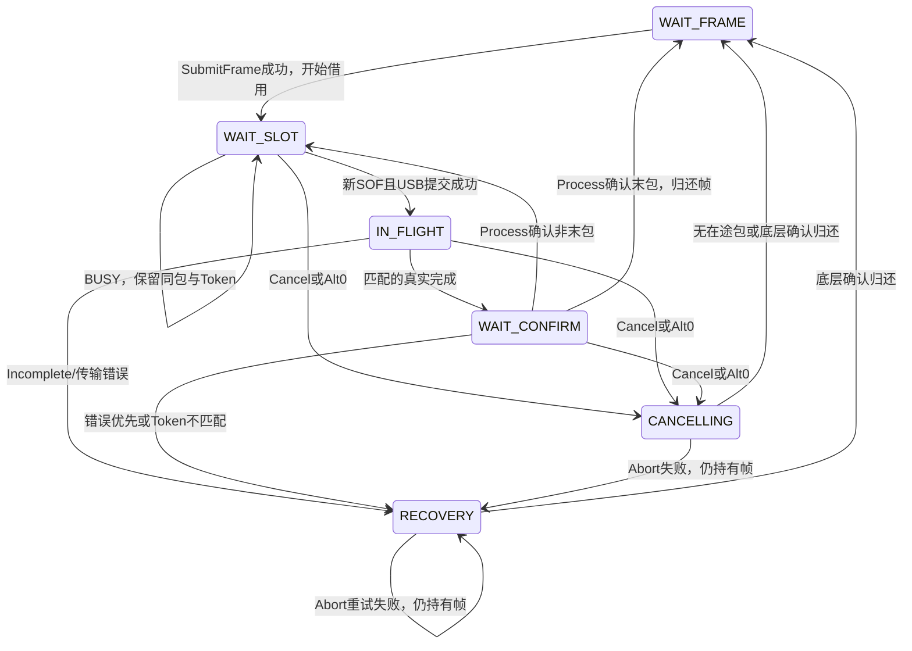

> M4追加同步：按用户后续要求，主线M4同步为UVC-10A当前工作树版本（含已有OLED强制全亮调试），主线不同的OLED本地版本已先备份。此项独立于USB移植，不是相机/UVC桥接。

> 主线USB移植说明（2026-11-02）：按用户确认，main保留当前Application，不新增app_uvc_test.c/.h或静态彩条。下文09C/10A分支内容保留为设计来源；main仅迁入USB模块、GET_CUR兼容修复及相关测试。main默认USB仍为TEST，USB专用冷启动选项改名为USB_MODE_BOOT_UVC（默认0，置1仅注册UVC，不切换Application也不生成图像）。主线验收范围为原621次USB回归＋14项契约，共635次；09C的24项Application彩条测试不移植。主线结果以Tests/UvcUsbCleanup/verification_report.md为准。

# UVC-10A USB接口设计与模块边界

日期：2026-11-02。主线移植基线main `3367401`，USB来源为UVC-10A `0ecf94a`。按用户确认保留主线Application，不迁入09C静态彩条；保留GET_CUR兼容性修复。这里描述USB接口契约，不提供Camera/Media桥接实现。

## 1. 基线保护和本轮范围

建分支前核对原09C工作树：`usb_uvc_class.c`存在初始GET_CUR兼容修复；OLED及Keil工程也有未提交改动。只将UVC Class原文件复制到新工作树，保留修复，不复制OLED、调试断点和用户Keil配置改动。原工作树保持原样。

本轮整理：公开API置于内部实现之前，内部函数提前声明；使用固定视频能力的命名常量替代传输接口中的重复字面量；补充简短中文职责、状态和所有权注释。API名称、状态枚举数值、结构字段、调度顺序、临界区以及硬件操作顺序保持不变。

Payload算法和描述符字节不改；USB Mode只修正说明文字，不改状态机。BSP、Platform、HAL/LL、官方Core、Camera、OV5640、DCMI、DMA、SDRAM、Media、Application均不在USB整理范围。CM4按用户追加要求另行与10A当前工作树同步，详见验收报告。主线不新增静态彩条Application，TEST/UVC均不分配38400B彩条缓冲区；可运行的彩条回归基线保留在09C和10A开发分支。

## 2. 模块架构



|文件|职责|不承担的工作|
|---|---|---|
|usb_uvc.h|唯一业务侧UVC API、状态快照与使用约定|不暴露Class句柄、HAL对象或摄像头对象|
|usb_uvc_class.c|Probe/Commit、接口Alt、EP1生命周期、单帧异步调度、借用与取消|不产生图像、不初始化传感器、不管理SDRAM|
|usb_uvc_payload.c/.h|外部只读帧→2B头+图像数据；Token确认、FID/EOF、取消|不访问端点、时钟、IRQ、Camera或Media|
|usb_uvc_desc.c/.h|静态设备、配置、语言、功能字符串；有效长度、对齐和PIO尾部|不注册Class、不打开端点、不协商格式|
|usb_mode.c/.h|冷启动选择TEST/UVC、唯一注册、Start、WAIT_CONFIGURED、同模式重连|不把RUNNING等同视频成功，不做图像桥接，不实现跨模式热切换|
|usb_device.c/.h（只审查）|Class注册、端点状态/所有权、标准请求适配、USB IRQ嵌套锁、SOF/完成序号|不决定图像来源，不硬编码UVC业务状态机|
|bsp_usb.c/.h（只审查）|控制器、FIFO、PIO暂存、Abort、实际IRQ事件|不包含UVC能力或Media依赖|

固定能力：UVC 1.1，YUY2，160×120，38400B/帧，帧间隔1000000×100ns=100ms（10FPS），USB FS EP1 IN `0x81`，ISO，最大包长512B。没有JPEG/MJPEG、运行时格式热切换或PTS/SCR发送。

## 3. 调用环境与并发边界

5个公开API由CM7启动流程或主循环串行调用。`Register`用于Core初始化后、USB Start之前；其余接口不得从摄像头/DMA/USB ISR调用。提交长度、指针无效时可能先返回参数错误，不能把返回码当作IRQ检测接口。

Class内部DataIn、SOF、Incomplete由USB IRQ触发，仅记录匹配事件，不在这些回调中构包或阻塞等待。主循环通过现有`USB_Device_Lock/Unlock`屏蔽并恢复USB IRQ，与内部回调串行访问Payload。锁不等于暂停其他DMA硬件，外部图像提供者仍必须保证源图像不会被覆盖。

SET_INTERFACE、Reset、Disconnect、DeInit可能从USB生命周期IRQ路径进入，沿用既有同步Close/Abort路径；HAL中存在有限轮询。本轮没有把整个USB IRQ描述为完全无等待。禁止在USB回调中进行相机处理、printf或长时间业务操作。

## 4. 对外API契约

### USB_UVC_Register()

```c
SysResult_t USB_UVC_Register(void);
```

启动流程调用，只向通用Core登记Class操作表和描述符。Core必须先完成Init，USB尚未Start，不能替换活动Class。返回Core注册结果；SYS_OK不等于主机已枚举。Class上下文在SET_CONFIGURATION时才从`USBD_malloc`申请，该宏映射到1024B固定池，不使用标准malloc。Mode Manager已有注册时不重复覆盖。

### USB_UVC_SubmitFrame(frame, length)

```c
SysResult_t USB_UVC_SubmitFrame(const uint8_t *frame, uint32_t length);
```

主循环调用。frame指向完整、连续、CPU可读的YUY2图像，顺序为Y0 U Y1 V，每行320B；length必须38400B。当前PIO由CPU复制每包图像，Submit不复制整帧。地址必须有效且不溢出，不得覆盖UVC分包对象。Payload支持非对齐输入，不把4字节对齐作为外部源帧的额外要求；内部发送包有自己的PIO对齐和尾部补齐。

|结果|意义|调用者对新帧的所有权|
|---|---|---|
|SYS_OK|接受借用，等待SOF与真实完成|保持图像存活且只读，不能释放、覆盖或让DMA复用|
|SYS_ERR_BUSY|已有帧或尚在取消恢复|新传入帧未被接受；先前已借出的帧仍按状态查询管理|
|SYS_ERR_INVALID_STATE|未Configured、无Commit、非Alt1、关闭失败、无Class或非法调用环境|未接受新帧，不等于先前的帧已经归还|
|SYS_ERR_INVALID_ARG|NULL、长度错误、地址/内存重叠非法|未接受新帧|

**SYS_OK只代表借用成功，不代表构包完成、USB发送完成或主机已经显示。** 只允许一帧在途。`can_submit`是一次快照，不能保证随后Submit一定成功；生命周期IRQ可以改变就绪条件，必须检查Submit实际返回值。

### USB_UVC_CancelFrame()

```c
SysResult_t USB_UVC_CancelFrame(void);
```

主循环登记取消。已有活动Class且无帧时可幂等成功；没有Class或非法调用环境返回INVALID_STATE。SYS_OK只表示请求已记录：继续调用Process，让底层确认Abort和资源归还，不能立即释放图像。Cancel不代表Reset、USB Stop或关闭Alt1；端点可能仍打开。

### USB_UVC_GetStreamStatus(status)

```c
SysResult_t USB_UVC_GetStreamStatus(UsbUvcStreamStatus_t *status);
```

主循环传入独立、有效的可写输出对象，不得把输出对象放进被借用的图像。NULL返回INVALID_ARG。SYS_OK时获得USB临界区内的一致快照：

|字段|解释|
|---|---|
|state|WAIT_FRAME、WAIT_SLOT、IN_FLIGHT、WAIT_CONFIRM、CANCELLING或RECOVERY|
|result|最近调度错误；与本次查询返回值分开，归还帧不必清除历史错误|
|frame_offset|已经真实完成并确认的图像字节，不含UVC头；归还帧后可回到0|
|token|内部当前包标识，不是图像Handle，不用于访问外部图像|
|completed_frames|当前Class生命周期确认成功的整帧数，Reset重建Class后会清零|
|frame_owned|true表示仍借用图像，即使当前已经报错也不能释放|
|can_submit|Configured、有效Commit、Alt1、无关闭故障、WAIT_FRAME且无旧帧借用|

有效快照`frame_owned=false`表示UVC已经归还外部图像，但不保证主机显示成功。`state=WAIT_FRAME`本身不保证Commit/Alt1已经就绪。

查询失败时输出不更新，不能继续读取上次快照。INVALID_STATE有两个来源：非法IRQ环境或没有活动Class。**在调用者已经保证主循环环境、输出指针有效的前提下，INVALID_STATE表示没有活动Class。** 当前Class只有确认停止、归还图像后才销毁；Close/Abort失败会保留上下文，并使查询继续返回SYS_OK且frame_owned=true。因此合法主循环观察到Class消失时，可以按“生命周期已结束”处理原借用。不得把IRQ中的同名错误或未经检查的任意失败套用为归还依据。

### USB_UVC_Process()

```c
void USB_UVC_Process(void);
```

主循环持续调用。取消和恢复优先；其次确认真实完成，最后消耗最新SOF机会构包和提交。一次SOF最多一次提交机会，不累计无限额度。Build成功、Transmit成功和真实完成是三个不同阶段。只有匹配Token及底层完成序号的真实完成才能推进偏移；ISO Incomplete不是成功。

Process不产生图像、不调用Media、不因没有图像而自动生成假帧。没有Class时安静返回。IRQ中调用直接返回。若主循环被长时间业务阻塞，可能错过1ms发送机会；接口不能保证在任意主循环负载下达到10FPS。

## 5. 控制协商到帧归还

```text
Core Init → 注册UVC → USB Start → 主机枚举/SET_CONFIGURATION
  → 初始Probe GET_CUR（返回默认能力，不授权）
  → Probe SET_CUR → 完整Probe GET_CUR成功完成
  → Commit SET_CUR匹配已确认的Probe
  → VS SET_INTERFACE Alt1成功打开EP1
  → 主循环SubmitFrame成功借用外部帧
  → SOF机会 → BuildPacket → USB提交 → 真实完成IRQ
  → Process确认Token/序号 → 下一包
  → 末包真实完成并确认 → completed_frames++ → 图像归还
```

成功抓包`STM32H747_UVC_BlackScreen_ok.pcapng`（外部原始文件保留，未复制进仓库）已在本轮直接核对：设备15，2726/2727帧初始Probe GET_CUR 34B及响应成功；随后2728/2729 SET_CUR、2730/2731 GET_CUR、2732–2735 GET_MAX/MIN、2738–2741第二轮SET/GET、2742/2743 Commit SET_CUR、2744/2745 Alt1成功。这里初始命令是GET_CUR，不是GET_DEF；尚未协商时由设备提供默认值。

初始GET_CUR兼容修复必须保留：没有有效Probe/Commit时返回默认结构，按主机wLength截断。完整读取初始默认值不设置probe_valid、probe_observed、commit_valid或probe_reply_pending；只有真实有效Probe的完整GET_CUR完成才授权后续Commit。失败Probe后的默认查询同样不能继承旧授权，但已有有效Commit独立保留。

首次复制本地已实板版本运行全部645次测试，643 PASS/2 FAIL；失败项是旧Probe78“初始CUR拒绝”和83“失败Probe后CUR拒绝”。本轮保留两项编号并将其改为独立核对默认数据、长度、不授权及不覆盖已有Commit。没有删除测试，没有放宽非法Commit、26B SET_CUR、短包或跨请求保护。

## 6. 帧所有权状态机



WAIT_SLOT、IN_FLIGHT、WAIT_CONFIRM、CANCELLING、RECOVERY均可能仍借用外部帧。Build会复制本包最多510B到内部包，但整个外部图像仍按整帧借用管理，不能据frame_offset自行提前复用前半段。

38400B图像分成76包，前75包为512B，末包152B，均含2B头；EOF只在末包，FID在成功帧或已开始帧被确认取消后按原分包规则切换。10FPS是固定协商能力及SOF节奏，不以Application自建Timer保证。

## 7. 生命周期与恢复约定

|事件/操作|USB内部行为|图像提供者约定|
|---|---|---|
|正常整帧完成|真实完成确认后归还、整帧计数增加|查询所有权后再复用，不按Submit返回或固定延时释放|
|Alt0|先停止提交，Close内含Abort/FIFO清理，成功后才发布Alt0|失败时保持帧，等待主机重试Alt0或受控Stop|
|Cancel|登记取消；Process确认Abort或无在途包后归还|继续Process，不在请求返回时回收|
|Incomplete|锁存TIMEOUT/RECOVERY；BSP保留PIO，等待主循环Abort|不把Incomplete或busy=false当作完成|
|提交失败|不推进Payload偏移；错误恢复优先|检查frame_owned，不能根据错误码直接释放旧帧|
|Reset/Disconnect|先走Class清理，成功才销毁上下文|等待归还快照；合法主循环确认Class消失时生命周期已结束|
|Reset/DeInit清理失败|保留上下文和外部帧，禁止假成功释放|查询仍可见所有权；上层由既有USB管理流程受控Stop/重连|
|USB Stop失败|保留仍被使用的对象、端点与引用|不能重用图像；由既有通用Core管理恢复，不绕过Core直接操作BSP|

Mode的RUNNING仅表示主机完成SET_CONFIGURATION，不能当作Commit、Alt1或视频完成。全局设备错误和单次端点操作错误保持分离。已锁存的错误值可能在资源安全归还后仍可读，直到下一帧提交更新；错误与所有权应分别判断。

本轮审查未发现需要改变现有所有权算法的新缺陷。现有36项Streaming、45项EP1、Core生命周期测试继续覆盖Alt0、Reset、Disconnect、Stop、Abort/Close失败、重复和迟到完成；新增契约测试直接验证取消/Incomplete失败持帧、Reset/DeInit失败保持可查询状态、Stop成功后Class消失且帧已归还。

## 8. Media未来如何使用（只说明，不实现）

由用户自行决定Media与Application之间的图像取得/释放策略。USB只接收外部只读地址和长度，不知道Media对象、Framebuffer索引、Camera配置或SDRAM地址。调用者应只有一个图像提交入口，不同时让静态彩条与真实帧争用同一个UVC实例。

用户未来实现的调用流程应遵守：先取得与描述符一致的完整YUY2图像；查询可提交状态；调用Submit并检查返回；成功后持续保留该图像、不允许DMA重新写入；主循环持续Process并查询归还，再由用户自己的图像管理接口处理释放。Submit失败只拒绝新帧，不能擅自归还此前借用的帧。

不得在DMA完成ISR直接调用UVC API。DMA产物的完整帧判定、字节顺序、Cache一致性、SDRAM范围和帧所有权由用户的图像层保证。本轮不添加CameraCapture调用、Media回调、队列、桥接文件、图像复制层或SDRAM常量。

主线USB冷启动选项为`USB_MODE_BOOT_UVC`，默认0保持TEST，置1只注册UVC Class，不改变App_Init/App_Run的相机应用流程。旧的USB_MODE_UVC_TEST_ENABLED彩条开关不迁入主线。没有外部SubmitFrame时，UVC不会自动发送图像；图像提供者由用户自行实现并保证唯一。09C/10A分支保留静态彩条作为独立回归参考。

## 9. 验收和遗留边界

本轮数据以`Tests/UvcUsbCleanup/verification_report.md`及同目录JSON、构建日志为准。主线保留原621次USB回归，另有14项契约专项，共635次。09C的24项Application彩条测试不适用于本次USB-only主线，不移植该套件。实际编译执行ARMCC5 C99代码，Unicorn模拟器仅替代硬件事件和HAL外设行为，未冒充实板重测。

历史实板证据来自用户提供的09D成功抓包及复盘：FFplay静态彩条显示、33帧CRC为FC92082C。本轮整理后的新二进制仍需用户复测Windows开流、连续10分钟、反复开关5次、拔插/Reset恢复和OBS；不把既有实板结果自动套用到新提交。

其他边界：静态固定池1024B、Token和传输序号不允许耗尽后复用；类重建会清零整帧计数；主循环饥饿、SOF丢失、USB时钟和实际ISR延迟仍需硬件观测；TEST/UVC沿用内部实验VID/PID，Windows旧绑定缓存风险仍在；不新增运行时热切换或自动恢复策略。

成功归还表示USB不再读取内存，不证明主机应用已经显示该帧。后续若需要多消费者、帧完成业务通知或图像Handle，须由用户另行设计；不能把内部packet.token当成这些接口。
