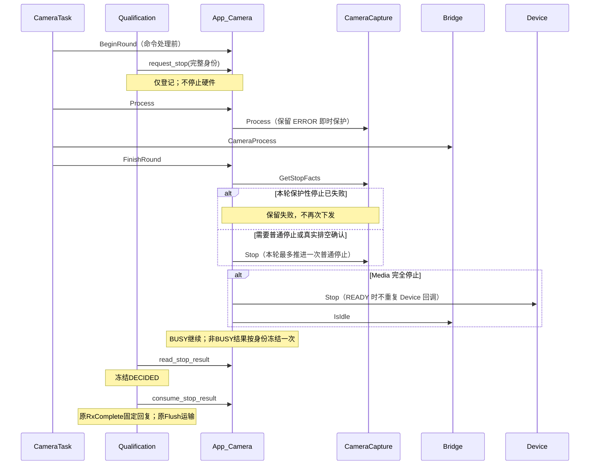

# C2.2A-R2 Camera 停止职责整改报告

日期：2026-11-12。基线：`fa9ce5df130246b685c93ca8bde0d8248c420867`。
分支：`codex/stage-C2-2A-R2-stop-ownership`。依赖 PR #6，R2 单独提 PR，不合并任何 PR。

## 1. 交付结论与验收边界

普通停止已经收敛到 `App_CameraFinishRound()`；Qualification 不再直接停止 Media 或 Device。Media ERROR 即时保护性停止及 START 失败回退仍保留，并通过本轮停止事实避免重复下发。

R2 专项 74/74、原 C2.2A 162/162、C2.1.1 648/648、C1 419/419、C1.1 新增 24/24、回归判定器 29/29 通过。正式 CM7、CM4 全量编译均 0 Error、0 Warning。

**历史回归门禁没有全通过。** 原 B1 严格调用轨迹检查 ID 9、10 仍 FAIL：旧断言要求 START 回退之后再次推进原停止路径，与本轮禁止同轮重复停止的目标存在冲突。原断言未删除、未放宽，也未过滤轨迹获得 PASS。这两项的 baseline_ok、current_ok 均为 true，失败原因是 trace_equal=false。需人工审核接受这个授权行为变化后，另行决定旧轨迹基线如何维护；本轮没有擅自修改其期望。

没有执行实板验收。未接入 USB/Storage 生命周期，不进入 C2.2B，不新增消费者或恢复策略。

## 2. 实际修改范围

| 文件 | 职责 |
| --- | --- |
| CM7/Application/app_camera_qualification.h | 将 stop Ops 拆成 request/read/consume，新增只读请求结果类型 |
| CM7/Application/app_camera_qualification.c | 先读专属结果，冻结 DECIDED 后消费；身份或结果异常进入 BLOCKED |
| CM7/Application/app_camera.c | 保存完整停止身份、真实结果及轮次事实；唯一普通停止协调；保留保护性回退 |
| CM7/Application/app_camera.h | 新增 BeginRound；明确 App_CameraStop 只登记意图 |
| CM7/Application/Tasks/camera_task.c | BOOT 后、处理命令前调用 BeginRound，其他顺序不变 |
| CM7/Media/Inc/camera_capture.h | 12B 只读停止事实接口和状态标志 |
| CM7/Media/Src/camera_capture.c | 记录实际 BSP 停止序号、结果、普通/保护性类别，查询不清理资源 |

测试仅补齐三个原测试桩的依赖/异步调度契约，新增 `Tests/CameraStopOwnershipR2/`。B1 测试场景与断言正文未改；C2.2A 的 CK/VERIFY 表达式核对保留，仅将旧同步适配调用替换为显式轮末调度桩。C1/C1.1/C2.1.1 的生产实现及原测试脚本字节不变。

未修改 USB、Storage、Bridge、Dispatcher、Device、BSP、FIFO、消息协议、工程配置、任务栈和队列容量。`output/` 仍未跟踪；没有清理原输出。正式构建前的产物备份在 `output/CameraStopOwnershipR2/build/previous_output/`。

## 3. 停止请求、结果与提交

| Ops | 输入/结果 | 副作用与限制 |
| --- | --- | --- |
| request_stop | 完整 session/request/consumer/generation | 只绑定身份并设置停止意图；SYS_OK 只表示受理。相同身份幂等，不覆盖不同身份的未消费记录 |
| read_stop_result | 相同完整身份、12B结果副本 | 未绑定返回 NOT_FOUND；未完成 complete=0；身份不符 PROTOCOL。不能用全局 STOPPED 替代 |
| consume_stop_result | 相同完整身份 | Qualification 必须先冻结 DECIDED；只消费已完成记录。异常保留业务事实并进入 BLOCKED |

`STOP_IF_IDLE` 在已有记录时优先读取原请求结果。新请求仍须满足原资格/idle 证据门控。UNSTARTED 分支不初始化传感器、不下发 Stop、不声明 HARDWARE_STOPPED；已有 STOPPED_CONFIRMED 分支沿用真实历史停止事实。

完成结果冻结一次。请求返回失败后，后台停止后来成功，不会把原请求失败改为成功。重复请求和回复固定仍完全交给原 Rx/Replay。RxComplete BUSY 保留 DECIDED，并沿用原窗口复核；它不是回复队列背压，不重做硬件效果、不重建或清空 Replay。RxFlushReply 的 NO_RESOURCE 才按原运输机制保留重试。

## 4. 当前真实调用链与新路径

整改前存在三条普通推进路径：Qualification stop 回调、App_CameraRun 自动停止、FinishRound。START 回退和 Media ERROR 还可能在同轮已经尝试过停止。

真实正式任务仍不调用资格业务入口：上述资格交互通过专项测试验证，尚未在实板 USB/Storage 上激活。

### 4.1 普通停止

`App_CameraStop()` 改为登记意图，初始化后返回 BUSY；它不再同步执行 Media/Device。生产源码内没有外部调用者依赖它同步完成。实际执行 helper `App_CameraAdvanceStop()` 只有两个调用点：FinishRound 的普通协调，以及 START 失败回退的保护性例外。

顺序保持 Media Stop → Media IsStopped → Device Stop → Bridge Idle。Media BUSY、DRAINING 或 Bridge 未 Idle 均不能完成。跨轮保留原 Media 停止/排空检查，不为了优化减少原检查。没有租约超时强制回收。

### 4.2 即时保护与 START 失败

Media 在 ERROR 下仍立即调用原 CameraCapture_Stop。只在真实调用 BSP_DCMI_Stop 时递增序号并记录结果；BUSY 的前置检查、DRAINING 等待和只读查询不制造硬件尝试。

START 部分启动失败仍先回退 Media，再停 Device，保留原失败优先级。如果回退后 Media 仍为 ERROR，本轮 App_CameraRun 跳过会重复停止的 Media Process；Bridge 在 Task 中仍然执行。回退已排空时保留原 Media Process 调用。FinishRound 消费本轮事实，不再重复实际停止。下一轮仍走原安全重试，没有 Device ERROR 自动恢复。

### 4.3 Media 停止事实

- attempt_sequence：最近一次实际 BSP 停止序号，仅作本轮相等/不等比较；不是 session 或 lease。
- hardware_result：最近一次实际底层结果。后续新尝试有新序号，可以记录新结果；不改变 Media 原 last_result，也不改写已冻结请求结果。
- flags：INITIALIZED、ERROR、DRAINING、COMPLETE，以及最近尝试的 NORMAL_ATTEMPT / PROTECTIVE_ATTEMPT。
- 完全停止必须由原 `CameraCapture_IsStopped()` 判定；DRAINING 不等于完全停止。
- Snapshot Release 的原 BSP 停止也记录事实，但不改变其返回语义。FIFO、租约和引用算法未改。

## 5. 软件结果和历史不兼容

| 检查 | 实际结果 |
| --- | --- |
| R2 真实 Task/App/Media 25场景 × O0/O2 | 50/50 PASS |
| R2 真实资格/Rx 提交异常 12场景 × O0/O2 | 24/24 PASS |
| 原 C2.2A 核心及适配 | 162/162 PASS |
| C2.1.1 原专项 | 648/648 PASS，原 40960 次事务压力保留 |
| C1 原专项 | 419/419 PASS |
| C1.1 新增专项 | 24/24 PASS |
| 原 ABI 两种优化探针 / 判定器 | 2/2、29/29 PASS |
| B3 / B2 / B2集成 | 51/51、102/102、19/19 PASS |
| B1 Bridge+Storage / 真实Media | 11/11、6/6 PASS |
| B1 精确轨迹 | 37/39 PASS；ID9、ID10 FAIL，未改旧期望 |
| IPC | 448/448 PASS |
| 有效全绿组原688项 | 候选686 PASS、2 FAIL，门禁返回1 |
| 全部28组比较 | 仅B1一组新增差异；旧失败/不可用组未改善也未扩大 |

完整归一化报告有1273个用例：基线1054 PASS/219 FAIL，候选1052 PASS/221 FAIL；描述符另有1个报告错误，11组无法产生可用报告，均在基线复现。不能把旧失败隐藏，也不能把本轮2个新增轨迹差异算作PASS。

ID9、10均保留旧功能断言并返回成功，但严格比较旧轨迹仍失败：

- ID9 Media start failure：旧实现在同步回退后又调用 Media Stop；新实现本轮使用回退记录，不重复调用。
- ID10 Start rollback failure：旧实现回退失败后仍进入 Media Process/后续 Stop；新实现保留实际失败并推迟重试到下一轮，同时 Bridge 继续推进。

专项覆盖对应的新安全目标，不替代或删除这两条旧检查。需要审核此兼容性决策；本轮不通过修改断言使门禁变绿。

## 6. 构建、ABI、RAM与栈

正式工程输出设置未改。CM7/CM4 均完整重编0 Error、0 Warning。CM7原CreateHexFile=0，因此生成AXF和MAP、没有HEX；CM4原CreateHexFile=1，AXF/HEX/MAP均存在。没有擅自改Keil设置。

| ARMCC5结构 | 基线 | R2 |
| --- | ---: | ---: |
| Camera私有上下文 | 948B | 988B |
| Qualification核心 / Entry / Decision | 824 / 72 / 32B | 不变 |
| Resource Ops | 20B | 28B |
| Lifecycle Message / AppMessage | 56 / 52B | 不变 |
| CameraFrame_t | 24B | 不变，按实际ABI而非历史描述认定 |
| StopFacts / StopResult | 无 | 各12B |
| Camera Debug | 40B | 不变 |
| Camera任务栈 / 优先级 | 6144B / 3 | 不变 |

实际Map比较（基线为保留的上一版正式输出；fa9ce5d ABI另行独立编译）：

| CM7 | 基线 | 最终R2 | 增量 |
| --- | ---: | ---: | ---: |
| Code | 137030 | 137698 | +668B |
| RO Data | 3106 | 3114 | +8B |
| RW Data | 1328 | 1340 | +12B |
| ZI Data | 100880 | 100932 | +52B |
| RW+ZI | 102208 | 102272 | +64B |

CM4的Map总量和文件哈希保持一致。未增加队列或完整四方向业务管理对象。资格接口尚未业务激活，正式链接器会移除不可达工具函数，专项另行编译执行实际资格实现。

正式CameraTask_Run静态已知调用深度320B→320B；FinishRound已知深度168B→184B。独立O0/O2探针也已检查。静态调用图存在函数指针、库和中断未知量，**不能把静态深度视为实板栈验收**。需实板观察原stack_free_words。专项中的真实Qualification Process已知深度O0=480B、O2=472B（包含原Rx提交路径，资源回调为桩）；这些值不能证明未来接入后的真实最坏栈。

## 7. 实板验收（全部待用户执行）

1. 烧录本分支配套CM7/CM4正式AXF，完整断电后启动；保持原视频配置。观察Camera/USB/IPC/OLED原功能、FPS和栈余量。
2. 不开启Storage，使用原ControlTask_RequestStop/RequestStart业务入口验证正常停采与重启。不要在Watch直接改running、stopping、Replay或引用计数。原函数仍要求合法任务上下文，若无现成UI触发，应通过已有应用命令入口调用，不能从ISR发起。
3. 在正常STOP路径观察：Bridge持续推进归还；Media未IsStopped时Device不得READY；DRAINING仍等待。确认Camera/USB没有新增死锁。
4. 在受控测试构建中注入一次BSP停止BUSY/失败及启动部分失败，核对本轮BSP Stop次数≤1，下一轮按原条件重试；保护性停止仍即时生效。故障注入镜像不能冒充正常固件验收。
5. 覆盖USB与SD双路持帧时停止等待，不能改私有计数假装归还。此轮不修改旧全局停止策略，不能宣称已完成消费者自主STOP。
6. 连续视频、抓拍和录像回归，观察 `g_camera_task_debug`、`g_bridge_debug`、`g_storage_debug`、`g_ipc_task_debug`、`g_control_task_debug.last_fault`。记录真实结果与持续时间。
7. 资格STOP专属身份、RxComplete故障和BLOCKED主要由软件专项证明；正式任务尚未接入，不宣称已完成实板生命周期协议联调。

## 8. 尚未解决及合并建议

- 两项旧B1精确轨迹门禁未通过；保留真实失败，提交供人工评审，不自动合并。
- 实板普通STOP、保护性STOP、失败回退和重启未测，栈余量未测。
- 原Device ERROR恢复限制、历史不兼容测试、消费者归还证据未接入等保持现状。
- 不能将本次结果解释成USB/Storage独立生命周期或C2.2B完成。
- FE根因、录像吞吐、SDMMC参数均不在本轮修改范围。

证据见 `Tests/CameraStopOwnershipR2/` 下 results、original_results、protocol_results、regression_results、layout_results、scope_results、build_results 以及两核原始构建日志。
