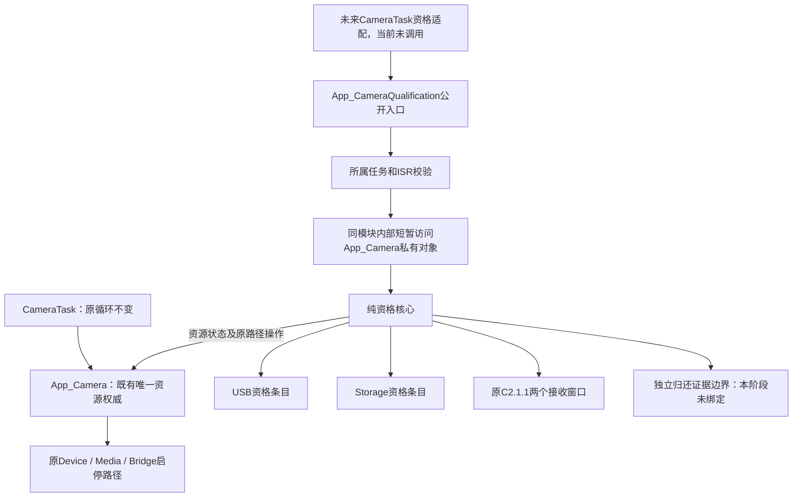

# C2.2A Consumer Qualification Core 实施报告

## 1. 交付状态与前置依赖

本阶段交付纯资格核心、原资源路径适配、专项和构建验证，不交付USB/Storage自主生命周期集成，不进入C2.2B。生产Task没有启用新资格路径，真实帧归还证明未绑定。

- 初始基线：main@182c84e7334f0a62d96f1d3109b0d7fb8efb8158。
- 审核设计：e0acd75b4361c817b1e113787c434b762e3cc238。
- 工作分支：codex/stage-C2-2A-consumer-qualification-core。
- 初始核对发现main缺少C2.1.1，先以8272e5c提交阻塞说明，没有擅自重写协议。
- 用户随后明确批准原样引入c6d2bed；核对确认它相对182c84e只有一笔C2.1.1提交、25个文件/工程条目，没有夹带其他业务阶段。
- 使用merge提交75392cc2a20733835e5b4170ee04d19f29c01eef保留原对象及父子关系：父提交为8272e5c与c6d2bed。没有cherry-pick、rebase或改写原提交。
- 原C1/C1.1、C2.1.1生产文件、所有旧测试及断言保持字节一致；本轮新增脚本在隔离快照执行原脚本并核对完整用例集合。
- 原未跟踪output/保留，正式构建覆盖前的输出另行备份；没有删除用户文件。

## 2. 实际生产架构与唯一权威



USB与Storage条目各保存自己的阶段、grant键、最高已见Generation、当前工作身份和32B冻结决策。二者不维护Camera running/stopping；唯一资源状态继续归App_Camera原字段管理。

Resource Lifecycle不是第二份运行枚举缓存：state回调从原running/stopping/prepared/fault及新增的“正在同步启动”“已确认硬件停止”事实派生UNSTARTED、PREPARING、RUNNING、STOPPING、STOPPED_CONFIRMED、FAULT_DRAINING。资源session及关闭门控在同一App_Camera私有核心中。没有另一份全局Camera业务对象。

旧START与新资源回调共用抽出的App_CameraStartResource，保持BridgeCameraBegin→原Device/Media启动→prepared判断→运行/FPS事实更新的相对顺序。旧STOP仍按原Media、IsStopped、Device及Bridge检查执行。B1逐调用轨迹通过，未修改CameraTask、ControlTask、USB、Storage。

公开资格入口的任务/ISR检查放在资格适配文件，原Camera模块不增加Platform同步头文件依赖。内部Access仅供已经通过校验的同模块适配使用，不是公共业务接口，不得跨任务调用或长期保存返回指针。

## 3. 修改文件与职责

| 文件 | 本阶段变化 |
|---|---|
| CM7/Application/app_camera.c | 私有持有唯一资格对象；抽取共用资源启动步骤；派生资源状态；原安全停止适配；内部受限借用入口 |
| CM7/Application/app_camera.h | 声明显式资格入口，未改变原API及业务状态发布 |
| CM7/Application/app_camera_qualification.c | 固定双消费者决策、Session/Generation规则、原Rx适配、冻结提交及所属任务门控 |
| CM7/Application/app_camera_qualification.h | 固定上下文、状态、资源契约与ARMCC5尺寸断言 |
| CM7/Application/app_camera_qualification_internal.h | 仅同模块内部使用的私有状态访问契约 |
| MDK-ARM/h7_mac.uvprojx | 仅为CM7登记一个新源文件；输出路径、名称、Target其他设置不变 |
| Tests/ConsumerQualificationC2_2A/ | 新专项、模块适配、隔离原协议回归、历史基线对照、ABI/Map审计及结果 |
| Docs/Design/C2.2_Consumer资格管理设计.md | 保留原R1全文，末尾追加本阶段实现状态 |

上述列表不包含原样merge的前置依赖文件；PR相对main的完整Diff会同时展示该依赖，不能将其隐藏为本轮原创。没有修改Media/FIFO、Bridge、Frame Dispatcher、SDMMC/IDMA、UVC、CM4及原消息结构、通道或容量。

## 4. 接口与调用契约

| 接口 | 调用环境及效果 |
|---|---|
| App_CameraQualificationPrepare | Camera所属任务、非ISR；仅首次准备；拒绝接管旧业务已启动/准备的资源；不是Recover或Reset |
| App_CameraQualificationReceive | 所属任务运输已接收请求到原Rx；分类、候选及重复不执行业务 |
| App_CameraQualificationProcess | 所属调度边界串行推进；每方向最多一笔；不等待队列，不阻塞等待证据 |
| App_CameraQualificationFlush | 提供已有运输回调；只提交固定回复；NO_RESOURCE保留原READY |
| App_CameraQualificationGetStatus | 同一所有者只读；不采样Media、不提交、不发送、不释放 |
| App_QualificationNextGeneration | 未来各消费者本地独立计数器使用；非零递增，耗尽拒绝；本阶段未在USB/Storage创建客户端实例 |

底层App_Qualification接口接收显式上下文，供App_Camera内部及独立单测使用；它不是跨任务直接操作资格的替代通道。Context首次必须全零，只Init一次；不提供无条件清理、超时强清或恢复入口。

返回值不能代替完成事实：Receive成功只是原Rx接受；Process成功可能仍在等待证据；Flush成功只证明回复入队；消费者仍须用原Tx完整匹配回复并ConfirmConsumed。资格GetStatus不证明帧已归还。

## 5. Generation与Session

- 两个消费者分别维护highest_seen_generation和当前grant_generation。新的合法申请尝试消耗代次；同request不重新执行；失败不回退。ACTIVE/RELEASING上的新申请保持终结拒绝，不悄悄在后台批准。
- 被拒的更高Generation不覆盖旧grant的session/generation/ACQUIRE编号；RELEASE先精确匹配旧grant，所以保留退出权。
- Generation分配助手支持跳号后的单调序列与UINT32_MAX耗尽拒绝，不回绕，不因READY取消回退。
- QUERY惰性分配首个非零会话，不初始化或启动Camera。已存在会话供另一消费者复用。
- STOP_IF_IDLE真正完成关闭后，下一QUERY在无资格、候选、未决业务/提交、未稳定运输及真实空闲证明等门控下创建新会话。新会话不Init原Tx/Rx，不清请求高水位和Generation。
- 消费者身份、资源session、request编号与原stream_epoch/lease_id及Storage/FIFO session严格分开。消息仍56B，旧AppMessage仍52B，CameraFrame_t实际为24B；没有修改任何一种结构。
- 不支持单核热复位或私有对象丢失后的会话恢复。

## 6. 四种操作

| 操作 | 决策与错误路径 |
|---|---|
| SESSION_QUERY | 首次安全分配或返回当前session；资源准备、停止、故障排空时BUSY；耗尽NO_RESOURCE；不触碰硬件 |
| ACQUIRE | 原Rx首次Promote后校验会话和Generation；首个消费者沿原资源路径启动；第二个复用RUNNING；成功才ACTIVE；部分失败保留原资源排空事实，失败代次已消耗 |
| RELEASE | 匹配当前grant进入RELEASING；无独立真实证据一直等待；确认后一次性撤销grant→INACTIVE并冻结QUALIFICATION_RELEASED；不调用Media Release |
| STOP_IF_IDLE | 不替代RELEASE；其他资格、候选、交接或证据未完成时BUSY；Stop返回BUSY时仍等待，不终结假成功；成功必须确认真实资源终态；从未启动不执行Stop、不置HARDWARE_STOPPED |

Storage文件故障通过请求business_result/cleanup_result保留；真实帧证明成立后可以释放资格，但不会伪造FILE_FINISHED/FILE_CLOSED/VOLUME_RELEASED，也不改变Storage自己的录像完成统计。

归还证明的生产回调released与idle当前均为NULL。RELEASE因此保持RELEASING；需要idle证明的停止不获成功。单测中明确注入证据，真实App_Camera适配测试仍保留一组空证明验证。本阶段没有通过completion_flags、Debug、App_Status或全局HasLoan伪造分消费者证明。

## 7. DECIDED / BLOCKED与原Rx

```text
原Rx首次Promote → 校验与原资源动作/真实证据
    → 更新唯一资格/资源事实 → 冻结32B DECIDED
    → 复核原窗口、固定方向及完整事务键
    → 原RxComplete → 核对唯一Replay正文及原Pending/入队事实
    → 清除本地提交记录 → 原RxFlushReply
    → 对端Tx完整身份匹配 → 业务消费后ConfirmConsumed
```

冻结记录只保存request关联、回复session、flags、三种结果、阶段及诊断错误。工作键补充原session/generation/operation/related_request_id；完整原文和唯一固定回复仍只在原Rx中。

- RxComplete入口BUSY：真实原RxEnter在写Replay前返回；保留DECIDED及真实事实，退出本轮。下一所属调度边界先核对Rx可读、原窗口和完整身份、冻结回复及提交状态，一致才继续同一提交；不自旋、不修改api_busy，不重做Start、Session分配或资格撤销。
- 参数/身份/窗口错误：BLOCKED，不自动恢复。不因后来成功动作覆盖原错误。
- ALREADY_EXISTS或非OK但缓存已固定：逐字节比较冻结回复及缓存，再检查Pending匹配或已有成功入队事实；不会依赖重复Complete补Pending。
- 固定正文冲突、固定后Pending缺失且未入队、FlushReply PROTOCOL：BLOCKED，保留真实资格/资源事实；不伪造请求、不清Replay，不实现新的Recover接口。
- FlushReply NO_RESOURCE：正常运输背压，原READY保留，后续只重试运输。
- 一路BLOCKED不会清另一条目的grant；资格等待期间本核心每轮可继续另一方向。原CameraTask的数据面没有被替换或阻塞。

submit_error是等待证据或提交异常的诊断，不参与回滚资格；RELEASING的证据错误不会被当作已释放。资源Stop失败继续保留真实故障，不把超时当作安全证明。

## 8. 实际RAM、ABI与栈

| 项目 | ARMCC5实测 |
|---|---:|
| 单方向冻结决策 | 32B |
| 单消费者资格/工作键/决策 | 72B |
| 两个原Rx窗口 | 664B |
| 核心上下文 | 824B（资格语义160B+Rx664B） |
| Rx起始偏移 | 144B |
| 原Camera私有上下文 | 120B |
| 候选Camera私有上下文 | 948B |
| 私有对象增量 | 828B，含核心及两个资源事实标记/对齐 |
| CameraTask静态栈 | 6144B，不变 |
| CameraTask优先级/等待时间 | 3 / 20ms，不变 |

只实例化Camera接收的两个窗口，没有提前实例化四个方向的全部Tx/Rx或USB/Storage客户端。R1的192～272B语义预算还包含未来消费者本地语义，本阶段核心实际160B；未把后续客户端内存假装已分配或已验收。

正式CM7：Code=137030、RO-data=3106、RW-data=1328、ZI-data=100880。本轮保存的改动前Map与c6d2bed的artifact_manifest SHA一致，基线RW=1328、ZI=100048；正式ZI增加832B，其中私有对象增加828B，其余为链接对齐影响。CM4仍为Code=26302、RO=1438、RW=936、ZI=3576。

Map保留s_camera=948B、s_camera_stack=6144B；旧队列360/1040/20B，新生命周期队列216/672/12B均不变。AXI SDMMC 32KiB和SRAM4 4KiB窗口不变。没有新增SDRAM分配。

资格入口当前未被生产Task调用，正式链接Map显示资格执行函数已编译后按不可达代码移除；这符合本阶段不切换业务路径的限制，不能据正式固件声称新生命周期已经运行。核心代码的实际执行验证来自ARMCC5编译的独立镜像。

无故障包装的适配镜像静态调用图：App_CameraQualificationProcess已知深度O0=424B、O2=416B；核心Process为408/400B。间接资源回调、完整硬件调用和ISR栈不能仅靠这些数字界定，必须在后续接入测量。

旧CameraTask_Process在同一B1桩环境下的已知深度仍为O0=200B、O2=184B；提取共用启动函数使HandleCommand已知路径从116→124B（O0）、96→112B（O2），但没有改变其调用轨迹或任务栈分配。没有实测本轮硬件栈余量，不将6144B减静态深度当作真实余量。

详见Tests/ConsumerQualificationC2_2A/layout_results.json及scope_memory_audit.json。编译保持原Keil输出设置：CM7原配置不生成HEX，保留原样；AXF/MAP正常生成，CM4 AXF/HEX/MAP正常生成。

## 9. 专项与协议回归

| 检查 | 本轮结果 |
|---|---|
| 核心67场景×O0/O2 | 134/134 PASS |
| 真实App_Camera/CameraTask适配14场景×O0/O2 | 28/28 PASS |
| 新专项合计 | 162/162 PASS |
| 原C2.1.1 | 648/648 PASS（含40960次原协议压力事务） |
| 原C2.1.1 ABI | O0/O2两项PASS |
| 原C1 | 419/419 PASS |
| 原C1.1新增 | 24/24 PASS；连同C1为443项 |
| 原回归判定门禁 | 29/29 PASS |
| 本阶段资格长循环 | O0/O2各512个QUERY/ACQUIRE/RELEASE/STOP周期，固定824B对象 |
| CM7/CM4正式完整重编 | 两核均0 Error、0 Warning |

Q01～Q44映射如下。PASS仅针对明确的当前核心/桩断言；依赖真实任务接入、帧归还和硬件的部分未验收，不把整条最终业务流程写成已通过。

| Q | 原设计场景 | 核心case_id | 本轮 | 验证边界 |
|---|---|---:|---|---|
| Q01 | QUERY首次非零session | 0 | O0/O2 PASS | 纯核心/证据桩；未验证真实硬件 |
| Q02 | QUERY重复/退休/旧缓存 | 1 | O0/O2 PASS | 纯核心/证据桩；未验证真实硬件 |
| Q03 | 首个ACQUIRE成功 | 2 | O0/O2 PASS | 纯核心/证据桩；未验证真实硬件 |
| Q04 | 第二消费者成功 | 3 | O0/O2 PASS | 纯核心/证据桩；未验证真实硬件 |
| Q05 | 两消费者相同request_id | 4 | O0/O2 PASS | 纯核心/证据桩；未验证真实硬件 |
| Q06 | 同request重复ACQUIRE | 5 | O0/O2 PASS | 纯核心/证据桩；未验证真实硬件 |
| Q07 | ACTIVE上的新request | 6 | O0/O2 PASS | 纯核心/证据桩；未验证真实硬件 |
| Q08 | 失败ACQUIRE同Generation新request | 7 | O0/O2 PASS | 纯核心/证据桩；未验证真实硬件 |
| Q09 | 失败后新Generation | 8 | O0/O2 PASS | 纯核心/证据桩；未验证真实硬件 |
| Q10 | g跳号/耗尽/取消 | 9 | O0/O2 PASS | 纯核心/证据桩；未验证真实硬件 |
| Q11 | 被拒更高g与仍有效旧grant | 10 | O0/O2 PASS | 纯核心/证据桩；未验证真实硬件 |
| Q12 | 旧session/g的新请求 | 11 | O0/O2 PASS | 纯核心/证据桩；未验证真实硬件 |
| Q13 | READY取消和WAIT_REPLY停止意图 | 12 | O0/O2 PASS | 受控Tx工具部分通过；消费者业务接入待后续阶段 |
| Q14 | RELEASE声明FRAMES_DRAINED但无证据 | 13 | O0/O2 PASS | 纯核心/证据桩；未验证真实硬件 |
| Q15 | 真正排空后RELEASE | 14 | O0/O2 PASS | 纯核心/证据桩；未验证真实硬件 |
| Q16 | 归还失败与超时 | 15 | O0/O2 PASS | 纯核心/证据桩；未验证真实硬件 |
| Q17 | 同request重复RELEASE | 16 | O0/O2 PASS | 纯核心/证据桩；未验证真实硬件 |
| Q18 | INACTIVE后新request RELEASE | 17 | O0/O2 PASS | 纯核心/证据桩；未验证真实硬件 |
| Q19 | USB退出而Storage ACTIVE | 18 | O0/O2 PASS | 纯核心/证据桩；未验证真实硬件 |
| Q20 | Storage退出而USB ACTIVE | 19 | O0/O2 PASS | 纯核心/证据桩；未验证真实硬件 |
| Q21 | 同时退出 | 20 | O0/O2 PASS | 纯核心/证据桩；未验证真实硬件 |
| Q22 | Camera FAULT持帧 | 21 | O0/O2 PASS | 纯核心/证据桩；未验证真实硬件 |
| Q23 | STOP_IF_IDLE从未启动 | 22 | O0/O2 PASS | 纯核心/证据桩；未验证真实硬件 |
| Q24 | STOP_IF_IDLE真正可停 | 23 | O0/O2 PASS | 纯核心/证据桩；未验证真实硬件 |
| Q25 | 停止中收到START | 24 | O0/O2 PASS | 纯核心/证据桩；未验证真实硬件 |
| Q26 | 会话安全关闭再QUERY | 25 | O0/O2 PASS | 纯核心/证据桩；未验证真实硬件 |
| Q27 | 编号预留和资源申请失败 | 26 | O0/O2 PASS | 受控Tx工具部分通过；消费者业务接入待后续阶段 |
| Q28 | 回复固定与队列失败分别处理〔R1细化〕 | 27 | O0/O2 PASS | 纯核心/证据桩；未验证真实硬件 |
| Q29 | 候选、通知合并和反方向消息 | 28 | O0/O2 PASS | 双路核心隔离及原协议队列通过；真实Task接入待后续阶段 |
| Q30 | 只读状态接口 | 29 | O0/O2 PASS | 纯核心/证据桩；未验证真实硬件 |
| Q31 | ACQUIRE成功、RxComplete入口BUSY | 30 | O0/O2 PASS | 纯核心/证据桩；未验证真实硬件 |
| Q32 | RELEASE已真实排空且撤销、RxComplete BUSY | 31 | O0/O2 PASS | 纯核心/证据桩；未验证真实硬件 |
| Q33 | Replay固定、回复队列NO_RESOURCE | 32 | O0/O2 PASS | 纯核心/证据桩；未验证真实硬件 |
| Q34 | DECIDED但Replay未固定时重复request | 33 | O0/O2 PASS | 纯核心/证据桩；未验证真实硬件 |
| Q35 | 两消费者同时操作，一方提交失败 | 34 | O0/O2 PASS | 纯核心/证据桩；未验证真实硬件 |
| Q36 | Camera启动成功、ACQUIRE结果未交付 | 35 | O0/O2 PASS | 纯核心/证据桩；未验证真实硬件 |
| Q37 | STOP完成后旧回复重传且新session已运行 | 36 | O0/O2 PASS | 纯核心/证据桩；未验证真实硬件 |
| Q38 | QUERY已分配session、RxComplete BUSY | 37 | O0/O2 PASS | 纯核心/证据桩；未验证真实硬件 |
| Q39 | Complete参数/未初始化/身份错误 | 38 | O0/O2 PASS | 纯核心/证据桩；未验证真实硬件 |
| Q40 | ALREADY_EXISTS与不同已固定回复 | 39 | O0/O2 PASS | 纯核心/证据桩；未验证真实硬件 |
| Q41 | 异常部分固定后无待发记录、未入队 | 40 | O0/O2 PASS | 纯核心/证据桩；未验证真实硬件 |
| Q42 | 提交等待超时 | 41 | O0/O2 PASS | 纯核心/证据桩；未验证真实硬件 |
| Q43 | 两消费者同时退出，只有一路证据成立 | 42 | O0/O2 PASS | 纯核心/证据桩；未验证真实硬件 |
| Q44 | 原调用问题消除后的同一决策再提交 | 43 | O0/O2 PASS | 纯核心/证据桩；未验证真实硬件 |

另有case44～66覆盖回复冲突、Pending异常、实际入口BUSY、证据缺失、停止失败、完整身份变更、旧ACK、别名拒绝、未知资源状态、申请候选阻止停止等；完整数据见results.json。故障注入包装仅在独立测试，正常路径调用原生产工具。

## 10. 现行有效及历史回归

比较基线c6d2bed与实际候选源码快照；原测试代码、断言、完整用例ID集合和失败诊断均保留。

- 688项有效用例通过。
- 所有可报告套件合计1053项PASS、220项历史FAIL/ERROR，另11组旧测试未生成报告。
- 28组套件无缺失、无新增退化，失败诊断相同；没有用“两边退出码都是0/1”代替用例比较。
- 不宣称全仓全绿。无法编译/链接的历史测试仍是维护项，不改断言也不删除。

| 套件 | 候选实际统计 | 相对基线 |
|---|---|---|
| B1Behavior | {'total': 39, 'passed': 39, 'failed': 0} | 同基线，无新增退化 |
| B1BridgeStorage | {'total': 11, 'passed': 11, 'failed': 0} | 同基线，无新增退化 |
| B1Media | {'total': 6, 'passed': 6, 'failed': 0} | 同基线，无新增退化 |
| B2Behavior | {'total': 102, 'passed': 102, 'failed': 0} | 同基线，无新增退化 |
| B2Integration | {'total': 19, 'passed': 19, 'failed': 0} | 同基线，无新增退化 |
| B3Behavior | {'total': 51, 'passed': 51, 'failed': 0} | 同基线，无新增退化 |
| Bridge | 未生成报告 | 同基线，无新增退化 |
| CameraApp | 未生成报告 | 同基线，无新增退化 |
| CameraContext | 未生成报告 | 同基线，无新增退化 |
| CameraDeviceLifecycle | 未生成报告 | 同基线，无新增退化 |
| CameraStream | 未生成报告 | 同基线，无新增退化 |
| Cancellation | {'total': 39, 'passed': 0, 'failed': 39} | 同基线，无新增退化 |
| ContinuousMedia | 未生成报告 | 同基线，无新增退化 |
| Core | {'total': 204, 'passed': 201, 'failed': 3, 'assertions': 2947} | 同基线，无新增退化 |
| Descriptors | {'total': 8, 'passed': 7, 'failures': 0, 'errors': 1} | 同基线，无新增退化 |
| EP0IRQ | {'total': 4, 'passed': 4, 'failed': 0} | 同基线，无新增退化 |
| EP1 | {'total': 45, 'passed': 0, 'failed': 45} | 同基线，无新增退化 |
| IpcStatus | {'total': 448, 'passed': 448, 'failed': 0} | 同基线，无新增退化 |
| JpegDevice | 未生成报告 | 同基线，无新增退化 |
| JpegMedia | 未生成报告 | 同基线，无新增退化 |
| NativeIntegrated | 未生成报告 | 同基线，无新增退化 |
| NativeTest | 未生成报告 | 同基线，无新增退化 |
| Payload | {'unique_cases': 62, 'executions': 124, 'passed': 122, 'failed': 2} | 同基线，无新增退化 |
| Probe | {'total': 89, 'passed': 0, 'failed': 89} | 同基线，无新增退化 |
| Streaming | {'total': 36, 'passed': 1, 'failed': 35} | 同基线，无新增退化 |
| Strings | {'total': 8, 'passed': 8, 'failed': 0} | 同基线，无新增退化 |
| UvcLifecycle | {'total': 40, 'passed': 34, 'failed': 6} | 同基线，无新增退化 |
| VideoConfig | 未生成报告 | 同基线，无新增退化 |

原嵌套run_legacy包装在隔离快照发生tar归档失败，未将继承的提交内结果算作本轮通过；最终包装器先删除快照旧报告，再直接执行原C1.1脚本（其内部重新执行原C1）和原门禁，取得上述新结果。首次历史对照也发现新增平台头文件使旧测试首诊断变化，已把任务门控移回资格适配边界，最终全量对照为new_failures=0。两次初始失败均没有通过修改原协议或断言消除。

## 11. 构建日志与复现

在仓库根目录依次执行：

```powershell
python Tests/ConsumerQualificationC2_2A/run_tests.py
python Tests/ConsumerQualificationC2_2A/run_protocol.py
python Tests/ConsumerQualificationC2_2A/run_regression.py
python Tests/ConsumerQualificationC2_2A/run_build.py
python Tests/ConsumerQualificationC2_2A/run_layout.py
python Tests/ConsumerQualificationC2_2A/audit_scope.py
```

正式构建日志、build_results.json、162项results.json、protocol_results.json、regression_results.json、layout_results.json、scope_memory_audit.json及q_mapping.json均在该专项目录。AXF、Map、调用图及隔离快照位于原output/下，本轮未提交构建产物或Python依赖。

## 12. 未验证事项与C2.2B前置条件

1. 本轮没有实板新资格生命周期验收，没有声称USB/Storage自主START/STOP可用；默认正式固件仍运行原流程。
2. released/idle生产证明未绑定；必须先独立审核分消费者交接和真实Lease核验，再允许成功退出。现有Media引用算法不改。
3. CameraTask尚未运输新资格业务请求，USB/Storage尚未分配本地Generation并驱动受控Tx；Control旧路径、NONE按需采集均未切换。不得运行时同时驱动旧控制流程和新核心；后续必须明确互斥接替。
4. 异常Pending缺失及BLOCKED不提供自动恢复。超时不清记录、资格或帧引用；单核热复位和任意内存破坏未解决。
5. 既有相机初始化仍为同步调用，资源回调未承诺实时非阻塞；未来任务接入必须测量启动及复杂画面负载。
6. 本轮静态栈数据不含完整间接回调/ISR上限，后续需实测Camera/USB/Storage/IPC栈余量、心跳、FPS、双路独立停止及故障交错。
7. 新Stage无网口、MSC、SD Access Manager或新恢复策略，不允许借本次接口直接实施这些功能。

## 13. 实板回归清单（用户后续执行，当前均未执行）

- 保持原视频配置，烧录当前正式CM7和原配套CM4，完整断电启动。
- 验证原Camera、USB MJPEG、SD录像/抓拍、IPC与OLED；记录真实FPS、丢帧增量和任务栈余量。
- 确认没有自动资格请求或自动Storage操作，原启停及故障处理未变化。
- 本阶段不在调试器里从任意任务调用资格入口；所属Camera上下文限制仍然有效。资格成功归还必须等C2.2B证明适配，不能手动把状态、api_busy或completion_flags改成“通过”。
- 后续真正接入后另验USB/Storage单路退出、共享采集、迟到回复、停止/重启及真实归还。本报告没有提前标记这些项目PASS。

完成后仅提交、推送独立分支并创建PR，等待人工审核，不合并main，不进入C2.2B。
