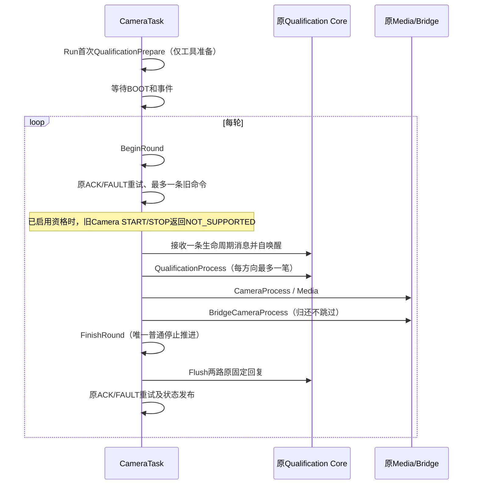

# C2.2B USB / Storage 消费者真实接入

基线：main@f0ce45fd9ab7250b1e22260e087d606ee5ed9ecb。独立分支：codex/stage-C2-2B-consumer-integration。本轮不合并main，不实施C2.2C。

**状态：WIP。基础接入已实现，Core批量冷QUERY专项保留失败，真实Task采用串行准入，不能宣布完成验收。**

## 1. 原调用链与迁移

| 原流程 | 当前流程 |
| --- | --- |
| Control → Camera START → USB START | Control → USB START → SESSION_QUERY → ACQUIRE → USB_Mode_Start |
| Control → USB STOP → Camera STOP | Control → USB业务STOP；USB原Cancel/Process/Bridge/Process/Mode_Stop保持；随后请求RELEASE |
| Storage命令出队 → Mount →接受帧 | 保留原用途命令 → SESSION_QUERY → ACQUIRE → 原Mount/文件操作/帧入口 |
| Storage Finish后IDLE | 文件结果独立保留；原Camera归还流程继续；本地工作安静后请求RELEASE |
| NONE冷启动Camera | NONE冷启动不启动Camera和USB，Storage按需申请 |

Camera、USB、Storage业务权威仍分别为App_Camera、App_USB、App_Storage。Control仅编排主输出命令，不再下发Camera硬件命令。旧Control状态编号保留用于IPC诊断兼容，但START_CAMERA/STOP_CAMERA不再进入，Command入口拒绝建立这些命令。

正式基线已经删除独立Watch验收入口，只有公共用户请求接口和诊断；本轮不恢复g_r2_hw、g_storage_debug.request或历史测试宏。

## 2. CameraTask调度位置

资格Process每轮只有一次。STOP_IF_IDLE如能满足证明条件，只登记停止意图；FinishRound保存真实结果，下一轮资格Process才读取对应身份的结果。DECIDED/BLOCKED与RxComplete BUSY语义完全沿用原实现。

## 3. 消费者适配对象

新增app_camera_consumer.c/.h供USB、Storage分别静态持有。每对象232B：原Tx144B、原请求56B、8个32位进度/身份/结果字段32B。对象只表示发送方的当前事务及已经收到的grant回复，不是第二张资格表，不保存帧引用计数或Camera running/stopping。

进度为IDLE → QUERY → ACQUIRE → GRANTED → RELEASE → STOP_IDLE → IDLE；FAILED保留实际终结失败。Camera唯一资格阶段INACTIVE/ACQUIRING/ACTIVE/RELEASING仍由原Core维护，两者含义不同。

- Init只绑定一次，普通STOP、故障、Recover不重新Init。
- Begin使用原Generation分配接口，失败尝试也消耗Generation。原Tx一次预留4个编号，按QUERY/ACQUIRE/RELEASE/STOP顺序Stage；不会先发送更大编号再补发较小清理编号。
- Stage成功才推进原issued_through；发送失败只Flush同一原文。没有新Replay、退休或超时强清接口。
- Receive只接受原Tx完整身份匹配的回复。USB/Storage模块入口另外核对所属任务和非ISR上下文。
- Process先消费原回复，再建立合法后继。终结BUSY不当作运输背压；不会自动重发新QUERY。
- End只请求RELEASE，completion_flags为0，不声称FRAMES_DRAINED、文件成功或资格已经释放。
- 只有真实成功回复带QUALIFICATION_RELEASED，才能清granted并Stage STOP_IF_IDLE。其他消费者仍活动时STOP_IF_IDLE的BUSY与本路释放成功分开表达。
- Camera反方向Shutdown请求当前不实现，收到非匹配回复不执行业务、不伪造ACK；C2.2C需要独立接入已有反方向Tx/Rx能力。

## 4. USB适配

START保存原命令，在UVC冷启动模式申请资格；TEST不申请Camera。只有获得grant才调用原USB_Mode_Start、开始原UVC/Bridge处理，并交付业务START ACK。该ACK仍不等于Windows已Configured或已收流。

STOP先关闭新帧入口，保持Cancel → UVC Process → Bridge(false) → 再次UVC Process → Bridge Idle → USB_Mode_Stop顺序。失败保留原帧和停止要求。业务STOP ACK与资格事务诊断分开；释放未完成时不允许新的START。

Reset/Disconnect/Suspend/Resume本身不清grant。原Mode错误处理仍可停止USB业务，只有明确STOP命令或START取得资格后自身初始化失败的撤销路径才请求RELEASE，不直接停Camera。

## 5. Storage适配

四个公共请求接口和原四项命令队列保持。Start命令出队后保存用途等待授权，此时不Mount、不创建文件、不开放s_accepting。授权成功后进入原Storage_OnStart的文件准备体（命名为Storage_StartGranted），文件流程保持原顺序。

STOP可取消尚未执行的业务用途，但不清已发出的QUERY/ACQUIRE。若迟到授权到达，取消的业务不会打开文件，随后仍须请求RELEASE。

已有完整帧继续按原校验、CRC、AVI/JPG写入及收尾流程处理。CameraTask继续调用原ProcessReturns实际释放Media引用。释放请求前检查本地输入关闭、无offering/queue、所有原槽位FREE；这只决定何时发请求，**不绑定为Camera侧真实归还证明**。

文件失败与清理失败分别保留到原诊断及原RELEASE消息字段。Recover只处理原文件系统状态，不能清空消费者Tx、grant或Replay。帧安全时允许提出释放请求，不把文件失败计为正常完成。

## 6. C2.2C边界

生产s_qualification_ops.released和idle保持NULL。Camera收到RELEASE后保持RELEASING，客户端保持WAIT_REPLY/granted=1，不会发STOP_IF_IDLE绕过它。不根据USB STOP、Storage IDLE、文件关闭或诊断字段伪造释放。

因此本阶段生产上可以单路启动、依次启用双路、停止一路业务而不关闭另一消费者；不能宣称完整资格释放、最后一路退出后Camera关闭、重复START/STOP或主动Shutdown闭环已完成。停止后同一路再次START通常会BUSY，需C2.2C实现真实证明，不能通过清Tx/强制释放解决。

## 7. 已发现的并发冷QUERY阻塞

consumer_test.c用例17：空会话下两路QUERY在同一轮同时到达。原Qual_Execute QUERY路径调用Qual_OtherWork；一方看到另一候选，另一方看到前一路尚未入队回复，于是双方终结BUSY，session仍0，Device_Start次数0。发送端分别消费失败，均进入FAILED，不能自动完成ACQUIRE。O0/O2都保留FAIL。

已经验证：首个QUERY回复完成后的重叠启动成功；两路收到BUSY后，由用户显式重新START也可成功。现有任务优先级可能使实板启动串行，但这不是协议并发正确性的证明，不据此豁免失败用例。

本轮不修改原Core、Replay或终结BUSY语义。CameraTask改为每轮只接收一条资格请求，再执行一次原Core决策和回复Flush；后继请求留在原静态队列，取走消息后使用原WAKE自唤醒，保证通知合并时还有下一轮。原Begin/Media/Bridge/Finish顺序和等待周期不改变。

真实CameraTask双路冷启动专项在O0/O2通过：两路QUERY同时位于运输队列时，第一条先建立会话，随后再处理另一条；两路ACQUIRE成功，只启动一次资源，自唤醒次数为4且有界。Core直接批量接收的用例17仍保持FAIL，不能把这个前提限制写成Core已经修复。后续不得绕过CameraTask串行准入；若需要Core本身支持批量冷QUERY，要单独审核其并发仲裁条件。

## 8. 依赖与所有权

Task只负责静态任务、BOOT、等待、合法队列收发、模块调度和诊断投影。模块只持有本业务上下文。App_Camera只沿原Device/Media入口操作硬件。Frame Lease的stream_epoch/lease_id与消费者session/request/generation严格分离。

无新任务、队列、动态内存、通用事件框架、网络消费者、MSC、SceneManager或恢复策略。Device、Media/FIFO、Bridge/Dispatcher、USB Core/UVC、SDMMC/IDMA、FatFS/DiskIO及CM4源码保持不变。
