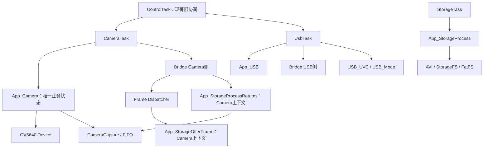
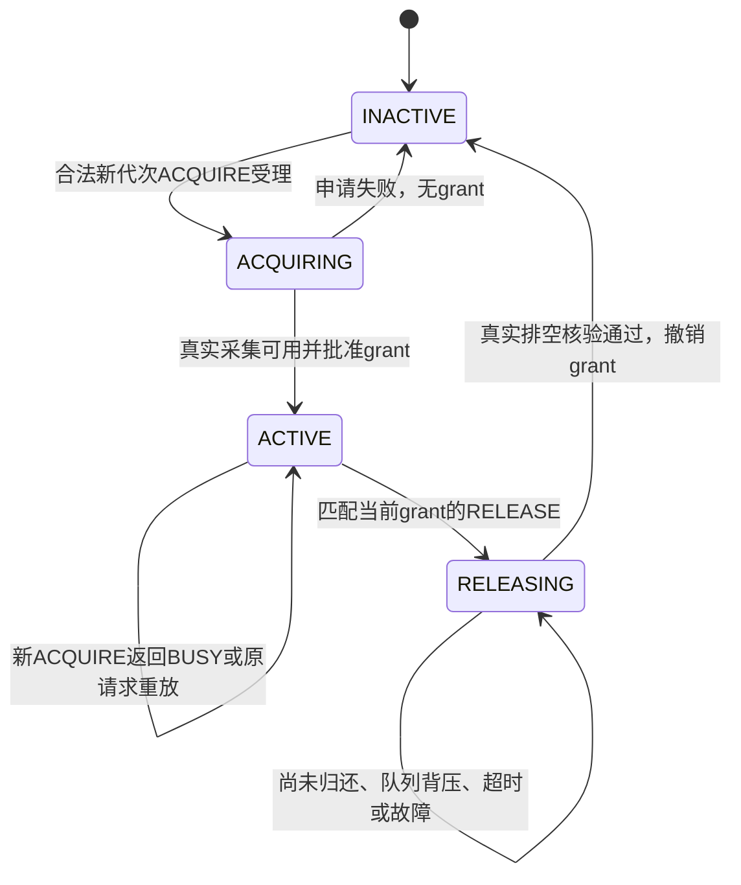
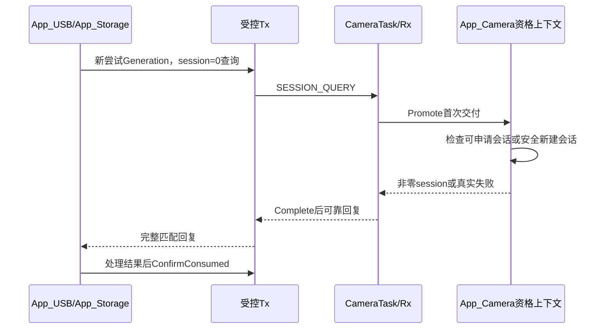
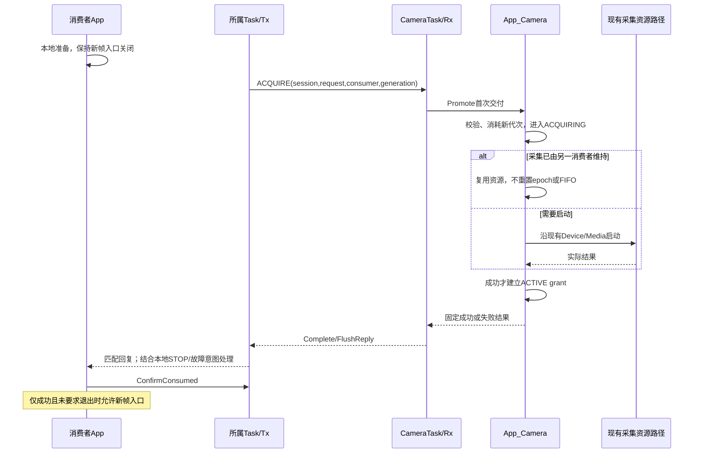
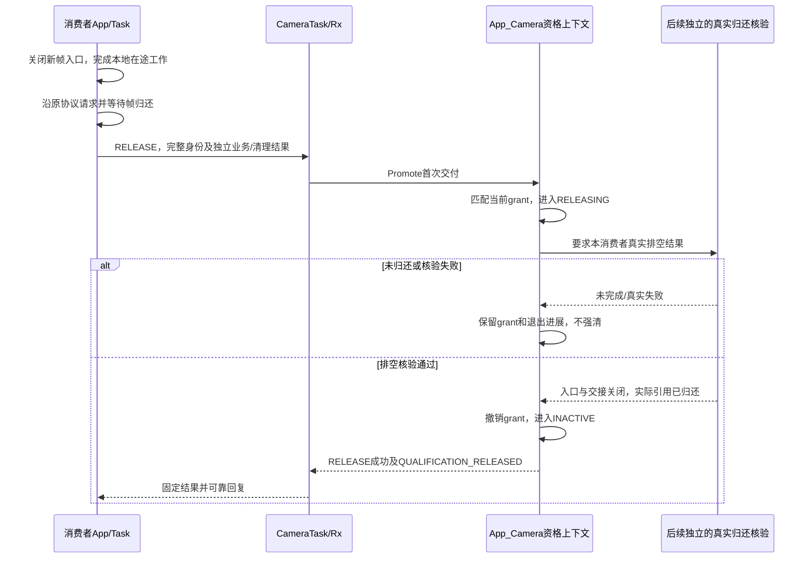
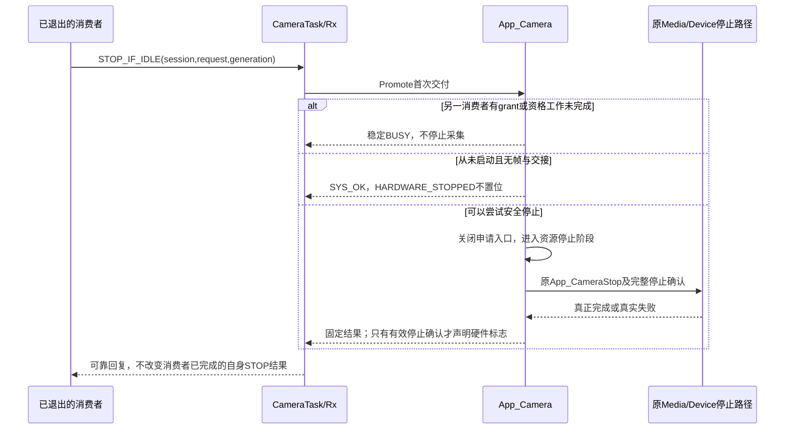

# C2.2 Consumer资格管理设计

## 1. 审查基线、范围与结论

- 仓库：h7_mac。
- 审查提交：`c6d2bedc28683883ffa433f802f8c06aaec3c542`。
- 审查分支：`codex/stage-C2-1-1-replay-reuse`；main仍为182c84e，C2.1.1尚未合并main。
- 审查开始时工作区只有原有未跟踪的output/。
- 本轮仅新增本文档；没有修改生产、测试、工程设置，没有编译或运行测试，没有接入START/STOP。
- 本文中“源码事实”来自当前提交；“建议”均尚未实施；“待确认”不视为已经授权的实现。

推荐架构：App_Camera拥有唯一资格上下文和Camera资源会话；CameraTask串行运输消息及推进既有数据面；App_USB/App_Storage各自管理本地生命周期与Generation；受控Tx/Rx管理请求、重试及Replay。资格与帧账本严格分离。

本文只确定资格层及所需证明的边界，不设计具体USB/Storage归还采样接口。实际释放核验仍需后续单独审核；缺少真实核验时，资格层不得批准RELEASE成功。

## 2. 当前工程实现审计：源码事实

### 2.1 文件与实际能力

| 文件/位置 | 已确认事实 | 尚未实现的能力 |
|---|---|---|
| CM7/Application/app_camera_lifecycle.h:38 | 身份包含session/request/consumer/generation；消息固定56B | 不分配业务Generation，不保存资格 |
| CM7/Application/app_camera_lifecycle.c:17 | 校验操作、方向、字段及标志声明权限 | 不证明真实资源完成 |
| 同文件:112 | 回复匹配完整事务；成功QUERY允许返回新非零session | 不判断Camera当前是否允许grant |
| 同文件:290 | ReplayRetire对完成记录返回NOT_SUPPORTED | 无无条件缓存退休 |
| CM7/Application/app_camera_lifecycle_replay.h:23 | Tx=144B；Rx=332B，含当前Replay与一个候选 | 正式业务尚未实例化 |
| CM7/Application/app_camera_lifecycle_replay.c:226 | 重复/旧请求分类，HELD与QUARANTINED分离 | 不执行ACQUIRE或RELEASE业务 |
| 同文件:317 | 临时Replay构造后安全接替；高水位保留 | 不生成消费者资格 |
| CM7/Application/app_messages.h:34 | 原AppMessage包含stream_epoch、lease_id及CameraFrame_t，固定52B | 不是资格请求消息 |
| CM7/Application/app_messages.c:169 | 三条独立生命周期队列在Framework中准备 | 业务Task尚未使用新协议 |
| CM7/Application/app_camera.c:10 | s_camera是唯一Camera业务状态；含配置、Device、running/stopping、旧ACK/FAULT | 无消费者资格表、业务session或Generation |
| 同文件:219 | 旧START调用BridgeCameraBegin后启动采集；旧STOP进入后台停止 | 非消费者自主申请机制 |
| 同文件:92 | CameraCapture_Stop → IsStopped → Device_Stop | 不可由资格位替代此安全路径 |
| CM7/Application/Tasks/camera_task.c:131 | CameraProcess → BridgeCameraProcess → FinishRound | 没有资格事务调度 |
| CM7/Application/app_usb.c:46 | s_usb保存唯一USB业务状态；旧START调用USB_Mode_Start | 无Camera资格客户端 |
| 同文件:124 | USB停止保持Bridge归还及Abort失败所有权 | 不能据started等于有Camera资格 |
| CM7/Application/app_storage.c:638 | START先挂载并检查空间，再打开s_accepting；有独立Storage session | 此session不是Camera生命周期session |
| 同文件:334 | 实际SD引用归还在CameraTask上下文完成 | StorageTask不自行释放Media |
| 同文件:920 | 文件收尾与诊断状态独立存在；IDLE不等于所有帧已归还 | 诊断不能作为资格释放证明 |
| Common/Inc/camera_config.h:27 | CameraFrame_t描述数据地址、总长度及跨界第二段 | 没有消费者资格身份，也不应本轮追加 |
| CM7/Application/app_uvc_bridge.c:111 | 每次CameraBegin递增epoch，lease编号在新epoch内重置 | epoch不是消费者Generation |
| 同文件:425 | USB帧凭据匹配stream_epoch、lease_id、command_id | 不替代生命周期身份匹配 |
| CM7/Media/Inc/camera_mjpeg_fifo.h:19 | SD帧凭据为session/id；FIFO保留USB/SD引用 | FIFO session也不是生命周期session |

已搜索CM7，`app_camera_lifecycle_context.c/.h`和`app_camera_media.c/.h`均不存在。本文不将计划中的模块当作已有实现，也不因名称相似虚构第二份Camera模块。

### 2.2 当前调用图



现有ControlTask仍串联Camera/USB启停，且把NONE当成需要冷启动Camera的路径（control_task.c:152、209）。这些现状与已确认的按需采集目标存在差距，本轮不修改；后续接入必须单独处理，不能在旧路径外再并行启用一套资格启停。

### 2.3 C2.1.1文档与测试审查

已阅读Docs/Design/C2.1.1_Replay安全复用.md、生产工具及Tests/CameraLifecycleC2_1_1/测试和结果。其当前记录为648项专项、2项ABI、原C1/C1.1及历史有效回归通过；本轮没有重新执行，不能算作本轮资格层验证。

现有测试覆盖Replay、候选、身份确认、队列和固定内存，但没有资格表、真实Generation申请、双消费者grant、真实RELEASE或STOP_IF_IDLE硬件验收。其大量循环使用协议与业务计数桩，不代表资格层已经实现或实板独立启停通过。

## 3. 现有协议、资格与业务的职责边界

| 层/模块 | 权威职责 | 不承担 |
|---|---|---|
| C1/C1.1 | 消息合法性、身份匹配、基本Pending/Replay | Camera使用资格、硬件或文件真实性 |
| C2.1.1 Tx/Rx | 单未完成请求、编号、高水位、重试、重复请求去重 | Generation业务语义、grant和真实资源清理 |
| App_Camera资格上下文 | USB/Storage资格、Camera资源会话、业务准入决策 | UVC Cancel、FatFS关闭、复制帧引用计数 |
| App_Camera原资源路径 | Device/Media准备、启动、停止及故障处理 | 代替消费者归还租约 |
| App_USB | 本地START/STOP、Generation分配、申请/退出事务 | 直接调用CameraCapture_Stop |
| App_Storage | 本地录像/抓拍及文件生命周期、Generation分配、申请/退出事务 | 直接Media Release |
| CameraTask | Camera消息收发、资格决策调度、数据面推进及真实归还执行 | 第二套资格表 |
| UsbTask/StorageTask | 各自协议运输和原任务工作 | 写入Camera资格上下文 |
| Media/FIFO/Bridge | 原有帧借用、交接、实际引用及Return/ACK | 自动分配消费者资格 |
| ControlTask | 后续只发业务意图和接收结果，保留BOOT职责 | 万能AppManager或全局资格/STOP控制器 |

App_Camera不得跨任务调用App_USB内部停止或StorageFS关闭。跨任务生命周期操作只通过既有三条通道和受控Tx/Rx。普通C内部函数调用只发生在所属任务内，不是绕过消息跨任务操作。

## 4. 资格上下文：建议及设计理由

### 4.1 是否独立建立Context

建议建立逻辑独立的Consumer Qualification Context，作为App_Camera唯一业务上下文的私有组成部分，而不是第二个有static全局和独立任务的Camera业务模块。

优先在app_camera.c私有区域表达，app_camera.h只暴露必要的只读状态和所属任务调用入口。若将来为单测拆出纯决策文件，状态仍由App_Camera持有并显式传入；不新增另一套静态权威状态。

本阶段不确定C结构体字段顺序、偏移或bool打包方式。先确认下面的语义和预算，再在编码阶段用ARMCC5断言及Map确定实际布局。

### 4.2 每消费者所需的逻辑信息

| 信息 | 必要性与来源 | 避免的重复 |
|---|---|---|
| consumer_id | 两个固定槽的身份，可由槽索引推导 | 不建动态注册容器 |
| 资格阶段 | INACTIVE/ACQUIRING/ACTIVE/RELEASING | 不额外维护一份active_count |
| 当前申请或grant所属session | 防止旧资源会话操作当前资格 | 不复用FIFO或Storage session |
| 当前grant/申请Generation | 绑定本次业务使用资格 | 不用request_id替代 |
| highest_seen_generation | 拒绝已经消耗的旧申请代次，跨session保留 | 与当前grant代次分开 |
| ACQUIRE请求关联 | 引用对应Rx事务；成功后保留必要grant键 | 不复制整个56B请求/回复 |
| RELEASE请求关联 | 指向当前退出事务，关联同一grant | 不另建ACK和重试记录 |
| 最近资格决策结果 | 保留申请/退出错误 | 不覆盖本地文件或UVC故障 |

当前ACQUIRE/RELEASE完整原文、回复和等待发送记录继续由Rx保存。资格表只保留必要语义键，例如session/generation/ACQUIRE request_id；固定consumer和操作无需重复存两套完整Identity。不能让资格模块直接改Tx/Rx字段。

### 4.3 三个不同的判断

- HasQualification：ACTIVE或RELEASING时仍保留grant；未完成的ACQUIRING不算已grant，但阻止停止完成。
- CanAcceptNewFrame：ACTIVE且当前会话、采集健康、消费者未要求退出时才可能为真；还需消费者自己的本地门控和UVC/Storage条件。
- FramesDrained：来自后续独立的真实交接/Lease核验，不由资格阶段推导。

因此不建议再保存可独立修改的qualification_valid和exiting两个布尔副本：valid/退出状态尽量由阶段及资源条件派生。Camera FAULT时可保留ACTIVE/RELEASING的所有权关系，同时由资源故障关闭新帧入口；不把条目清成INACTIVE。

资格Getter必须只读，不采样/推进Media，不调用Release，不产生隐含START/STOP。

## 5. Consumer Qualification状态机



ACQUIRING失败回INACTIVE只表示没有批准grant，不表示启动失败后的硬件已经安全恢复。原App_Camera.stopping/故障清理和资源状态仍须继续；STOP_IF_IDLE和下一申请不能绕过它。

RELEASING仍保留资格，只关闭本消费者新帧准入。正常退出中没有其他消费者时，也必须等真实帧归还后才能进入既有硬件停止路径。

资源的未启动、启动中、运行、停止中、故障排空、会话关闭是App_Camera资源生命周期的逻辑视图，不建议另外建立与running/stopping竞争的第二套硬件FSM。后续实现须明确由现有唯一上下文派生或经审核迁移。

## 6. USB/Storage双消费者关系

| USB | Storage | 采集资源决策 |
|---|---|---|
| INACTIVE | INACTIVE | 没有grant；是否可停还要查申请/释放、帧和硬件 |
| ACTIVE | INACTIVE | 为USB维持采集 |
| INACTIVE | ACTIVE | 为Storage维持采集，不能因USB停止而停Camera |
| ACTIVE | ACTIVE | 共享同一采集资源，不重复Device_Start/Begin |
| RELEASING | ACTIVE | USB入口关闭并排空，Storage继续 |
| ACTIVE | RELEASING | Storage排空，USB继续 |
| RELEASING | RELEASING | 两路独立排空，不强制清引用 |
| ACQUIRING | 任意 | 存在未完成申请，不报告整体停止完成 |

第二个消费者获得资格时不得重新调用BridgeCameraBegin、重置stream_epoch、lease编号、FIFO或既有采集统计。消费者换Generation不等于重新开启整条采集管线。

USB Reset/Disconnect/Suspend/Resume不自动释放资格；USB_TEST不申请资格；NONE按需采集。这些是此前已经确认的目标规则，当前基线业务尚未接入，本轮不改变。

## 7. Generation生命周期

### 7.1 谁生成、何时消耗

建议由App_USB、App_Storage分别拥有自己的单调分配序列，Task只运输。一次新的本地START请求通过重复/冲突门控并被接收为新尝试时，先分配非零Generation，再使用同一个Generation执行QUERY、ACQUIRE及必要清理。

- 同一request重传：不分配新Generation，交给Replay。
- ACTIVE/退出中对本地新START的直接BUSY拒绝：没有接收为新尝试，不分配Generation。
- 一旦已分配，之后查询、挂载、申请、硬件启动失败或READY取消都消耗该代次，不回退。
- 失败后重新接受一笔START：使用更大Generation，不把旧Generation重新申请成成功。
- 允许跳号，不要求Camera看到所有代次；不得回绕，耗尽拒绝新START。
- Generation按消费者跨Camera session保留，不随停止/重新枚举或普通Device初始化清零。
- 此保证限同一配套固件运行期，不覆盖任务状态丢失或单核热复位。

### 7.2 Camera如何拒绝旧Generation

先经过Rx去重/Promote，只有首次交付的事务才进入资格决策。Camera分别保存当前grant代次和最高已见申请代次，不能只保存一个generation字段。

建议判定规则：

1. 格式、消费者、真实来源及当前session不合法：拒绝，不授权；错误旧session不能改变当前资格。
2. 原request重复：直接走Rx原结果，不重新做Generation决策。
3. 新ACQUIRE的Generation已消耗且当前无对应grant：拒绝，不允许失败的START后来凭同代次重新成功。
4. ACTIVE/RELEASING上的新ACQUIRE：不增加grant，返回BUSY；若收到更大合法代次，记为已见失败尝试，但保留原grant身份。
5. 因此RELEASE必须先精确匹配当前grant的session/consumer/generation，再判断它；不能因曾见到一个更大但被拒绝的ACQUIRE而拒绝仍有效的原grant退出。
6. 只有INACTIVE、合法新代次、资源允许时才进入ACQUIRING。新的已见尝试单调记录，即使随后资源BUSY或启动失败也不回退。
7. SESSION_QUERY只读取会话，不推进资格阶段，不替代ACQUIRE建立grant，也不因查询较大代次撤销旧grant。

对旧Generation/错误session建议使用现有SYS_ERR_INVALID_STATE，对当前有grant的新申请使用SYS_ERR_BUSY，不新增消息结果枚举。相同request编号改Generation属于Replay层PROTOCOL，不进入上述业务分支。

### 7.3 与其他编号的区别

| 编号 | 管理者与意义 |
|---|---|
| Lifecycle session_id | App_Camera资源周期 |
| consumer_generation | 各消费者新START尝试 |
| request_id | 各方向受控Tx请求编号，不随session/generation重置 |
| stream_epoch/lease_id/帧command_id | 原Bridge帧协议 |
| CameraMjpegLease_t.session/id | 原FIFO的SD引用凭据 |
| Storage s_session/slot.generation | 原存储帧槽及录像会话 |

这些数值即使碰巧相等，也不能互相转换或用于代替校验。

## 8. Camera会话生命周期与查询引导

### 8.1 建议的会话分配点

为解决QUERY需要非零返回值而ACQUIRE又必须带session的引导问题，建议App_Camera在资格层首次准备时分配一个非零“可申请资源会话”，不启动传感器。首次可使用1，由Camera独占的单调序列分配。

SESSION_QUERY返回的是可申请的资源会话，不是Camera已经运行的证明。

最后一个grant释放后也不立即更换session：仍要完成STOP_IF_IDLE/安全停止或未启动分支，并结束旧资源工作。关闭旧资源周期后，下一个合法SESSION_QUERY可以在安全门控下惰性分配下一session；多个查询看到同一个新会话，不重复递增。

安全门控至少包括：无grant、无正在执行的资格申请/释放、无真实外部帧和交接、无旧启动/停止/清理工作、旧事务回复已经稳定且无本地未提交回复工作；当前正在执行的QUERY自身不计为阻塞项。无法证明则QUERY返回BUSY/真实错误，不分配新会话。

不要求跨任务读取对端Pending来证明它已消费回复。旧终结回复缓存可保留，由C2.1.1水位保护；新的session检查阻止旧请求操纵新资格。所有Tx/Rx只初始化一次，绝不能为切换session重新Init。

### 8.2 对资格的影响

- 存在ACTIVE/RELEASING/ACQUIRING时，不得切换资源session。
- Camera FAULT不立即滚动session、不自动清空条目；先保护性停硬件，保留外部引用和grant关系，待真实退出后再关闭资源周期。
- 旧session的新请求只能得到稳定失败，不能对新会话执行RELEASE/STOP。
- 旧QUERY原request重放仍返回缓存原session，消费者用它申请可能被拒绝；重新查询必须用新request_id。
- session耗尽拒绝新资源周期，不回绕，不借用stream_epoch作为替代。

这是一项待确认的分配策略，不是当前代码事实。

## 9. 四种操作契约与时序

### 9.1 SESSION_QUERY

| 项目 | 建议契约 |
|---|---|
| 发起方 | USB/Storage所属Task通过已有Tx发起 |
| 前置 | 本方向没有未消费Pending；非零Generation；请求session=0 |
| 状态变化 | 不改变消费者资格；仅在旧资源周期安全关闭后可能分配新session |
| 成功 | 返回当前非零可申请session，不声明grant或硬件运行 |
| 失败 | 会话切换暂不安全返回BUSY；编号耗尽或内部失败返回真实错误 |
| 重复 | 当前request重放原结果；已退休request拒绝 |
| 超时/清理 | 保留WAIT_REPLY；不启动Camera、不产生文件清理 |



### 9.2 ACQUIRE

| 项目 | 建议契约 |
|---|---|
| 发起方 | USB/Storage；使用查询所得session及本次START Generation |
| 前置 | 身份合法；未重复grant；代次未被消耗；会话开放；资源无未解决危险状态 |
| 状态变化 | INACTIVE→ACQUIRING；实际可用后→ACTIVE；失败→INACTIVE且代次消耗 |
| 成功 | 原采集确实可用；已有运行资源则不重复启动；先登记grant再缓存成功回复 |
| 失败 | ACTIVE/退出/停止中BUSY，旧身份INVALID_STATE，启动/准备失败保留真实错误 |
| 重复 | 同request只返回原进展/结果；新request的重复START不会增加grant |
| 超时/清理 | 未收到回复不能认定失败或未授权；若本地已要求STOP，收到成功后立即走安全退出 |
| 责任 | Camera独占采集准备/启动/失败清理；消费者独占自身初始化、失败后的文件/UVC清理 |



Camera正在STARTING而另一消费者请求到达时，建议返回终结BUSY，避免未经审核合并多个硬件启动等待者；同原request仍由Replay处理。现有启动函数本身含同步调用，本设计不声称将它改成非阻塞硬件状态机。

一次ACQUIRE返回终结BUSY后不能在后台悄悄批准同一事务。需要重试时，应由消费者接受新的START尝试、分配新Generation和新请求。

若grant已建立但回复入队失败，grant仍保留并阻止STOP；不能回滚资格或重新执行启动。内部回复构造/缓存异常同样保留安全状态并上报，不靠清Replay恢复。

### 9.3 RELEASE

| 项目 | 建议契约 |
|---|---|
| 发起方 | USB/Storage所属Task，在关闭自身入口并完成本地退出后提交 |
| 前置 | 精确匹配当前grant的session/consumer/generation；原本地处理仍受单未完成请求约束 |
| 状态变化 | ACTIVE→RELEASING，grant保留但新帧准入关闭；真实排空核验通过才→INACTIVE |
| 成功 | 独立核验确认本消费者交接和实际租约已经归还，才设置QUALIFICATION_RELEASED |
| 失败 | 错误身份拒绝；真实归还失败保留RELEASING，不能完成假成功 |
| 重复 | 同request走原Replay；新request在已经INACTIVE时建议返回INVALID_STATE，不重做释放 |
| 超时/清理 | 不能清资格或帧；Camera继续处理Return/归还，消费者继续原清理 |
| 责任 | USB处理UVC；Storage处理文件；CameraTask执行原Media实际归还；Camera资格层只验证退出条件 |



本图的L是后续证明边界，不是已经实现的接口；本轮不设计其内部采样布局。资格单测可以注入明确的证据事件，但未来生产没有证据时必须保持等待，不能默认true，也不能直接使用消息completion_flags、Debug或App_Status代替。

RELEASING等待是尚未终结的请求，不应先回复BUSY再让相同request后来变成功。如果决定把归还错误作为终结失败回复，该回复必须永久保持失败；该条目仍保留grant，消费者后续需要新的合法RELEASE事务继续请求。尚未解决的资源失败不自动恢复。

已确认的Storage例外继续成立：文件Finish/Close/Unmount失败，但入口关闭、CPU/IO不再访问原帧、交接结束且实际帧引用已安全归还时，可以释放Camera资格。RELEASE.result可成功，同时business_result/cleanup_result保留失败；不能因此给出虚假的FILE_FINISHED/FILE_CLOSED/VOLUME_RELEASED，也不能计为正常AVI完成。

资格正式失效的时点是Camera确认真实排空后将条目改为INACTIVE；不是命令入队、消费者声明STOP或文件关闭。成功回复尚未被消费者消费时，本地仍可处于等待确认；后续START必须等原Pending完成并消费。

### 9.4 STOP_IF_IDLE

| 项目 | 建议契约 |
|---|---|
| 发起方 | 消费者在自身释放后独立提出；不得用它代替RELEASE |
| 前置 | 当前session合法；请求Generation不得倒退到已见旧尝试；未启动新尝试可请求空闲检查，不产生grant |
| 其他消费者仍活动 | BUSY；本消费者自身STOP/资格释放成功仍独立成立 |
| 存在未完成资格/交接 | BUSY，或者已受理停止继续等待真实完成；不得先BUSY后改同request结果 |
| 真正可停 | 无grant、无未完成申请/释放、无外部帧和交接、硬件可安全停止 |
| 成功 | 沿App_CameraStop及原Stop/IsStopped/Bridge/Device语义确认；从未启动走专用无操作分支 |
| 重复 | 同request重放原回复；新request重新执行只读资格检查及必要幂等停止 |
| 超时 | 保留请求与实际状态，不宣称硬件安全 |



STOP检查排除它自身这笔事务，但包含已受理的ACQUIRE/RELEASE工作。未受理的新请求在停止阶段返回BUSY；对已有HELD候选采用保守门控，不能在明知有待处理申请时立即报告稳定停止。不能要求所有Replay为空，否则完成缓存永久保留会阻止停止；要区别业务工作未完成和已完成回复记录。

HARDWARE_STOPPED建议沿用前次设计定义：通过既有停止路径获得、尚未被后续启动尝试作废的安全停止确认，不要求每次重复STOP都实际调用硬件。首次从未启动的分支SYS_OK但不置位；任何新启动尝试先作废旧确认。本语义仍列为需确认项。

## 10. 与C2.1.1接口衔接及提交顺序

### 10.1 不建立第二套协议

消费者端必须使用AppLifecycleTxContext_t，Camera接收每个消费者必须使用AppLifecycleRxContext_t。反向Camera请求在后续阶段仍使用另两个固定方向的Tx/Rx；不得从控制消息或直接函数调用另开资格申请通路。

```text
消费者分配Generation及预留请求编号
→ TxStage/TxFlush
→ CameraTask从原Lifecycle通道Receive
→ RxReceiveRequest分类
→ RxPromote首次交付
→ App_Camera资格决策
→ RxComplete固定回复
→ RxFlushReply
→ 消费者TxAcceptReply/GetCompleted
→ 消费者处理结果与本地意图
→ TxConfirmConsumed完整原请求
```

重复和旧请求在Rx层结束，不再次调用资格决策。内部RxPromote的BUSY只表示背压，不转换成终结业务BUSY。QUARANTINED不自动解锁，也不能通过重建资格上下文顺便重置Replay。

资格数据和回复应在提交前准备合法决策。ACQUIRE成功只能在资源可用后登记grant；RELEASE成功只能在真实排空后撤销grant。随后把同一个稳定决策交给RxComplete。若内部缓存失败，不得假设grant已经撤销或重新执行硬件；保留安全所有权并报告内部错误，具体错误恢复不能在本阶段擅自引入。

### 10.2 所属任务与状态读取

| 调用者 | 允许操作 |
|---|---|
| CameraTask | 调用App_Camera资格处理和Process，操作Camera拥有的Rx/Tx，核验并执行原实际归还 |
| UsbTask | 调用App_USB资格客户端，继续显式UVC/Bridge推进，操作其Tx/Rx |
| StorageTask | 调用App_Storage资格客户端及原文件操作，操作其Tx/Rx |
| 其他任务/ISR | 只能通过已批准的业务意图或消息入口，不直接改资格或管理对象 |

所有权Getter只输出副本；跨任务若需状态发布，应通过已有状态发布机制或明确的同步快照，不能让UsbTask读取Camera私有条目。Task调度统计、诊断观察者仍只做投影。

## 11. 与帧资源生命周期隔离

必须维持四个不同完成点：消费者业务停止、帧租约真实归还、资格释放、Camera硬件停止。它们不是一个STOPPED字段。

安全顺序为：消费者关闭入口并结束在途工作 → 原帧归还/交接处理 → Camera侧真实核验 → 资格失效 → 可选STOP_IF_IDLE。

既有CameraFrame_t不追加资格身份。既有stream_epoch/lease_id、FIFO session/id和引用计数不改。未来资格准入通过App层关联当前会话与消费者，不能使用资格位调用无条件Media Release。

- USB和Storage可以共享同一物理JPEG，但各自的资格和引用独立。
- 一路释放资格不能清另一条目的grant或引用。
- 全局HasLoan只能用于最终整体资源检查，不能替代分消费者排空。
- Camera FAULT允许必要保护性停止，DRAINING和外部借帧继续存在；不能为了新session重建或覆盖旧缓冲。
- 没有真实归还核验前，资格层只能保持RELEASING，不能交付成功。

## 12. 异常交错场景

| 场景 | 设计结果 |
|---|---|
| USB与Storage同时申请 | CameraTask串行；一次硬件启动；另一路已运行时复用或STARTING时终结BUSY |
| 同request重传START | Replay原进度/回复，不消耗新Generation或重复grant |
| ACTIVE的新START request | BUSY；不产生第二份grant |
| STOPPING收到新申请 | 关闭准入，BUSY或旧身份拒绝；不得停止反转成自动启动 |
| ACQUIRE失败 | 无grant，Generation消耗；启动失败清理由Camera独占继续 |
| 本地STOP先于ACQUIRE回复 | READY可取消但Generation不回收；WAIT_REPLY不可取消，成功到达后转安全退出 |
| USB RELEASE时Storage ACTIVE | 只退出USB；STOP_IF_IDLE BUSY；Storage继续采集 |
| Storage RELEASE时USB ACTIVE | 只退出Storage；文件错误仍由Storage保留 |
| 两消费者同时RELEASE | 独立核验、独立回复；所有权清完后才允许整体停止 |
| 新大Generation的ACQUIRE被拒绝而旧grant仍在 | 保留旧grant退出权；匹配旧grant的RELEASE不能被高Generation水位误杀 |
| 旧Generation新request | 业务层拒绝；同旧request由Replay先拒绝或重放，不重复操作 |
| 旧session迟到回复 | Tx完整匹配；未匹配不消费当前Pending，不开启新帧入口 |
| 回复成功入队但尚未消费 | grant决定与传输状态分开；不因为通知而开始下一事务 |
| 候选槽/队列满 | 沿C2.1.1保留，不丢身份，不扩容，不发送内部BUSY作业务终结 |
| 归还失败或CPU/IDMA仍使用帧 | 保留RELEASING，不清资格，不覆盖缓冲 |
| 文件失败但帧已安全归还 | 可释放资格；Storage仍FAULT，文件失败不清除 |
| Camera FAULT有外部租约 | 先保护硬件、保留grant/引用，等待真实退出，不自动换session |
| Generation/session/request耗尽 | 拒绝新尝试，保留必要清理额度，不回绕 |
| 单核热复位/任务私有状态丢失 | 不承诺恢复；不能重置计数后继续原会话 |

## 13. RAM预算与上下文布局决策

本节仅预算，不确定最终结构体字段和排列。本轮文档没有RAM增量，也没有重跑sizeof/Map。

| 项目 | 建议预算 | 原因 |
|---|---:|---|
| Camera每消费者资格语义 | 32～48B | 阶段、session、当前/最高Generation、请求关联及结果；不复制完整消息 |
| 两消费者条目 | 64～96B | 固定USB/Storage |
| Camera会话及资源工作关联 | 24～48B | 序列、当前session、关闭/停止确认及有界操作关联 |
| Camera资格层合计 | 88～144B | 纳入唯一App_Camera上下文 |
| 每消费者本地资格客户端语义 | 24～32B | 代次分配、当前身份、本地退出意图及结果关联，不复制原业务FSM |
| 两消费者本地语义 | 48～64B | App_USB与App_Storage分别所有 |
| 资格语义总增量预算 | 136～208B | 不含协议对象、诊断发布扩展和证明适配层 |

C2.1.1已记录Tx=144B、Rx=332B：

- 只接消费者→Camera两个请求方向：协议对象952B，加上述语义约1088～1160B。
- 全部四方向实例化：协议对象1904B，加上述语义约2040～2112B。
- 当前C2.1.1未实例化业务对象，不能把1904B说成已经占用。
- 上述为设计预算，后续若选择更完整身份副本或额外状态发布必须重新计算，不允许默默超出。
- 新回调/适配的任务栈未知；原工具已知RxPromote链200B不是完整任务栈证明，编码后重新检查，不自动扩大任务栈。

## 14. 测试用例设计（未实施、未运行）

先使用普通C资格模型和确定结果的资源/归还事件桩验证，再单独进行任务适配、回归、构建和实板验收；不复制Replay实现。

| 编号 | 场景 | 关键断言 |
|---|---|---|
| Q01 | QUERY首次非零session | 不启动Device/Media，不产生grant |
| Q02 | QUERY重复/退休/旧缓存 | 原结果不变或被Rx拒绝，不刷新旧request |
| Q03 | 首个ACQUIRE成功 | 一次资源启动，ACTIVE在真实成功后建立 |
| Q04 | 第二消费者成功 | 不调用第二次Begin/Start，不重置epoch/Lease |
| Q05 | 两消费者相同request_id | 各自方向隔离，各有一个grant |
| Q06 | 同request重复ACQUIRE | 状态、Generation与资源调用次数不变 |
| Q07 | ACTIVE上的新request | BUSY，无第二grant |
| Q08 | 失败ACQUIRE同Generation新request | 拒绝，不能从失败代次变成功 |
| Q09 | 失败后新Generation | 仅旧资源安全后可新申请 |
| Q10 | g跳号/耗尽/取消 | 不回退不复用，失败输出保持 |
| Q11 | 被拒更高g与仍有效旧grant | 旧grant仍能精确RELEASE，不被max_seen误拒 |
| Q12 | 旧session/g的新请求 | 没有硬件/资格副作用，固定失败 |
| Q13 | READY取消和WAIT_REPLY停止意图 | 前者只取消未提交，后者保留并处理迟到成功 |
| Q14 | RELEASE声明FRAMES_DRAINED但无证据 | 保留grant，不给成功标志 |
| Q15 | 真正排空后RELEASE | 先确认排空再INACTIVE，一次撤销 |
| Q16 | 归还失败与超时 | 不清资格、帧或Pending |
| Q17 | 同request重复RELEASE | 原缓存回复，不重复Release |
| Q18 | INACTIVE后新request RELEASE | 按已确认规则拒绝，不伪造第二次退出 |
| Q19 | USB退出而Storage ACTIVE | USB失效、Storage不变、STOP_IF_IDLE BUSY |
| Q20 | Storage退出而USB ACTIVE | USB不变，文件失败独立保留 |
| Q21 | 同时退出 | 两路实际归还前不得停止硬件 |
| Q22 | Camera FAULT持帧 | 保护停止不清grant，拒绝新grant/session |
| Q23 | STOP_IF_IDLE从未启动 | 不初始化，不调用假Stop，硬件标志为0 |
| Q24 | STOP_IF_IDLE真正可停 | Stop/IsStopped/Bridge/Device完整确认 |
| Q25 | 停止中收到START | BUSY，原停止继续，不自动反转 |
| Q26 | 会话安全关闭再QUERY | 只分配一次新session，Tx/Rx水位不重置 |
| Q27 | 编号预留和资源申请失败 | 清理仍有编号；不能倒序使用旧预留编号 |
| Q28 | 回复缓存/队列失败 | grant决定保留，重试回复不重执行业务 |
| Q29 | 候选、通知合并和反方向消息 | 不堵塞另一消费者，原帧归还持续推进 |
| Q30 | 只读状态接口 | 不改阶段、取帧、释放、启动或发消息 |

后续回归仍保留C1/C1.1/C2.1.1所有断言，分别确认业务资格与协议缓存的不同失败含义。实板验证须覆盖双路运行、单路停止、重复启停、断连不释放、掉卡文件故障、Camera保护停止及真实栈余量；本轮没有任何实板通过结论。

## 15. 未解决风险与需确认决策

### 15.1 已确认的兼容性风险

1. 当前Control旧串联启停与NONE冷启动行为尚在，不能同时接入新自主生命周期；退出旧路径需后续单独批准。
2. 当前Camera全局CanOfferFrame和Bridge单enabled门控不足以表达两消费者独立资格；未来需Application级准入适配，不改帧协议。
3. 分消费者真实归还核验尚未设计/实施；这是RELEASE生产成功的阻塞项，不能默认或仅用completion_flags。
4. 现有App_CameraStart同步执行；业务层可能阻塞CameraTask，不承诺本设计已解决耗时初始化。
5. 当前USB把重复START的BUSY记为故障。新资格BUSY是否沿用此上报语义，需接入前确认，不能顺手优化。
6. 当前Storage无帧5秒超时从现有准备流程开始；未来等待资格时不能被误计为正常采集无帧，具体迁移须另审。
7. Replay保证依赖受控Tx与单所有者；不能提供任意跨任务直接访问或热复位会话恢复。

### 15.2 需要用户确认的设计选择

- D1：资格上下文作为App_Camera私有组成；不建立第二个Camera业务模块，实际C布局在编码阶段再定。
- D2：Generation由各消费者分配；一次已接受新尝试分配后永不回退。Camera保存最高已见申请代次与当前grant代次，错误新申请不能剥夺旧grant的退出权。
- D3：相同request重复由Replay处理；失败代次不允许用新ACQUIRE重新变成功；ACTIVE新request和STOPPING新申请返回终结BUSY。
- D4：已有grant时被拒绝的更大合法Generation记入已见尝试，但不覆盖当前grant身份；低于它的当前grant仍可RELEASE。
- D5：会话先以可申请非零session引导，不启动硬件；安全关闭资源周期后由下一QUERY惰性创建新session，跨周期保留所有编号和Generation边界。
- D6：新request的重复RELEASE在INACTIVE时返回INVALID_STATE；原request仍返回原结果，不新增幂等释放动作。
- D7：RELEASE默认保留未终结等待直到真实排空；若选择终结失败，保留grant，后续新请求才能继续，绝不改原回复。
- D8：从未启动STOP_IF_IDLE成功但无HARDWARE_STOPPED；此标志表示仍有效的真实停止确认，不要求重复请求重复硬件操作。

上述D项是建议，不代表已获编码授权。包括文件收尾失败可安全释放资格、USB总线事件不自动释放、NONE按需采集等此前已确定规则不重新要求确认。

## 16. 推荐实施顺序、文件范围和协议结论

1. 本文审核：先确定Generation、会话分配和重复RELEASE语义。
2. 资格纯逻辑：App_Camera拥有固定两条目；用桩测试，不接入业务/硬件，不重新实现Tx/Rx。
3. 归还证明单独设计与验证：只确定权威证据如何到达资格层，不改变Media引用算法。
4. CameraTask及受控消息适配：保留数据面处理机会和原调用顺序，防止资格等待阻断Return。
5. USB业务接入，再Storage接入：分别验证独立START/STOP；第二消费者不重复启动资源。
6. STOP_IF_IDLE/会话关闭与Restart；随后退出Control旧串联路径并实现NONE按需采集。
7. 有效回归、CM7/CM4全量编译、Map/任务栈及双路实板验收。

预计需要修改的生产文件，均为后续经批准阶段：

| 文件 | 预期职责变化 |
|---|---|
| app_camera.c/.h | 私有资格和资源会话、操作决策、只读视图；不移交硬件所有权 |
| camera_task.c | 资格协议运输与调度；保持原Media/Bridge/Finish顺序 |
| app_usb.c/.h、usb_task.c | 本地Generation、受控资格客户端和现有UVC生命周期门控 |
| app_storage.c/.h、storage_task.c | 本地Generation、受控资格客户端、文件与资格退出分离 |
| app_uvc_bridge.c/.h、必要的app_frame_dispatcher.c/.h | 后续仅准入与证据适配，先单独审核，不修改帧凭据 |
| control_task.c | 后续取消冲突的旧串联启停，不建立全局AppManager |
| 对应专项测试和必要工程登记 | 只在实现阶段新增 |

不预计修改C1/C1.1、C2.1.1、app_messages结构/通道、CameraFrame_t、Device、Media/FIFO、UVC协议、SDMMC/IDMA或CM4。若实现发现必须修改这些边界，应先停止并报告，不在本设计中预授权。

结论：资格逻辑不需要新增消息类型、completion_flags或扩大56B/52B结构；四种既有操作能够表达目标。新增的是业务语义和权威资格状态，不是另一套Replay。预计资格语义RAM136～208B，协议对象另计，最终以实际结构和Map为准。尚需先确认D项及后续真实归还证明，不能据本文直接开始业务接入。

## 17. 本轮交付与验证说明

本轮唯一新增文件为本设计文档。未运行编译、单测或硬件测试；只检查文档内容、引用位置和Git修改范围。不会将历史软件结果当成本次资格验证通过。按仓库已有备份要求，设计文档可单独提交到当前独立分支并推送，不修改或合并main。
