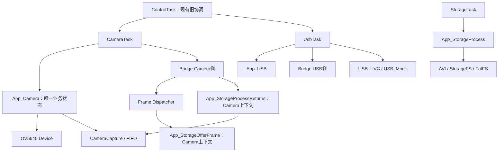
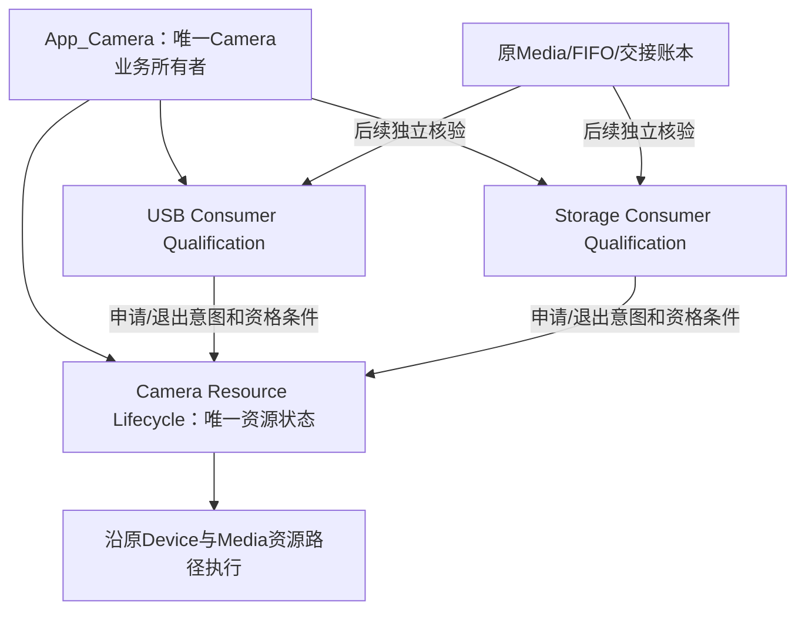
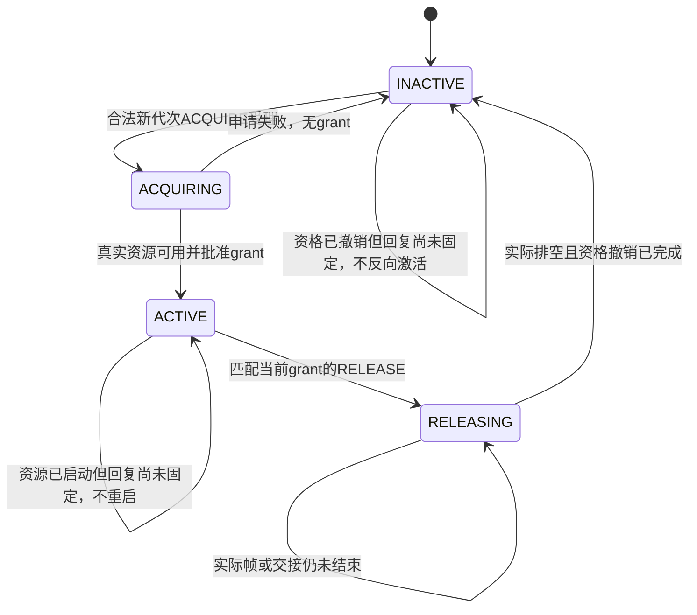
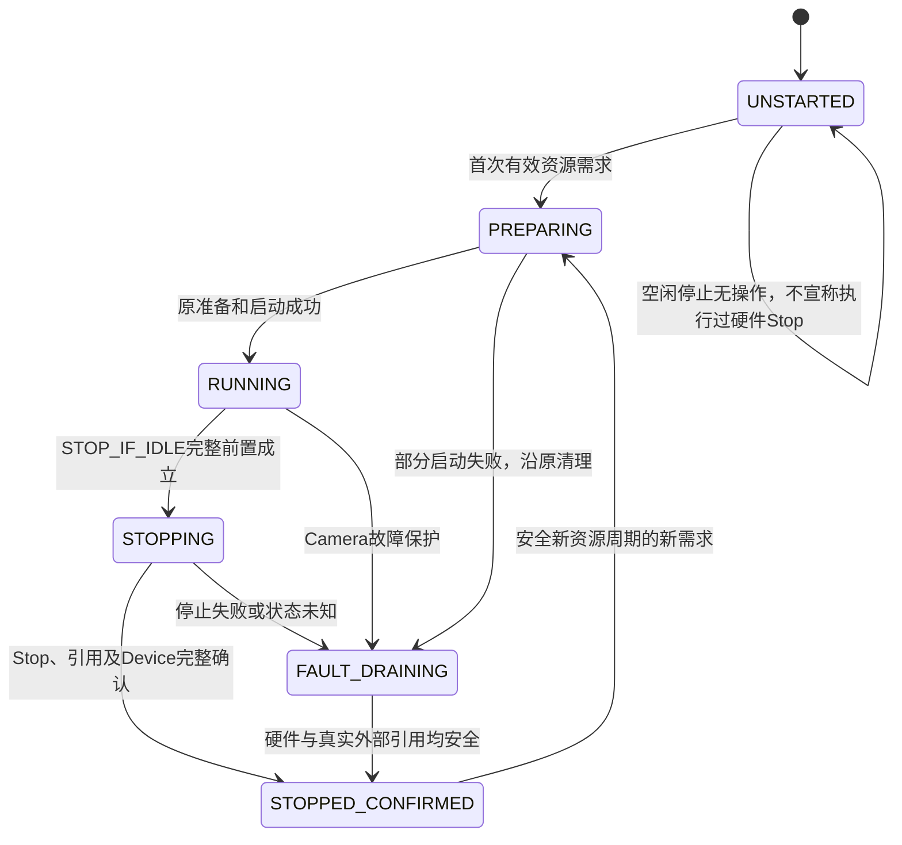
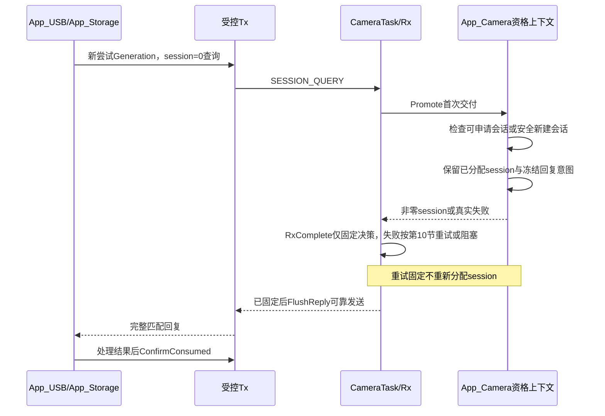
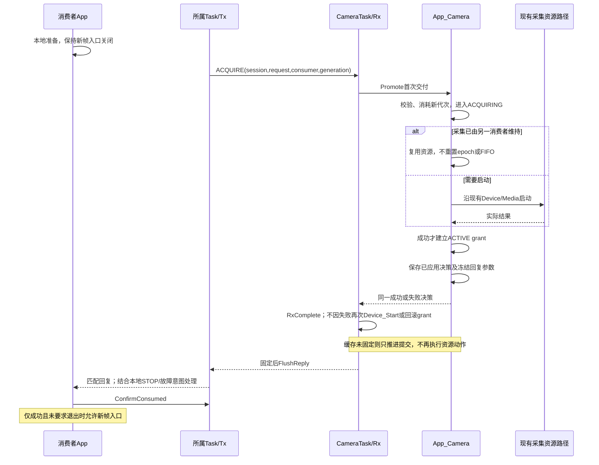
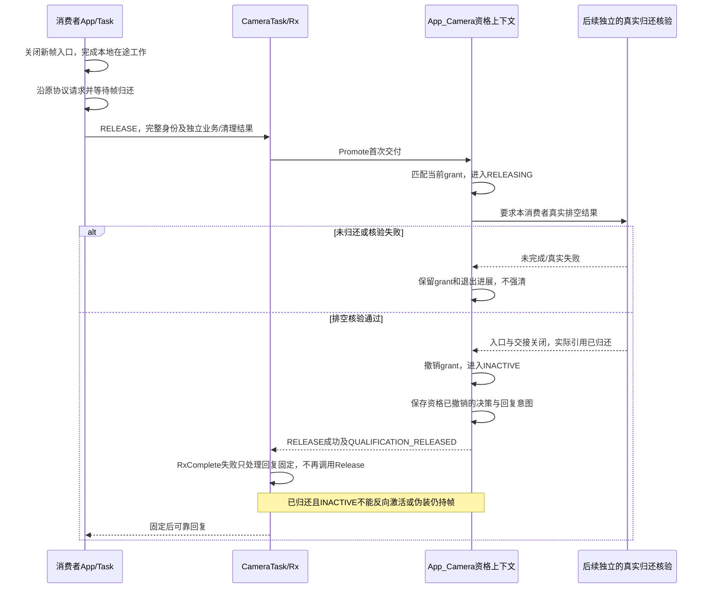
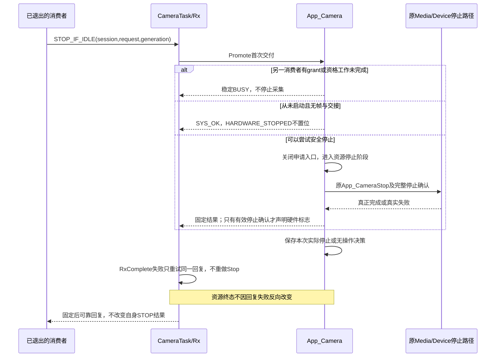

# C2.2 Consumer资格管理设计（R1修订）

## 1. 审查基线、范围与结论

- 仓库：h7_mac。
- 审查提交：`c6d2bedc28683883ffa433f802f8c06aaec3c542`。
- 初版文档提交：`28ed403cfdca75f8704cf47e4068113be616bd53`。
- R1修订分支：`codex/stage-C2-2-R1-qualification-design`；生产审查基线仍为c6d2bed，main仍为182c84e。
- 审查开始时工作区只有原有未跟踪的output/。
- R1仅更新本文档；不修改生产、测试、工程设置，不编译、不运行测试、不接入START/STOP。
- 本文中“源码事实”来自当前提交；“建议”均尚未实施；“待确认”不视为已经授权的实现。

推荐架构〔R1修订〕：App_Camera在同一业务所有者内管理USB资格、Storage资格、Camera资源生命周期三个独立状态对象；CameraTask串行运输消息及推进既有数据面；App_USB/App_Storage各自管理本地生命周期与Generation；受控Tx/Rx管理请求、重试及Replay。资格与帧账本严格分离。

本文只确定资格层及所需证明的边界，不设计具体USB/Storage归还采样接口。实际释放核验仍需后续单独审核；缺少真实核验时，资格层不得批准RELEASE成功。

### 1.1 R1修订索引〔新增〕

| 章节 | R1变化 |
|---|---|
| 1、2.4、3、4 | 更新基线、对象边界与结构名称；增加有界业务提交记录的设计理由 |
| 5 | 重写为两类状态机、三个独立状态对象，新增资源状态图及关系图 |
| 6、8 | 双消费者独立性；资源安全与回复固定门控分开 |
| 9.1～9.4 | 四种操作加入“效果已发生→决策固定→运输”的时序；明确历史STOP回复语义 |
| 10 | 重写RxComplete源码审查、部分完成判定、最小提交阶段及恢复路径；最终纠偏：RxEnter的BUSY是契约异常，不是队列背压 |
| 11、12 | RELEASE真实归还后不反向伪造持帧，新增交错场景 |
| 13 | 增加提交记录预算，明确资源对象不重复计费 |
| 14 | 保留Q01～Q30并细化Q28，新增Q31～Q44共14项测试设计 |
| 15～17 | 保留接口异常缺口、更新待确认决策、实施顺序和文档交付约束 |

本文中〔R1新增/修订/重写〕标记定位改动，未标记部分原则上沿用初版。没有将设计状态当成已存在源码，也没有执行任何测试。

〔R1最终BUSY纠偏〕本次以b286670为文档基线，仅修正10.5及相关冲突表述：同步10.2、12、Q31/Q32/Q38、D10；不增加结构、接口、RAM预算、恢复阶段或测试用例。RxComplete的BUSY必须先回到所属任务边界核查契约，RxFlushReply的NO_RESOURCE才按原运输背压重试。

## 2. 当前工程实现审计：源码事实

### 2.1 文件与实际能力

| 文件/位置 | 已确认事实 | 尚未实现的能力 |
|---|---|---|
| CM7/Application/app_camera_lifecycle.h:38 | 身份包含session/request/consumer/generation；消息固定56B | 不分配业务Generation，不保存资格 |
| CM7/Application/app_camera_lifecycle.c:17 | 校验操作、方向、字段及标志声明权限 | 不证明真实资源完成 |
| 同文件:112 | 回复匹配完整事务；成功QUERY允许返回新非零session | 不判断Camera当前是否允许grant |
| 同文件:290 | ReplayRetire对完成记录返回NOT_SUPPORTED | 无无条件缓存退休 |
| CM7/Application/app_camera_lifecycle_replay.h:23 | Tx=144B；Rx=332B，含当前Replay与一个候选 | 正式业务尚未实例化 |
| CM7/Application/app_camera_lifecycle_replay.c:226 | 重复/旧请求分类，HELD与QUARANTINED分离 | 不执行ACQUIRE或RELEASE业务 |
| 同文件:317 | 临时Replay构造后安全接替；高水位保留 | 不生成消费者资格 |
| CM7/Application/app_messages.h:34 | 原AppMessage包含stream_epoch、lease_id及CameraFrame_t，固定52B | 不是资格请求消息 |
| CM7/Application/app_messages.c:169 | 三条独立生命周期队列在Framework中准备 | 业务Task尚未使用新协议 |
| CM7/Application/app_camera.c:10 | s_camera是唯一Camera业务状态；含配置、Device、running/stopping、旧ACK/FAULT | 无消费者资格表、业务session或Generation |
| 同文件:219 | 旧START调用BridgeCameraBegin后启动采集；旧STOP进入后台停止 | 非消费者自主申请机制 |
| 同文件:92 | CameraCapture_Stop → IsStopped → Device_Stop | 不可由资格位替代此安全路径 |
| CM7/Application/Tasks/camera_task.c:131 | CameraProcess → BridgeCameraProcess → FinishRound | 没有资格事务调度 |
| CM7/Application/app_usb.c:46 | s_usb保存唯一USB业务状态；旧START调用USB_Mode_Start | 无Camera资格客户端 |
| 同文件:124 | USB停止保持Bridge归还及Abort失败所有权 | 不能据started等于有Camera资格 |
| CM7/Application/app_storage.c:638 | START先挂载并检查空间，再打开s_accepting；有独立Storage session | 此session不是Camera生命周期session |
| 同文件:334 | 实际SD引用归还在CameraTask上下文完成 | StorageTask不自行释放Media |
| 同文件:920 | 文件收尾与诊断状态独立存在；IDLE不等于所有帧已归还 | 诊断不能作为资格释放证明 |
| Common/Inc/camera_config.h:27 | CameraFrame_t描述数据地址、总长度及跨界第二段 | 没有消费者资格身份，也不应本轮追加 |
| CM7/Application/app_uvc_bridge.c:111 | 每次CameraBegin递增epoch，lease编号在新epoch内重置 | epoch不是消费者Generation |
| 同文件:425 | USB帧凭据匹配stream_epoch、lease_id、command_id | 不替代生命周期身份匹配 |
| CM7/Media/Inc/camera_mjpeg_fifo.h:19 | SD帧凭据为session/id；FIFO保留USB/SD引用 | FIFO session也不是生命周期session |

已搜索CM7，`app_camera_lifecycle_context.c/.h`和`app_camera_media.c/.h`均不存在。本文不将计划中的模块当作已有实现，也不因名称相似虚构第二份Camera模块。

### 2.2 当前调用图



现有ControlTask仍串联Camera/USB启停，且把NONE当成需要冷启动Camera的路径（control_task.c:152、209）。这些现状与已确认的按需采集目标存在差距，本轮不修改；后续接入必须单独处理，不能在旧路径外再并行启用一套资格启停。

### 2.3 C2.1.1文档与测试审查

已阅读Docs/Design/C2.1.1_Replay安全复用.md、生产工具及Tests/CameraLifecycleC2_1_1/测试和结果。其当前记录为648项专项、2项ABI、原C1/C1.1及历史有效回归通过；本轮没有重新执行，不能算作本轮资格层验证。

现有测试覆盖Replay、候选、身份确认、队列和固定内存，但没有资格表、真实Generation申请、双消费者grant、真实RELEASE或STOP_IF_IDLE硬件验收。其大量循环使用协议与业务计数桩，不代表资格层已经实现或实板独立启停通过。

### 2.4 结构名称与尺寸说明〔R1新增〕

需求中的“AppMessage 56B、CameraFrame_t 52B”与实际类型名称不一致：源码与已存在的C1/C2.1.1断言中，`AppLifecycleMessage_t`为56B，旧`AppMessage_t`为52B；`CameraFrame_t`是帧描述成员，不能把52B直接归给它。本轮不修改任何上述类型，也不重新编译尺寸探针；这里只更正命名，不把历史尺寸检查作为本轮新验收。

## 3. 现有协议、资格与业务的职责边界〔R1修订〕

| 层/模块 | 权威职责 | 不承担 |
|---|---|---|
| C1/C1.1 | 消息合法性、身份匹配、基本Pending/Replay | Camera使用资格、硬件或文件真实性 |
| C2.1.1 Tx/Rx | 单未完成请求、编号、高水位、重试、重复请求去重 | Generation业务语义、grant和真实资源清理 |
| App_Camera中的两个Qualification对象 | 分别管理USB与Storage资格及准入 | 不持有Camera资源running/stopping，不操作文件或帧引用 |
| App_Camera中的唯一Resource Lifecycle对象 | 复用并封装既有资源状态、会话、Device/Media准备/运行/停止/故障排空 | 不复制running/stopping权威状态，不代替消费者归还租约 |
| App_USB | 本地START/STOP、Generation分配、申请/退出事务 | 直接调用CameraCapture_Stop |
| App_Storage | 本地录像/抓拍及文件生命周期、Generation分配、申请/退出事务 | 直接Media Release |
| CameraTask | Camera消息收发、资格决策调度、数据面推进及真实归还执行 | 第二套资格表 |
| UsbTask/StorageTask | 各自协议运输和原任务工作 | 写入Camera资格上下文 |
| Media/FIFO/Bridge | 原有帧借用、交接、实际引用及Return/ACK | 自动分配消费者资格 |
| ControlTask | 后续只发业务意图和接收结果，保留BOOT职责 | 万能AppManager或全局资格/STOP控制器 |

App_Camera不得跨任务调用App_USB内部停止或StorageFS关闭。跨任务生命周期操作只通过既有三条通道和受控Tx/Rx。普通C内部函数调用只发生在所属任务内，不是绕过消息跨任务操作。

## 4. 资格上下文：建议及设计理由

### 4.1 是否独立建立Context

〔R1修订〕明确采用三个逻辑独立对象：USB Qualification、Storage Qualification、Camera Resource Lifecycle。三个对象都由App_Camera/CameraTask唯一管理，资格对象各有自己的阶段和身份，不把资源准备/运行/停止状态塞入资格枚举。

Resource对象是对现有s_camera资源字段的唯一归属与封装，不在原running/stopping外再保存第二份权威副本。未来若用资源状态枚举替换旧标志，必须一次性迁移其权威来源，不能长期并存两套决策状态。本轮只描述逻辑对象，不创建第二个Camera业务模块或新的全局static管理器。

优先在app_camera.c私有区域表达，app_camera.h只暴露必要的只读状态和所属任务调用入口。若将来为单测拆出纯决策文件，状态仍由App_Camera持有并显式传入；不新增另一套静态权威状态。

本阶段不确定C结构体字段顺序、偏移或bool打包方式。先确认下面的语义和预算，再在编码阶段用ARMCC5断言及Map确定实际布局。

### 4.2 每消费者所需的逻辑信息

| 信息 | 必要性与来源 | 避免的重复 |
|---|---|---|
| consumer_id | 两个固定槽的身份，可由槽索引推导 | 不建动态注册容器 |
| 资格阶段 | INACTIVE/ACQUIRING/ACTIVE/RELEASING | 不额外维护一份active_count |
| 当前申请或grant所属session | 防止旧资源会话操作当前资格 | 不复用FIFO或Storage session |
| 当前grant/申请Generation | 绑定本次业务使用资格 | 不用request_id替代 |
| highest_seen_generation | 拒绝已经消耗的旧申请代次，跨session保留 | 与当前grant代次分开 |
| ACQUIRE请求关联 | 引用对应Rx事务；成功后保留必要grant键 | 不复制整个56B请求/回复 |
| RELEASE请求关联 | 指向当前退出事务，关联同一grant | 不另建ACK和重试记录 |
| 最近资格决策结果 | 保留申请/退出错误 | 不覆盖本地文件或UVC故障 |

当前ACQUIRE/RELEASE完整原文、已固定回复和运输记录继续由Rx保存。〔R1新增〕在业务效果发生、Rx回复尚未可靠固定的间隙，需要一个绑定当前请求的最小提交记录，详见第10.3节；它不保存历史请求或执行去重，不是第二套Replay。资格表只保留必要语义键，例如session/generation/ACQUIRE request_id；固定consumer和操作无需重复存两套完整Identity。不能让资格模块直接改Tx/Rx字段。

### 4.3 三个不同的判断

- HasQualification：ACTIVE或RELEASING时仍保留grant；未完成的ACQUIRING不算已grant，但阻止停止完成。
- CanAcceptNewFrame：ACTIVE且当前会话、资源健康、grant回复已固定、消费者未要求退出时才可能为真；还需消费者自己的本地门控和UVC/Storage条件。〔R1〕grant已建立但回复固定失败时仍保留ACTIVE所有权，本消费者新帧入口保持关闭，不通过回滚资格解决运输错误。
- FramesDrained：来自后续独立的真实交接/Lease核验，不由资格阶段推导。

因此不建议再保存可独立修改的qualification_valid和exiting两个布尔副本：valid/退出状态尽量由阶段及资源条件派生。Camera FAULT时可保留ACTIVE/RELEASING的所有权关系，同时由资源故障关闭新帧入口；不把条目清成INACTIVE。

资格Getter必须只读，不采样/推进Media，不调用Release，不产生隐含START/STOP。

## 5. 两类状态机、三个独立状态对象〔R1重写〕

### 5.1 对象关系



U与S相互独立，不能通过其中一路的STOP去改另一路的资格。R独占资源准备、启动、停止、故障与安全排空。三个对象受同一CameraTask串行推进，不表示新增三个Task，也不要求新增三个业务模块。

### 5.2 USB与Storage各自的资格状态机

下面的图分别应用于USB和Storage，两个实例互不共用阶段字段。



资格变更与Rx回复固定分开。RELEASING只持续到实际退出条件成立、资格撤销完成；如果此后仅回复固定失败，真实阶段应为INACTIVE加“待固定提交”，不能为了占位继续伪装成仍持有帧。

ACQUIRING失败回INACTIVE也不能说明资源一定已恢复：部分启动后的故障与安全排空仍归R处理。资格Getter不得以INACTIVE替代资源安全检查。

### 5.3 唯一Camera资源生命周期

以下是逻辑资源状态图，不是当前源码已经存在的新增enum；未来必须封装/迁移现有权威资源字段，不能复制running/stopping。



- ACTIVE/INACTIVE不能直接驱动资源图“跳到已停止”。
- 两消费者均INACTIVE时仍须检查ACQUIRING/RELEASE业务工作、未固定决策、交接、外部引用和真实硬件。
- RUNNING下增加第二grant不经过PREPARING，不重复Device_Start或BridgeCameraBegin。
- Camera FAULT时R可先保护性停止；U/S不因而自动清资格或引用。
- 资源已安全停止但STOP回复固定失败时，R仍是STOPPED_CONFIRMED；阻止的是该事务完成/新会话准入，不把资源状态改回RUNNING。

### 5.4 内部提交进展不是第三类业务状态机

第10节的提交记录只跨越“已发生业务决策”到“原Replay可靠固定”之间的间隙。它没有业务START/STOP转换、没有自己的资源所有权、没有独立任务或超时回滚；固定后即清除。不能通过它把U/S或R改回先前状态。

## 6. USB/Storage双消费者关系〔R1修订〕

| USB | Storage | 采集资源决策 |
|---|---|---|
| INACTIVE | INACTIVE | 无grant仍不等于可停：检查申请、未固定决策、交接、实际帧引用及资源硬件 |
| ACTIVE | INACTIVE | 为USB维持采集 |
| INACTIVE | ACTIVE | 为Storage维持采集，不能因USB停止而停Camera |
| ACTIVE | ACTIVE | 共享同一采集资源，不重复Device_Start/Begin |
| RELEASING | ACTIVE | USB入口关闭并排空，Storage继续 |
| ACTIVE | RELEASING | Storage排空，USB继续 |
| RELEASING | RELEASING | 两路独立排空，不强制清引用 |
| ACQUIRING | 任意 | 存在未完成申请，不报告整体停止完成 |

〔R1补充〕USB ACTIVE时Storage申请只复用R；Storage ACTIVE时USB退出只改U；两路同时退出分别等待自己的真实证据，不能用一次核验替代两路。某一路回复固定/运输失败不将另一条目清空，不自动全局STOP；只有错误涉及共享资源真实性时才由R阻止新的资源转换。

第二个消费者获得资格时不得重新调用BridgeCameraBegin、重置stream_epoch、lease编号、FIFO或既有采集统计。消费者换Generation不等于重新开启整条采集管线。

USB Reset/Disconnect/Suspend/Resume不自动释放资格；USB_TEST不申请资格；NONE按需采集。这些是此前已经确认的目标规则，当前基线业务尚未接入，本轮不改变。

## 7. Generation生命周期

### 7.1 谁生成、何时消耗

建议由App_USB、App_Storage分别拥有自己的单调分配序列，Task只运输。一次新的本地START请求通过重复/冲突门控并被接收为新尝试时，先分配非零Generation，再使用同一个Generation执行QUERY、ACQUIRE及必要清理。

- 同一request重传：不分配新Generation，交给Replay。
- ACTIVE/退出中对本地新START的直接BUSY拒绝：没有接收为新尝试，不分配Generation。
- 一旦已分配，之后查询、挂载、申请、硬件启动失败或READY取消都消耗该代次，不回退。
- 失败后重新接受一笔START：使用更大Generation，不把旧Generation重新申请成成功。
- 允许跳号，不要求Camera看到所有代次；不得回绕，耗尽拒绝新START。
- Generation按消费者跨Camera session保留，不随停止/重新枚举或普通Device初始化清零。
- 此保证限同一配套固件运行期，不覆盖任务状态丢失或单核热复位。

### 7.2 Camera如何拒绝旧Generation

先经过Rx去重/Promote，只有首次交付的事务才进入资格决策。Camera分别保存当前grant代次和最高已见申请代次，不能只保存一个generation字段。

建议判定规则：

1. 格式、消费者、真实来源及当前session不合法：拒绝，不授权；错误旧session不能改变当前资格。
2. 原request重复：直接走Rx原结果，不重新做Generation决策。
3. 新ACQUIRE的Generation已消耗且当前无对应grant：拒绝，不允许失败的START后来凭同代次重新成功。
4. ACTIVE/RELEASING上的新ACQUIRE：不增加grant，返回BUSY；若收到更大合法代次，记为已见失败尝试，但保留原grant身份。
5. 因此RELEASE必须先精确匹配当前grant的session/consumer/generation，再判断它；不能因曾见到一个更大但被拒绝的ACQUIRE而拒绝仍有效的原grant退出。
6. 只有INACTIVE、合法新代次、资源允许时才进入ACQUIRING。新的已见尝试单调记录，即使随后资源BUSY或启动失败也不回退。
7. SESSION_QUERY只读取会话，不推进资格阶段，不替代ACQUIRE建立grant，也不因查询较大代次撤销旧grant。

对旧Generation/错误session建议使用现有SYS_ERR_INVALID_STATE，对当前有grant的新申请使用SYS_ERR_BUSY，不新增消息结果枚举。相同request编号改Generation属于Replay层PROTOCOL，不进入上述业务分支。

### 7.3 与其他编号的区别

| 编号 | 管理者与意义 |
|---|---|
| Lifecycle session_id | App_Camera资源周期 |
| consumer_generation | 各消费者新START尝试 |
| request_id | 各方向受控Tx请求编号，不随session/generation重置 |
| stream_epoch/lease_id/帧command_id | 原Bridge帧协议 |
| CameraMjpegLease_t.session/id | 原FIFO的SD引用凭据 |
| Storage s_session/slot.generation | 原存储帧槽及录像会话 |

这些数值即使碰巧相等，也不能互相转换或用于代替校验。

## 8. Camera会话生命周期与查询引导

### 8.1 建议的会话分配点〔R1修订〕

为解决QUERY需要非零返回值而ACQUIRE又必须带session的引导问题，建议App_Camera在资格层首次准备时分配一个非零“可申请资源会话”，不启动传感器。首次可使用1，由Camera独占的单调序列分配。

SESSION_QUERY返回的是可申请的资源会话，不是Camera已经运行的证明。

最后一个grant释放后也不立即更换session：仍要完成STOP_IF_IDLE/安全停止或未启动分支，并结束旧资源工作。关闭旧资源周期后，下一个合法SESSION_QUERY可以在安全门控下惰性分配下一session；多个查询看到同一个新会话，不重复递增。

安全门控至少包括：无grant、无正在执行的资格申请/释放、无真实外部帧和交接、无旧启动/停止/清理工作、旧事务回复已经稳定且无本地未提交回复工作；当前正在执行的QUERY自身不计为阻塞项。无法证明则QUERY返回BUSY/真实错误，不分配新会话。〔R1〕QUERY已经分配并发布新session但RxComplete失败时，保留同一分配结果与冻结回复参数，不再次调用编号分配；存在未固定提交记录时不再滚动资源会话。

不要求跨任务读取对端Pending来证明它已消费回复。旧终结回复缓存可保留，由C2.1.1水位保护；新的session检查阻止旧请求操纵新资格。所有Tx/Rx只初始化一次，绝不能为切换session重新Init。

### 8.2 对资格的影响

- 存在ACTIVE/RELEASING/ACQUIRING时，不得切换资源session。
- Camera FAULT不立即滚动session、不自动清空条目；先保护性停硬件，保留外部引用和grant关系，待真实退出后再关闭资源周期。
- 旧session的新请求只能得到稳定失败，不能对新会话执行RELEASE/STOP。
- 旧QUERY原request重放仍返回缓存原session，消费者用它申请可能被拒绝；重新查询必须用新request_id。
- session耗尽拒绝新资源周期，不回绕，不借用stream_epoch作为替代。

这是一项待确认的分配策略，不是当前代码事实。

## 9. 四种操作契约与时序

### 9.1 SESSION_QUERY〔R1修订〕

| 项目 | 建议契约 |
|---|---|
| 发起方 | USB/Storage所属Task通过已有Tx发起 |
| 前置 | 本方向没有未消费Pending；非零Generation；请求session=0 |
| 状态变化 | 不改变消费者资格；仅在旧资源周期安全关闭后可能分配新session |
| 成功 | 返回当前非零可申请session，不声明grant或硬件运行 |
| 失败 | 会话切换暂不安全返回BUSY；编号耗尽或内部失败返回真实错误 |
| 重复 | 当前request重放原结果；已退休request拒绝 |
| 超时/清理 | 保留WAIT_REPLY；不启动Camera、不产生文件清理 |



### 9.2 ACQUIRE〔R1修订〕

| 项目 | 建议契约 |
|---|---|
| 发起方 | USB/Storage；使用查询所得session及本次START Generation |
| 前置 | 身份合法；未重复grant；代次未被消耗；会话开放；资源无未解决危险状态 |
| 状态变化 | INACTIVE→ACQUIRING；实际可用后→ACTIVE；失败→INACTIVE且代次消耗 |
| 成功 | 原采集确实可用；已有运行资源则不重复启动；先登记grant再缓存成功回复 |
| 失败 | ACTIVE/退出/停止中BUSY，旧身份INVALID_STATE，启动/准备失败保留真实错误 |
| 重复 | 同request只返回原进展/结果；新request的重复START不会增加grant |
| 超时/清理 | 未收到回复不能认定失败或未授权；若本地已要求STOP，收到成功后立即走安全退出 |
| 责任 | Camera独占采集准备/启动/失败清理；消费者独占自身初始化、失败后的文件/UVC清理 |



Camera正在STARTING而另一消费者请求到达时，建议返回终结BUSY，避免未经审核合并多个硬件启动等待者；同原request仍由Replay处理。现有启动函数本身含同步调用，本设计不声称将它改成非阻塞硬件状态机。

一次ACQUIRE返回终结BUSY后不能在后台悄悄批准同一事务。需要重试时，应由消费者接受新的START尝试、分配新Generation和新请求。

〔R1〕grant建立、Replay回复固定、回复入队、发起者消费分别记账。资源已启动且grant为ACTIVE时，RxComplete失败只进入第10节待固定/阻塞提交，不再Device_Start、不将grant回滚成INACTIVE；未可靠得到grant结果的USB/Storage入口仍关闭。

### 9.3 RELEASE〔R1修订〕

| 项目 | 建议契约 |
|---|---|
| 发起方 | USB/Storage所属Task，在关闭自身入口并完成本地退出后提交 |
| 前置 | 精确匹配当前grant的session/consumer/generation；原本地处理仍受单未完成请求约束 |
| 状态变化 | ACTIVE→RELEASING，grant保留但新帧准入关闭；真实排空核验通过才→INACTIVE |
| 成功 | 独立核验确认本消费者交接和实际租约已经归还，才设置QUALIFICATION_RELEASED |
| 失败 | 错误身份拒绝；真实归还失败保留RELEASING，不能完成假成功 |
| 重复 | 同request走原Replay；新request在已经INACTIVE时建议返回INVALID_STATE，不重做释放 |
| 超时/清理 | 不能清资格或帧；Camera继续处理Return/归还，消费者继续原清理 |
| 责任 | USB处理UVC；Storage处理文件；CameraTask执行原Media实际归还；Camera资格层只验证退出条件 |



本图的L是后续证明边界，不是已经实现的接口；本轮不设计其内部采样布局。资格单测可以注入明确的证据事件，但未来生产没有证据时必须保持等待，不能默认true，也不能直接使用消息completion_flags、Debug或App_Status代替。

RELEASING等待是实际退出条件尚未成立的请求，不应先回复BUSY再让相同request后来变成功。〔R1〕实际排空且资格撤销后，阶段已经INACTIVE；若此时回复未固定，等待的是提交，不是帧归还。如果决定把归还错误作为终结失败回复，该回复必须永久保持失败；该条目仍保留grant，消费者后续需要新的合法RELEASE事务继续请求。尚未解决的资源失败不自动恢复。

已确认的Storage例外继续成立：文件Finish/Close/Unmount失败，但入口关闭、CPU/IO不再访问原帧、交接结束且实际帧引用已安全归还时，可以释放Camera资格。RELEASE.result可成功，同时business_result/cleanup_result保留失败；不能因此给出虚假的FILE_FINISHED/FILE_CLOSED/VOLUME_RELEASED，也不能计为正常AVI完成。

资格正式失效的时点是Camera确认真实排空后将条目改为INACTIVE；不是命令入队、消费者声明STOP或文件关闭。成功回复尚未被消费者消费时，本地仍可处于等待确认；后续START必须等原Pending完成并消费。

### 9.4 STOP_IF_IDLE〔R1修订〕

| 项目 | 建议契约 |
|---|---|
| 发起方 | 消费者在自身释放后独立提出；不得用它代替RELEASE |
| 前置 | 当前session合法；请求Generation不得倒退到已见旧尝试；未启动新尝试可请求空闲检查，不产生grant |
| 其他消费者仍活动 | BUSY；本消费者自身STOP/资格释放成功仍独立成立 |
| 存在未完成资格/交接 | BUSY，或者已受理停止继续等待真实完成；不得先BUSY后改同request结果 |
| 真正可停 | 无grant、无未完成申请/释放、无外部帧和交接、硬件可安全停止 |
| 成功 | 沿App_CameraStop及原Stop/IsStopped/Bridge/Device语义确认；从未启动走专用无操作分支 |
| 重复 | 同request重放原回复；新request重新执行只读资格检查及必要幂等停止 |
| 超时 | 保留请求与实际状态，不宣称硬件安全 |



STOP检查排除它自身这笔事务，但包含已受理的ACQUIRE/RELEASE工作。未受理的新请求在停止阶段返回BUSY；对已有HELD候选采用保守门控，不能在明知有待处理申请时立即报告稳定停止。不能要求所有Replay为空，否则完成缓存永久保留会阻止停止；要区别业务工作未完成和已完成回复记录。

〔R1语义澄清〕HARDWARE_STOPPED回复标志表达：该请求指定的session在该操作完成时已通过真实安全停止确认。它不是收到回复这一时刻全局Camera仍然停止的证明。当前Resource对象的停止确认在新启动尝试前作废，但不得回写/修改已经固定的历史回复。旧STOP request重传只能重放旧session的历史结果，不能再次Stop或影响新会话。首次从未启动分支仍为SYS_OK、标志不置位；本次细化的会话限定语义保留为待确认。

## 10. 业务提交与RxComplete的衔接〔R1重写〕

### 10.1 运输与决策职责不变

消费者必须使用既有AppLifecycleTxContext_t；Camera按消费者使用既有AppLifecycleRxContext_t。仅RxPromote首次成功交付的请求可以进入资格/资源决策。DUPLICATE_RUNNING、REPLAY、STALE及候选背压不能重新调用业务处理。原ReplayRetire继续禁止成功，不直接写Tx/Rx字段，不建立第二通道或Replay。

### 10.2 RxComplete实际语义、失败与部分完成：源码事实

以下按当前c6d2bed实现逐层复核，R1没有修改源码。

| 位置 | 实际行为 | 设计含义 |
|---|---|---|
| app_camera_lifecycle_replay.c:59～68 | RxEnter：NULL→INVALID_ARG，api_busy→BUSY，未初始化→INVALID_STATE | 这些返回发生在本次写Replay之前，不说明此前是否已完成；BUSY在正常单所有者禁重入契约下不是队列背压 |
| 同文件:363～372 | 先ReplayComplete，再仅在返回SYS_OK时StageReply；最后清api_busy | 不是把业务、Replay及待发记录一起回滚的事务 |
| app_camera_lifecycle.c:265～275 | NULL参数→INVALID_ARG；未占用/回复不匹配→PROTOCOL；完成且相同→ALREADY_EXISTS；不同→PROTOCOL | 错误不能被解释为业务动作未执行；完成结果不能覆盖 |
| 同文件:273～274 | 首次成功把完整回复复制到Replay并设置completed=1 | 回复固定发生在准备待发记录之前 |
| app_camera_lifecycle_replay.c:218～222 | 非EMPTY待发槽直接返回SYS_OK；EMPTY时调用Stage | RxComplete成功不等于已发送，也不能独立证明非空待发槽内容正确 |
| app_camera_lifecycle.c:172～180 | Stage在NULL/消息非法时INVALID_ARG，非空时ALREADY_EXISTS/BUSY，成功才复制完整消息 | 正常新终结路径回复已通过匹配且槽应为空，后段失败不应被当成普通队列满 |
| app_camera_lifecycle_replay.c:376～397 | FlushReply才调用运输；EMPTY→NOT_FOUND，缓存/待发不匹配→PROTOCOL | 队列不可用发生在这里，不是RxComplete中调用FreeRTOS Queue |
| 同文件:389～393 | Flush成功后final_reply_enqueued=1，再Clear已提交Pending | 仍只证明入队，不证明对端已消费 |
| 同文件:245～261 | completed=0重复请求分类DUPLICATE_RUNNING；completed=1则REPLAY并StageReply | 重复请求不再次Promote执行；真实重复可触发原回复重放 |
| 同文件:401～417 | GetStatus输出active/occupied/completed/入队事实/候选/协议故障 | 这是协议状态观察，不是硬件或帧释放证明 |

特别注意：已经completed的相同回复再次调用RxComplete返回ALREADY_EXISTS，并且不会再次进入StageReply。不能把“反复RxComplete直到发送成功”写成恢复算法。

在遵守管理对象不被直接改写、单所有者和新请求Promote前待发槽为空的正常契约下，StageReply后段失败基本不应出现。但实现顺序仍是两阶段，错误注入或不变量破坏时不得把非SYS_OK等同于“Replay肯定没有固定”。

### 10.3 最小内部提交记录与生命周期〔新增〕

需要一个仅绑定当前请求的“待固定业务决策”记录，原因是：外部效果不能因缓存函数失败而再次执行；同时C2.1.1的Replay尚未固定时也不会替业务保存已完成的资源决策。

建议每个Camera接收编号域最多一个记录，复用到当前四种操作，不为每种操作分别开槽。它由同一App_Camera/CameraTask拥有，不建立任务、队列或历史表。

最小语义：当前request_id、预定reply_session、completion_flags、result、business_result、cleanup_result、一个提交阶段。按7个32位值估算28B；若需要单独记录最近固定错误，再加4B。完整请求原文仍在现有Rx；方向固定、active_request_id和完整身份在生成回复前重新核对，不能把request_id单独当跨域身份。

不保存第二份完整请求/回复、Replay键索引、高水位或ACK重试计数。最终固定回复与历史重放只有C2.1.1 Replay一处权威。这个记录是未提交决策参数，不是允许业务绕过Rx发送回复的缓存。

提交阶段只需要：

| 阶段 | 意义 | 可做/不可做 |
|---|---|---|
| NONE | 没有待固定的已应用决策；业务可能尚在原资格/资源阶段执行 | 仅原首次交付路径可执行业务；不能由重复请求再次进入 |
| DECIDED | 本请求的实际结果及资格变更已确定并应用，回复参数冻结但未确认Replay固定 | 只重建同一临时回复并尝试RxComplete；禁止重新Start、Release、分配session或回滚资格 |
| BLOCKED | 决策仍真实成立，但协议身份/窗口/缓存不一致，不能安全继续固定 | 保留记录和事实，报告错误；不自动Reset、不改原回复、不强清资源 |

正常确认原Replay已固定、正文一致且待发/入队状态符合既有不变量后清除该记录；运输背压继续由原reply_pending管理，不再复制到本记录。若固定后的待发状态异常，保留BLOCKED直到一致性判定完成，不能先清记录再假设运输可继续。BLOCKED不超时回滚，不是自动恢复业务状态机。若后来有明确、经验证的本地调用问题被消除且原窗口/身份/回复仍一致，只可恢复同一提交，不重新执行效果；具体纠错入口未获授权，不能先实现公开Recover。

建议顺序：

1. 原RxPromote交付后检查本请求没有DECIDED/BLOCKED的旧记录，预留固定槽，验证请求和可构造的回复参数。
2. 由原业务/资源路径执行一次必要动作；等待中的ACQUIRING/RELEASING继续沿原阶段，不用另一个执行FSM。
3. 实际结果可确认后，更新唯一Resource/Qualification事实并立即冻结该请求的决策参数，发布DECIDED。
4. 第3步的软件更新段不调用Observer、发送或可重入业务函数。硬件调用在之前，调用返回的真实部分成功/失败必须保留，不能宣称跨硬件与内存的掉电原子性。
5. 根据现有Rx的不可变原请求，用既有MakeReply构造临时完整回复，再填写冻结的flags/business/cleanup；Validate和MatchesReply通过后调用RxComplete。
6. 失败按10.5分支处理；重复请求不得调用第2步。
7. 回复固定且通过一致性核对后，业务提交记录退出；通过原RxFlushReply运输。后继仍必须经过原候选与高水位接替，不直接放行新业务。

一致性约束不是要求资源位、资格位和Replay.completed在同一条指令改变，而是要求每个中间进展都有明确解释：

- 资源效果未完成时不能提交成功业务决策。
- 已应用业务决策而Replay未固定时，必须有同请求DECIDED/BLOCKED记录，重复请求不能重新进入效果路径。
- Replay固定成功时，其正文必须与实际已应用的冻结决策一致；若不一致只能显式报错，不能回滚事实去迎合缓存。
- 资格已撤销时FramesDrained不能被反向改成未归还，资格也不能为了运输占位被恢复ACTIVE。
- 清理待固定记录只说明固定成功，不代表回复入队或对端消费；后两者仍由原Rx/Tx维护。

这个最小阶段不表示本轮已增加生产结构，也不改变C2.1.1。

### 10.4 四种操作的业务效果与提交失败矩阵〔新增〕

| 操作 | 效果事实 | 资格事实 | Rx未固定时 | 固定后队列背压时 |
|---|---|---|---|---|
| SESSION_QUERY | 可能已分配/发布资源session | 不产生grant | 冻结同一session，不能再分配一次；阻止未决会话滚动 | 只Flush原查询回复 |
| ACQUIRE | 原资源实际启动成功或已运行复用 | 成功即ACTIVE并保留grant；失败无grant但资源清理独立 | 保持真实状态，DECIDED只提交；不能再Device_Start，也不能因无ACK撤销grant | Replay保留成功，消费者本地未获结果则不收新帧 |
| RELEASE | 权威核验确认帧与交接已实际归还 | 撤销完成即INACTIVE | 不重新激活，不伪装仍持帧，不再次Media Release；保留尚未固定的成功退出决策 | 只发送资格释放结果，原文件错误继续保留 |
| STOP_IF_IDLE | 硬件实际安全停止，或从未启动的无操作分支已完成 | 两资格事实不反向改变 | 保持资源终态，不能重做Stop或改回RUNNING；新会话推进受未决提交门控 | 重放指定旧session的原结果，不操作新会话 |

RELEASE必须把两个先后事实拆开：若仅真实排空成功但资格撤销尚未应用，记录“排空证据成立、grant仍待撤销”的实际阶段，下一步只完成一次资格撤销，不再做Media Release；资格撤销完成后进入DECIDED。不能为省字段把“帧已归还但资格尚在”写成“帧仍持有”。上述排空事实来源仍是后续独立权威证明，不由本提交记录增加引用计数。

### 10.5 RxComplete失败后的恢复/阻塞分支〔新增〕

| 当前观察 | 处理 | 禁止行为 |
|---|---|---|
| RxComplete返回BUSY：RxEnter发现api_busy已占用，本次尚未修改Replay | 保留DECIDED和实际业务/资格事实，返回所属任务调度边界，检查重入、所有权及调用时序；确认原Rx窗口、完整请求身份、冻结决策与提交状态仍一致后，才可继续同一回复提交，否则保持阻塞 | 无条件下一轮盲重试；重复资源操作；Init/Reset/清Replay；直接修改api_busy绕过门控 |
| 返回INVALID_ARG/INVALID_STATE或身份不匹配PROTOCOL，尚未固定 | 视为调用或窗口不变量错误，BLOCKED并保留真实决策，不能盲目自动重试 | 改身份以凑匹配；Reset/Init Rx；回滚已发生效果 |
| 返回ALREADY_EXISTS，completed=1且原缓存与冻结回复逐字节一致 | 确认已固定，不是新的业务失败；待发/入队不变量正常才退出本地记录，否则走下面BLOCKED分支 | 再Complete以为会重新Stage；重新应用资格变更 |
| 非SYS_OK但completed=1且缓存与预定回复一致 | 识别为“固定已发生”，不回滚；检查现有运输能力后分别继续或BLOCKED | 只凭返回码认定未固定 |
| completed=1但缓存与预定回复不同，或active身份改变 | BLOCKED，原缓存不可覆盖，保留已发生事实并报告严重不一致 | 用后来成功覆盖失败或修改缓存正文 |
| 原回复已固定，FlushReply返回NO_RESOURCE等运输失败且Pending仍READY | 沿现有RxFlushReply后续重试，结果/身份/业务事实不变 | 把队列满转换为业务失败或重复操作 |
| 原回复固定且final_reply_enqueued=1 | 已发生可靠入队；是否消费由原Tx负责；重复请求可走REPLAY | 把入队等同对端已消费或资源此刻状态 |
| completed=1、未入队、FlushReply为NOT_FOUND（异常缺少待发记录） | 现接口不保证自动修复：BLOCKED并保留缓存/真实决策；实际同request重传可经RxReceiveRequest触发原重放，但不能依赖它必然到来 | 伪造对端新请求；直接改reply_pending；宣称再次RxComplete必定补齐Pending |
| FlushReply为PROTOCOL（缓存/待发不一致） | BLOCKED；现有防护会拒绝发送错误回复，不能清掉以绕过 | 发送未经匹配回复、强清或换号重做 |
| RxGetStatus本身BUSY/无效，不能可靠判断固定状态 | 保留DECIDED/BLOCKED；同样返回所属任务边界核查重入/所有权和状态一致性，未知时既不重执行业务，也不盲目继续提交 | 将未知等同未执行/未归还；直接修改api_busy |

〔R1最终BUSY分类：源码依据〕RxComplete在app_camera_lifecycle_replay.c:365调用Replay_RxEnter，366～367行直接返回其错误。RxEnter在63～64行因api_busy非零返回BUSY，本次没有进入ReplayComplete或StageReply，也没有替原调用清除门控。App_LifecycleReplayComplete（app_camera_lifecycle.c:265～275）本身没有BUSY返回分支；Replay_StageReply（app_camera_lifecycle_replay.c:218～222）发现待发槽非空直接返回SYS_OK，正常单所有者路径在槽为空时才调用Stage，不执行队列发送。因此此处BUSY不能被解释为回复队列满。

在单所有者、禁止重入契约下，观察到入口BUSY意味着至少需要检查重入、错误共享所有者或调用时序；不能无条件归类成普通瞬时失败。处理时先停止该次提交尝试、返回所属任务调度边界，让仍在执行的原管理调用按自身正常路径返回；不得修改api_busy帮助它“解锁”，也不在回调内自旋。DECIDED及已启动资源、已撤销资格、已归还帧的事实全部保留。

随后必须在合法所属上下文核对原编号域、Rx当前请求原文/身份、冻结决策及Replay提交状态：仍一致且未固定才允许重新提交同一冻结回复；已固定则转相应固定后分支；不一致或无法核实则保持DECIDED/BLOCKED并报告契约错误。返回调度边界本身不是恢复成功证明，不新增公开Recover、Init/Reset或Replay清理入口。

与之分开，RxFlushReply在app_camera_lifecycle_replay.c:389通过既有Flush执行真实发送；由现有消息运输返回的NO_RESOURCE表示队列暂不可用，原Pending保持READY，这是正常运输背压，可以按原机制重试。不能把这个重试策略套用到RxComplete的入口BUSY，也不能把所有FlushReply错误都视为队列背压。

仅同一所属任务的协议适配部分可使用现有RxGetStatus观察状态，按既有对象只读规则读取同一Rx的不可变replay.request重建临时回复（先核对固定编号域、active_request_id及原完整身份；不另存第二份请求），并用既有只读App_LifecycleReplayGetReply(&rx.replay, ...)取当前固定回复，与临时重建的冻结回复比较；不修改Rx字段，不让资格Getter或其他任务访问它。若最终封装不允许该只读组合，应作为需要确认的适配接口缺口上报，而不是暗加C2.1.1 API。

本节不承诺任意内部损坏可自动恢复。尤其“固定后Pending缺失”没有专门重装待发API：再次RxComplete相同回复只返回ALREADY_EXISTS。R1明确保留这个异常恢复缺口，不修改既有工具，也不通过本地伪造对端流量绕开。真实队列背压沿既有运输机制重试；入口BUSY先作为契约异常检查，只有窗口、身份和提交状态一致性确认后才允许继续原提交，不能无条件自动重试。永久身份/窗口冲突只能保持安全事实并等待纠错方案审核。

### 10.6 重复请求与双消费者并发〔新增〕

业务效果只由首次Promote触发；正常重复消息只调用RxReceiveRequest：

- 业务已DECIDED但Replay.completed=0：分类仍为DUPLICATE_RUNNING，不再次交付业务；所属任务按本地记录继续固定。
- Replay.completed=1：分类REPLAY，使用唯一原缓存；不读取当前硬件状态重算旧结果。
- 旧request已退休：STALE，不申请资格、不归还帧、不Stop。

一个消费者的DECIDED/BLOCKED只阻止该方向被当作正常新事务继续执行，不自动停止另一消费者、不清另一grant或Rx。CameraTask仍须推进原Media/Bridge/归还，不能为了等固定阻塞主循环。若共享Resource真实状态安全，另一方向既有服务可以继续；若错误影响共享资源身份或安全性，则由唯一Resource生命周期关闭相关准入，不能假装局部问题已恢复。

同时RELEASE仍逐路核验：一路已归还且INACTIVE但待固定，另一路仍持帧则保持RELEASING。不能把前一路重新ACTIVE以“保持两个表一致”，也不能将后一路伪造INACTIVE。

### 10.7 进展对照与历史回复〔新增〕

```text
资源动作/权威核验完成
    → 资格变更完成（如该操作需要）
    → DECIDED：冻结回复参数，效果不再执行
    → 原Rx Replay可靠固定并通过一致性核对
    → 原reply_pending成功入队
    → 对端Tx接受并显式消费
```

这些进展可能跨多轮；只有前两个影响真实资格和资源。后面失败不能反向改变前面的事实。没有全局事务回滚，没有第二份Replay。

STOP_IF_IDLE完成后旧回复重传尤其如此：旧session的停止结果是历史操作结果，不能把已固定HARDWARE_STOPPED当成当前新session资源状态。当前Resource状态只由自身真实路径决定，旧重放不能触发任何Stop或清资格。

### 10.8 所属任务与状态读取〔原10.2保留并澄清〕

| 调用者 | 允许操作 |
|---|---|
| CameraTask | 推进两个Qualification与唯一Resource，按消费者保存待固定记录，使用所属Rx/Tx和原归还路径 |
| UsbTask | 使用App_USB本地生命周期和受控Tx/Rx；不直接修改Camera资格或资源 |
| StorageTask | 使用App_Storage本地生命周期和受控Tx/Rx，独占原文件业务 |
| 其他任务/ISR | 不直接读取/修改上述私有对象，不能把状态发布当资源释放证明 |

只读业务Getter不提交决策、不重试RxComplete、不推进硬件。诊断Observer不改变提交阶段。跨任务状态发布沿既有机制，不向其他任务暴露可写管理对象。

## 11. 与帧资源生命周期隔离〔R1修订〕

必须维持四个不同完成点：消费者业务停止、帧租约真实归还、资格释放、Camera硬件停止。它们不是一个STOPPED字段。

安全顺序为：消费者关闭入口并结束在途工作 → 原帧归还/交接处理 → Camera侧真实核验 → 资格失效 → 可选STOP_IF_IDLE。

既有CameraFrame_t不追加资格身份。既有stream_epoch/lease_id、FIFO session/id和引用计数不改。未来资格准入通过App层关联当前会话与消费者，不能使用资格位调用无条件Media Release。

- USB和Storage可以共享同一物理JPEG，但各自的资格和引用独立。
- 一路释放资格不能清另一条目的grant或引用。
- 全局HasLoan只能用于最终整体资源检查，不能替代分消费者排空。
- Camera FAULT允许必要保护性停止，DRAINING和外部借帧继续存在；不能为了新session重建或覆盖旧缓冲。
- 没有真实归还核验前，资格层只能保持RELEASING，不能交付成功。
- 〔R1〕核验已经真实完成并撤销资格后，不能因RxComplete错误继续宣称帧未归还；应保持INACTIVE和待固定决策，不增加虚假引用、不重新激活grant。

## 12. 异常交错场景〔R1补充〕

| 场景 | 设计结果 |
|---|---|
| USB与Storage同时申请 | CameraTask串行；一次硬件启动；另一路已运行时复用或STARTING时终结BUSY |
| 同request重传START | Replay原进度/回复，不消耗新Generation或重复grant |
| ACTIVE的新START request | BUSY；不产生第二份grant |
| STOPPING收到新申请 | 关闭准入，BUSY或旧身份拒绝；不得停止反转成自动启动 |
| ACQUIRE失败 | 无grant，Generation消耗；启动失败清理由Camera独占继续 |
| 本地STOP先于ACQUIRE回复 | READY可取消但Generation不回收；WAIT_REPLY不可取消，成功到达后转安全退出 |
| USB RELEASE时Storage ACTIVE | 只退出USB；STOP_IF_IDLE BUSY；Storage继续采集 |
| Storage RELEASE时USB ACTIVE | 只退出Storage；文件错误仍由Storage保留 |
| 两消费者同时RELEASE | 独立核验、独立回复；所有权清完后才允许整体停止 |
| 新大Generation的ACQUIRE被拒绝而旧grant仍在 | 保留旧grant退出权；匹配旧grant的RELEASE不能被高Generation水位误杀 |
| 旧Generation新request | 业务层拒绝；同旧request由Replay先拒绝或重放，不重复操作 |
| 旧session迟到回复 | Tx完整匹配；未匹配不消费当前Pending，不开启新帧入口 |
| 回复成功入队但尚未消费 | grant决定与传输状态分开；不因为通知而开始下一事务 |
| 候选槽/队列满 | 沿C2.1.1保留，不丢身份，不扩容，不发送内部BUSY作业务终结 |
| 归还失败或CPU/IDMA仍使用帧 | 保留RELEASING，不清资格，不覆盖缓冲 |
| 文件失败但帧已安全归还 | 可释放资格；Storage仍FAULT，文件失败不清除 |
| Camera FAULT有外部租约 | 先保护硬件、保留grant/引用，等待真实退出，不自动换session |
| Generation/session/request耗尽 | 拒绝新尝试，保留必要清理额度，不回绕 |
| 单核热复位/任务私有状态丢失 | 不承诺恢复；不能重置计数后继续原会话 |
| ACQUIRE成功但RxComplete BUSY | ACTIVE与DECIDED保留、入口未开放；返回所属任务边界核查契约和一致性后才继续原提交，不重复启动 |
| RELEASE真实排空且撤销完成后固定失败 | INACTIVE保留，不反向激活、不再次Release；记录待固定或BLOCKED |
| 缓存已固定但回复队列满 | 只重试原FlushReply，固定结果不变 |
| 业务已经完成时相同request到达 | completed=0时只识别重复执行中；completed=1时只重放 |
| USB提交失败而Storage仍ACTIVE | 保持Storage服务，不用USB回复失败触发全局STOP |
| STOP已完成、后来新资源周期运行、旧回复重传 | 只重放旧session结果，新Resource不被停止 |

## 13. RAM预算与上下文布局决策〔R1更新〕

本轮只改文档，实际RAM增量为0，未编译或重跑sizeof/Map。资源对象封装/迁移现有权威字段，不能按新建一套running/stopping再预算。

初版资格语义预算仍为136～208B（Camera两个条目64～96B、资源会话等24～48B、两个消费者本地语义48～64B）。R1仅额外预算Camera两个接收方向的有界待固定决策：

| 项目 | 预算 | 说明 |
|---|---:|---|
| 每消费者当前提交记录 | 28～32B | request关联、reply_session、flags、三个结果及阶段；可选单独错误码 |
| Camera两个提交记录 | 56～64B | 每方向一个，四种操作复用，不保存历史 |
| R1资格语义总预算 | 192～272B | 初版136～208B加56～64B |
| 两个消费者→Camera方向协议对象 | 952B | 既有Tx/Rx大小，不修改工具 |
| 先接两个方向的合计预算 | 1144～1224B | 952加192～272 |
| 全部四方向协议对象 | 1904B | Camera反向请求的Tx/Rx另计，未实例化 |
| 四方向协议加本R1语义预算 | 2096～2176B | 不包含未来反向业务执行额外语义、诊断及归还证明适配 |

记录采用小量标量，不重复保存完整56B回复。原Replay是唯一固定回复与重放来源；临时重建完整回复约56B属于调用栈，不持久分配为第二缓存。若实现选择保留完整身份/正文或额外阶段，必须先重算预算，不能默默扩大。

结构顺序、填充和最终sizeof仍待实现阶段确认；Task栈还要叠加临时回复、工具调用及中断，不能把既有RxPromote已知200B当作完整Task上限。不会在R1修改任务栈或声称实板余量通过。

## 14. 测试用例设计（未实施、未运行）〔R1更新〕

先使用普通C资格模型和确定结果的资源/归还事件桩验证，再单独进行任务适配、回归、构建和实板验收；不复制Replay实现。

| 编号 | 场景 | 关键断言 |
|---|---|---|
| Q01 | QUERY首次非零session | 不启动Device/Media，不产生grant |
| Q02 | QUERY重复/退休/旧缓存 | 原结果不变或被Rx拒绝，不刷新旧request |
| Q03 | 首个ACQUIRE成功 | 一次资源启动，ACTIVE在真实成功后建立 |
| Q04 | 第二消费者成功 | 不调用第二次Begin/Start，不重置epoch/Lease |
| Q05 | 两消费者相同request_id | 各自方向隔离，各有一个grant |
| Q06 | 同request重复ACQUIRE | 状态、Generation与资源调用次数不变 |
| Q07 | ACTIVE上的新request | BUSY，无第二grant |
| Q08 | 失败ACQUIRE同Generation新request | 拒绝，不能从失败代次变成功 |
| Q09 | 失败后新Generation | 仅旧资源安全后可新申请 |
| Q10 | g跳号/耗尽/取消 | 不回退不复用，失败输出保持 |
| Q11 | 被拒更高g与仍有效旧grant | 旧grant仍能精确RELEASE，不被max_seen误拒 |
| Q12 | 旧session/g的新请求 | 没有硬件/资格副作用，固定失败 |
| Q13 | READY取消和WAIT_REPLY停止意图 | 前者只取消未提交，后者保留并处理迟到成功 |
| Q14 | RELEASE声明FRAMES_DRAINED但无证据 | 保留grant，不给成功标志 |
| Q15 | 真正排空后RELEASE | 先确认排空再INACTIVE，一次撤销 |
| Q16 | 归还失败与超时 | 不清资格、帧或Pending |
| Q17 | 同request重复RELEASE | 原缓存回复，不重复Release |
| Q18 | INACTIVE后新request RELEASE | 按已确认规则拒绝，不伪造第二次退出 |
| Q19 | USB退出而Storage ACTIVE | USB失效、Storage不变、STOP_IF_IDLE BUSY |
| Q20 | Storage退出而USB ACTIVE | USB不变，文件失败独立保留 |
| Q21 | 同时退出 | 两路实际归还前不得停止硬件 |
| Q22 | Camera FAULT持帧 | 保护停止不清grant，拒绝新grant/session |
| Q23 | STOP_IF_IDLE从未启动 | 不初始化，不调用假Stop，硬件标志为0 |
| Q24 | STOP_IF_IDLE真正可停 | Stop/IsStopped/Bridge/Device完整确认 |
| Q25 | 停止中收到START | BUSY，原停止继续，不自动反转 |
| Q26 | 会话安全关闭再QUERY | 只分配一次新session，Tx/Rx水位不重置 |
| Q27 | 编号预留和资源申请失败 | 清理仍有编号；不能倒序使用旧预留编号 |
| Q28 | 回复固定与队列失败分别处理〔R1细化〕 | 按10.5先区分Replay是否已固定，不按返回码重做业务 |
| Q29 | 候选、通知合并和反方向消息 | 不堵塞另一消费者，原帧归还持续推进 |
| Q30 | 只读状态接口 | 不改阶段、取帧、释放、启动或发消息 |
| Q31 | ACQUIRE成功、RxComplete入口BUSY | 核对BUSY发生在写Replay前；Start只一次，保留ACTIVE/DECIDED；返回所属任务边界核查重入、所有权、窗口/身份/提交状态，一致后才继续原提交，禁止直接改api_busy |
| Q32 | RELEASE已真实排空且撤销、RxComplete BUSY | INACTIVE和已归还事实不变；先回所属任务边界核查契约与一致性，禁止盲重试、重复Release、重新激活或清门控 |
| Q33 | Replay固定、回复队列NO_RESOURCE | 只保留/重试原reply_pending，业务与回复正文不变 |
| Q34 | DECIDED但Replay未固定时重复request | Rx只返回DUPLICATE_RUNNING；资源/资格动作次数不增加 |
| Q35 | 两消费者同时操作，一方提交失败 | 另一路grant/正常工作不受篡改，无全局STOP |
| Q36 | Camera启动成功、ACQUIRE结果未交付 | 资源RUNNING，grant保留；本消费者入口不开，不重启资源 |
| Q37 | STOP完成后旧回复重传且新session已运行 | 旧回复正文/旧session不变，新资源没有第二次Stop |
| Q38 | QUERY已分配session、RxComplete BUSY | 不再次递增session；契约与原窗口一致性确认后才继续固定同一决策，不因BUSY重做查询效果 |
| Q39 | Complete参数/未初始化/身份错误 | BLOCKED保留实际效果，不改身份凑成功、不清窗口 |
| Q40 | ALREADY_EXISTS与不同已固定回复 | 相同缓存视为已固定，不重复业务；不同缓存不可覆盖并BLOCKED |
| Q41 | 异常部分固定后无待发记录、未入队 | FlushReply NOT_FOUND不能假装已发送；不靠重复Complete或伪造请求恢复 |
| Q42 | 提交等待超时 | 不回滚资格、资源或已归还事实，不自动清DECIDED/BLOCKED |
| Q43 | 两消费者同时退出，只有一路证据成立 | 已完成一路可INACTIVE待固定，另一路仍RELEASING，资源停止条件不伪造 |
| Q44 | 原调用问题消除后的同一决策再提交 | 只使用原身份和冻结结果，不切换为新业务或修改既有缓存 |

〔R1计数〕初版Q01～Q30全部保留，Q28细化；新增Q31～Q44共14项，设计总数44项。本轮未增加测试代码，未执行这些用例，不能写PASS。故障注入仅是后续测试设计，不暗示现有生产工具已有相应注入口。

后续回归仍保留C1/C1.1/C2.1.1所有断言，分别确认业务资格与协议缓存的不同失败含义。实板验证须覆盖双路运行、单路停止、重复启停、断连不释放、掉卡文件故障、Camera保护停止及真实栈余量；本轮没有任何实板通过结论。

## 15. 未解决风险与需确认决策〔R1更新〕

### 15.1 已确认的兼容性风险

1. 当前Control旧串联启停与NONE冷启动行为尚在，不能同时接入新自主生命周期；退出旧路径需后续单独批准。
2. 当前Camera全局CanOfferFrame和Bridge单enabled门控不足以表达两消费者独立资格；未来需Application级准入适配，不改帧协议。
3. 分消费者真实归还核验尚未设计/实施；这是RELEASE生产成功的阻塞项，不能默认或仅用completion_flags。
4. 现有App_CameraStart同步执行；业务层可能阻塞CameraTask，不承诺本设计已解决耗时初始化。
5. 当前USB把重复START的BUSY记为故障。新资格BUSY是否沿用此上报语义，需接入前确认，不能顺手优化。
6. 当前Storage无帧5秒超时从现有准备流程开始；未来等待资格时不能被误计为正常采集无帧，具体迁移须另审。
7. Replay保证依赖受控Tx与单所有者；不能提供任意跨任务直接访问或热复位会话恢复。
8. 〔R1〕RxComplete不是业务与运输的原子提交；缺少待固定决策会丢失“效果已发生”的进展，未来必须落实第10节而不是重试整个操作。
9. 〔R1〕异常“缓存已固定、未入队但Pending为空”没有专门恢复API。当前接口可由真实重复请求触发重放，但受控Tx不会自动重发WAIT_REPLY，不能保证一定恢复。R1不改C2.1.1，作为需要审核的异常缺口保留。
10. 〔R1〕对ALREADY_EXISTS/错误返回后的缓存核对需要所属协议适配层组合既有只读ReplayGetReply与RxGetStatus；若实现封装禁止访问所属Rx的replay只读成员，应先报告接口缺口。
11. 〔R1〕单一软件更新段不等于掉电事务；任意内存破坏、执行中断或单核复位后没有持久化决策日志，不能保证自动恢复。
12. 〔R1〕历史HARDWARE_STOPPED必须限定原session及操作完成时刻；若使用者将它当作当前全局资源状态，可能错误影响新会话。

### 15.2 需要用户确认的设计选择

- D1〔R1明确〕：App_Camera内USB资格、Storage资格、唯一Resource Lifecycle三个独立状态对象；资源对象封装/迁移原权威字段，不重复running/stopping。
- D2：Generation由各消费者分配；一次已接受新尝试分配后永不回退。Camera保存最高已见申请代次与当前grant代次，错误新申请不能剥夺旧grant的退出权。
- D3：相同request重复由Replay处理；失败代次不允许用新ACQUIRE重新变成功；ACTIVE新request和STOPPING新申请返回终结BUSY。
- D4：已有grant时被拒绝的更大合法Generation记入已见尝试，但不覆盖当前grant身份；低于它的当前grant仍可RELEASE。
- D5：会话先以可申请非零session引导，不启动硬件；安全关闭资源周期后由下一QUERY惰性创建新session，跨周期保留所有编号和Generation边界。
- D6：新request的重复RELEASE在INACTIVE时返回INVALID_STATE；原request仍返回原结果，不新增幂等释放动作。
- D7：RELEASE默认保留未终结等待直到真实排空；若选择终结失败，保留grant，后续新请求才能继续，绝不改原回复。
- D8〔R1澄清〕：从未启动STOP_IF_IDLE成功但无HARDWARE_STOPPED；历史标志仅说明指定session的原操作完成结果，不能证明当前新会话仍停止。
- D9〔R1新增、待确认〕：采用每Camera接收方向28～32B的当前决策待固定记录；资源/资格已发生的事实不因RxComplete失败回滚。原Replay固定后即退出该记录，不另存历史回复。
- D10〔R1最终BUSY纠偏、待确认〕：RxComplete入口BUSY不是正常背压；保留DECIDED和实际事实，返回所属任务边界核查重入/所有权/时序，仅在原窗口、身份及提交状态一致后继续原提交。RxFlushReply的NO_RESOURCE才沿原机制重试；身份/缓存冲突及异常Pending缺失保持BLOCKED，不伪造流量、不重置协议、不修改api_busy、不宣称自动恢复。后续若要求异常全自动恢复，须另审现有接口能力，不在本轮补代码。

上述D项是建议，不代表已获编码授权。包括文件收尾失败可安全释放资格、USB总线事件不自动释放、NONE按需采集等此前已确定规则不重新要求确认。

## 16. 推荐实施顺序、文件范围和协议结论〔R1更新〕

1. R1审核：先确定Generation、会话分配、重复RELEASE、待固定决策及异常BLOCKED边界，未审完不得进入C2.2A。
2. 资格纯逻辑：App_Camera拥有固定两条目；用桩测试，不接入业务/硬件，不重新实现Tx/Rx。
3. 归还证明单独设计与验证：只确定权威证据如何到达资格层，不改变Media引用算法。
4. CameraTask及受控消息适配：保留数据面处理机会和原调用顺序，防止资格等待阻断Return。
5. USB业务接入，再Storage接入：分别验证独立START/STOP；第二消费者不重复启动资源。
6. STOP_IF_IDLE/会话关闭与Restart；随后退出Control旧串联路径并实现NONE按需采集。
7. 有效回归、CM7/CM4全量编译、Map/任务栈及双路实板验收。

预计需要修改的生产文件，均为后续经批准阶段：

| 文件 | 预期职责变化 |
|---|---|
| app_camera.c/.h | 私有资格和资源会话、操作决策、只读视图；不移交硬件所有权 |
| camera_task.c | 资格协议运输与调度；保持原Media/Bridge/Finish顺序 |
| app_usb.c/.h、usb_task.c | 本地Generation、受控资格客户端和现有UVC生命周期门控 |
| app_storage.c/.h、storage_task.c | 本地Generation、受控资格客户端、文件与资格退出分离 |
| app_uvc_bridge.c/.h、必要的app_frame_dispatcher.c/.h | 后续仅准入与证据适配，先单独审核，不修改帧凭据 |
| control_task.c | 后续取消冲突的旧串联启停，不建立全局AppManager |
| 对应专项测试和必要工程登记 | 只在实现阶段新增 |

不预计修改C1/C1.1、C2.1.1、app_messages结构/通道、CameraFrame_t、Device、Media/FIFO、UVC协议、SDMMC/IDMA或CM4。若实现发现必须修改这些边界，应先停止并报告，不在本设计中预授权。

结论：资格逻辑不需要新增消息类型、completion_flags或扩大56B/52B结构；四种既有操作能够表达目标。新增的是业务语义和权威资格状态，不是另一套Replay。R1资格与提交语义预算192～272B，协议对象另计，最终以实际结构和Map为准。正常决策重提交不要求修改原协议；异常Pending缺失的自动恢复能力尚有缺口，不能声称现协议覆盖任意故障。尚需确认D项及后续真实归还证明，不能据本文开始编码或业务接入。

## 17. R1交付与文档验证说明〔修订〕

本轮唯一修改文件为本设计文档；不修改生产、测试、工程配置、C1/C1.1、C2.1.1或main，不执行编译、单测和实板操作，不进入C2.2A。

源码行号按本次未变的c6d2bed生产树复核，RxComplete/ReplayComplete/Stage/Flush/Getter顺序及失败分支见10.2。文档检查只核对章节、图、Q编号、引用和Git范围，不算软件测试通过。新增设计14项、合计44项，均未执行。

修订独立分支为codex/stage-C2-2-R1-qualification-design，文档提交基于28ed403；生产基线c6d2bed不变。按要求仅提交、推送文档，不合并main，完成后等待人工审核。

## 18. C2.2A实现状态追加（2026-11-12）

原R1审核章节及D1～D10保持历史原文，本节只记录后续经用户批准的实际实现状态。

- 基于main@182c84e创建codex/stage-C2-2A-consumer-qualification-core；经补充授权merge完整c6d2bed，原C2.1.1生产及测试保持字节一致。
- App_Camera私有持有两资格条目及两个原Rx，唯一资源状态沿原字段派生；核心完整实现QUERY/ACQUIRE/RELEASE/STOP_IF_IDLE及32B DECIDED/BLOCKED记录。
- 核心824B，其中两Rx664B、资格/会话/提交语义160B；Camera私有对象增828B，正式ZI增832B；任务栈、消息尺寸和队列容量不变。
- 新专项162/162、原C2.1.1为648/648、原C1为419/419、C1.1新增24/24及门禁29/29；两核全量编译均0 Error、0 Warning。688项有效回归通过；220项历史失败与11组无报告保留，无新增退化。
- 真实帧归还证明未绑定，USB/Storage和CameraTask未切换业务路径；缺少证据不能批准RELEASE。Q13/Q27/Q29的业务/任务部分及全部真实硬件生命周期验收留待后续，不把证据桩写成实板结果。
- 具体架构、接口、逐项Q映射、ABI/Map、栈证据和风险见[C2.2A实施报告](C2.2A_ConsumerQualificationCore实施报告.md)。不合并main，不实施C2.2B。
