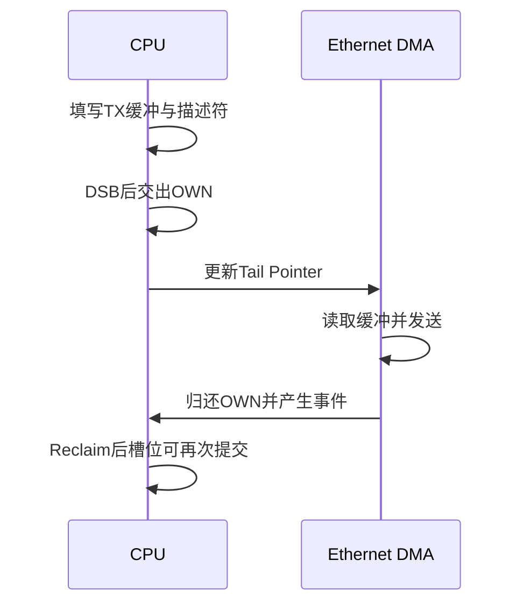

# PHY、MAC 与 DMA 底层 Debug

## 首先验证三条独立通路

原理图记录为 LAN8742A 25 MHz 晶体、PHY 产生 50 MHz RMII REF_CLK，经 33 Ω 到 PA1；MDIO=PA2、MDC=PC1、复位 PG9。地址 0 来自 strap 推断，之后板上读到 ID `0x0007C131`。HCLK 240 MHz 示例用 MDC /102，约 2.35 MHz。管理总线读到 ID、链路协商、RMII 数据双向收发以及人工示波器量测分别取证。[BRINGUP](../BRINGUP.md) · [E2_E3_IMPLEMENTATION](../E2_E3_IMPLEMENTATION.md)

## 所有权与时序

RX 按已释放到 CPU 的描述符复制，再发布 guard 并轮转。IRQ 记录事件，Poll 决定交付，Reclaim 决定 TX 何时复用。Tail 指向软件发布边界，OWN 保留对单槽数据访问的约束。发布顺序错误可能让 DMA 看到旧地址或未完成的内容。Region 4 为非缓存 DMA 区，起点 `0x24078000`，DMA 池 12544 B。DSB 是发布屏障，Cache 属性仍需单独核对。Stop/Start 依 READY、Link 和硬件停止门禁，避免重建硬件仍可访问的描述符。[MEMORY_AND_OWNERSHIP](../MEMORY_AND_OWNERSHIP.md)

源码定位（`a1fbe31`）为 `Platform/Ethernet/eth_mac.c` 的 `eth_mac_init()` 第 108 行、`eth_mac_start()` 第 209 行、`ETH_IRQHandler()` 第 398 行及 `eth_dma.c` 的 `eth_ring_tx()` 第 56 行、`eth_ring_rx()` 第 145 行。错误现场应同时看 DMA 状态、MAC 状态、OWN、统计与 Stop 结果。

## C01 PHY 波形与板上身份门禁

### 1. 问题背景

先验证管理面与链路，预期 PHY ID 可读，随后真实收发。

### 2. 第一次异常

板上 ID 为 0x0007C131，通信后来通过；资料缺 PA1 50 MHz 的独立示波器记录。

### 3. 最初的怀疑

若管理面通过而收发失败，RMII 时钟、strap、接线仍值得区分。

### 4. 排查过程

先审图、读 ID、观察状态，再用原始帧验证。长测中曾确认 100 Mbps 全双工。

### 5. 关键突破

ID 只证明 MDIO 管理路径。双向通信证明测试条件下 RMII 数据可用。

### 6. 根因及修复

**NOT_RUN**。PA1 波形及 E3.5 目标镜像独立读回仍缺；无证据表明曾发生 RMII 时钟失效。

### 7. 验证结果

PHY Host、原始帧实板和 E3.5 长测有证据。[E3_5_FINAL_AUDIT](../E3_5_FINAL_AUDIT.md)

### 8. 底层原理

参考时钟用于同步 MAC 与 PHY，而 MDC 为独立管理时钟。

### 9. 最终经验

证明范围应该随证据层级逐步扩大。

### 10. 面试复盘

我负责 STM32H747 和 LAN8742A 的起步验证，把 MDIO 管理、PHY 协商和 RMII 收发拆成三个门禁。先看原理图，发现 50 MHz 应由 PHY 经过电阻送到 PA1，MCU 只接收。我依据 HCLK 选择 MDC 分频，复位后通过管理总线读到 0x0007C131，再用原始帧确认实际双向通路和百兆全双工。面试中我会画出两条时钟从哪里来，并把独立示波器记录缺失写进交付清单。后来长测通过支持板能收发，不能代替测量波形或证明所有板型都有相同裕量。

## C02 Keil 产物路径与旧 MAP

### 1. 问题背景

要求能重建并验定 DMA 实际链接地址。

### 2. 第一次异常

工程输出路径及旧产物曾使构建结果不可直接作为证据；后续还发生独立 E3.5 AXF 打不开。

### 3. 最初的怀疑

工作目录、对象响应文件路径、旧打开工程缓存都可能改变实际产物。

### 4. 排查过程

782bf1b 使用绝对路径并核对新鲜度；1330972 给 E3.5 独立工程标识，检查输出、目标与源哈希。

### 5. 关键突破

编译结果、AXF 与 MAP 必须属于同一次执行。

### 6. 根因及修复

**CONFIRMED**。已确认工具链路径及缓存隔离问题，修复在工具侧。

### 7. 验证结果

见 [构建结果 JSON](../../../Tests/Ethernet/build_path_fix_results.json) 与 [CONFIGURATION](../CONFIGURATION.md)。板上 Flash Verify 单列。

### 8. 底层原理

链接器可以留下上次成功的 MAP。旧绝对地址即使符合期望，仍可能对应旧源码。

### 9. 最终经验

构建日志、产物时间、SHA、链接范围组成一组。

### 10. 面试复盘

接入 DMA 时我需要用 MAP 证明描述符确实在指定 AXI 区。我发现一个风险是 Keil 编译返回后仍可能看到上次构建留下的文件，有一次独立 E3.5 项目甚至无法打开输出 AXF。我先比较工作目录和响应文件，改成绝对路径，再把独立验证使用的工程标识与旧调试工程分开。此后把日志、源码哈希、产物生成时间和 MAP 地址一起核对。这个案例适合回答为什么只见到链接地址正确还不够，以及为什么应单独保留下载校验或板上读回。
