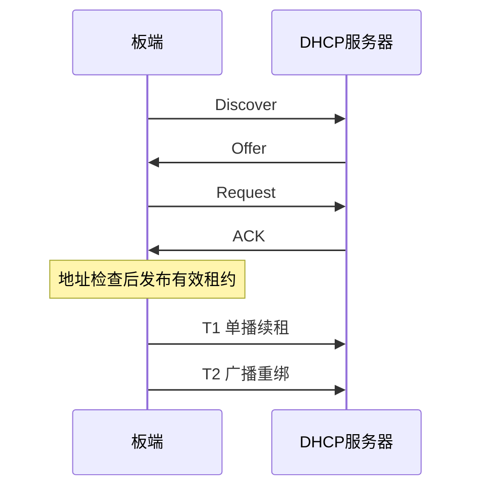

# lwIP、ARP、ICMP 与 DHCP Debug

`eth_network_poll()` 处理链路、`eth_netif_poll()` 与 `sys_check_timeouts()`。NO_SYS=1 时同一执行上下文独占 Raw API。DMA 原始描述符与 lwIP pbuf 各有所有者；RX 复制和分段 TX 都按错误路径释放。源码（`a1fbe31`）`Platform/Ethernet/eth_network.c` 第 60、123、266 行分别为地址轮询、Link Down、主轮询。ARP 先解析对端 MAC，ICMP Echo 才完成双向 IP 验证。

## C07 静态链路恢复与池耗尽

### 1. 问题背景

把原始帧接入 lwIP，验证 ARP、ICMP、MTU 和普通链路重连。

### 2. 第一次异常

Host 注入 PBUF_POOL 耗尽、TX BUSY 与输入拒绝，验证收发接口能返回资源不足并回收。

### 3. 最初的怀疑

分别怀疑 DMA 槽、pbuf 和管理员/物理链路状态。

### 4. 排查过程

真 lwIP 配模拟 MAC 做用尽、释放和重试。实板抓 ARP、ICMP；拔插后再 Ping。

### 5. 关键突破

链路可 down 而管理状态仍 up。再次协商成功后恢复交付。

### 6. 根因及修复

**CONFIRMED**。资源和链路模型经 Host 验证，实板通断工作；拔线瞬间 Watch 未归档。

### 7. 验证结果

正式历史 E4.1 报告 1000/1000，丢包 0%，重连 4/4。[E4_1_IMPLEMENTATION](../E4_1_IMPLEMENTATION.md)

### 8. 底层原理

pbuf 的释放责任由提交/拒绝边界定义；低层 ring BUSY 和网络池耗尽是不同资源。

### 9. 最终经验

诊断由 L2、L3 到资源池分别留证。

### 10. 面试复盘

原始收发通过后，我把 lwIP 接到 netif。Host 用真实 lwIP、模拟 MAC 主动制造 BUSY、池耗尽和输入拒绝，检查每条释放路径，再用板测记录 ARP 和 ICMP。这里有一条容易说错的边界，管理 up 可以保留，物理链路 down 期间仍要阻止交付，直到重新协商和恢复。历史实板通过了 1000 次 Ping，并在插回后收到四次回应。拔线瞬间的状态快照未归档，因此我只把结论落在已经观察到的重连和相关 Host 测试上。

## C08 DHCP 获租、回退与到期

### 1. 问题背景

支持 DHCP Only、Static 与 Fallback；验证租约生命周期。

### 2. 第一次异常

无 DHCP Server 时地址可长期为空；固定地址或 ICS 已配地址也可能被误认为板端已获租。

### 3. 最初的怀疑

连接未就绪、请求无应答、ACK 后 ACD 尚未完成、已进入 fallback 均要单独检查。

### 4. 排查过程

Host 注入 DORA、NAK、池压力；实板短租约先确认 T1 单播与 T2 广播，再停止应答观察过期、重新 Discover；另测无服务器 fallback。

### 5. 关键突破

lease_valid、state、IP、DHCP 事务与抓包要一致。E7 历史现场抓到 Discover，ICS 重绑后以用户 Watch 确认获租，完整应答链未保存。

### 6. 根因及修复

**CONFIRMED**。E4.2 回退、续租、重绑和过期机制已验证；E7 那次未获租的精确触发原因未独立关闭。

### 7. 验证结果

E4.2 历史 DORA、fallback 及短租约第三组均有报告。[E4_2_IMPLEMENTATION](../E4_2_IMPLEMENTATION.md) · [E4_2_DHCP](../E4_2_DHCP.md)

### 8. 底层原理

T1 单播续租，T2 广播重绑，到期使地址失效。链路断开时释放状态，不发送无法送达的 DHCP RELEASE。

### 9. 最终经验

区分静态/回退与有效租约，并给 trace 标上事务 ID 和墙钟时间。

### 10. 面试复盘

我调试 DHCP 时先对齐板端 lease_valid 与抓包事务，避免把静态回退地址当成租约。Host 用真正的 lwIP 等待 DORA、处理 NAK 和 ACD，再模拟耗尽。实板用短租约观察 T1 单播、T2 广播，随后停答使租约到期并发现旧地址已不通。拔线恢复另看新事务。E7 有一次已看到 Discover 却没有马上获租，重绑 ICS 后板端 Watch 恢复，但没有保存完整应答链，所以这次精确原因与 E4.2 的已验证租约机制要分别叙述。
