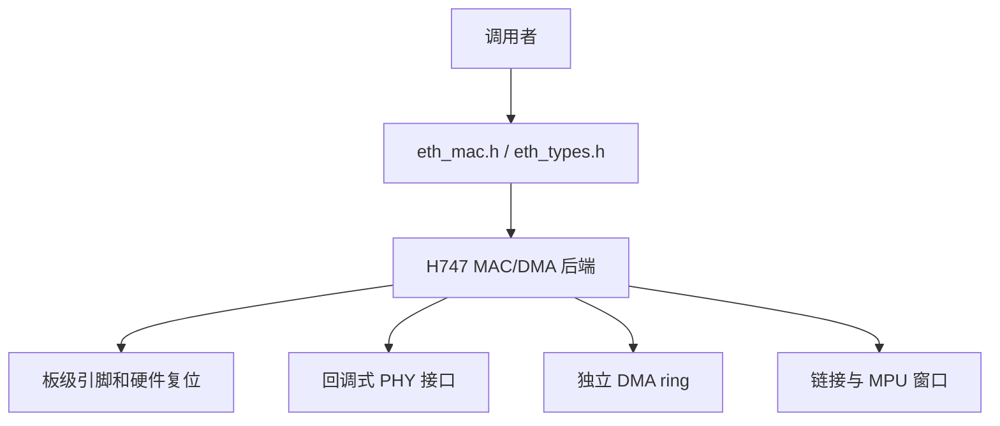

# Ethernet 接口解耦

本轮在纯风格提交 4647ac7 之后拆分实现，公开函数名、返回值、结构体布局和所有权合同保留。没有新增 Application 管理层、任务、队列或动态注册机制。

| 边界 | 文件 | 责任 |
| --- | --- | --- |
| 任务侧公开 API | eth_mac.h、eth_types.h | 原始帧提交、回收、接收、状态和统计；仅依赖标准 C 类型 |
| 可移植 PHY | eth_phy.c/h | 由 MDIO 回调访问 PHY，不依赖 HAL |
| 可移植 DMA ring | eth_dma.c/h | descriptor/内部 buffer、OWN、索引、完成回收；通过 barrier/kick 回调访问后端 |
| H747 MAC/DMA 后端 | eth_mac.c | MMIO、MDIO 时钟分频、中断、启停及模式；仅这里组合 PHY、ring、内存和板级适配 |
| 板级适配 | eth_board.h、eth_board_stm32h747.c | 原理图相关 GPIO、RMII 选择、外设时钟准备及 PHY 硬件复位 |
| 内存适配 | eth_memory.c/h | 专用静态池、链接位置和 MPU 配置/检查 |

公开 eth_mac.h 不再传递包含 eth_phy.h 或 eth_dma.h；调用者无需知道描述符、内部池、GPIO 或 HAL 类型。共用结果和统计移入 eth_types.h，原类型名称保留以避免破坏现有接口。descriptor 和静态池只供驱动内部使用，不能从任务 API 获取或持有 DMA-owned 指针。

板级适配用静态链接的 EthBoard_Prepare()，不引入可变回调表或新生命周期。GPIO/复位函数体、时钟准备语句及其调用次序与拆分前逐项比较一致。PHY 地址当前仍为这块板的 0；移植到其他板时还须核对 PHY 型号/地址、参考时钟、IRQ、内存窗口，不能仅替换 GPIO 文件便宣称移植完成。

Keil CM7 target 仅增加板级源文件；该公共工程改动另行提交。FreeRTOS、CM4、USB、Storage、V2 均不改动。先前准备中的 Windows 发包工具不属于本轮整理，不自动发送网络流量。

验证：公开头文件仅凭标准库独立编译，确认不泄露 PHY/descriptor/HAL 头文件；五个实现模块 ARMClang C99 -Wall -Wextra -Werror 通过；六项主机测试通过；完整 CM7 smoke 为 0 Error / 0 Warning。Code 66690，比整理前多 8 字节调用开销，RO/RW/ZI 保持 2834/1220/82468，DMA 对象仍为 0x24078000、12544 字节。完整证据见 Tests/Ethernet/decoupling_results.json。

这次重构尚未重新完成实板收发。后续应重新下载生成的 smoke 固件，再重复 PHY ID、Link、单帧 TX/RX，随后继续多帧与异常恢复测试。
