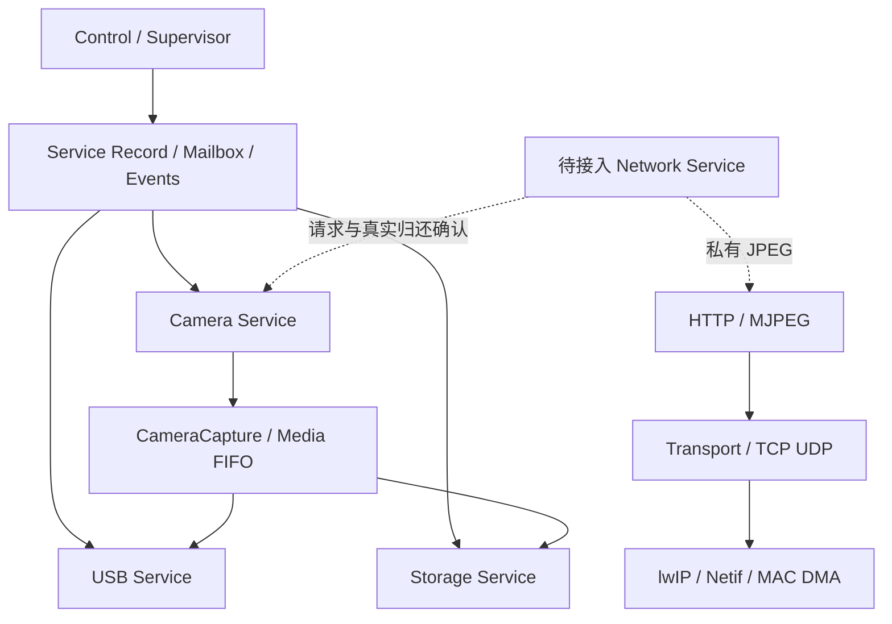

# 实际架构及正式接入缺口

实际生产路径为 ApplicationV3 Camera/USB/Storage 三服务，经既有 Service Record、Mailbox、Events 和静态队列池运行。Network 目前未接入，不能将下面待实现路径标成现有功能。

现有网络模块在 Platform/Ethernet，HTTP/MJPEG 在 CM7/Service/Ethernet。Network Service 应进入 CM7/ApplicationV3/Services/Network，注册、任务和队列沿用原 Runtime。不能新增第二套生命周期框架或把 Camera DMA 暴露给 HTTP。

固定池当前 MESSAGE_SLOTS=9、SIGNAL_SLOTS=3。新增服务和双向帧通道须先计算额外命令槽、记录信号和数据槽，静态扩容必须连同 DTCM、任务栈、lwIP CPU 窗口、JPEG SDRAM 空间及双核共享布局做编译审计。不能在现有满额配额上仅增加 Registry 条目。
