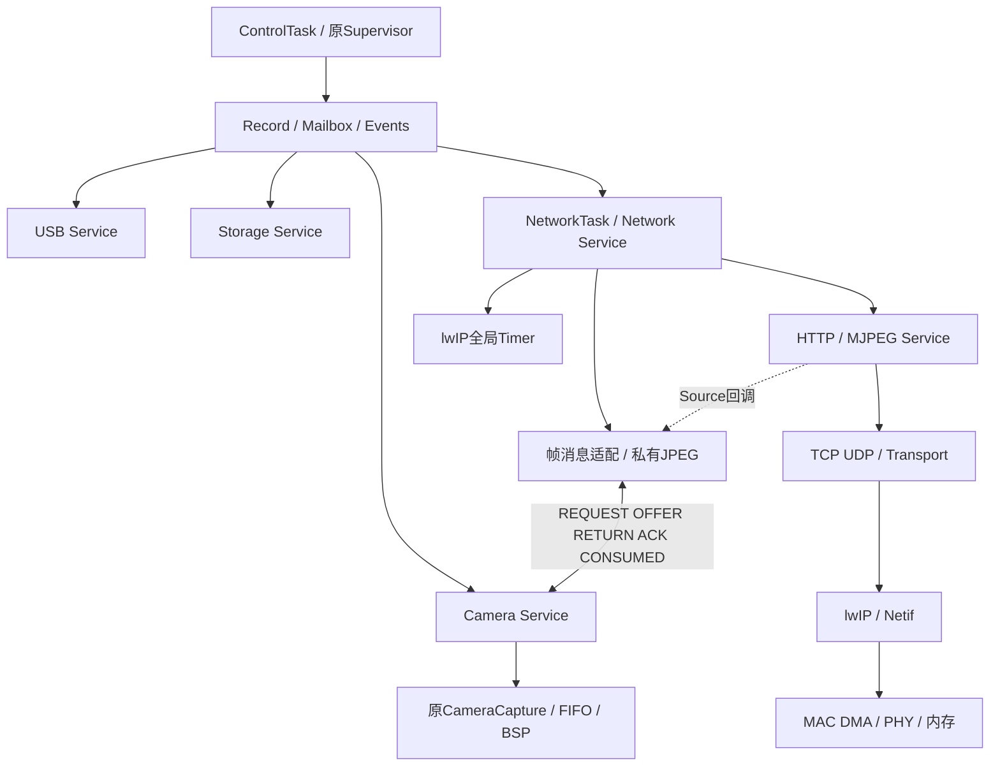
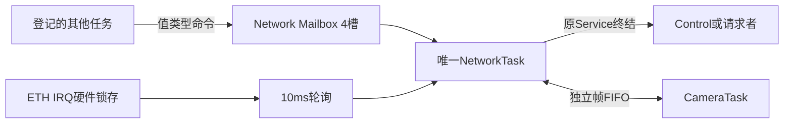

# 实际生产架构

审查日期：2026-11-26（Asia/Shanghai）。源码冻结：`78580073610ff4cfe06a4b004b1b0d75bffef499`；main：`851c1115fe097f7fd2e0bdcaa5f7b3f8c03feb71`。

本报告替代早期Integration中“Network未实现”的状态描述，历史审计与失败不回写。

Platform负责PHY/MAC/DMA/内存/netif/Raw门禁/TCP/UDP；Service负责HTTP/MJPEG/纯JPEG复制；
ApplicationV3 Network负责配置、生命周期、合法Camera消息消费者和私有缓冲。
原监督器新增组件位8，视频依赖Camera，停止时先消费者再Camera。
网络控制可独立启动而不自动借帧；只有实际MJPEG需求才申请Camera原帧。

普通h7_mac目标保留业务启动策略，APP_NETWORK_BOOT默认0，但真实任务/API已编入。
生成的正式Network profile使用生产main，APP_NETWORK_BOOT=1，由Control启动DHCP+HTTP视频。
验收profile只在生成的Control调用点增加命令生产者，不含Mock/测试main/JPEG fixtures。
原USB能力配置保留，实际通路以监督器mask为准；网络启动不隐式启动USB或Storage。

没有新增RTP/JPEG、RTSP或另一个生命周期框架。CM4、USB、Storage、Media算法和上游lwIP不变。
