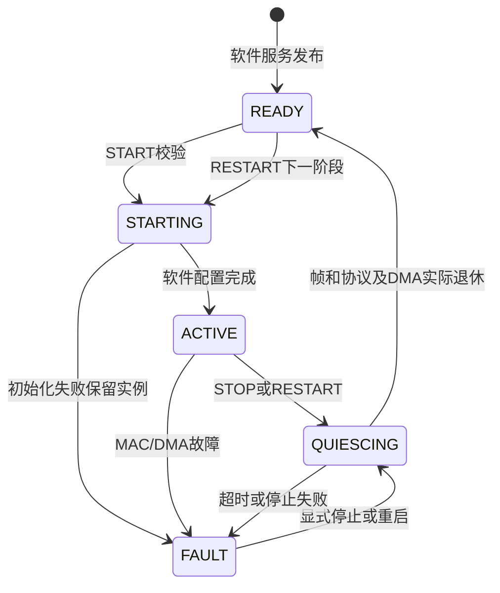

# N2 — 生产生命周期

审查日期：2026-11-26（Asia/Shanghai）。源码冻结：`78580073610ff4cfe06a4b004b1b0d75bffef499`；main：`851c1115fe097f7fd2e0bdcaa5f7b3f8c03feb71`。

**PASS（软件）**。沿用AppV3HardwareState及原监督器，不用状态清零代替退休。

START完成不等于PHY Up、DHCP BOUND或监听就绪。QUERY flags为Link/IP/listener/client-open的1/2/4/8位。
低两位0/1/2选择静态/DHCP/DHCP+显式fallback，0x100选择HTTP。
静态/fallback为192.168.50.2/24、网关0，fallback等待30秒，仅在显式选择时使用。
生产视频启动选择DHCP Only，不默认给任意LAN套静态地址。

非HTTP配置提供TCP Server5003、显式CONNECT到参数IPv4的TCP5004 Client、UDP5005及有界回送。
HTTP配置用80端口；沿用原双角色TCP，不承诺HTTP与5003/5005模式同时运行。ARP/ICMP/DHCP可与HTTP并行。

STOP关闭新发送/帧需求，HTTP归还私有帧，连接排空或按原截止时间真实abort。
active/bound/listen/TIME_WAIT PCB全部实际退休后，才清理DHCP/ARP、down netif、停止MAC，
成功才移除netif和解除实例绑定。Camera原帧始终走Camera消息归还协议。
全局lwip_init只一次；cyclic timer持续存在，STOP后仍由唯一任务推进。

停止总截止130秒，原监督器给Network140秒窗口；其他组件原窗口不变。
失败保存实例、首错和不确定资源。MAC recover先停止DMA再重识别PHY，不改原收发环算法。
安全新START才按Camera既有契约建立新事务首错快照；历史驱动/内存计数及旧终结消息保留。

真实bound PCB阻止提前STOP、停止态timer、Client连接中停止、UDP池耗尽恢复、100轮软件回收、
DORA/ACD/T1、队列背压、RST重连和失败后重开均有生产测试。实板生命周期NOT_RUN。
