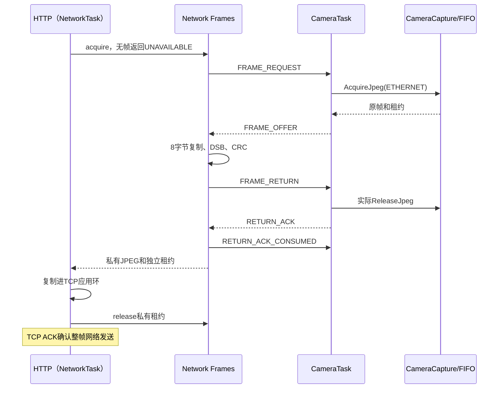

# N3 — Camera 与 Network 所有权

审查日期：2026-11-26（Asia/Shanghai）。源码冻结：`78580073610ff4cfe06a4b004b1b0d75bffef499`；main：`851c1115fe097f7fd2e0bdcaa5f7b3f8c03feb71`。

**PASS（软件）**。原Camera FIFO/DMA算法、USB和Storage独立契约未改。
新增网络通道8/9映射新物理槽6/7；旧USB编号及Storage别名6/7保持原映射。

| 资源 | 所有者与复用条件 |
|---|---|
| Camera原帧 | Camera/Media所有，Network只持消息凭据；Camera实际释放 |
| 私有JPEG | Network Frames所有；HTTP Source释放后复用 |
| TCP应用环 | NetworkTask所有；复制给lwIP后复用相应段 |
| lwIP发送副本 | ACK/错误/真实PCB退休 |
| DMA内部TX Buffer | 描述符实际完成或硬件停止 |

HTTP不调用CameraCapture/DCMI/OV5640。Network不把原始DMA Buffer或Descriptor交给lwIP。
私有区0xD07F0000，61440字节，UNINIT；纯复制/CRC提取为公共Service，独立E7使用同一实现。
保留8字节SDRAM分段复制策略，不通过关缓存或移除FIFO错误检测规避问题。

队满保留原事务，超时只取消申请，不伪造归还。旧command/session/lease不能退休新租约。
浏览器断开后撤销需求，迟到OFFER仍真实归还；HTTP归还私有借用，重连可再次申请。
RST、再次握手、再次借帧和清理用真实TCP/HTTP报文驱动生产实现验证，未扩大120ms断言窗口。
Media多租约回归和四服务组合通过；实际DMA/Cache并行仍待N5。
