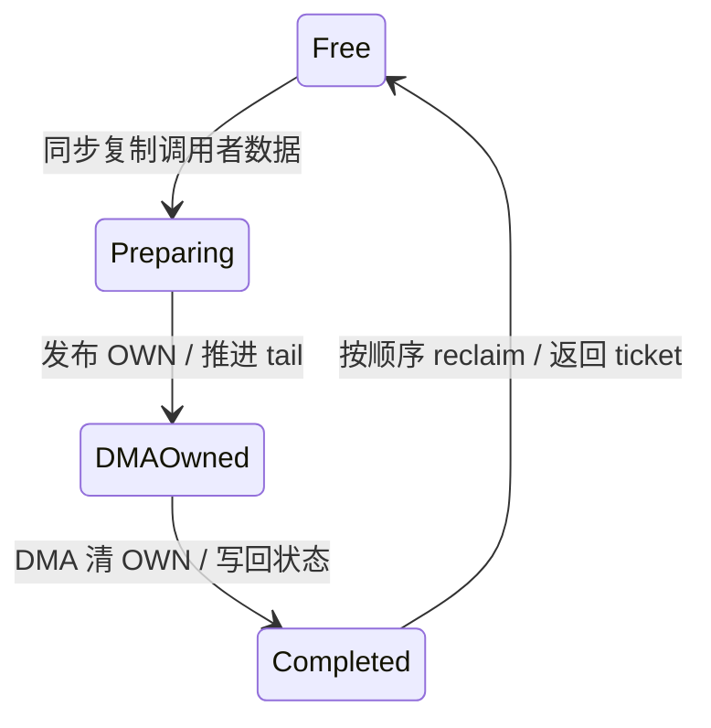
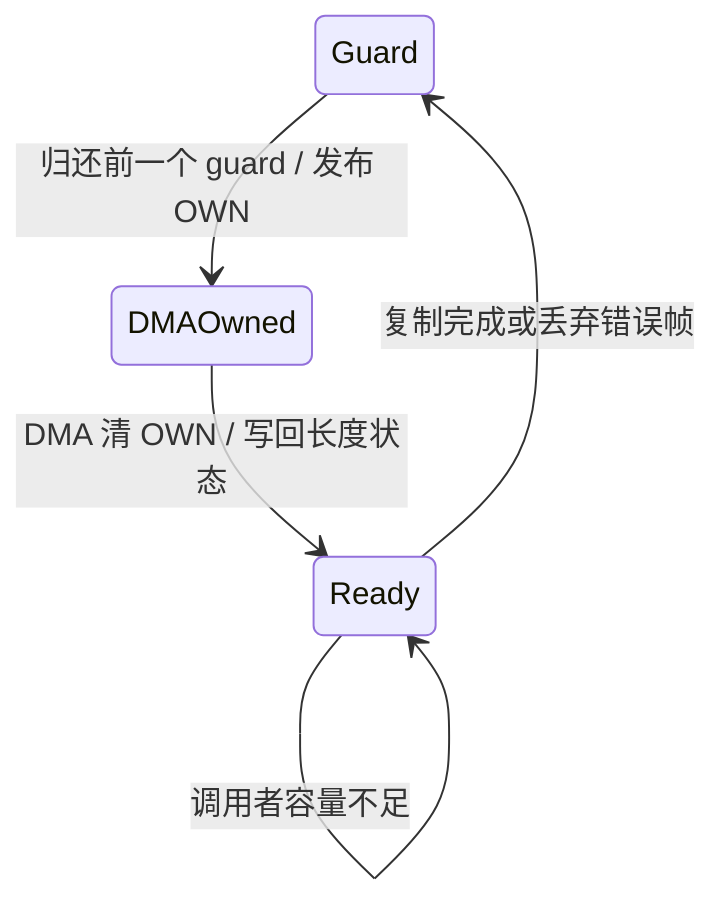

# E2/E3 内存、缓存和所有权

依据 [RM0399](https://www.st.com/resource/en/reference_manual/rm0399-stm32h745755-and-stm32h747757-advanced-armbased-32bit-mcus-stmicroelectronics.pdf) 的系统架构图、总线连接及 embedded SRAM 说明审计。DMA 可达性不由 CPU 可达性推导。

| 区域 | Ethernet DMA 审计结论 | 本次选择 |
| --- | --- | --- |
| DTCM 0x20000000 | CM7 TCM/AHBS 路径，不供 ETH master 使用 | 只放软件元数据，不放 DMA 数据 |
| AXI SRAM 0x24000000 | ETH 经 D2-to-D1 bridge 可达 | 选用末尾专用窗口 |
| D2 SRAM 0x30000000/0x30020000/0x30040000 | ETH 本域可达 | 被 CM4 0x10000000 别名链接区覆盖，不占用 |
| D3 SRAM4 0x38000000 | D2-to-D3 bridge 路径可达；还须核对电源/时钟 | 既有 IPC 使用，不占用 |
| FMC SDRAM | D2-to-D1 到 FMC 路径；依赖 FMC 初始化和刷新 | 既有 Camera 区域，不选用、不声称完成 DMA 验证 |

内存访问期间 D1/ETH 时钟必须保持开启。本阶段没有低功耗迁移支持。

## 实际布局

`g_eth_dma_memory` 放入 `.ethernet_dma`，Keil scatter 的 UNINIT region 固定地址；启动代码不会自动清零，驱动在确认 DMA 复位后初始化。

| 内容 | 起始地址 | 大小 |
| --- | --- | --- |
| TX descriptors，4 × 32 | 0x24078000 | 128 |
| RX descriptors，4 × 32 | 0x24078080 | 128 |
| TX buffers，4 × 1536 | 0x24078100 | 6144 |
| RX buffers，4 × 1536 | 0x24079900 | 6144 |
| 实际对象末尾（exclusive） | 0x2407B100 | 总计 12544 |
| MPU/linker 窗口末尾（exclusive） | 0x24080000 | 总计 32768 |

描述符前 16 字节是硬件字段，后 16 字节跳过；DMACCR.DSL=4（128-bit skip），stride=32。base、每个 descriptor、每个 buffer 都按 32 字节对齐，编译期检查结构尺寸和偏移。每方向 4 个物理槽，最多 3 个可用；保留一个 exclusive-tail guard，避免满环的 head/tail 相等歧义。

## Cache/MPU

1. Descriptor、TX buffer、RX buffer 全部位于同一个专用非缓存 Normal 区。
2. TX copy 后执行 DSB，再写 OWN，再执行 DSB，最后更新 tail。
3. RX 先读取 OWN；确认 CPU-owned 后执行 DSB，再检查状态并复制数据。
4. RX 重备 buffer 地址及字段后执行 DSB，再发布 OWN，再执行 DSB 后更新 tail。
5. 本配置不对每帧调用 Clean/Invalidate：CPU 没有该窗口的缓存副本。早期 MPU 配置必须发生于 DCache 关闭且首次访问前。
6. 描述符和 buffer 不与其他对象共享缓存行；所有软件索引、计数、ticket、统计位于普通软件内存，不放入 DMA 字段。
7. 每次收发前验证 MPU 属性。后续移植不得只更改地址或删除验证，也不得把 buffer 移到可缓存区而沿用当前代码。

这是一套已实现、已编译的非缓存设计；硬件下的 cache-enabled 持续流量、总线排序与恢复尚未验证。

## TX 所有权

调用者始终拥有原始输入；submit 返回后可复用输入。驱动的内部副本从发布 OWN 起不可修改。DMA 清 OWN 后仍需 reclaim，软件 pending 才清除；因此不能只看 OWN=0 就复用 TX 槽。每次成功 submit 返回 ticket，reclaim 的 OK/FRAME_ERROR 返回对应 ticket。相同数据再次 submit 是新的发送，不是再次交出同一 descriptor。ticket 是 32-bit 递增值，会自然回绕，调用者不得跨无限时间保存它。

submit 的 BUSY 表示 3 个可用内部副本均占用，无隐式丢包、等待或重试。没有 heap 或第二套可耗尽的 buffer 池。输入/输出指针与 DMA 对象重叠会被拒绝，防止借 copy 接口访问 DMA-owned buffer。

## RX 所有权

RX 初始发布槽 0–2，槽 3 是 CPU-owned guard。消费槽 i 时，先完成复制或错误丢弃，再把旧 guard 发布给 DMA，槽 i 成为新 guard，tail 指向 i。这样已消费 buffer 不一定立即成为 DMA-owned；descriptor 状态与 buffer 使用生命周期分别管理。调用者只取得自己的副本，从不取得 DMA buffer 指针，也不负责归还内部 buffer。

容量不足返回 CAPACITY 和所需长度，当前帧保留，需更大 buffer 重试，否则硬件最终暂停。正常空环返回 EMPTY，不改变 OWN。CRC/error、context、缺失 FD/LD、分片或非法长度的帧被丢弃并归还容量。当前只支持一 descriptor 一帧（14–1522 字节，无 FCS），不支持 jumbo/TSO/PTP context/zero-copy。

## 停止、错误和并发

所有任务接口由一个调用上下文串行使用。ISR 不操作 descriptor、buffer 或软件 ring 索引。IRQ 的 fatal bus/context/stopped 或 MAC 错误锁存故障并屏蔽相关中断，任务 `service` 执行 abortive stop；需要显式 stop 后 start 恢复。

stop 先禁 IRQ、RCC 复位、等待 MAC/DMA 软件复位确认，成功后才记录 pending ticket 为 aborted。超时保留 FAULT，绝不回收或改写 DMA 内存。下一次 start 再重建 ring。停止不是成功发送，aborted 计数不能算入 tx_completed。所有 MMIO 等待都有毫秒 deadline 和 spin 上限；硬件 reset delay 要求 HAL tick 正常运行。
