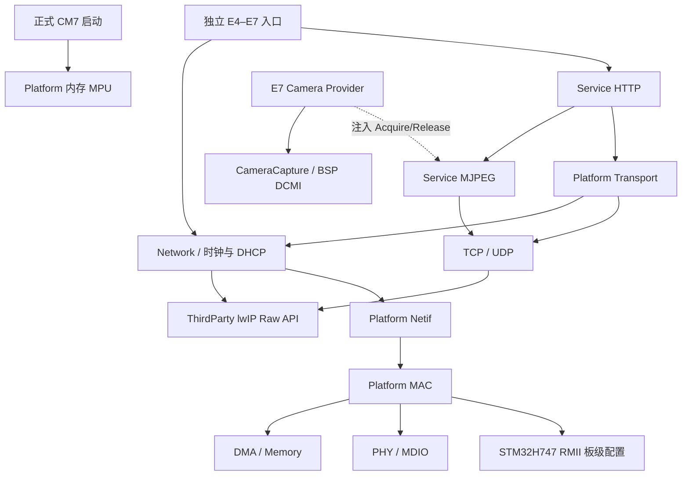

# Q3/Q4 目录与实际依赖

Q3 **PASS**（本地候选）。Q4 **NEEDS_FIX**（运行时架构）。直接 include 边见 source-index.md。生产平台和服务之间没有反向 include。

正式 main 初始化 MPU/HAL/框架，保留协议符号不触发启动。独立入口在 MPU 和 DCache 配好后初始化 Network，Network 建 MAC、一次性 lwIP 和默认 netif；Link 启动后 Transport 建 PCB，之后 HTTP 推进。DMA IRQ 只进 MAC，不调用 lwIP；TCP 回调由 Poll 推进，JPEG 回调在同一调用上下文执行。Platform 服务无 Camera/BSP 反向依赖，V2 无 Descriptor 引用。可见共享状态在 Network、Transport、TCP、HTTP 单例；Transport 读取 Network 暴露的 netif 与 initialized。当前无运行时 V2 接入，停止、跨任务请求和通知缺口见 ETH-Q03、Q05。
