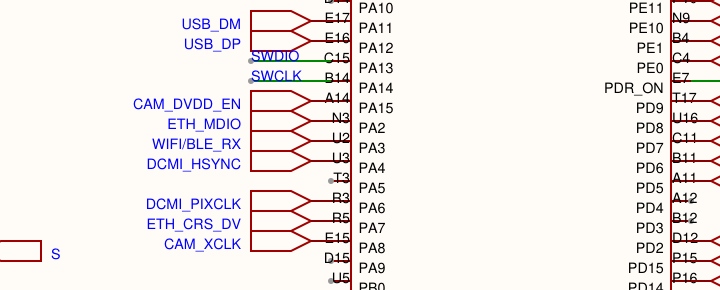
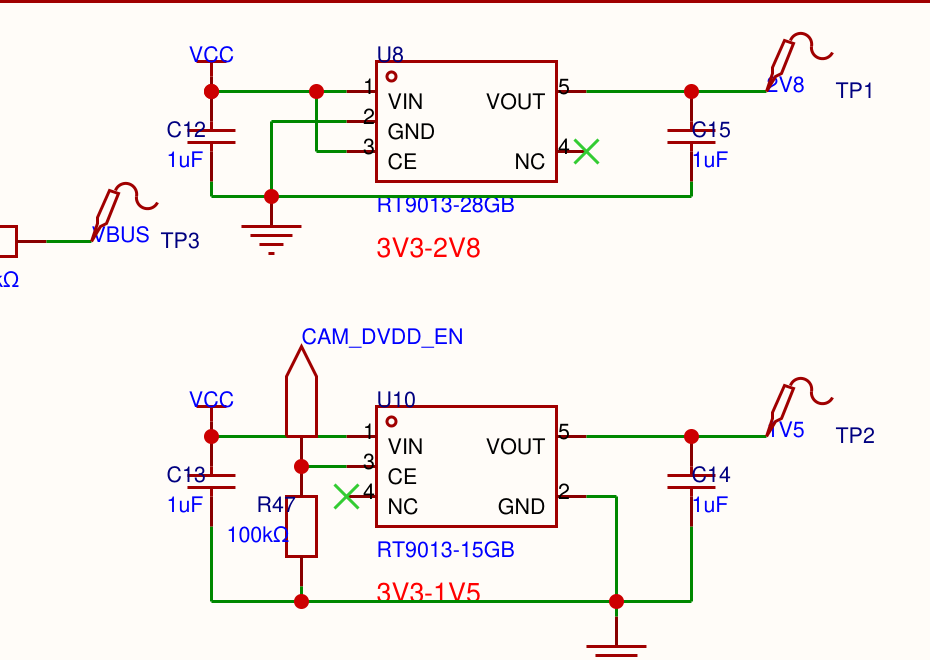
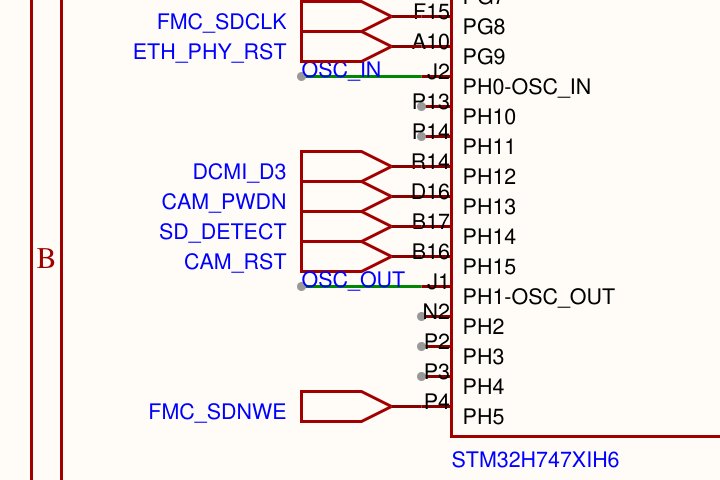
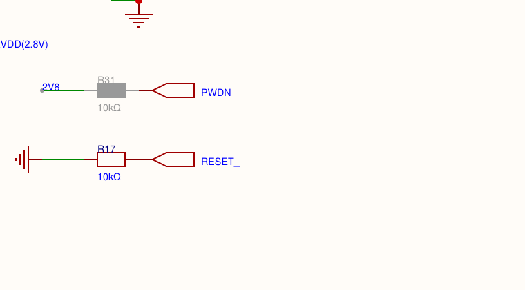

# V1 CAM_DVDD_EN 最小适配与验收记录

日期：2026-11-15。开发分支：`fix/v1-cam-dvdd-enable`。基线：`main@f0ce45fd9ab7250b1e22260e087d606ee5ed9ecb`。

## 1. 结论与未关闭条件

软件适配及CM7构建通过；未进行实板电压、复位和摄像头初始化验收。不能将模拟测试写成电源时序实测通过。

**CPU执行前默认断电尚不能保证。** PA15同时是JTDI调试脚，SWJ-DP复位默认上拉必须纳入检查，不能只看到R47下拉就认为一定为低。软件只能从`BSP_Camera_EarlyInit()`执行后保证主动输出低。需用示波器核实冷上电及NRST保持期间的CE/TP2；如复位期间CE升高，需要硬件解决，本次没有更改原理图或电阻。

## 2. 原理图依据

来源：用户提供的`SVG_Schematic1_1_2026-11-15.zip`，SHA256 `f05aa00faeca44e7661310502e0f0d4f20b8e74e0c9a93009d02c597f746e750`。

| 页 | 实际接线 | 结论 |
| --- | --- | --- |
| 2-主控，STM32H747XIH6 | `CAM_DVDD_EN`接PA15，A14球 | GPIO为PA15，不是PH15 |
| 1-电源管理，U10 RT9013-15GB | VCC→VIN(1)，CE(3)接CAM_DVDD_EN，VOUT(5)→1V5/TP2，GND(2)接地 | 高电平使能1.5V数字电源 |
| 1-电源管理 | R47=100kΩ将CE下拉；C14=1µF | 外部下拉不等于能压住调试脚内部上拉 |
| 1-电源管理，U8 RT9013-28GB | CE接VIN，输出2V8/TP1 | CAM_DVDD_EN不关闭2.8V |
| 4-摄像头接口，FPC1 | pin15=DVDD(1.5V)，pin14=DOVDD(2.8V)，pin21=AVDD(2.8V) | 1V5供DVDD；AVDD经L3来自2V8 |
| 2-主控及4-摄像头接口 | PH13→CAM_PWDN→pin17；PH15→CAM_RST→RESET_→pin19 | PWDN高有效，RESETB低有效 |
| 4-摄像头接口 | R17=10kΩ将RESET_下拉；R31=10kΩ为PWDN到2V8的灰色元件 | R31是否实装需核实，软件主动驱动PH13，不依赖其默认电平 |

极性依据为Richtek原厂编写的RT9013 DS9013-10功能引脚说明：EN高有效，低电平关闭。参考[原厂文档镜像](https://xonstorage.z8.web.core.windows.net/pdf/richtek_rt901330gbz00_apr22_xonlink.pdf)。原厂网站旧PDF地址返回404，未把无法下载的地址当作已核对资料。

## 3. 上电与停止策略

依据[OV5640原厂数据手册v2.03](https://cdn.sparkfun.com/datasheets/Sensors/LightImaging/OV5640_datasheet.pdf)第2.7.2节、图2-4及2.8节（PDF页29–31）。外部DVDD模式要求先稳定DOVDD/AVDD，再DVDD；DVDD稳定后至少5ms再释放受控PWDN，之后至少1ms释放RESETB，RESETB释放后至少20ms才能访问SCCB，XVCLK须提前至少1ms运行。

| 步骤 | 原软件 | V1软件 |
| --- | --- | --- |
| EarlyInit | PH15拉低；SCCB开漏释放 | 先预装PA15低再配置推挽+下拉；PH13高，PH15低；保留SCCB配置 |
| 时钟检查 | PLL1Q=240MHz及DWT检查 | 保留；检查失败不使能DVDD |
| 电源 | U10硬件常开假设 | `BSP_Camera_PowerEnable()`令PA15高 |
| 电源稳定 | 无GPIO供电阶段 | 沿用10ms等待，给小于5ms上升及稳定后5ms；TP2真实上升必须实测 |
| 退出待机 | 未控制PWDN | PH13低 |
| XCLK | 原MCO1/PLL1Q÷10=24MHz | 同一HAL配置及分频，移到供电等待后启动；不改PLL |
| 退出复位 | 原10ms后PH15高 | PWDN释放及XCLK启动后至少1ms，PH15高 |
| SCCB访问 | RESETB释放后20ms | 保留20ms及原读写实现 |

等待总量由原10+20ms变为10+1+20ms。10ms不是电源监测；板上DVDD上升若不满足小于5ms，必须重新评估，不能宣称延时自动保证稳定。2.8V实际稳定先于DVDD也要测量，AVDD滤波不能仅靠网络名证明时间关系。

正常`Device_Stop()`仍使用原OV5640软件停止，不调用PowerDisable，不切DVDD。原因：本板只能独立切DVDD，不能切全部电源；掉电会丢失寄存器配置，而现有普通Stop/Start保留配置。没有修改Device生命周期或引入恢复策略。

`BSP_Camera_PowerDisable()`仅用于调用者已经安全停止采集并释放帧后的整机断电流程：RESETB低→PWDN高→PA8模拟态停止XCLK→PA15低→撤销SCCB就绪。它不停止DCMI/DMA，不归还租约，不构成完整Device DeInit。断电后不能直接沿用原Device_Start；必须完整重新初始化/配置传感器。本次没有增加运行时电源循环业务。

## 4. 复位默认电平的硬件限制

[STM32H747数据手册DS12930](https://www.st.com/resource/en/datasheet/stm32h747xg.pdf)确认PA15复位功能为JTDI；[ST AN4899第6.6节](https://www.st.com/resource/en/application_note/an4899-stm32-microcontroller-gpio-hardware-settings-and-lowpower-consumption-stmicroelectronics.pdf)提醒调试脚有默认上下拉。RM0399的SWJ-DP章节是进一步核实调试口内部上拉的依据；本轮官方完整PDF下载失败，未伪造下载记录。

交叉核对发现本机Keil.STM32H7xx_DFP.4.1.3的STM32H747_CM7.svd给出GPIOA PUPDR复位值0x12100000，不能据该寄存器描述排除SWJ-DP内部偏置。因此本轮不把SVD当作冷上电CE低电平的证明，也不把分压估算当作实测电平。

若按30–50kΩ内部上拉与100kΩ外部下拉估算，3.3V供电时节点可能约2.2–2.54V，高于RT9013使能高阈值1.6V。这是硬件风险估算，不是板上测量。若需严格保证CPU执行前断电，应由用户确认硬件下拉/门控方案，单纯提前一段软件不能覆盖复位保持阶段。本次不擅自改阻值。

## 5. 修改范围与专项测试

生产文件仅`CM7/BSP/bsp_camera.c/.h`。新增接口：`BSP_Camera_PowerEnable()`、`BSP_Camera_PowerDisable()`。PH13是既有PWDN接线，本轮配置它只为满足新增DVDD的上电顺序。

未修改：SCCB读写函数、PLL配置、DCMI/DMA、Media/FIFO/Frame Lease、任务/启动顺序、资格协议、USB/UVC、Storage/FatFS及Keil正式工程配置。没有混入未合并C2.2B分支的修改。

新增`Tests/CameraPowerV1`，使用ARMCC5编译真实bsp_camera.c，Unicorn执行，仅替换HAL硬件边界。14/14通过：

| ID | 覆盖 |
| --- | --- |
| 0 | PA15先写低后输出、下拉、PWDN/RESET预装、EarlyInit幂等 |
| 1 | 完整上电调用轨迹与10/1/20ms等待、MCO来源和分频 |
| 2–5 | PLL未就绪、Q分频关闭、Q频率错误、CPU频率无效时不使能电源 |
| 6 | DWT不运行时不使能电源 |
| 7 | 断电先复位/待机、停XCLK、再关DVDD并禁止SCCB |
| 8 | BSP断电后再次Init；仅证明BSP时序，不证明Device配置恢复 |
| 9 | Init幂等，不意外关电或再次复位 |
| 10 | Enable只供电，不伪造传感器就绪 |
| 11 | Enable后EarlyInit不再次关电 |
| 12 | 初始化前Disable安全落到低电平 |
| 13 | 未就绪时拒绝SCCB读写 |

运行：`python Tests/CameraPowerV1/run_tests.py`。测试未注册到正式固件，无测试任务/宏。未修改或执行历史测试断言，也不宣称全仓回归通过。

## 6. CM7正式完整构建

使用当前源码的独立git归档快照并覆盖两份BSP修改，正式`h7_mac.uvprojx`/`h7_mac_CM7`全量重编，ARMCC5 5.06 update7。原工作目录工程配置及原output均保留，不覆盖原镜像。

结果：0 Error、0 Warning，退出码0。Code=137786，RO-data=3114，RW-data=1340，ZI-data=100932。

- 日志：`output/V1CameraPower/CM7_rebuild.log`，SHA256 `6d018c3f3a5b61f23ce313442ccf61647e3f4f0d84acc29a270dde32e61fc09e`。
- AXF：`output/V1CameraPower/build_snapshot/MDK-ARM/h7_mac_CM7/h7_mac_CM7.axf`，SHA256 `a8d94e842c35865a7a727e98f3c751818b90babf271c6a443fa23ea30ebb3fb1`。
- MAP：同目录`h7_mac_CM7.map`，SHA256 `a1c3edeec58c038c7f167bb1a06326d8dc3e5d96920c1e11a464f579e334da66`。
- 当前正式Target未启用HEX生成，本轮不修改该选项，不把仓库旧HEX当成新构建。
- CM4未改动，本任务未要求且未重新编译。

## 7. 实板验收（全部待执行）

先用SWD调试，不使用占用PA15的完整JTAG。不要在视频/DMA运行中通过调试器直接调用PowerDisable。

| 项目 | 操作与观察 | 通过要求 | 结果 |
| --- | --- | --- | --- |
| 复位期间默认状态 | 完整断电重上电，并保持NRST低；同时测PA15/U10 CE、TP2、TP1 | 若要求初始化前断电，则CE须在关闭阈值内、TP2未启动；否则该要求不通过 | 待验证 |
| EarlyInit默认状态 | 断点停在EarlyInit返回处 | `(GPIOA->ODR>>15)&1=0`，MODER[31:30]=1，PH13=1，PH15=0，实测TP2断电 | 待验证 |
| 电源与复位时序 | 示波器捕获TP1/AVDD、CE、TP2、PWDN、RESETB、XCLK，可分次对照 | TP1/AVDD先稳定；DVDD上升小于5ms、稳定至少5ms后PWDN低；至少1ms后RESETB高；XCLK=24MHz | 待验证 |
| SCCB及初始化 | 连续运行至Device初始化及Camera配置结束 | RESETB高后至少20ms才有首个SCCB访问；ReadID=0x5640，初始化无错误、视频正常 | 待验证 |
| 普通Stop/Start | 使用既有业务命令停止再启动，不直接切电 | 停止过程DVDD仍在，重新启动正常，原帧归还条件不变 | 待验证 |
| 电源Disable接口 | 仅在明确停硬件并释放资源的专门板级验收上下文调用 | RESETB低、PWDN高、XCLK停止，再CE低；不宣称关闭了2.8V | 待验证 |

软件可供审核；冷启动断电保证及真实上电/复位/初始化未验收，不标记适配全部通过。不合并main。
