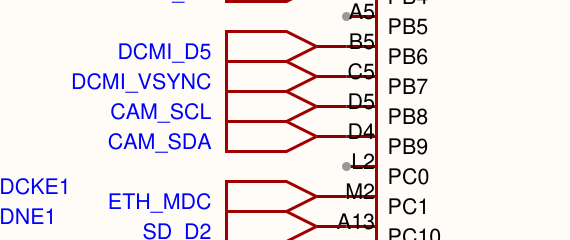

# V1 Camera：硬件I2C1适配与验收

日期：2026-11-15。分支：`fix/v1-camera-i2c1`。基线：`9bc95fb`（已包含CAM_DVDD_EN适配）。未合并main，未混入C2.2B。

## 1. 现场与接线核对

用户实测PA15与U10 CE均3.31V，TP2为1.51V；PA15输出1，PWDN低、RESETB高。Camera报告SYS_ERR_IO；本次复现未命中Dcmi_RecordError，首次读芯片ID寄存器0x300A时软件SCCB的error=4，表示写设备地址未得到ACK。接口处其余电源及信号由用户反馈符合预期，未取得示波器波形文件，未将口述转成精确时序测量。

重新核对V1主控页的连线端点，发现：

| 信号 | V1原理图 | 旧软件定义 |
| --- | --- | --- |
| CAM_SCL | PB8，D5球 | PB9 |
| CAM_SDA | PB9，D4球 | PB8 |



软件与原理图映射相反是已经确认的缺陷。真实PCB是否完全遵循原理图、调整后是否恢复ACK，仍需实板验证。用户随后授权改用硬件IIC。本报告为旧V1报告中“软件SCCB保持不变”的后续授权修订；旧报告保留历史，不把新的实现写成此前已经存在。

## 2. 实现与调用顺序

生产代码仅修改`CM7/BSP/bsp_camera.c/.h`。

- PB8=SCL、PB9=SDA，均为AF4 I2C1、开漏、无内部上拉；使用原理图2.8V外部上拉。
- Camera独占私有`s_camera_i2c`；保持原来的`BSP_Camera_ReadReg/WriteReg`签名，Device和Component无需改动。
- 不使用I2C中断或DMA，不新增Task、消息或资格状态；仅用阻塞HAL主机事务访问配置寄存器，不逐帧传输图像。
- HAL I2C及I2CEx源文件已在CM7/CM4正式工程中，不再添加重复文件。CM7没有另一个I2C1使用者；CM4 OLED使用I2C2。
- GPIOB仍在CM4唤醒前由EarlyInit配置，避免运行期再次修改与CM4共用的端口配置寄存器。HAL默认弱MSP无额外操作，本BSP负责I2C1门控和GPIO。
- 原PLL1Q/XCLK配置、电源10/1/20ms顺序和既有DWT启动检查保留。DWT不再负责SCCB逐位延时，保留该检查是为了不额外改变原启动失败行为。

```text
EarlyInit：EN低、PWDN高、RESETB低，PB8/PB9配置AF4开漏
    ↓
原PLL1Q、CPU与DWT检查
    ↓
校验I2C共享时钟选择器与PCLK1，开启I2C1并初始化、配置滤波
    ↓
沿用DVDD使能 → 等待10ms → PWDN低 → XCLK 24MHz
    ↓
等待1ms → RESETB高 → 等待20ms → 允许SCCB访问
```

读取：`HAL_I2C_Master_Transmit(0x78, [reg_hi, reg_lo])`完成并产生STOP，再`HAL_I2C_Master_Receive(0x78, 1字节)`。HAL负责设置读方向位，不能把接收API地址写成7位0x3C或额外移位。此处0x78是7位地址0x3C左移1后的HAL参数。

写入：`HAL_I2C_Master_Transmit(0x78, [reg_hi, reg_lo, value])`。保留写0x3008=0x82成功后的5ms复位等待，失败时不假装复位成功。

选择两个主机API而非Mem_Read，是为了保留原软件SCCB的STOP分隔读顺序。实际HAL代码中Master_Transmit使用AUTOEND并等待STOP标志。没有改动HAL库或传感器寄存器表。

## 3. 时钟与时序预算

STM32H747的I2C1/2/3共享内核时钟选择器。本BSP只读检查`__HAL_RCC_GET_I2C1_SOURCE()==RCC_I2C123CLKSOURCE_D2PCLK1`和PCLK1=120MHz；不调用PeriphCLKConfig、不切换时钟源、不重配PLL，因此不主动改变CM4 I2C2的时钟配置。

TIMINGR=`0xB0D32C36`，模拟滤波开启、数字滤波0。按120MHz内核计算：

| 字段 | 值 | 不含额外同步/滤波延迟的预算 |
| --- | --- | --- |
| PRESC | 11 | 100ns时基 |
| SCLDEL | 13 | 1.4µs数据建立间隔 |
| SDADEL | 3 | 0.3µs数据保持间隔 |
| SCLH | 44 | 4.5µs高电平 |
| SCLL | 54 | 5.5µs低电平 |

高低合计10µs，额外滤波、同步及线路边沿会降低实际SCL频率，因此目标为不超过100kHz的标准模式，而非声称实测恰好100kHz。预算按标准模式上升不超过1µs、下降不超过0.3µs、模拟滤波50–260ns核验，实板必须确认边沿和ACK。计算方法参考[ST AN4235](https://www.st.com/resource/en/application_note/an4235-i2c-timing-configuration-tool-for-stm32f3xxxx-and-stm32f0xxxx-microcontrollers-stmicroelectronics.pdf)的I2C定时字段及约束；该资料是F0/F3应用笔记，本项目使用本机H7 HAL和H7数据手册核对，未把工具输出冒充H747实测。

最初预算测试采用浮点数，10µs边界发生精度误差，已改成纳秒有理数精确计算，未放宽任何时序约束。初始借用的OLED TIMINGR没有作为最终Camera配置；最终值如上。

## 4. 超时、错误与关闭

每个HAL事务传入20ms超时。读包含发送、接收两笔事务，不能宣称整个ReadReg总超时为20ms。本机HAL另有25ms BUSY等待，故不能把20ms参数解释为所有路径的硬实时上界；期间不关中断，不进入RTOS临界区，但轮询会占用当前任务CPU，失败场景的调度影响仍需实测。

- HAL_OK→SYS_OK；HAL_BUSY→SYS_ERR_BUSY。
- HAL_TIMEOUT或HAL_ERROR伴随TIMEOUT位→SYS_ERR_TIMEOUT。
- NACK(AF)、BERR等其他失败→SYS_ERR_IO。
- 不自动循环重试、切换软件I2C、强行清总线或改设备状态。
- 保留`s_sccb_error`用于观察，但它现在是HAL错误位：0x04=HAL_I2C_ERROR_AF（NACK），不能再套用旧软件“哪一字节失败”的编码表。
- HAL_BUSY可能不更新ErrorCode，不能把上一笔AF作为本次BUSY原因；本BSP清零该诊断投影并保留BUSY返回值，不修改HAL句柄错误状态来绕过失败。
- PowerDisable先断言RESETB/PWDN，再撤销本核I2C1，停XCLK并关闭DVDD。仍要求调用者先停止采集并归还资源；普通Device_Stop不切DVDD。

资料：[本机同类HAL API官方说明](https://raw.githubusercontent.com/STMicroelectronics/stm32h7xx-hal-driver/master/Src/stm32h7xx_hal_i2c.c)、[OV5640原厂数据手册](https://cdn.sparkfun.com/datasheets/Sensors/LightImaging/OV5640_datasheet.pdf)。实际构建使用仓库内HAL，而非在线最新版替换。

## 5. 软件验证

| 项目 | 本轮真实结果 |
| --- | --- |
| CameraPowerV1原上电测试 | 14/14 PASS，Power_TestRun函数体及全部原断言逐字核对未变 |
| CameraI2cV1新增专项 | 24/24 PASS，ARMCC5编译真实Camera BSP，Unicorn执行，仅模拟HAL边界 |
| TIMINGR预算 | 精确有理数约束检查PASS，不等于波形实测 |
| CM7正式Target完整重编 | 0 Error、0 Warning，退出0 |
| CM4正式Target完整重编 | 0 Error、0 Warning，退出0 |
| 用户Keil设置 | uvprojx/uvoptx本轮前后SHA256一致；未提交用户修改 |

新增专项覆盖PB8/PB9 AF4、句柄及TIMINGR配置、16位寄存器字节序、0x78地址、发后收顺序、写3字节、复位等待、首次TX失败不继续RX、RX失败、NACK/BERR/BUSY/TIMEOUT、空指针、初始化及滤波失败、共享时钟不匹配、断电拒绝访问、NACK后下一次新请求、0xFFFF地址边界、0x300A/0x300B测试数据交付。

这些测试没有实际与OV5640通信；测试中0x56/0x40来自模拟传感器，不是实测芯片ID。未运行或宣称全仓历史回归全绿，业务数据面源文件未改。

运行：`python Tests/CameraPowerV1/run_tests.py`、`python Tests/CameraI2cV1/run_tests.py`。

构建使用本轮独立快照，拷贝当前两份BSP和用户本地工程配置，不改原工程路径、选项或原镜像。构建快照BSP与最终工作区逐字一致。

| Target | Code | RO-data | RW-data | ZI-data |
| --- | ---: | ---: | ---: | ---: |
| CM7 | 139702 | 3114 | 1344 | 100992 |
| CM4 | 26302 | 1438 | 936 | 3576 |

本轮使用用户当前本地工程设置，未将其工程差异提交；以下是两次构建数值对照，并非同一工程配置下的独立内存归因实验。相比上一份V1构建，CM7 Code增加1916B、RW+ZI净增加64B；Map确认私有I2C句柄为84B，净增还受删除旧软件SCCB代码和原变量布局影响，不能把64B直接当成句柄大小。没有改任务栈及队列。

- CM7日志：`output/V1CameraI2c1/CM7_rebuild.log`，SHA256 `a1b59cee03274d6c7c41e7bb079e54e652da3f64ac283cc90e397a0002044731`。
- CM4日志：`output/V1CameraI2c1/CM4_rebuild.log`，SHA256 `75f3d044b23c49f952866283807012e8e8630856056daa568ee1a75ea80b060c`。
- CM7 AXF：`output/V1CameraI2c1/build_snapshot/MDK-ARM/h7_mac_CM7/h7_mac_CM7.axf`，SHA256 `1decbb8c6948ddd5b06751d45ac8f67860547c51b409388c86d49e37feb0ebc5`。
- CM4 AXF：对应`h7_mac_CM4/h7_mac_CM4.axf`，SHA256 `d20db837c63faba7893a0dd023bbf936e5a6c7d6a8c368a6f38457ea53d95093`。
- 原output保留。不要把原目录尚未重编的旧AXF误认为当前硬件I2C版本。

## 6. 实板步骤与剩余风险

1. 当前分支打开原`MDK-ARM/h7_mac.uvprojx`，选择CM7，执行Rebuild后Download，再完整断电启动。用户原Keil设置未改，不需要手动添加HAL I2C源文件。
2. 确认PB8/PB9均为AF4、开漏，SCL在PB8、SDA在PB9；外部上拉到2.8V。示波器确认频率、上升/下降时间和地址ACK。
3. 在`Ov5640_ReadId()`内合并ID后观察`*id`，预期0x5640；Camera和Control无新增错误，实际视频恢复。该项待验收。
4. 若失败，在BSP_ReadReg第一次Transmit返回后暂停，查看reg、result及`s_camera_i2c.ErrorCode`。再区分地址/线路NACK、BUSY、超时，不能按旧error逐字节表解读。
5. 检查普通Camera STOP/START及MJPEG输出，CM4 OLED和IPC同时正常；本轮均待实板验证。
6. 原PA15在CPU执行前默认断电保证、2.8V/1.5V实际启动先后及稳定时间风险继续保留；改用硬件I2C不解决这些硬件条件。

软件已完成，不宣称真实ACK、芯片ID或视频已恢复；等待用户实板反馈，不合并main。
