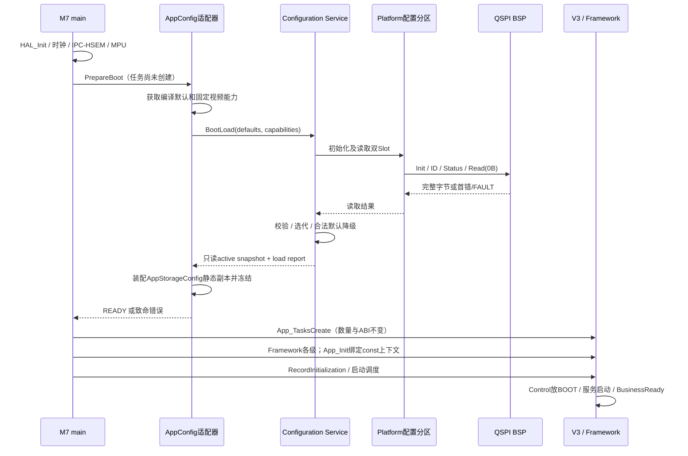

# 初始化、API和文件白名单（设计建议）

冻结输入、限制和未决条件见 [Design](Design.md)。以下函数名是拟议接口，不表示仓库已经存在这些实现。本轮无生产改动。

## 启动时序与INIT_LEVEL

事实：main `CM7/Core/Src/main.c:135–194` 顺序为HAL_Init、系统时钟、IPC/HSEM唤醒CM4、MPU、App_TasksCreate、Framework_InitRuntime、App_TasksRecordInitialization、Platform_RtosStart。Framework按PLATFORM→BUS→DEVICE→MEDIA→SERVICE→APPLICATION执行，同级按链接表遍历，不能用链接顺序赌依赖（`framework_init.c:9–60`）。因此在SERVICE级注册Configuration_Init，虽早于BOOT和业务执行，仍晚于任务创建，**不满足本任务要求**。

拟议最小接入：在MPU配置之后、首次App_TasksCreate之前显式调用 `AppConfig_PrepareBoot()`。不整体前移Framework，不改App_TasksCreate内部顺序、五任务、启动订阅/屏障或USB_MODE_NONE选择。Configuration Service的BootLoad由此处唯一调用，不再注册第二个Initcall；既有APPLICATION级App_Init只消费已准备快照及初始化Record。无法证明快照就绪则不创建任务。



Configuration内部不依赖FreeRTOS队列、SD挂载、Camera/USB Service或尚未执行的Framework Initcall；默认和能力由Application适配器按值传入，不能反向包含Application头。Platform前置入口只准备配置分区/BSP，并非运行整个Platform初始化。

### HAL Tick与执行上下文证明

- `CM7/Platform/platform_hal_timebase.c:9–33,47–52`：HAL_InitTick配置TIM6、启IRQ及CEN，IRQ递增HAL Tick；HAL初始化与时钟重配阶段先完成。不能把FreeRTOS调度Tick与TIM6混同。
- QSPI `CM7/BSP/bsp_qspi.c:58–67` 检查Thread mode、PRIMASK/FAULTMASK、TIM6 CEN/UIE/NVIC和BASEPRI；未要求调度器已启动。因而“main线程模式且Tick活跃”源级可行，仍需Q2验证，不可仅凭头文件“普通线程”注释宣布已通过。
- 第一个FreeRTOS任务创建过程可能改变BASEPRI；准备点放在所有任务创建之前，不依赖稍后调度器恢复屏蔽状态。证明前后Tick推进和所有屏蔽寄存器；禁止临时改TIM6优先级、全局清BASEPRI来绕过检查。
- Init预算约5200ms；Boot总预算建议6000ms，包含两Slot读取；不再对Init层层完整重试。HAL Tick停止仍不能保证墙钟退出，固定CPU循环的活性探测也需实测。仅当Tick在前置有界探测内确实前进才开始HAL访问。探测失败直接默认降级且禁保存，不继续有潜在无限等待的HAL调用。
- BootLoad返回“默认降级可继续”与“依赖/编译默认非法、无法发布快照”两种不同结果。前者顶层返回SYS_OK以保持相机可启动，但load report保留原I/O/解析错误，后者返回错误阻止任务创建。不得将BSP故障伪装成已恢复READY。
- Init、加载、完整备份均用静态RAM，禁止在main或服务栈放4KiB局部数组。审核MSP栈深、HAL调用栈和链接Map，不能只看五个任务水位。

## 拟议公共API

业务/诊断结构放 `CM7/Service/configuration_service.h`；不序列化C结构体。所有SysResult_t沿用现有定义，额外状态通过输出结构表达，不擅自新增通用错误码。schema/slot/operation/load_source/primary/cleanup/sequence/confirmed_bytes/commit_outcome等属配置诊断；不修改既有QSPI诊断ABI。

```c
SysResult_t Configuration_BootLoad(const RecordingConfig_t *defaults,
    const RecordingCapabilities_t *caps, ConfigurationLoadReport_t *report);
const RecordingConfig_t *Configuration_GetActive(void);
SysResult_t Configuration_ReadStaged(RecordingConfig_t *config,
    uint32_t *generation);
SysResult_t Configuration_Stage(const RecordingConfig_t *config,
    uint32_t expected_generation);
SysResult_t Configuration_StageDefaults(uint32_t expected_generation);
SysResult_t Configuration_Commit(uint32_t expected_generation,
    ConfigurationCommitReport_t *report);
SysResult_t Configuration_DiscardStaged(uint32_t expected_generation);
SysResult_t Configuration_GetDiagnostics(ConfigurationDiagnostics_t *report);
```

|接口|契约|
|---|---|
|BootLoad|main前置唯一一次，默认/能力有效，输出active稳定const对象；读取不写Flash，不创建任务；重复调用ALREADY_EXISTS|
|GetActive|仅初始化完成后返回非NULL；对象终生地址稳定，启动后不修改；不是staged地址，不允许调用者强转写入|
|ReadStaged|按值复制并返回generation；不暴露可写内部指针，不触碰Flash|
|Stage|四字段整份验证，通过才替换staged、generation+1；不改active，不擦写；expected_generation不匹配返回INVALID_STATE；范围/空指针错误INVALID_ARG|
|StageDefaults|仅把已验证编译默认复制为staged并增加generation；恢复默认不自动格式化，不立即保存|
|Commit|校验generation、权限、静止条件、硬件、固定分区、备份；只显式落盘，报告NO_CHANGE/COMMITTED/FAILED_BEFORE_COMMIT/OUTCOME_UNKNOWN和pending_reboot；active仍不变|
|DiscardStaged|回到最后确认persisted内容（无persisted时为本次Boot默认），不写Flash、不影响active；UNKNOWN后拒绝，不能伪造确认|
|GetDiagnostics|短临界区快照或BUSY；首错与清理错独立，诊断只读，无Init/Recover等副作用|

generation是本次启动的staged乐观并发令牌，Flash Sequence是持久代次，两者不可混用；stage/commit期间一次逻辑预约，其他修改返回BUSY。generation回绕不得当作长期唯一身份：首版在UINT32_MAX耗尽时拒绝进一步Stage，要求维护重启，避免ABA。Commit一开始固定本次数据，不能中途读取外部指针。无效请求不接触QSPI，也不锁存硬件FAULT。

用户的“恢复默认并保存”是StageDefaults后显式Commit；“只试改不保存”停在Stage，重启丢弃staged；“保存后立即改录像”不提供。保存成功后的后续Stage也只改staged，active永远是本次Boot选定值。获取persisted状态通过诊断按值查询，不将上层服务指针替换为新值。

尚未定义网络/USB/按键前端。第一版仅允许已审核现有维护调用者、合法M7线程和已证明业务静止条件，配置写入口不加入Runtime消息/全局事件/新任务。Control API所有权沿用，不假设任意线程可查询Supervisor；静止证明如何与既有Control结合需Q3专审。不能通过一个任何调用者可置真的bool作为写许可。

## BSP契约复用与明确缺口

|现契约与源码|产品处理|
|---|---|
|空公共策略 `bsp_qspi.c:31–37,992–996,1326–1376`|保存当前一定NOT_SUPPORTED；未来只改为两个产品Slot的不可变编译策略，范围开通必须单独批准。若两Slot非连续，精确验证两窗口，不能以中间大范围代替|
|Program `:1289–1323`|全请求FF预检、分页、BUSY及逐页验读全部复用，不在Platform实现WREN、轮询或第二套页写|
|Erase `:1332–1369`、`bsp_qspi.h`|提供完整当前4096B副本供逐字节预检；持久备份要求待专审解决，不用RAM冒充持久化|
|写期限20/500ms内部预留及最大60000ms|外层两秒为建议完整逻辑期限，剩余时间给BSP；BSP单次限时和整个配置事务限时均需满足，禁止各步骤各获两秒|
|FAULT / partial completed / Recover拒绝写风险|Config记录精确失败阶段，不自动清锁存、不重放、不替换首错；Commit之后报UNKNOWN而非回滚成功|
|BSP原子占用只覆盖单API|Platform逻辑预约保护跨API副本选择及提交，不能拿到预约就声称BSP READY；仍检查每次BSP返回、completed和诊断|

旧副本保护的逻辑事务和BSP总线锁承担不同职责。预约最长覆盖有界保存，绝不长期关中断或持有其他服务的Frame Lease、文件/SD资源。保存依赖外部备份若需SD，必须先完成备份再进入QSPI修改阶段，并避免“加载配置需要挂SD，挂SD又需要配置”的启动循环。

## 未来文件新增/修改清单（非本轮改动）

|阶段|路径|最小职责|
|---|---|---|
|Q2新增|`CM7/Service/configuration_service.c/.h`|独立四字段模型、校验、默认/选择及active/staged诊断；初期只读|
|Q2新增|`CM7/Platform/configuration_store.c/.h`|固定Slot读取与逻辑预约，BSP适配；不暴露HAL/任意地址接口|
|Q2新增|`CM7/ApplicationV3/Core/app_config.c/.h`|编译默认/能力映射、AppStorageConfig不可变适配|
|Q2修改|`CM7/Core/Src/main.c`|任务创建前一次显式PrepareBoot，不改变双核启动及任务创建/Framework相对关系|
|Q2修改|`CM7/ApplicationV3/Core/app_main.c`|只绑定已准备的录像快照；video仍固定默认，Record初始化不变|
|Q2工程|隔离候选Keil CM7登记新增源文件|基于已通过的Q1.5-A底座，不覆盖本地Keil，不改CM4/Scatter/任务数|
|Q3修改|上述Configuration/Platform实现|显式Commit、双Slot算法及受限维护资格|
|Q3待批准|`CM7/BSP/bsp_qspi.c`及必要策略私有头|仅精确产品窗口及经过审核的备份契约方案；不重构Read/Recover，不开启H1测试宏|
|Q2–Q4新增|`Tests/PersistentConfiguration/`、`Docs/QSPI/Configuration/`|独立Mock/序列化/断电模型/只读与后续获准实板入口和证据|

无需修改StorageService使用方式、Runtime队列、消息ABI、Supervisor组件、App_Events或五个任务。若发现实际需要修改这些冻结边界，停止对应部分并提交设计增量，而不是在实施时顺手拓展。Q2/Q3具体文件白名单须在阶段开工审核中再次冻结；本设计不等于这些生产修改已经获准。
