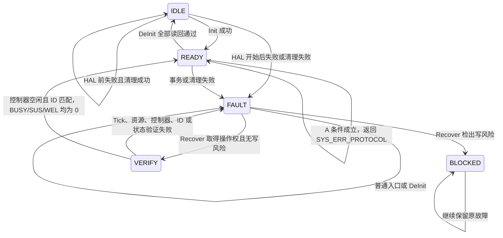

# Q1.4 故障隔离与显式恢复

授权基线为 `ca841b78cfca4b5b50d20741e68a3af260f13259`。工作区已经包含后续只读提交 `81d9b4b`，H1 真实备份依赖它，因此保留该提交并以它作为 Q1.4 代码差异及构建比较的直接基线。Keil 未提交配置及现场 HEX 保持原样。

开发前审计覆盖 Init/DeInit、Cleanup、ReadFinish、WriteFinish、WriteWait、Program/Erase、两种现有诊断结构和 H1 本地归档。原驱动区分 READY 和锁存 FAULT，但根因跨入口的记录分散。原清理在 GPIO/MUX 全部读回之前关闭 QSPI 门，部分清理失败后缺少独立证据。原 WriteWait 已用 BUSY/WEL 和逐字节验读判断进度，HAL OK 仅表示 MCU 事务返回。Q1.4 保留这些正常事务行为，增加独立故障快照及显式恢复入口。

|来源|记录与旧行为|恢复准入|
|---|---|---|
|准备阶段错误，HAL 未开始|PREPARE，保留首错。没有清理故障时仍可正常 Init|未锁存时无需 Recover；清理失败时需资源证明|
|HAL 初始化已开始|HAL_INIT，锁存 FAULT|可显式重试，须清理及重新识别|
|JEDEC/初始化验读失败|INIT_IDENTIFY，锁存 FAULT|同上|
|纯读取事务失败|READ，锁存 FAULT，保留旧读取进度|可显式验证空闲及 JEDEC 后返回 READY|
|写预检或首条写命令前故障|WRITE_PREFLIGHT；合法拒绝仍遵守旧结果|未触发 WREN/写命令且锁存时可评估恢复|
|A．WREN 成功，后续有效 SR1 证明 BUSY=0、WEL=0，本次调用尚未尝试 PP/SE|返回 SYS_ERR_PROTOCOL；写诊断仍记录 WREN 已尝试|保持 READY，无需 Recover|
|B．WREN 命令执行结果不确定|WREN，和内部编程未知分开保存|锁存 FAULT，阻止恢复写资格|
|C．WREN 成功后 SR1 状态证明失败|WREN，保留首错以及独立清理结果|锁存 FAULT，阻止恢复写资格|
|D．PP/SE 已尝试且修改命令阶段失败|MUTATION_COMMAND，标记修改命令可能已发出|保持 FAULT；禁止重发或恢复写资格|
|E．BUSY 等待或结束状态证明失败|FLASH_PENDING，完成状态未知|保持 FAULT|
|F．已证实空闲，验读失败|WRITE_VERIFY，记录已验读前缀|保持 FAULT；数据需人工审核|
|Abort/DeInit/资源恢复失败|CLEANUP 或独立清理阶段，原始主错误不被覆盖|仅在无写风险且可重新证明资源时尝试|

`BSP_QSPI_GetFaultDiagnostics()` 提供独立快照，原两套诊断及 H1 RAM ABI 保持原样。fault_stage 所在的 Init/Read/Write/Cleanup 枚举由 fault_origin 指定。首错与首轮清理固定保留，后续清理和恢复另记。写入范围仅记录最近一次具有非零逐字节验证结果的前缀。RAM 诊断无跨复位持久化保证。

A 还要求 HAL WREN 成功、SR1 完整且无 HAL 错误、没有其他需要锁存的控制器、配置或清理错误。有效 SR1 已证明 Flash 空闲且写使能未建立，调用在发送修改命令之前结束，因此无需 Recover。短接收或带 HAL 错误的零值归 C。B–F 有写使能或修改命令已尝试的历史，普通 Init 不清除锁存，显式 Recover 拒绝恢复写资格且不发出 Flash 指令。跨页 Program 已验读前页后遇到下一页 WEL=0 的现状及待审决定见 [R1 跨页技术说明](Q1_4_R1_MultiPageDecision.md)。

清理时依据 BSP 所有权处理私有句柄、控制器、六个 GPIO 位和 QSPI mux。非间接模式或 DMA 状态异常时拒绝 Abort。Abort 需通过 HAL 返回、ErrorCode 和控制器 BUSY/ABORT 读回。DeInit 需通过 HAL 结果、句柄 RESET 和 CR/SR 停止证明。确认 GPIO 和 mux 已归还后才关闭 QSPI 门，门读回通过才清除所有权。部分失败保持所有权，GPIOF/G 门保持开启。控制器停下不代表 Flash 停下。

显式恢复从检查 Tick 开始计入同一个 5200 ms 初始验证预算。预留 HAL 的 5000 ms 初始化上限，其后 JEDEC 与三组状态读取使用剩余预算，失败后的故障清理单独计时。Tick 用无符号差处理回绕，恢复前有固定次数的 Tick 前进探测。实际 HAL 等待仍要求 TIM6 在整个操作中持续运行。没有跨核所有权协议，恢复必须延续 Q1 的 M7 独占合同，禁止外部并发修改所属引脚和 QSPI mux。

## 软件验证

新增专项通过真实 BSP 入口触发故障。注入位于 HAL 返回、模拟寄存器和 Tick 模型，不直接改写 BSP 锁存、所有权或恢复验证结果。专项 **45/45，12,757 条断言**。原始逐例输出及实际编译命令位于 Tests/QspiFlashQ1/q14/evidence/mock/。

|用例范围|注入及通过判据|
|---|---|
|0–8|Command/Receive 的 BUSY、ERROR、TIMEOUT，HAL_OK 带错误、短接收、配置改变。完成字节数为零，首错保留，符合条件时只读恢复|
|9–11、40–42|控制器持续 BUSY，Abort/DeInit 失败及伪成功证据，DMA 状态异常。失败保留所有权和清理阶段|
|12–22、43|Flash BUSY/SUS/WEL，重复和并发恢复，恢复中 Receive 失败，Tick 回绕、超预算和停表，GPIO 或 RCC 被其他使用者改变。READY 仅在重新核验后发布|
|23–25|HAL 前失败、HAL 已开始失败、JEDEC 不匹配。分别记录并判断是否需显式恢复|
|26–39、44|写命令前期限、WREN、Program 命令或 Transmit 的三类 HAL 错误、短发送、持续 BUSY、跨页部分完成、写后与验读期限、数据不符、Erase 内部状态未知。确认范围及首错保留，写风险锁存时恢复不发任何命令|

专项核验错误码、READY/FAULT、GPIO/RCC 控制器占用、确认字节数、首错和独立清理、下一次访问，以及实际发送的指令序列。成功恢复只发 9F、05、35、15。已证明可恢复的场景包括无写风险的纯读取故障、模拟 HAL Init/JEDEC 故障及清理在显式调用中重新通过。R1 专项覆盖 A–C，逐例结果和跨页 FAIL 见 [R1 回归报告](Q1_4_R1_WrenWel.md)。B–F 锁存后需人工核对数据与原始现场，后续 JEDEC 识别无法恢复写资格。

实际 ST HAL 链接仿真验证初始化 5000 ms 超时。控制器持续 BUSY 时，初始化首错为 SYS_ERR_TIMEOUT，Recover 为 SYS_ERR_IO，FAULT 与所有权保留，未写 CCR 指令。以前的真实 HAL 默认写门禁仍返回 SYS_ERR_NOT_SUPPORTED，外设未映射，Tick 调用数为 0。

Q1.1 **51/51**，Q1.2 **516/516**，Q1.3 **48/48**，SFDP **6/6**，Quad ID **22/22**，H1 固件 **19/19**，H1 PC 工具 **10/10**。旧断言未改动。Q1.1 的 DMA 异常用例少执行 3 条清理钩子中的断言，Q1.2 的 Memory Mapped 异常用例少执行 2 条。这是新清理门禁拒绝调用不安全的 HAL 清理导致，旧用例仍执行并通过。历史 SDRAM 18 通过/8 失败，DCMI 88 通过/45 失败，USB 7 通过/1 错误，原始日志保留，基线与当前结果逐例一致。

## 双核 Rebuild 与资源

ARMCC5 用同一原 Keil 工程配置的隔离快照分别构建直接基线和 Q1.4。仅从隔离副本移除诊断宏，当前两核均 **0 Error、0 Warning**。

|内核|ROM 基线 → 当前|RAM 基线 → 当前|静态栈 基线 → 当前|
|---|---:|---:|---:|
|CM7|148,928 → 149,644 B（+716）|114,752 → 114,856 B（+104）|1,344 → 1,344 B|
|CM4|28,676 → 28,676 B|4,512 → 4,512 B|432 → 432 B|

默认镜像未引用 Recover，链接器会剔除该入口。上表为默认镜像的统计，静态栈不代表显式恢复路径的实板高水位。实际 Recover 和新诊断入口在独立 ST HAL 仿真镜像中保留并执行。静态审核确认仅修改生产 BSP 两文件，未增加动态内存、任务、DMA、Flash Reset 或写指令，生产写策略继续为空。

## H1 现场记录与审核边界

重读本机写前、写后、擦后原始归档。相同 UID，520 字节图案于 30 MHz 写后验读，于 120 MHz 两路与图案一致；30 MHz 擦除验读 4,096 字节；最终 120 MHz 双读确认目标和相邻扇区分别与写前文件逐字节相同。H1 限该板、单扇区、已批准的单次试验。非空恢复未在板上执行，波形未取证。原始 BIN、HEX、AXF、UID 和 PC 归档仍在本地，提交中仅放 SHA-256 和结论。

阶段提交 A 8fdd07e、B 862875e、C f480cc1、D 本报告所属提交。全量文件见 [变更清单](../../Tests/QspiFlashQ1/q14/changed_files.txt)，原始日志见 Tests/QspiFlashQ1/q14/evidence/。本轮未下载、未向实板注入故障或操作 Flash。实板恢复时序、长期稳定和跨掉电一致性待另审，Q1.5 未启动。
