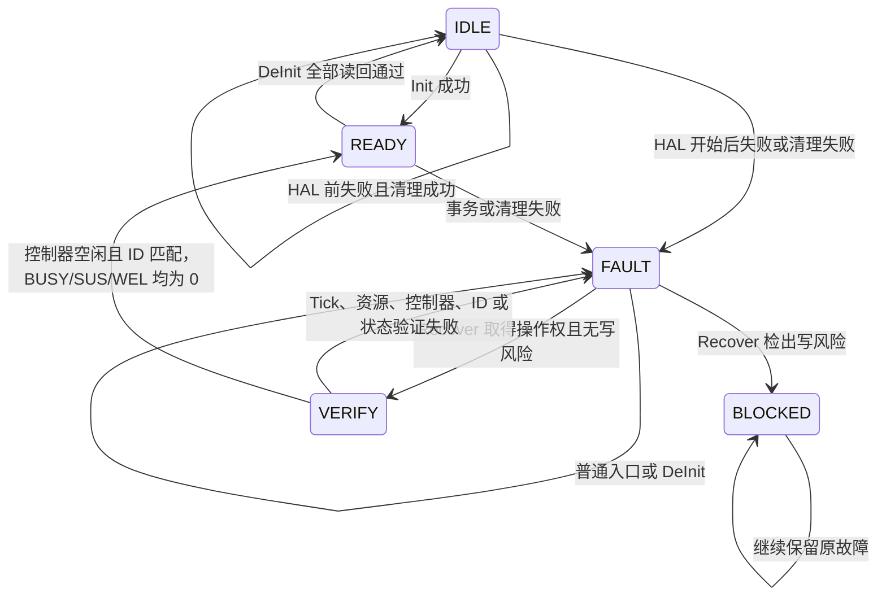

# Q1.4 故障隔离与显式恢复

授权基线为 `ca841b78cfca4b5b50d20741e68a3af260f13259`。工作区已经包含后续只读提交 `81d9b4b`，H1 真实备份依赖它，因此保留该提交并以它作为 Q1.4 代码差异及构建比较的直接基线。Keil 未提交配置及现场 HEX 保持原样。

开发前审计覆盖 Init/DeInit、Cleanup、ReadFinish、WriteFinish、WriteWait、Program/Erase、两种现有诊断结构和 H1 本地归档。原驱动区分 READY 和锁存 FAULT，但根因跨入口的记录分散。原清理在 GPIO/MUX 全部读回之前关闭 QSPI 门，部分清理失败后缺少独立证据。原 WriteWait 已用 BUSY/WEL 和逐字节验读判断进度，HAL OK 仅表示 MCU 事务返回。Q1.4 保留这些正常事务行为，增加独立故障快照及显式恢复入口。

|来源|记录与旧行为|恢复准入|
|---|---|---|
|准备阶段错误，HAL 未开始|PREPARE，保留首错。没有清理故障时仍可正常 Init|未锁存时无需 Recover；清理失败时需资源证明|
|HAL 初始化已开始|HAL_INIT，锁存 FAULT|可显式重试，须清理及重新识别|
|JEDEC/初始化验读失败|INIT_IDENTIFY，锁存 FAULT|同上|
|纯读取事务失败|READ，锁存 FAULT，保留旧读取进度|可显式验证空闲及 JEDEC 后返回 READY|
|写预检或首条写命令前故障|WRITE_PREFLIGHT；合法拒绝仍遵守旧结果|未触发 WREN/写命令且锁存时可评估恢复|
|WREN 可能发出|WREN，和内部编程未知分开保存|存在锁存时阻止自动回到 READY|
|PP/SE 调用已进入 HAL|MUTATION_COMMAND，标记可能已发出|保持 FAULT；禁止重发或恢复写资格|
|BUSY 等待或结束状态证明失败|FLASH_PENDING，完成状态未知|保持 FAULT|
|已证实空闲，验读失败|WRITE_VERIFY，区别于完成未知|保持 FAULT；数据需人工审核|
|Abort/DeInit/资源恢复失败|CLEANUP 或独立清理阶段，原始主错误不被覆盖|仅在无写风险且可重新证明资源时尝试|

`BSP_QSPI_GetFaultDiagnostics()` 提供独立快照，原两套诊断及 H1 RAM ABI 保持原样。fault_stage 所在的 Init/Read/Write/Cleanup 枚举由 fault_origin 指定。首错与首轮清理固定保留，后续清理和恢复另记。写入范围仅记录最近一次具有非零逐字节验证结果的前缀。RAM 诊断无跨复位持久化保证。

清理时依据 BSP 所有权处理私有句柄、控制器、六个 GPIO 位和 QSPI mux。非间接模式或 DMA 状态异常时拒绝 Abort。Abort 需通过 HAL 返回、ErrorCode 和控制器 BUSY/ABORT 读回。DeInit 需通过 HAL 结果、句柄 RESET 和 CR/SR 停止证明。确认 GPIO 和 mux 已归还后才关闭 QSPI 门，门读回通过才清除所有权。部分失败保持所有权，GPIOF/G 门保持开启。控制器停下不代表 Flash 停下。

显式恢复从检查 Tick 开始计入同一个 5200 ms 初始验证预算。预留 HAL 的 5000 ms 初始化上限，其后 JEDEC 与三组状态读取使用剩余预算，失败后的故障清理单独计时。Tick 用无符号差处理回绕，恢复前有固定次数的 Tick 前进探测。实际 HAL 等待仍要求 TIM6 在整个操作中持续运行。没有跨核所有权协议，恢复必须延续 Q1 的 M7 独占合同，禁止外部并发修改所属引脚和 QSPI mux。
