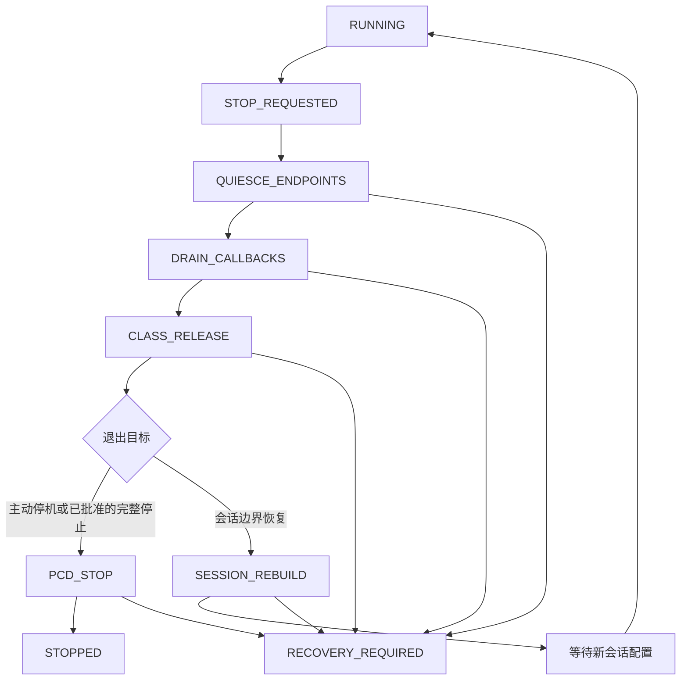

# USB停止与会话恢复生命周期设计

日期：2026-11-19。审计基线：`a0ec0eb72f5260d9602b32a996db5f0e76417c6a`。本文件仅设计，不修改生产代码，不授予实现或MSC-5权限。VERIFIED为指定源码/既有证据，INFERRED为推断，UNRESOLVED为尚未解决，NOT_TESTED为尚未验证。

依赖：[EndpointCancel契约](EndpointCancel_Contract.md)、[硬件证据](EndpointCancel_HardwareEvidence.md)、[测试计划](EndpointCancel_TestPlan.md)。本文的状态机为目标行为，**不是对当前实现的描述**。

## 1. 当前实现的差距

VERIFIED：`CM7/Platform/usb_device.c:1729 Usb_StopDevice`先调用 `CM7/BSP/bsp_usb.c:188 BSP_USB_Stop`，底层195行先关闭NVIC，再Abort各方向，最后才HAL_PCD_Stop；Platform在BSP Stop成功后才释放Class。当前顺序不满足“先排空、Class Release、最后PCD Stop”的目标。

VERIFIED：`Usb_Disconnect:1543 -> USBD_LL_DevDisconnected:995 -> Usb_ManagedClassDeInit:1855 -> Msc_DeInit:84`可在IRQ链内发生。MSC先禁止配置请求和BOT推进，再分别关闭OUT2/IN2；失败方向保留资源。当前Bulk取消是同步轮询，没有独立取消完成事件。

VERIFIED：Platform `Usb_DataOut:1410 / Usb_DataIn:1430`在非零端点Class非ACTIVE时直接过滤业务路径；新的收尾不能只依靠这条路径，因为旧取消事件必须仍能完成旧Stop。现有ManagedClassDeInit失败保持RELEASE_FAILED及外部绑定，不表示资源已经释放。

上述事实决定了后续实现须有新的底层完成契约和Core调用适配；本轮不能仅新增状态枚举就宣称整改完成。

## 2. 事务、会话与共同准入点

每个Stop事务保留：`stop_id`、旧Session、受影响端点incarnation/Transfer、各Cancel身份、原因集合、首个错误、Class释放进度、PCD停止进度、IRQ提交状态、通知引用及后端排空状态。

单一Task串行推进；ISR只记录事实、关闭新提交准入并通知Task。StopRequested的线性化点必须覆盖：

- 禁止新CBW解释为业务命令；已arm的CBW buffer继续保留，等待取消或正常完成证据。
- 禁止新Data IN/OUT、CSW、BSP自动PIO续包和Worker Submit。封锁业务不等于删除已在途引用。
- 取消旧EP0 Deferred Status资格；Token失效不释放端点、Worker或DMA。
- 建立旧会话的收尾记录，才允许推进“当前会话已失效”的Session标记。不能先递增epoch后把旧事件全部丢弃。

重复Stop合并到现有事务并返回其身份/状态。原因集合可增加；不能启动第二个并行Class释放或PCD Stop。Stop记录不可因USB重枚举或调用超时而丢失。

## 3. 统一流程及明确的退出策略

统一的是事务、准入、端点静止、回调排空、Class释放和恢复判据。**是否最终关闭PCD是明确的策略，不由一次物理事件盲目决定。**

| 原因 | ISR/入口动作 | Task共同收尾后的策略 |
| --- | --- | --- |
| 主动Stop | Task登记Stop，立即封锁新提交 | Class释放后最终PCD Stop，成功才STOPPED；后续Start必须显式请求 |
| USB Disconnect回调 | 失效控制资格，记录旧Session和断线事实，封锁提交 | 退役旧Class/端点；若需自动重连，保留明确的控制器监听策略，不无条件关PCD后假设会自动收到Connect |
| USB Reset | 记录Reset边界、失效旧控制请求并封锁旧业务 | 完成旧收尾后建立地址0/新EP0边界，等待主机配置；正常Reset不自动变成断开再强制Start |
| 致命错误/恢复失败 | 锁定准入，保存首个失败 | RECOVERY_REQUIRED，保留未证明静止的引用和RAW租约 |

VERIFIED：当前VBUS sensing关闭，SOF/Suspend/Disconnect是不同入口。设计不把SOF缺失或Suspend当作安全断开，也不假设PCD已关闭时仍有可靠的Connect唤醒来源。自动重连所需的实际检测/监听路径属于L-U2。

如果人工选择“Disconnect后完整关闭PCD”，它走PCD_STOP并需要独立、已验证的后续启动来源；缺少该来源时保持STOPPED，不能以轮询强制重启掩盖问题。

## 4. 状态的进入动作与完成证明

| 状态 | 允许动作 | 进入下一状态的必要条件 |
| --- | --- | --- |
| RUNNING | 仅当前Session可arm/提交业务 | 收到确定的Stop/会话边界，准入关闭 |
| STOP_REQUESTED | 固定旧目标、原因与Stop身份，失效旧EP0资格；保持收尾IRQ可用 | 所有提交生产者都已看到封锁，目标快照完整 |
| QUIESCE_ENDPOINTS | 分方向登记取消；维持有效事件入口；正常完成也可成为终结事实 | 每个目标取得匹配的Cancelled、Normal Complete或可靠Idle证明；超时不满足 |
| DRAIN_CALLBACKS | 消费旧数据/取消通知，只做计数与所有权收尾；等待后端实际排空 | 硬件和驱动无访问，旧事件引用/调用栈归还，SD Worker/IDMA独立静止 |
| CLASS_RELEASE | 在安全方向上Close及一次性释放；记录部分成功，失败方向不伪装释放 | Class与端点真实释放完成，无待使用旧context的事件 |
| PCD_STOP | 确认无端点/通知依赖IRQ后请求最终控制器停止 | 硬件与HAL结果一致、停止已确认，才提交started=false及最终IRQ禁用/清pending |
| STOPPED | 不接收新业务；保留可查询的终结及错误历史 | 显式Start且完整启动前置条件满足 |
| SESSION_REBUILD | 保持PCD监听策略，完成Reset/会话的Core和EP0同步 | 旧端点arm屏障已完成，新会话地址/EP0一致，允许主机重新配置 |
| RECOVERY_REQUIRED | 保存故障、继续服务有身份的旧收尾证据；不得重开业务 | 满足第8节恢复条件，允许继续原清理；不自动Start |

短时间屏蔽IRQ保护元数据与把IRQ长期关闭是不同操作。准入更新临界区必须有界并恢复原使能状态；不能在其中等待取消事件、SD操作、队列消费者或长硬件超时。最终PCD切换的原子化方案尚待L-U4核验，不能重复当前“先无条件关NVIC，再等待Abort”的路径。

## 5. ISR与Task职责

| ISR/BSP事实层 | Task/生命周期层 |
| --- | --- |
| 在HAL前捕获必要原始状态并绑定旧arm身份 | 创建/合并Stop，串行推进状态 |
| 记录Reset/Disconnect、XFRC、EPDISD等事实 | 发起取消、检查证据、处理恢复条件 |
| 立刻封锁新业务和PIO续包入口 | 排空数据/取消通知及消费者引用 |
| 把旧完成交给旧Stop；队列满保留记录/故障 | 等待Worker和SDMMC实际quiescent，不占用ISR |
| 有界、无文件操作、无长轮询、无Class Free | Class释放和最终PCD停止/重建 |

不允许在ISR中阻塞等待Task消费队列。Task等待取消完成时必须保留实际可产生该证据的IRQ/查询路径；如果硬件已停止但通知尚在队列，继续排队收尾，不把它误判成“取消未提交”。

## 6. 迟到事件、Session与资源账本

事件首先查找其Transfer/Cancel/Stop记录，而不是先比较全局当前epoch。路由规则：

1. 匹配旧Stop的取消通知：更新旧方向的证明、驱动/事件引用和排空计数。允许旧Stop推进，禁止新Session业务副作用。
2. 匹配旧Transfer的正常完成：记录真实完成前缀/整次完成；Stop准入已关闭时只归还引用，不发送下一笔CBW、Data或CSW。
3. 重复终结事件：识别相同事件身份并幂等消费，不再Free或增加完成次数。
4. 已安全退役后的旧事件：仅落在tombstone/异常记录，不得解引用已释放context，也不得被包装成新Session的当前Token。
5. 无法归属的原始IRQ：不向业务投递，封锁相关新arm并进入证据不足的恢复状态；不能靠epoch不等直接丢弃后释放旧buffer。

每次检查使用独立事实：`hardware_quiescent`、`driver_access_released`、`events_consumed`、`class_release_done`、`pcd_stop_done`。软件busy只是账本投影；不能先清busy再用其证明硬件静止。

缓冲引用计入硬件、BSP PIO分包、排队事件、正在执行的回调、Class和后端。对SD LUN，SDMMC IDMA及Worker可能仍持有同一MSC数据缓冲；必须等待其自己的完成证明。RAW租约在本生命周期里保持原所有者，任何Stop、Disconnect、Reset、取消或PCD停止结果都不自动授权FatFS。

## 7. Class Release、PCD Stop与Core适配

拟议完整停止的顺序为：取消证明 → 旧通知/后端排空 → Class/端点释放 → PCD Stop → 提交STOPPED。Class Release前必须有零旧context消费者；不能为了通过Core DeInit而强制清端点标记、释放内存或返回假成功。

Class部分释放失败时记录每个方向/步骤。下一次只能重试尚未完成且明确可重试的步骤；外部Class DeInit是否可重复调用必须逐Class核实。不能假设UVC等所有Class与MSC静态资源同样幂等。

PCD Stop失败时可能出现“Class已经真实释放、PCD尚未停止”。必须分别报告两个事实，不重新伪造Class仍ACTIVE，也不声称PCD已停止。不得把这些状态压成一个成功bool。取消/回调尚未排空时禁止进入PCD_STOP；失败保留真实控制器状态和错误，后续只能继续安全收尾或显式恢复。

**L-U1：ST Core同步回调与异步停止的适配尚未解决。** VERIFIED：当前Core Reset/Disconnect同步调用Class DeInit，Platform又在IRQ链内调用Core。目标设计需在Platform先登记会话边界，延后会调用DeInit的Core阶段，直到Task完成安全收尾；新Setup/EP0同时需要一个明确、合法的受控准入策略。

不能在异步清理未完成时向Core返回USBD_OK来谎称Class已释放；也不能把USBD_BUSY直接塞进旧同步路径假设Core会替我们等待。若标准控制请求必须暂缓，应核对EP0硬件与主机时序；没有这些证明时保持RECOVERY_REQUIRED并报告可用性失败，不擅自修改ST Core。

## 8. RECOVERY_REQUIRED恢复条件

超时只记录“按期未证明”，不改变硬件/缓冲所有权。状态需要继续接收旧收尾事件；延迟取消完成必须能帮助原Stop收尾，不能因当前Session变化被过滤。

继续清理必须同时满足：

- 原Stop/Transfer/Cancel身份可追溯，首个错误与后续证据都保留；没有Token复用或事件证据溢出。
- 各方向取得实际静止证明，驱动续传已封锁；新arm与旧原始事件已分离。
- 已排队/在栈的旧回调、取消通知和后端引用已经排空，或有确定且有界的可继续排空路径。
- SD Worker/IDMA独立确认，不通过USB事件代替；RAW租约保持。
- 对失败步骤重试不会重复Close/Free已完成资源；对PCD/IRQ状态有明确账本，不凭READY/UNLOCKED猜测。

迟到证明可以让旧清理继续至STOPPED或安全的会话重建门槛，但不能擦掉之前Failed结果、自动开放新Session或把历史失败报告改成全程成功。是否从RECOVERY_REQUIRED继续清理及之后是否允许Start是两个决定；证据不足时一直封锁业务。

控制器必须复位才能恢复、需要改未授权模块、或者共享RX归属不明时，保存现场并停止后续实现/验收；不能把自动MCU复位、强制PCD重启或开启FatFS当作恢复条件。

## 9. 实现前未解决项

| ID | 状态 | 待核验内容 |
| --- | --- | --- |
| L-U1 | UNRESOLVED | 同步Core DeInit与异步清理的Platform适配、恢复期间EP0合法准入和主机等待窗口 |
| L-U2 | UNRESOLVED | VBUS sensing关闭时Disconnect后的可靠监听/重连来源，不能依赖SOF缺失或关闭PCD后的假Connect |
| L-U3 | UNRESOLVED | 各Class部分释放重试的幂等性及零消费者证明，特别是默认UVC |
| L-U4 | UNRESOLVED | 最终HAL/PCD停止的有界串行化、临时IRQ保护与失败恢复，使其不妨碍必要收尾 |
| L-U5 | NOT_TESTED | 所有故障注入、RAM/SD只读/UVC实板矩阵和10次重连 |

本轮交付的是可审查的事务与条件设计。所有未解决项保留为实现门槛；没有编译、烧录或运行新的状态机。
