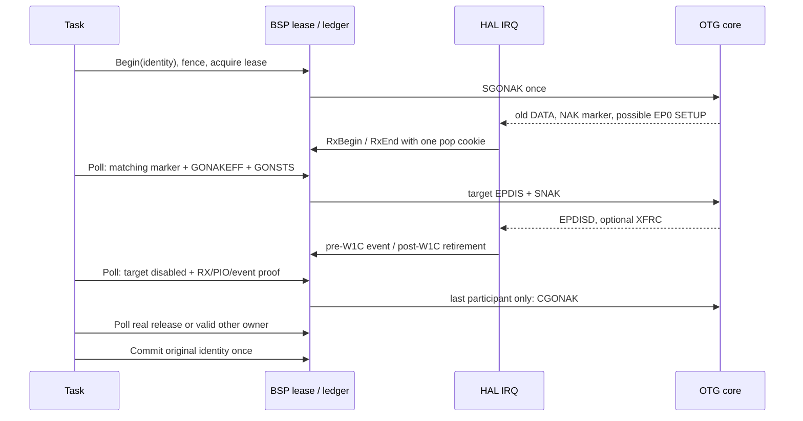

# P1-C1 — Global OUT NAK / RX 退休与 Stop Proof

VERIFIED（源码）：本契约只供显式启用后的非零 Bulk OUT。API 不硬编码 EP2 或 MSC；当前专项优先 EP2，并包含 EP1、EP0、ISO、IN 并发。Task 单执行器串行调用 Begin/Poll/Commit/Reconcile；ISR 只消费硬件事实。硬件结果 NOT_TESTED。

## 身份与资源账本

VERIFIED：方向包含在 endpoint_address；OUT 独立 Controller、Session、Endpoint generation、Transfer sequence、StopAttempt、Lease、RX cookie、Event cookie，借用 IN identity 的字段形状，不共用计数器。任一计数耗尽拒绝，不回绕、不清旧引用。Buffer 原址、capacity、received、PIO 引用、source_returns、fence、原始 events、first_error、failed_stage、reconcile_count 留在 proof 中。

VERIFIED：`CM7/BSP/bsp_usb.c:856` 在真实 HAL Receive 前持短原子窗口创建记录。已 fenced/owned、旧终止位未退休、Session 失效或 lease 故障都拒绝新提交。HAL 提交失败仍保留已登记的 Buffer 和失败事实。普通正常完成只有当前 immutable event、原身份及 PIO=0 才能归还；回调重 Arm 不清新记录。EP0 不能覆写尚未归还的普通接收 owner。

## 三阶段停止

| 接口/阶段 | 真实操作与必要证明 | 失败处理 |
| --- | --- | --- |
| `CM7/BSP/bsp_usb.c:884` | 原子登记同身份 StopAttempt、先 Fence 新 Receive；申请/加入唯一 Global OUT NAK lease | 失败保留 Fence、Buffer、身份；SYS_OK 只表示请求已登记，必须检查 proof.stage/error |
| WAIT_NAK | 正常 HAL RX 消费先前 DATA 和 NAK marker；同 lease marker cookie + GONAKEFF + GONSTS | 无 marker 不进入 Disable；不能只轮询有效位或屏蔽 RX |
| DISABLE | 仅非零目标 EPENA=1 时 EPDIS/SNAK；pre-W1C 捕获匹配 EPDISD；等待事件退休及 EPENA/EPDIS=0 | 旧 EPDISD、身份不明、超时进入 FAULT/RECOVERY_REQUIRED，不清 busy |
| DRAIN | 已有屏障水位、没有目标 PIO/活动 copy/未退休 event/raw terminal；目标不再使能 | EPENA=0 或 HAL_OK 单独不足；共享 FIFO 不必全空，EP0/其他 OUT 仍正常消费 |
| Global lease 退出 | 本参与者只移除自己的位；其他合法参与者仍持有则保留全局 NAK；最后一个发 CGONAK 并等待真实解除 | 解除未完成仍保留 owner；未知其他 NAK 不偷取；已观测屏障丢失不可复活 |
| PROVEN | 上述记录全部同身份闭合，lease 已安全交接或真实解除 | 没有 PROVEN 不允许返回 Buffer |
| `CM7/BSP/bsp_usb.c:973` | 再核验身份/Session/PIO/终止位/EPENA；恰好一次 source return；清 HAL旧指针及 Platform busy | 重复 Commit 幂等；旧 Commit 不影响新 Transfer；过早 Commit 属契约错误，锁定而非伪造成功 |

VERIFIED：从未 Arm 的端点 sequence=0，须先有真实 Open 身份、NAK 消费屏障和无活动硬件/事件证明；普通 XFRC 已先完成的端点须有真实 normal_complete/events_retired。两者均不以“空闲”猜测取消。

INFERRED：该图是代码及手册对应的实施时序，不是实板采样图。RX marker 前的数据由单消费者按 FIFO 顺序实际消费；marker 后普通旧目标 DATA 被全局 NAK 和目标 Disable 隔离。SETUP 仍会入队，故不能用“整个 RX 永久为空”替代目标证明。

## NAK 唯一 owner 与寄存器访问表

| 对象/原写者 | 绑定后的归属 | 约束 |
| --- | --- | --- |
| HAL ISO OUT incomplete SGONAK | Nak(ISO_REQUEST) → `CM7/BSP/bsp_usb.c:622` | 全部请求加入同一 lease，活动 ISO 等待 disable proof；没有合法 owner 则故障保留 |
| HAL BOUTNAKEFF → 同步 Abort | Nak(EFFECTIVE) → `CM7/BSP/bsp_usb.c:673` | 消费 marker 后有界提交 ISO Disable；没有 ISR 同步等待 |
| HAL 任意 OUT EPDISD CGONAK | 仅报告 pre/post W1C，禁止自动解除 | 无关 EPDISD 不得释放 Bulk 屏障 |
| BSP Bulk stop SGONAK/CGONAK | 唯一 lease 状态机 | 相同 lease 管理请求、硬件生效、参与者及解除完成；一次命令对应同一操作 |
| RXFLVL / GRXSTSP / DFIFO | 原 HAL/LL 唯一消费者 | 不增加 BSP FIFO 消费者；拒绝非法目的址时也消费当前已 pop 的 payload |
| Reset/DeInit/全局 PCD | 边界失效，而非普通取消成功 | 保留旧资源；C1 不实现从 Reset 故障自动恢复或整机重连 |

VERIFIED：`CM7/BSP/bsp_usb.c:1125`、AbortAll、Close/Abort/Flush 先检查新 ledger，不能绕过未完成事务，不因新 OUT Stop 失败提前关闭 USB IRQ。绑定模式单端点 OUT Flush 一律拒绝，包含没有普通 Buffer ledger 的 HAL SETUP 接收场景。显式全控制器生命周期不在本轮迁移范围，不能把其 FIFO 操作当单端点 proof。

## 超时与 Reconcile

VERIFIED：timeout 1..1000ms，HAL_GetTick 差值采用无符号比较；另有4096次 Poll 上限，冻结 tick 也保守故障。FAULT 对应 RECOVERY_REQUIRED，busy/source/lease 不清，原 first_error 不覆盖。普通 BUSY 是未获准操作，不是异步取消已成功；HAL_ERROR 映射 IO，不承诺未来取消回调。

VERIFIED：`CM7/BSP/bsp_usb.c:994` 只接受同身份同 StopAttempt、同 Session、原/当前 TIMEOUT、至多一次恢复，且有迟到 NAK/Disable 或原 CGONAK 的真实解除新证据。恢复只继续原 failed_stage，新预算有界，保留 first_error。Reset/Disconnect、未知 NAK、越界、身份混淆、屏障丢失均不得清错重启。

NOT_TESTED：USB PIO 已退休不证明 SDMMC IDMA 已停，不授予 RAW/FatFS 所有权；本轮没有接入 Storage Worker，也未迁移 BOT Reset Recovery。
