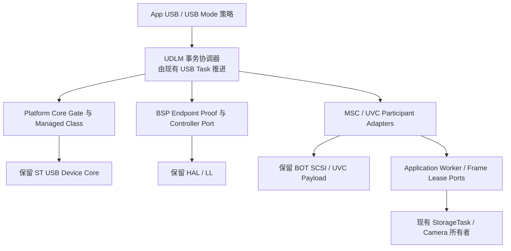

# UDLM 增量架构设计

> **P1进度（2026-11-19）**：本轮为未完成/受阻交付，生产代码未改；下面原有内容是Phase0历史设计。当前结果见本文末尾及三份EndpointLifecycle报告。

> 基线：`35401119bef1d5a4594925478119e048f68c2c77`；研究分支：`codex/usb-device-lifecycle-manager`；审计日期：2026-11-19。
> 范围：Phase 0，仅文档；未修改生产/测试代码，未编译或烧录。
> 标记：**VERIFIED**＝本基线源码确认；**INFERRED**＝推断或拟议设计，尚非已实现能力；**UNRESOLVED**＝证据/契约尚缺；**NOT_TESTED**＝本轮未运行验证。源码引用采用仓库相对路径和一基行号，均相对于上述 SHA。

## 1. 决策与分层

**INFERRED（推荐方案）**：增加一个普通 C 的生命周期协调模块，逻辑归属 Platform，独占 Controller/Core/Session 事务；由**现有 USB Task**调用 Process 推进。Service 提供 MSC/UVC participant adapter；Application 提供 Worker/Frame Lease 的跨任务 port。协调器仅调用 BSP，不在 Platform 读写 USB 寄存器，不直接调用 SD/FatFS/Camera 硬件。所有新模块和接口均为下一阶段建议，本阶段未实现、未获生产修改授权。

**VERIFIED** 设计依据：`CM7/Application/Tasks/usb_task.c:119` 已有 Task pump；`CM7/Platform/usb_device.c:260` 统一接收 BSP callbacks；`CM7/BSP/bsp_usb.h:27` 已把 PCD 与 Core 解耦；`CM7/Service/usb_mode.c:214` 已有模式策略。**INFERRED**：将停止“执行权”集中在 UDLM，模式/应用只决定何时请求和如何向 Control ACK；不再另造一个与 USB_Mode/App_USB 竞争的 RUNNING 标志。

**INFERRED**：模块数量不是任务数量。第一版仅一个全局事务槽、固定 participant 表、固定端点记录和有限 retired-record 表；容量不足关闭新提交入口并进入受控故障，不能覆盖旧记录。正式静态字节预算、链接 MAP 和最坏执行时间验收前标 **UNRESOLVED**。

## 2. 同步 Abort 与异步 Cancel 对比

| 项目 | 同步有界 Abort | 异步 Cancel |
| -- | -- | -- |
| 语义（INFERRED） | 一次调用收集停止结果；未证明则失败/受控重试 | Request 返回 Pending，随后具名完成事件或查询证明 |
| 当前 HAL 适配事实（VERIFIED） | HAL Abort → LL 轮询 EPENA，返回 HAL_OK/HAL_ERROR | 无通用 Bulk Cancelled 回调；EPDISD 只有 ISO incomplete 特殊通知 |
| 复杂度（INFERRED） | IRQ/PIO 短临界区、可计时预算、完整后置证明 | 每方向取消状态、Token、IRQ pre/post 捕获、正常完成竞争、迟到事件退休 |
| 当前阻塞（UNRESOLVED） | 10000 次不是时间预算；Flush 状态被 HAL 吞掉；RM 顺序未证明 | 必须先新增 BSP 完成事件与持久查询契约；仅 Class 改成异步不成立 |
| 推荐（INFERRED） | **第一版默认**；只对硬件短操作同步，不同步等待跨任务资源 | 作为硬件证据表明短 Abort 不可行时的替代，需要独立审批 |

**VERIFIED**：依据 `Drivers/STM32H7xx_HAL_Driver/Src/stm32h7xx_hal_pcd.c:1992`、`Drivers/STM32H7xx_HAL_Driver/Src/stm32h7xx_ll_usb.c:915`、`Drivers/STM32H7xx_HAL_Driver/Src/stm32h7xx_hal_pcd.c:1144`、`Drivers/STM32H7xx_HAL_Driver/Src/stm32h7xx_hal_pcd.c:1234`。**INFERRED**：不要把 HAL_ERROR 重命名为“取消仍 Pending”；可以在保留失败现场后，通过新的明确 Reconcile 操作补取晚到证据，历史 Abort 仍然失败。

## 3. 事务流程与顺序

**INFERRED**：请求入口全部先归一为 `LifecycleTransaction(reason, scope, identity, requested_target)`，不把不同 scope 当成相同 Stop：

1. **Fence/Admit**：原子关闭相应 Class/interface 的新提交（MSC 不再 arm CBW、UVC 不再借新帧）；保存旧资源集合与所有者。Reset/Disconnect ISR 只登记事实、失效旧 EP0 授权、围栏旧 Session；有界且不等待 Task。
2. **Prepare**：按静态依赖图调用每 participant。USB 端点短 Abort；MSC backend Cancel 后等 StorageTask 报告排空；UVC 等 Payload 无借用及 Camera RETURN_ACK。不同证明独立收集，禁止 ISR 等待 StorageTask。
3. **PreparedTicket**：所有 scoped participant 的资源版本、proof、引用账本与控制请求身份匹配且无未结依赖，产生不可伪造的单次票据。暂不释放 Class Context。
4. **Commit**：USB IRQ 短围栏内再验证 Ticket。调用原 Core Reset/Disconnect/Setup 或托管 Class DeInit；Class DeInit 只做已准备资源的同步收尾，不允许开始跨任务工作。Close 可以失败，因此票据不是成功承诺；失败必须否决状态包并保留部分释放进度。
5. **Controller Stop**：仅 full Stop/DeInit 范围，在 Class Release、数据端点 Close 与对应引用退休后才 BSP PCD Stop；最终停止成功并取得后置证据后再维持 IRQ disabled/清属于旧会话的 pending。DeInit 最后撤 callbacks/时钟。
6. **Publish/Retire**：更新 Core/Platform/Mode 的投影状态，向原请求者 ACK。新 Session 只能在旧端点事件退休、旧缓冲不可再被访问且身份未耗尽时开始。故障进入 RECOVERY_REQUIRED，不自动启动。

**INFERRED**：不是数据库原子回滚。Prepare 可能已停止端点、Commit 可能已关闭一半资源；恢复使用 progress bitmap 继续收尾。旧 ticket 失去提交资格，不等于旧 proof 或 cleanup obligation 消失。准备完成但上层取消时，可保持安全静止，不能未经审查自动恢复传输。

## 4. 保留 ST Core：同步 DeInit 与 Task Prepare

**VERIFIED**：Core Reset/Disconnect 同步调用 DeInit，SetConfig(0) 会先改 state/config 后忽略 DeInit 失败。依据 `Middlewares/ST/STM32_USB_Device_Library/Core/Src/usbd_core.c:771`、`Middlewares/ST/STM32_USB_Device_Library/Core/Src/usbd_core.c:995`、`Middlewares/ST/STM32_USB_Device_Library/Core/Src/usbd_ctlreq.c:770`。**INFERRED**：不能让 Managed DeInit 返回 BUSY，然后期待 Core 自动暂停和续接。

**INFERRED** 具体配合方式：

- Platform 在调用 Core **之前**门控破坏性入口；保留原 Core 函数体，Task Prepare 完成后才调用它们。控制器硬件已处理的 Bus Reset 事实立即记录，不尝试“延迟硬件 Reset”。
- `Usb_ManagedClassDeInit` 将来必须检查正在 Commit、scope 和 participant 的 PreparedTicket。未准备不能释放；记录 unprepared_commit，LL 状态包否决，RECOVERY_REQUIRED。不能无票返回 OK。
- 标准请求重放由 Task 调原 `USBD_LL_SetupStage`；不要递归调当前 `Usb_Setup`，避免再次失效自己刚准备好的 cookie。重放期间只允许本事务同步 Core 回调，禁止重入 Start/Stop。
- 无主机状态阶段的 Reset/Disconnect：保留一个持久事件记录，Prepare 后分别调用原 Core Reset 或 DevDisconnected；未准备时不先调用 Core 再假装回滚。Reset 新到来时旧控制资格作废，旧资源仍须退休；最新有效 Reset 重新验证后提交。
- PCD Init/DeInit 与 GPIO/时钟回收是 Task/启动阶段操作，不放入 Setup ISR。初始硬件 Init 可能 HAL_Delay（LL `USB_SetCurrentMode`，`Drivers/STM32H7xx_HAL_Driver/Src/stm32h7xx_ll_usb.c:253`），不属于短 IRQ 临界区。

**UNRESOLVED**：HAL 在 ENUMDNE 回调之前已经消费旧事件；必须有 BSP IRQ 入口围栏/证据 port，不能仅改 Platform 回调顺序。这是下一阶段 BSP 有限扩展的明确前置审批项，本轮只设计。

## 5. EP0 标准请求门控与失败状态包否决

**INFERRED**：建立独立 `ControlGate`，不把现有 MSC Deferred Token 全局放宽。

| 请求/事件 | Gate 行为 | Commit/终止 |
| -- | -- | -- |
| 合法 SET_CONFIGURATION(0)，以及会替换配置的请求 | 在 Core 前解析并校验合法性、复制8字节 SETUP；关闭 Class 新提交；保持 EP0 可接新 SETUP | Task Prepare 后重放原 Core Setup；无票/失败阻止 STATUS IN |
| UVC VS SET_INTERFACE Alt0 | 仅围栏 VS/EP1/frame participant | 原 UVC Setup/Alt0 同步提交，保留 Probe/Commit 和 Control interface |
| MSC BOT Reset | 保留现有精确 0x21 Deferred Token 与数据无关排空；连接 UDLM scoped participant | 原 BOT Reset → 排空 → 状态确认 → 双 ClearHalt；不触发全设备 DeInit |
| GET_DESCRIPTOR、SET_ADDRESS、普通查询/Probe | 没有破坏性依赖时走原路径 | 不让 UDLM 无理由增加延迟；控制器处于 Reset cleanup 时按 gate 策略拒绝/延迟，不借旧 Context |
| 新 SETUP/Reset/Disconnect/Stop | 失效旧控制 cookie 和 status 资格 | 旧 cleanup 继续，旧状态包禁止发送；资源不由 token 直接释放 |

**VERIFIED**：当前新 Setup 会取消旧 token，并对 busy EP0 Close/Open（`CM7/Platform/usb_device.c:1321`）；CompleteControlStatus 通过 s_operation_result 和 EP0 busy 检查真实 LL 提交（同文件 `Drivers/STM32H7xx_HAL_Driver/Src/stm32h7xx_ll_usb.c:1047`），DataIn 才标 COMPLETE（同文件 `Drivers/STM32H7xx_HAL_Driver/Src/stm32h7xx_ll_usb.c:1443`）。**INFERRED**：保留这两个层次，并扩展身份包含 controller/session/setup sequence、完整8字节请求、endpoint generation、status transfer id。

**INFERRED**：Gate 在等待期间不提交状态 ZLP；合法的延迟必须由 EP0 硬件 NAK/Setup 接收配置支持，不能让 Core 先执行一半。主机超时预算、EP0 在 PIO 模式保持可接新 SETUP 的 BSP 契约标 **UNRESOLVED**，须先手册/测试验证；不支持时拒绝该操作、记录故障，不发送伪成功。

**INFERRED**：状态 veto 位在 Core Commit 前清为本事务专用；任何 participant Commit/Close 或 Core callback 失败立即置 veto。`USBD_LL_Transmit` 在 STATUS_IN/length0 入口检查有效 gate identity、commit 结果和 veto；拒绝必须真正不调用 BSP，设置 CtlError/STALL 和诊断。仅在 Core 返回后再检查失败已经太晚。Core helper 即使返回 OK 也不算状态已提交，更不算 ACK；依据 `Middlewares/ST/STM32_USB_Device_Library/Core/Src/usbd_ioreq.c:171`。

**INFERRED**：新 SETUP 到来后的旧 ticket 不可复活；控制 gate 的序号不回绕。若 Commit 成功但状态未确认，记录本地已变更/主机确认未知，不能重新执行释放或合成 ACK。

## 6. Endpoint proof / Ownership Ledger

**INFERRED**：proof 由 BSP 产生、Platform 校验身份，必须同时包含停止方式、EPENA/INT/FIFO 结果、PIO continuation 围栏、旧事件退休和相关引用。详细字段/竞争规则见 ParticipantContract 与 Concurrency。关闭 IRQ、软件 busy=false、HAL Flush OK、等待超时均不能单独替代 proof。

**VERIFIED**：BSP PIO 续包在 Class 之前发生（`CM7/BSP/bsp_usb.c:655`），HAL RXFLVL 直接写 OUT buffer（HAL PCD `Drivers/STM32H7xx_HAL_Driver/Src/stm32h7xx_hal_pcd.c:1092`）。**INFERRED**：资源账本必须区分原 buffer 的 CPU/PIO source 借用、OUT destination 借用、回调引用、Worker 借用、Frame Lease、Class Context pin；不能因 USB 没开 DMA 就跳过 USB 引用。

**INFERRED**：USB endpoint proof 与 SD proof 必须分别成立。USB stopped 不代表 SD IDMA stopped；Worker DONE 的匹配 identity、backend quiescent、持有缓冲归还均验证后才可重用。RAW 租约不属于 UDLM 自动释放集合。

## 7. 增量改造矩阵

以下“需要改造/新增”全部 **INFERRED**，仅未来建议；“当前实现”列的事实依据均在 SourceAudit E1–E9。

| 模块 | 当前实现 | 保留内容 | 需要改造 | 是否新增 |
| -- | -- | -- | -- | -- |
| ST Core / ctlreq / ioreq | 同步 callbacks、部分错误吞掉 | 全部源码、协议分发和请求逻辑 | 外围 pre-Core gate / managed adapter / LL status veto；不改 Core | 否 |
| Platform usb_device | 单 Class、静态池、Deferred Token、IRQ lock | 注册/端点数据 API、描述符校验、精确 Deferred 契约 | 事务门控、prepared commit、旧会话 cleanup 路由、错误来源与 proof 关联 | 扩展原文件 |
| BSP usb | PIO、同步 Abort、FIFO/IRQ owner | HAL 分层、PIO 数据算法、端点规划 | 有界 stop/proof、Flush 独立可观测结果、IRQ pre/post、最终 Stop IRQ 顺序 | 扩展；需未来明确授权 |
| UDLM coordinator | 不存在公共七层模型 | 不替换协议/应用策略 | 静态 registry、事务/ticket/ledger、Process/query | 新普通 C 模块，非 RTOS Task |
| USB_Mode / App_USB | 已有策略/ACK/Stop | 启动策略、500 ms reconnect、Control 命令身份 | 从“非 OK 立刻 ERROR”迁移到显式 Pending/terminal 查询；仅一个执行者 | 扩展 |
| USB Task / App Events | Task pump、合并通知 | 现有静态 Task 与调度 | 加有界 UDLM Process；通知仅唤醒持久记录 | 不新增任务 |
| MSC Class | Init/DeInit/Open flags | 描述符、Setup、端点分配 | Prepare 冻结 CBW、确认端点与 Worker 后 DeInit | 小 adapter |
| MSC BOT / SCSI | 协议状态机、Sense、epoch | BOT/SCSI 功能和错误规则 | scoped Reset/Stop admission 与完成记录对接；不改命令语义 | 生命周期 helper 可新增 |
| UVC Class / Payload | Alt/Probe/Commit/packet cancel | 描述符、Payload/FID/EOF/视频管线 | 生命周期 adapter、端点 proof 后取消、显式 retired-frame 证明 | 小 adapter；不重写 Payload |
| Frame Bridge / Camera | stream_epoch/lease/RETURN_ACK | 数据和消息流程、Camera owner | 由原 owner 报生命周期证明，不用 INVALID_STATE 单独代替 | Application port；如需改代码另授权 |
| Storage Worker / SD adapter | mailbox Cancel/Drain、RAW 持有 | 执行接口/SDMMC/FatFS 排他 | 在原 Task 导出匹配排空证明；保持数据区 pin | Application/Service port；SDMMC 不改 |
| HAL / LL | 同步 Abort，Flush 返回有缺口 | 上游源码完整保留 | 通过 BSP 检查底层原语/后置证据；不改 HAL | 否 |
| FreeRTOS / Linker / MPU / CM4 | 既有配置 | 全部 | Phase0 无；后续也不能默认扩权 | 否 |

## 8. API 保留、扩展、废弃语义

| API/用法 | 决策（INFERRED） | 兼容迁移约束 |
| -- | -- | -- |
| RegisterClass/GetDescriptor/Open/Transmit/Receive/GetRxSize | 保留 | 新 admission gate 拒绝旧 session 提交；原成功路径保持 |
| USB_Device_Lock/Unlock | 保留为内部短互斥 | 不充当生命周期完成或跨任务锁 |
| Defer/Complete/Fail/GetControlStatus/WasComplete | 保留精确 Class 请求契约 | 新标准 gate 独立接口；两个 token 类型不得混用 |
| USB_Device_Start | 保留同步 API | 仅 STOPPED 且无 retired obligations、有效 controller 状态 |
| USB_Device_Stop | 保留入口，扩展协调契约 | 新 RequestStop/Poll/GetResult 更明确；迁移调用者后才允许其映射 Pending，禁止悄改现有 BUSY 含义 |
| BSP_USB_AbortEp/CloseEp/Stop/DeInit | 保留分层，扩展 proof/status 参数或配套 query | 旧 SYS_OK 不自动提升为新完整 proof |
| 直接 Core Stop/DeInit、无票 Managed DeInit | 废弃为应用调用方式 | 不删除 ST 函数；所有授权入口由 coordinator gate 进入 |
| busy=false / INVALID_STATE / epoch++ 即可释放 | 废弃推断 | 用具名 proof 和 ledger 消零替代 |
| RequestStop / Process / GetTransaction / RegisterParticipant / GetProof | 新增概念 API | 固定容量、无 heap；具体 ABI 待 Phase1 审核 |

**UNRESOLVED**：BSP/应用 bridge/Worker 新 port 是实现安全证明的必要边界。本轮没有这类修改授权，因此设计不能标记为“只改 Platform 即可落地”。这些阻塞与测试门禁列于 OpenQuestions/MigrationPlan。

## P1 本轮证据与状态更新

**INFERRED / 未实施**：同步有界Abort+Task分阶段协调方向不变。公开LL FIFO返回值可读取已由源码和刻画测试确认，但其时间预算、正确锁/scope和RX/EP0硬件条件未证明；不能因此把整体硬件门禁判为关闭。未新增生产coordinator/接口，未迁移MSC/UVC Class生命周期。

详见 [P1实施/阻塞报告](USB_EndpointLifecycle_ImplementationReport.md)、[硬件证据](USB_EndpointLifecycle_HardwareEvidence.md)、[软件验证](USB_EndpointLifecycle_SoftwareVerification.md)。
