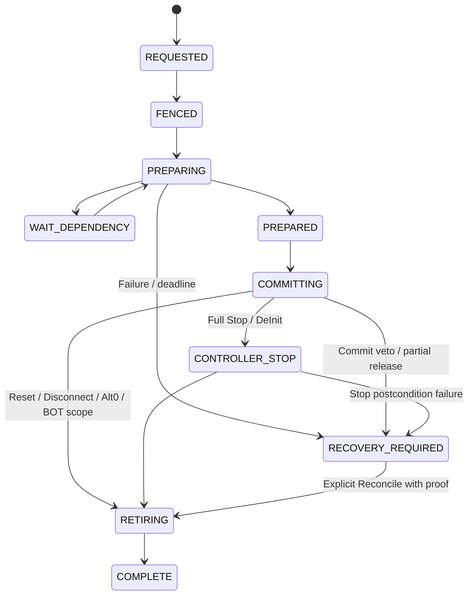

# UDLM 七层状态模型

> 基线：`35401119bef1d5a4594925478119e048f68c2c77`；研究分支：`codex/usb-device-lifecycle-manager`；审计日期：2026-11-19。
> 范围：Phase 0，仅文档；未修改生产/测试代码，未编译或烧录。
> 标记：**VERIFIED**＝本基线源码确认；**INFERRED**＝推断或拟议设计，尚非已实现能力；**UNRESOLVED**＝证据/契约尚缺；**NOT_TESTED**＝本轮未运行验证。源码引用采用仓库相对路径和一基行号，均相对于上述 SHA。

## 1. 模型定位

**INFERRED**：下述状态为设计模型，不冒充基线中的已有枚举。当前事实：Platform 仅有 initialized/started/stop_required 和托管 Class 状态（`CM7/Platform/usb_device.c:27`、`CM7/Platform/usb_device.c:48`）；Core 自有 dev_state/ep0_state，MSC BOT 与 UVC 又有各自协议状态。UDLM 应维护资源事实，并把必要状态投影给原模块，而不新增多个可互相矛盾的“总设备 RUNNING”真值。

## 2. 七个独立对象

下表为 **INFERRED**。每个对象都有非零 identity/generation、parent id、当前状态、last business result、cleanup result、剩余义务和 fence 标记。

| 对象 | 状态/正常转换 | 必须独立的原因 |
| -- | -- | -- |
| Controller | UNINITIALIZED → INITIALIZING → READY → STARTED → STOPPING → STOPPED → DEINITIALIZING → UNINITIALIZED；任一阶段可 RECOVERY_REQUIRED | PCD 时钟/IRQ/FIFO 生命周期；Bus Reset 不等于 PCD Stop |
| Session | NONE → ENUMERATING → ADDRESSED → CONFIGURED；RESETTING/DISCONNECTED → RETIRING → RETIRED | 物理/总线身份；旧 Session 退役可与新 EP0 管理并行，但不能共享未退休端点资源 |
| Class | ABSENT → INITIALIZING → ACTIVE → PREPARING → PREPARED → COMMITTING → RELEASED；失败 RETAINED_FAULT | Core 同步 DeInit 只能在已准备后执行；Context pin 独立 |
| Interface | INACTIVE/ALT0 → ACTIVATING → ACTIVE_ALT → QUIESCING → ALT0 | UVC Alt0 保留 Class/VC/Probe；MSC BOT Reset 不改变配置/接口号 |
| Endpoint | CLOSED → OPEN_IDLE → ARMED → QUIESCING → QUIESCENT → CLOSING → CLOSED；故障 UNKNOWN_RETAINED | hardware/PIO/FIFO/事件所有权不同于 class/configured |
| Transfer | ALLOCATED → ARMED → NORMAL_COMPLETE 或 STOP_REQUESTED → STOP_PROVING → CANCELLED；失败 FAILED_RETAINED；最后 RETIRED | Request accepted 不等于取消完成；失败不消除 buffer 借用 |
| EP0 transaction | RECEIVED → GATED_WAIT 或 DISPATCHING → STATUS_SUBMITTED → STATUS_CONFIRMED；任意未确认阶段可 CANCELLED/FAILED | 本地 Commit、LL 提交、主机确认三者不同 |

**INFERRED**：Transfer 的 NORMAL_COMPLETE/CANCELLED 是互斥终态；STOP_REQUESTED 中收到真实完整正常完成可选择 NORMAL_COMPLETE 结算一次。FAILED_RETAINED 以后若补证据可进入 CLEANUP_RESOLVED/RETIRED，但历史 result 不改写为成功。EP0 CANCELLED 仅撤销状态包资格；相关 Transfer/Worker 仍可能 FAILED_RETAINED。

## 3. 统一事务状态

所有边均为 **INFERRED**；本阶段 **NOT_TESTED**。WAIT_DEPENDENCY 不是异常，也不是可以无限等待的 Busy Loop；deadline 到只改变事务为故障，所有者与引用继续保留。

**INFERRED**：全局只有一个执行中的 destructive transaction。重复同 identity 请求返回原事务状态；新的更大 scope 请求先冻结新增范围、挂接到原 cleanup obligation，并分配新的事务身份/票据版本，不能在旧 ticket 上扩大 scope。不可合并的请求排队到固定 pending 槽，满则拒绝新主动请求；不可拒绝的 Reset/Disconnect 用独立 sticky generation/故障闩锁保留事实，不能因队满丢失。

## 4. 九种入口的目标与影响范围

全部为 **INFERRED**；现状调用链见 SourceAudit E1–E9。

| 入口 | scope / admission fence | Commit / 结果 | Controller 最终动作 |
| -- | -- | -- | -- |
| 主动 Stop | 当前全部 Class/接口/端点、当前 EP0 授权 | Prepare 完再 DeInit/Close；向 App 原 command_id ACK | PCD Stop；保持未 DeInit 便于同模式启动 |
| Bus Reset | 旧 Session 和旧控制授权；不能阻止物理 Reset | 旧引用退休后调用原 Core Reset；新枚举默认地址/EP0 | 保持控制器启动，不以全关 IRQ代替 Reset |
| Disconnect | 旧 Session 和控制授权 | 退役、Class release；真实检测来源须先确认 | 不强制无条件 PCD restart；按连接策略决定后续动作 |
| SET_CONFIGURATION(0) | 配置内 Class/数据端点 | 保留 Controller 和 EP0；Core 转 ADDRESSED | 不 PCD Stop；保留当前设备地址 |
| UVC Alt0 | 仅 VS/ISO endpoint/frame lease | Alt0；Class/VC/Probe/Commit 保留 | 无 |
| BOT Reset | MSC Bulk pair、BOT old epoch/Worker | 排空→Reset Status confirmed→双 ClearHalt→重新 arm CBW | 无；不重新枚举 |
| UVC 活跃流停止 | Payload/EP1/Frame Lease | Cancel+端点 proof+Camera ACK；可停留 Alt1 可供后续帧或由调用者再 Alt0 | 无，除非上层还有 Full Stop |
| Init 部分失败 | acquisition bitmap 中已获得的资源 | 逆依赖回收；失败仍保留记录 | 根据 Init 已进入阶段决定 DeInit；不能假定从未初始化 |
| PCD Stop / DeInit | 端点、FIFO、回调、PCD、时钟 | 全部 proof 齐全后最后执行 | Stop 保留 callbacks/ready；DeInit 最后注销/关钟 |

**INFERRED**：Suspend 不退出 Session，不是安全弹出、端点取消完成或 RAW 租约释放。Resume 恢复原协议状态，若已 RECOVERY_REQUIRED 则不能顺便恢复可用性。当前 Core Suspend/Resume 仅保存/恢复 dev_state（`Middlewares/ST/STM32_USB_Device_Library/Core/Src/usbd_core.c:853`、`Middlewares/ST/STM32_USB_Device_Library/Core/Src/usbd_core.c:871`）。

## 5. 身份、代际与失效

**INFERRED**：身份层级为 `controller_incarnation / session_id / class_instance / interface_generation / endpoint_open_generation / transfer_sequence`。另有 `lifecycle_tx_id`、`setup_sequence`、`prepared_ticket_id`。与 MSC request epoch/token/generation、UVC packet token、Camera stream_epoch/lease_id 明确映射，不把这些不同计数器混成一个 global epoch。

- 所有计数器零为无效；先检查溢出再分配。运行期不回绕，不通过 Stop/Reset/Init 随意清 seed；controller incarnation 的持久边界由完整硬件静止、软件旧记录归零后才能换代。
- Reset/Disconnect 立即撤销旧 Session 的“新提交资格”；允许旧 Session 的 completion/cleanup 精确匹配旧 ledger，禁止其变成新会话数据完成。
- 新 SETUP 撤销旧 control commit/status 权，不删除旧资源 proof；已确认历史状态只保留只读 tombstone，不再发送状态。
- 单靠 endpoint 地址不能识别迟到回调；raw IRQ 没有 token。必须用 BSP 停止/退休/重开 fence 保证新 arm 前旧事件已消费或被具名处理。
- 耗尽或记录池满时拒绝新传输，保留旧资源及故障诊断；清空记录来“恢复可用”违反身份唯一性。

**VERIFIED**：已有控制 seed 耗尽拒绝（`CM7/Platform/usb_device.c:1037`）、BOT request seed 耗尽故障（`CM7/Service/usb_msc_bot.c:121`）、Payload token 耗尽拒绝（`CM7/Service/usb_uvc_payload.c:160`），适合保留原行为再加显式映射。

## 6. RECOVERY_REQUIRED 的恢复条件

以下全部 **INFERRED**，缺任一条件不得 Start、Free 或开放新 CBW/帧：

1. 保留首个失败、原 HAL/LL 状态、停止阶段和寄存器快照；后来的 retry 不覆盖首因。
2. 有针对性 Reconcile：在 IRQ/PIO 串行化下重新取得端点静止/FIFO/旧事件退休证据；不是无条件“强制清 busy”。
3. Storage Worker 及 SD IDMA 分别确认无在途借用，取消后的晚到结果已入原 request ledger；RAW/FatFS 资格仍按原安全策略。
4. UVC Payload 不持帧，Camera owner 已确认租约归还；仅关闭 EP1 不能替代 ACK。
5. Class 释放进度可审计；已执行的 Free/Close 不重复执行，未完成的持有项仍 pin 住。
6. 完成 Controller Stop/DeInit 所需后置证明，确保 Core/PCD/Platform 地址、EP0/端点和 IRQ 状态一致。
7. 人工或明确策略请求新的 Start；故障排空并不自动等于主机卷安全归还，也不自动重启。

**UNRESOLVED**：若硬件状态无法证明，唯一结论是保持锁定并上报；是否允许某种硬件复位作为最后恢复手段必须另行审批并证明引用边界。本设计不以重启 PCD 绕过未知所有权。
