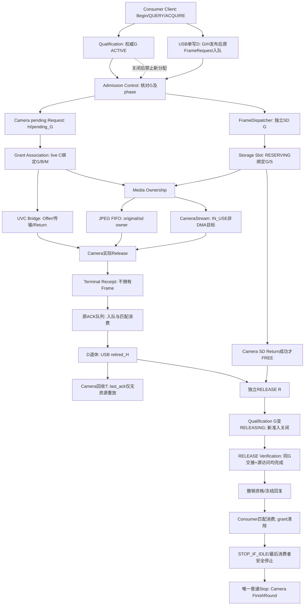

# Final Lifecycle Model

规范基线b6541af，源码基线14bbdcc。本文与FinalContractClosure/ImplementationPlan共同定义唯一目标模型；均DESIGN_PROPOSED，未实施、未运行。旧NOT_PROVEN不会因图示改为PASS。

## 1. 完整生命周期图

图中Media→Release表示其真实所有权操作，不能把USB传输完成或SD文件关闭直接画成资格撤销。SD-only以触发SD G的INTERNAL_CAMERA live C取原始Frame→Retain SD→本地真实Release→内部C结束；不经过USB D/T/ACK。

## 2. 身份清单

| 身份 | 生成/存放 | 校验及失效 |
|---|---|---|
| Consumer | 既定consumer_id及客户端task角色 | 生命周期通道权限与资源provider路由；不凭网络连接创建虚假帧持有 |
| ACQUIRE | Query后consumer Stage first+1，原Tx/Rx受控 | 完整session/request/consumer/generation，原Replay退休规则 |
| Grant G | Qualifier成功ACQUIRE的原grant_* | ACTIVE才允许新准入；RELEASING后不可重新ACTIVE，撤销只在真实核验后 |
| Release R | ConsumerEnd first+2，与G不同编号 | 当前Rx/work窗口、同session/consumer/generation关联原grant_request |
| Bridge B | epoch/lease_id/frame-request H | 原SameLease三元组，不从M或R推算 |
| Media M | JPEG原session/id；Stream新增私有session/acquisition/index元数据 | 类型化、无回绕、真实账本owner/IN_USE核对；不写入Frame消息 |
| Storage S | 本地session/slot/generation，slot额外G标签 | 队列/WRITING/RETURNING核验，FREE前不复用 |
| Terminal T identity | {G,H,terminal_kind,B或无帧,类型化M或无资源} | Camera单写不可变payload，ENQUEUED才可支持D退休；USB消费及retired_H后Camera回收 |

Grant Association Ledger指这些既有交接记录的身份标签集合，不新增全局Frame表/引用计数。每个实际owner必须有唯一业务G或INTERNAL_CAMERA关联；发现无标签owner拒绝核验，不默认归其他消费者。

## 3. 唯一写者与同步

U含G/H、phase/committed/consumed_H和持久retired_H，USB单写，Camera一致只读。pending_G、live C、T、F、last_ack_G由Camera单写；USB只读T。Storage slot G在Camera预留写入，其他slot状态按原Camera/Storage分阶段锁保护。stop_epoch由Storage_Request唯一受保护路径写入，可由合法Task发起；每命令start_epoch是入队时不可变标签，pending_start_epoch由StorageTask保存。Media身份元数据由Camera取得/安全Start路径写，ISR沿原路径只更新帧/块，不改grant标签。

共享记录均保存PRIMASK、禁中断、屏障、完整提交/快照、屏障并恢复原mask；队列/文件/USB/Media调用锁外，禁止阻塞/重入。只限CM7；CM4不写这些账本。USB/Camera不同队列间没有全局FIFO，安全依身份和关闭规则，不依通知顺序。

## 4. D和T状态机

D逻辑阶段由各自单写事实推导，不设多任务共写enum。EMPTY→PUBLISHED；send均失败可LOCAL_UNCOMMITTED退休；send成功→COMMITTED→Camera pending_G/H已核对→资源BOUND（可无资源直接负终结）→等待T/消费→RETIRED。Camera接受不能依赖滞后的USB committed标志，真实出队与PUBLISHED一致快照为受理依据。

T由Camera写EMPTY→PREPARED（无帧或真实Release已完成）→ENQUEUED（原终结消息send成功）→EMPTY（retired_H覆盖T.H）。T满不覆盖；并不持资源，SD-only服务不依赖它清空。USB收到ACK可先于ENQUEUED写点，但此时不能退休/发布下一个D；Camera发布后通知USB或等待原周期复查。

F只在Camera终结消息入队后推进，拒旧Frame请求；U.retired_H包含本地未提交退休，不能混同F或Lifecycle Replay水位。新请求之前Camera可据retired_H回收旧T；即使U已发布新D，旧退休事实不丢。last_ack_G支持无资源重复Return，不占新T，不再Release。

## 5. 准入与关闭的完整条件

L_stop_local：USB stopping；Storage成功STOP入队/E递增/accepting=false在同锁。它们关需求，不冒充全局关闭。
L_admit(G,H)：Camera核对权威ACTIVE G并登记pending_G/H，实际GetFrame前再次检查；SD在G检查后原FREE→RESERVING同步提交绑定G/S。
L_close_camera(G)：受控R匹配原grant后原Qualifier写RELEASING；所有新的取源/Retain必须见ACTIVE，不重开旧G。
L_verify(G,R)：同Camera窗口，G关闭且本G无待提交/已提交D、无pending请求/资源、T与消费握手已结算、SD槽/offering/队列已清；Media真实owner无本G源访问，UVC/DMA终止事实充分。资源query只读，Qualifier负责R窗口，不调用会重入Qual_Enter的API。

T可在R之前已回收：核验依retired_H/F的单调事实、所有入口G绑定不变量和当前无未结算记录，不要求永久保留全部历史T。若尚有未归属的Media owner或不一致记录，拒绝；不能仅凭T空或snapshot无M判断历史释放。

## 6. 两路独立性与内部角色

USB退出：只撤销G_USB；对相同JPEG M，SD owner仍在则不释放块。T迟延/USB停滞不阻止新SD-only C（真实原始loan已释放前提），USB队列控制重试有限且不跳过SD数据服务。
Storage退出：只关闭G_SD/接收并完成其slot Return；USB仍LOANED/IN_USE时保持源Frame，SD文件出错不替USB结束。
最后消费者：Qualification无其他活动/工作/候选不等于硬件已停，仍需所有交接/内部持有和Media排空，idle真实证明后由FinishRound停止Media/Device。Stop失败不强回收、不重建原账本。
SD-only内部C没有USB H，不生成USB receipt；内部Release失败保持其M和SD G关联，SD slot与内部原始持有分别归还；不得因slotFREE而忽略内部源持有。

## 7. 证明状态

以上为统一可执行的设计规范，不是当前源码功能。原D/T/G门/Stream身份未实现，released/idle仍NULL。Grant→Frame Lease和Stable Closure保持SOURCE_NOT_PROVEN、RUNTIME_NOT_PROVEN；实施、实际O0/O2及硬件证据后另审。本阶段不授权C2.2C生产工作。
