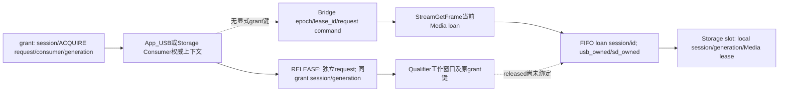

# Grant → Frame Lease Proof Audit

基线9cf537d；源码范围CM7/Application、Media、Tasks及既有协议。静态事实SOURCE_CONFIRMED，缺组合证明NOT_PROVEN，不将设计目标标PASS。

## 逐条追踪

| 步骤 | 真实路径 | 结果及缺口 |
|---|---|---|
| 1 ACQUIRE创建 | app_camera_consumer.c Begin→NextGeneration/TxReserveIds(4)→QUERY；Process匹配消费QUERY→Stage ACQUIRE first+1 | SOURCE_CONFIRMED，session/generation与单调编号独立 |
| 2 grant生成 | app_camera_qualification.c Qual_Execute ACQUIRE→ops.start→ACTIVE及grant_session/generation/request | SOURCE_CONFIRMED，ACQUIRE原request保存 |
| 3 身份传递 | Lifecycle三队列、RxPromote/work窗口；回复由Tx匹配消费后consumer.granted=1 | SOURCE_CONFIRMED到消费者业务上下文；没有把grant键传入Bridge Frame消息 |
| 4 Frame Offer | camera_task.c Process→BridgeCameraProcess(CanOfferFrame)；app_uvc_bridge.c :220/:243 GetFrame与:226/:252 DispatcherPublish | 整体enabled=running&&!stopping；无grant四元组字段 |
| 5 Lease分配 | Bridge next_request/epoch/next_lease；FIFO GetFrame loans[].id=++next_loan并usb_owned=true | 两种不同Lease域，不同于ACQUIRE/RELEASE编号 |
| 6 所有权记录 | FIFO RetainFrame验证真实frame后sd_owned=true，返回Media lease.session/id；Storage Offer存frame/lease/meta、本地session/slot generation | SOURCE_CONFIRMED帧和槽位链，但未记录生命周期consumer_generation/grant_request |
| 7 Return | USB Bridge_SameLease三元组→Camera StreamReleaseFrame；SD Camera owner ProcessReturns→ReleaseLease→同generation才FREE | SOURCE_CONFIRMED局部凭据核验/独立owner；非grant键匹配 |
| 8 RELEASE | ConsumerEnd Stage first+2；Qualifier核对session/generation/entry并将回调request_id换为grant_request | SOURCE_CONFIRMED RELEASE与原grant内部关联；related_request_id当前由Stage清零未设置 |
| 9 Camera核验 | app_camera.c s_qualification_ops released/idle为NULL | 未有生产真实核验；NOT_PROVEN闭环，不可能从现状宣称已实现 |

## 完整身份图

程序顺序边不是字段相等。Media loan.session、Bridge epoch、Storage local session、生命周期session不可混同。Frame数据地址也不能作为跨会话身份。

## 能否唯一关联到grant

现状能按原Bridge三元组识别Offer/Return，按Media lease识别具体SD loan，并按Storage slot键拒绝旧队列。不能单从这些字段唯一恢复所属ACQUIRE grant：同一Camera采集会话可服务不同消费者代次，Media loan没有consumer_generation；Bridge报文不带grant请求号。合法业务前置顺序提供部分联系，但跨队列迟到/重入/重新启用的完整不变量未证明。因此结论保持NOT_PROVEN。

旧grant影响新lease：已有Replay退休/代次检查可阻止旧生命周期请求重执行，Bridge/FIFO各自旧凭据校验可阻止局部旧Return错误匹配；尚不能据这些局部防护证明所有旧grant→新帧的组合路径都排除。没有复现具体生产破坏，不能反向认定必然有漏洞。

USB/Storage：资格entries独立，Tx/Rx独立，Media两个owner位独立；最后owner才释放块。SD-only路径仍暂以Media USB侧legacy loan取得原帧，再Retain SD并由Camera本地释放原始侧，这个“usb_owned”不总等同USB业务消费者正在持有。未来泛化查询不能仅按变量名把SD-only临时持有算成USB grant资源。

## 未来Network与API调整边界

Network需要新的受审核关联适配，不能复用usb_owned冒充第三路，不能将TCP队列作为Media引用账本。目标是身份化核验入口、原grant与各实际资源之间可验证联系；可使用受控程序顺序/唯一所有者/稳定关闭证明，是否需新增关联字段必须另审并给出owner/写点/失效/RAM，不先选结构。

现有Ops接收ACQUIRE grant，受控Rx保管当前RELEASE；应保持两层身份职责，不能把两request_id等同。修改具体API须先完成闭合证明和审批，本轮不修改任何接口。

## 建议补证而非本轮执行

真实FIFO而非ReleaseLease桩：获取/Retain/Return全程记录grant、Bridge、Media、slot身份来源并标无直接键；旧grant消息与新frame交错、双路持同帧先后退出、SD-only临时legacy持有、错误owner/重复Return和跨会话旧凭据。缺原始关联时继续NOT_PROVEN，不以通用压力通过替代每条身份边。
