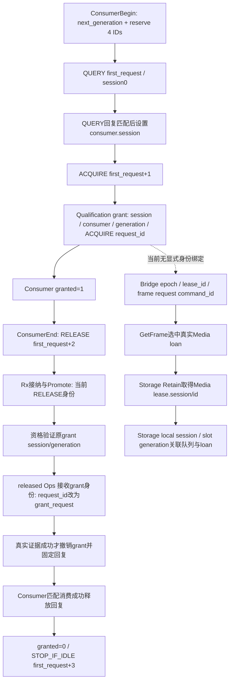

# Identity Contract

基线c3350b01698867939be456d1ef5e94aebc2985b8。源码事实记SOURCE_CONFIRMED，未有足够关联记NOT_PROVEN；本文不实现API。

## 身份关系图

虚线不是实现。生命周期session、Bridge stream_epoch、Media loan.session、Storage本地session是不同编号域；不能相等比较或互相赋值。三类request_id也不能等同。

## 1. ACQUIRE grant身份

SOURCE_CONFIRMED：app_camera_consumer.c App_CameraConsumerBegin递增generation，预留4个编号，Stage QUERY；Process消费匹配QUERY回复后设置session并Stage ACQUIRE。Qualification在受控Rx窗口中ACQUIRE成功，存grant_session/grant_generation/grant_request；consumer收到匹配回复才granted=1。完整身份包括session_id/request_id/consumer_id/consumer_generation；消息另有source/target/operation，App_LifecycleValidate/MatchesReply及Tx/Rx检查。

生命周期退休分两层：合法后继RxPromote使旧request进入退休高水位，旧请求不得重执行，但这不撤销grant；grant只有RELEASE真实核验通过才失效。失败ACQUIRE或更高generation不能覆盖旧有效grant的安全退出身份（qualification.c RELEASE分支精确匹配原grant）。编号或generation耗尽拒绝、不回绕，不新增Replay配额。

## 2. RELEASE请求身份

ConsumerEnd仅GRANTED且grant非零时Stage first_request+2，Stage成功转RELEASE。Consumer_Stage构造消息未设置related_request_id（清零结构），所以当前不能声称线消息明确携带ACQUIRE编号。Qualification关联原grant依session/consumer/generation及内部grant_request；released回调收到的grant.request_id被替换为原ACQUIRE编号，而非RELEASE编号。

当前RELEASE request由rx/work_request、work_session/work_generation/work_operation/work_related和Qual_Window约束；Replay重复处理与资源决策分离。资源API若按grant查询，当前RELEASE窗口验证责任仍由Qualification承担；若要求同一个API同时验证两份身份，必须先审核Ops适配，不能从现有回调假装获得RELEASE编号。此为NOT_PROVEN接口缺口，不能暗改related_request_id或消息布局。

成功回调后Qualification撤销grant并DECIDED；RxComplete固定、Flush入队、ConsumerAcceptReply与ConfirmConsumed分别发生。Consumer仅成功且带QUALIFICATION_RELEASED才清grant；FAIL、缺标志或错误身份不能视为退出成功。生产released/idle目前NULL，不存在真实确认闭环。

## 3. Frame Lease身份

Bridge：app_uvc_bridge.c CameraBegin递增epoch并重置next_lease；USB请求由next_request单调生成command_id。Camera成功取帧后递增Bridge lease_id，Offer携epoch/lease_id/command_id；SameLease在Return/ACK比较三者。Bridge lease_id不是Media loan.id，也不是生命周期request_id。

Media：camera_mjpeg_fifo.c Start在无loan且非运行时递增s_loan_session；GetFrame选择两owner均空槽，递增next_loan并置usb_owned；Retain校验真实当前frame地址/长度/格式，置sd_owned并返回CameraMjpegLease_t{session,id}。ReleaseLease要求session正确、id非零、对应sd_owned有效；ReleaseFrame经当前legacy_index和usb_owned归还USB侧。最后owner才释放块引用。

Storage：app_storage.c OfferFrame记录真实Media lease、本地session、slot generation、frame/meta；队列包含slot/generation/session，Process核对后使用；ProcessReturns保存generation和lease，真实释放后仅在同generation/RETURNING时FREE。旧队列/重复Return/错误owner路径在各层拒绝，不能把Debug.returned_frames当最终证据。

## 4. 关联完备性检查

| 关联 | 结论 | 原因 |
|---|---|---|
| RELEASE→原grant | SOURCE_CONFIRMED（Qualification内） | session/generation匹配，consumer按entry绑定；使用内部grant_request |
| Tx回复→当前RELEASE | SOURCE_CONFIRMED | 原MatchesReply和Tx接受/消费完整身份 |
| Bridge Return→Offer | SOURCE_CONFIRMED | SameLease三元组、state和return_sent |
| Storage槽→Media lease | SOURCE_CONFIRMED | Retain返回真实lease，存入slot并按generation使用 |
| USB Bridge lease→Media loan | SOURCE_CONFIRMED为当前单持帧程序顺序 | GetFrame到StreamReleaseFrame；没有显式相同ID，单legacy_index非万能身份查询 |
| grant→各Bridge/Media loan及Storage槽 | NOT_PROVEN | frame账本不存grant四元组；不能按ID相等关联 |
| RELEASE核验快照→资格撤销期间无新交接 | NOT_PROVEN | 需可靠关闭入口及授权分发门控证明 |

## 5. 草案约束

建议资源查询只接受grant身份并由受控Qualification窗口调用，或提交明确双身份适配设计；不得复制Rx/引用账本。关联缺失时优先以真实程序顺序、单调关闭与逐任务权威字段证明；若仍需新增关联字段，先审唯一owner、更新点、原子边界和RAM预算。本轮不新增字段。NOT_PROVEN不能通过观察日志数量或global HasLoan消除。
