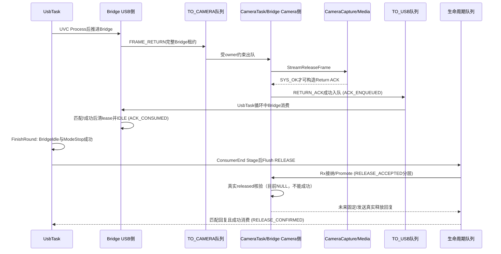

# USB ACK Consumption Contract

这里的Return ACK不是发给ControlTask的业务命令ACK，也不是生命周期回复。以下四个大写名仅为设计事件标签，不新增生产变量。基线c3350b0，未执行测试。

## 真实调用链及任务

## 通道、回调和通知

SOURCE_CONFIRMED：app_messages.c App_MessagesSend使用静态FreeRTOS队列xQueueSend(...,0)，TO_CAMERA仅USB owner发送、TO_USB仅Camera owner发送，成功入队再RuntimeEvent_Post(WAKE)；Receive由接收owner出队并唤醒对端以便满队列重试。Task通知eSetBits可合并，仅唤醒，不能当可靠消息。App_EventsWait用xTaskNotifyWait；CameraTask/UsbTask继续周期等待。

App_EventsInit通过USB_Device_SetEventCallback注册AppEvents_UsbNotify；USB设备/ISR事件经RuntimeEvent_Post或FromIsr唤醒USB_PROGRESS。真实完成链为Platform/usb_device.c Usb_DataIn→USBD_LL_DataInStage→Service/usb_uvc_class.c UVC_DataIn记录Token，UsbTask中的USB_UVC_Process推进；Bridge_GetStreamStatus确认frame_owned不再存在或Class无效，才进入RETURN。事件通知不直接归还Media。Camera侧Media回调通过CameraCapture_SetEventCallback/AppEvents_CameraNotify唤醒，仍由CameraTask推进。

UsbTask_Process实际顺序：Reply→接生命周期回复→最多一条业务命令→App_USBProcess→必要Cancel→USB_UVC_Process→BridgeUsbProcess(CanTransfer)→停止时再次UVC_Process→FinishRound→生命周期Flush→Reply。CameraTask_Process：BeginRound/Reply/最多一条业务命令→ReceiveLifecycle/QualificationProcess→Media Process→BridgeCameraProcess→FinishRound→生命周期Flush→Reply。不能把同一轮Qualification查询描述成位于本轮Bridge归还之后；查询可因本轮稍后归还而到下一轮再核验。

## 事件精确定义

| 事件 | 定义/来源 | 不代表 |
|---|---|---|
| ACK_ENQUEUED | Bridge_CameraRelease真实成功后构造ACK；Bridge_CameraFlush发送TO_USB成功并清ack_pending | USB已出队或已接受 |
| ACK_CONSUMED | BridgeUsbProcess处于RETURN、return_sent且SameLease、result OK，清当前lease并转IDLE | 资格已撤销、SD已退出或Camera已停 |
| RELEASE_ACCEPTED | 若指运输则仅LifecycleSend成功；本设计的受理边界须另记RxReceive合法/HELD与RxPromote成为work，不能笼统合并 | 完成核验或执行资格撤销 |
| RELEASE_CONFIRMED | 消费者收到完整匹配、result OK且QUALIFICATION_RELEASED的回复，经TxConfirmConsumed成功后清grant | 硬件STOP完成或文件收尾成功 |

生产NULL released/idle阻止最后两项的成功退出含义；未来接口实现前只能证明请求被送达/安全等待。

## ACK消费到RELEASE的已有顺序证明

Bridge_UsbReturn仅成功入队才return_sent=true；处于RETURN会一直保持，不因通知/超时自行IDLE。匹配ACK消费是该路径清租约的条件。随后FinishRound检查BridgeUsbIsIdle才ModeStop，业务不再started/stopping/start_command、grant有效且phase GRANTED才ConsumerEnd；Stage成功转RELEASE，Flush保持原请求重试。因此在正常已持帧Return路径，ACK_CONSUMED先于ConsumerEnd可由同USB任务程序顺序证明。无帧/未提交请求取消等路径可能没有ACK，不得强制要求不存在的ACK事件。

这不是Camera对所有USB内部状态的直接证明，也不建立grant与Bridge租约的显式映射。必须再证明旧队列消息不能在RELEASE之后重开交接；该点NOT_PROVEN，详见一致性文档。

## 丢失/重复/迟到与错误身份

- 队列满：ACK保留ack_pending；Return未成功入队保留return_sent=false；退出继续BUSY，不伪成功。
- 成功入队后的通知丢失/合并不删消息；真实队列内容等待后续唤醒/周期轮次处理。不能从现有代码推导“任意永久丢包可恢复”；ACK被外部破坏性删除不属于FreeRTOS可靠队列正常模型，Return已sent后没有已证明的自动重新发送机制，应阻塞而非超时释放。
- 重复Return：Camera匹配last_ack只重放ACK，不再次Release。重复ACK在非RETURN或不同租约时被拒；错误epoch/lease/command/result不清当前lease。
- 旧请求完整三元组无回绕复用，正常不应命中新租约；没有四元grant绑定的跨生命周期防护仍须组合证明。
- 无效Class路径GetStreamStatus返回INVALID_STATE被现有Bridge当作无UVC持帧，需保留真实UVC错误/Abort契约；本轮未进行硬件故障验证，不扩大其安全结论。

建议下一阶段只读采集分别记录ACK入队、出队、匹配分支、清租约、RELEASE Stage/Flush/Promote及确认，保留完整两类身份和事件seq。不新增平行ACK协议，不用业务ACK成功代替Return ACK消费。
