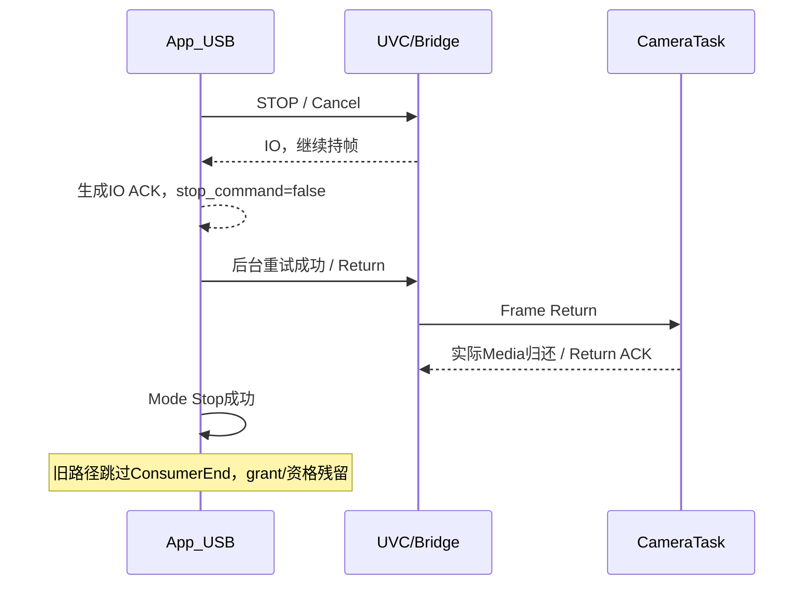
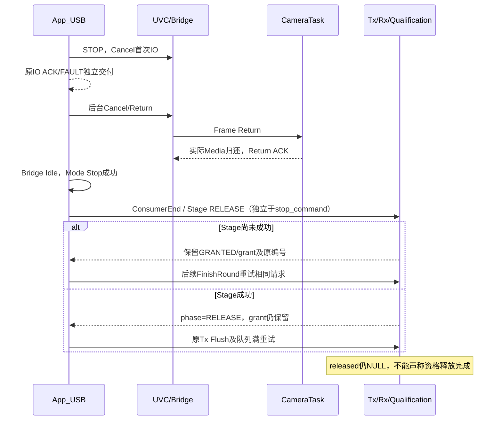

# C2.2B-ID7 整改验收报告

基线：`3cf288faf28781e4ab24551a610bb2031946a21a`。分支：`codex/stage-C2-2B-B2B6-v1-compat`。日期：2026-11-15。

**本次ID7缺陷整改专项通过；不代表C2.2B整体验收或C2.2C完成。** 只有app_usb.c发生生产变更，其他变更均为本目录下新增测试、工具及独立证据。原始失败记录和128项BLOCKED保持不变。

## 根因及原始时序

旧App_USBFinishRound将App_CameraConsumerEnd放在`stop_command && result != SYS_ERR_BUSY`分支内。首次Cancel失败时生成IO ACK并清除stop_command；后台仍能完成Return/ACK和Mode Stop，但不再进入此分支，所以USB资格一直ACTIVE。

相同新夹具编译旧3cf288f app_usb.c，O0/O2各执行一次，均按原缺陷FAIL：Mode Stop调用1次，RELEASE Stage为0，consumer.phase=GRANTED、granted=1。[负对照原始结果](baseline_results.json)。它们是保留的预期失败证据，不计为候选通过。

## 最小生产修改及停止事实

[完整生产Diff](ProductionDiff.md)。改动仅三处：

1. 取得grant后USB_Mode_Start失败：保留原START IO ACK/FAULT，登记原有stopping意图，先通过已有Bridge/Mode停止路径。避免该失败路径绕过“Mode Stop成功才RELEASE”的条件。未增加新的状态机或恢复策略。
2. 原stop_command分支只负责原ACK、last_result及诊断更新，不再负责ConsumerEnd。首次失败ACK生成后，后台恢复不会将其改写为OK。
3. 在FinishRound中独立检查：`!started && !stopping && !start_command && lifecycle_initialized && camera.granted && camera.phase == GRANTED && BridgeUsbIsIdle()`，才尝试ConsumerEnd。

Mode Stop事实的依据来自现有状态转换：获权后，USB启动成功则started=true；获权但启动失败现在进入stopping=true；业务停止只有在Bridge Idle且Mode Stop返回OK后才清除started/stopping。因此同一UsbTask串行执行下，上述静止获权状态不能从尚未停止的启动失败路径漏入。start_command门控同时排除了获得回复前的启动等待窗口。无需新增mode_stopped等副本。

## 防重复、错误及调用顺序

成功Stage后Consumer进入RELEASE；后续FinishRound不再调用End。Stage失败时仍为GRANTED，后续尝试使用同一预留request_id、同一完整请求正文，不分配新编号。Flush队列满时Tx维持READY，依靠原Flush重试，不重新Stage。等待真实资格回复期间grant始终为1，Camera资格仍RELEASING；没有QUALIFICATION_RELEASED或HARDWARE_STOPPED。

实际UsbTask顺序未改：每轮前段Reply重试 → 接收生命周期回复/命令 → App_USBProcess → Cancel/Process/Bridge/Process → App_USBFinishRound → Lifecycle Flush → Reply。新ID7联合调度夹具也按此顺序推进，ACK与FAULT分别确认，互不替代。CameraTask仍负责实际Media归还；USB未直接调用Camera硬件、Media Release或Device Stop。

## 专项测试及实际次数

专项11场景 × O0/O2 = **22次PASS、0 FAIL，C入口及运行器退出码0**。其中ID7在新专项编号1；原联合编号仍为7。所有场景使用真实App_USB、Consumer、Qualification及Tx/Rx/Replay；设备、UVC物理接口、存储介质和调度为可控桩。

| 专项编号 | 场景 | O0 | O2 | 成功Stage次数/每次执行 |
|---|---|---|---|---|
| 0 | 正常USB STOP | PASS | PASS | 1 |
| 1 | ID7：Cancel IO后后台恢复 | PASS | PASS | 1 |
| 2 | Cancel IO后RELEASE Stage失败一次 | PASS | PASS | 1 |
| 3 | RELEASE Flush实际四项队列满 | PASS | PASS | 1 |
| 4 | 取得grant后USB START失败 | PASS | PASS | 1 |
| 5 | 没有grant时STOP | PASS | PASS | 0 |
| 6 | STOP ACK失败而FAULT独立交付 | PASS | PASS | 1 |
| 7 | FAULT失败而STOP ACK独立交付 | PASS | PASS | 1 |
| 8 | Cancel IO后Stage连续失败两次 | PASS | PASS | 1 |
| 9 | Mode Stop先失败后恢复 | PASS | PASS | 1 |
| 10 | START失败后Stage暂时失败 | PASS | PASS | 1 |

[22次逐项结果和观察值](results.json)；[因果/身份核验](contracts.json)。Stage失败通过测试专用id7_consumer.c仅在调用边界一次或两次返回NO_RESOURCE，不修改Consumer/Tx内部状态，不重置Replay或资格。真实生产Consumer源码保持原样。Flush满使用四项运输队列排入真实旧ACQUIRE消息的重复副本，排队期间验证READY和原Request ID未变。

关键O0 ID7实际序号：原IO ACK=4451 → Frame Return=4492 → Camera实际Media归还=4584 → Return ACK=4585 → Mode Stop OK=4677 → RELEASE Stage=4683。O2有相同C级契约检查；不依赖优化后可能内联消失的调用入口来伪造事件。所有原始事件在Evidence/O0_*.json.gz及O2_*.json.gz。

新夹具首次执行时START/STOP共用命令号，导致ACK计数混入初始START ACK，已仅在新夹具中区分命令号10/12；首次结果fixture_initial_results.json保留。未修改任何历史断言。

## 原联合测试及B2回归

- 不带Stage包装的既有ConsumerJointC2_2B/joint_test.c 11项，原源码和断言不变，候选O0/O2各执行11项：**22/22 PASS**。原3cf的10/11和ID7 FAIL仍在上一级报告/证据中，不覆盖。见[joint/results.json](joint/results.json)。
- B2原C场景与接口102项，保留原断言，只补齐既有真实QUERY/ACQUIRE前置；O0/O2各执行102项：**204/204 C入口检查通过**。重点UVC ID10两次均返回0，并新增只读核验consumer.phase=RELEASE、grant=1，原同根因不再出现。见[O0](legacy/O0/usb_compat.json)、[O2](legacy/O2/usb_compat.json)。这是ID10资格意图专项证明，不将旧Python全轨迹判定改写成PASS。
- 正常STOP、未枚举/错误、Abort、Bridge等待、Mode Stop IO/BUSY、Frame Return/ACK及相关原业务场景均包含在上述102项完整C入口中；新专项另外验证正常Stop只Stage一次、失败ACK保持和真实帧归还的顺序。

## 其他历史回归与门禁

全部重新执行并保留原退出码：C1=419/419；C1.1=24/24；C2.1.1=648/648；C2.2A=162/162；R2=74/74。B1仍37/39（ID9/10 FAIL）；历史CameraModuleB1/integration_test.c仍0/11；原B2完整Python判定仍16/102，B3仍14/51；既有Consumer仍42/44（首次并发QUERY的ID17 O0/O2）；既有业务专项62/62。

[完整ID/结果对照](regression_comparison.json)核对缺失、新增、重复、执行顺序和结果变化均无异常；通过的原suite退出0，历史失败suite仍退出1。未将“新C入口通过”冒充旧完整Python通过；原153项报告和其中128项BLOCKED字节未改。ID7同根因已由新证据解决，但不自动更新该历史门禁快照。

## 两核构建及资源

使用3cf288f归档快照，仅叠加已授权app_usb.c候选；源文件SHA256同时记录在[build.json](build.json)和[manifest.json](manifest.json)，没有使用旧HEAD代码冒充候选构建。ARMCC5、原Keil工程完整Rebuild两次：CM7和CM4均退出0、0 Error、0 Warning。日志：[CM7](Evidence/build/h7_mac_CM7.log)、[CM4](Evidence/build/h7_mac_CM4.log)。

- 消息ABI仍52B/56B；Consumer/Tx/Rx/Qualification大小不变。
- AppUsbContext：332B→332B，地址不变；无新增字段或全局状态。
- CM7 RW=1376B、ZI=101536B；CM4 RW=936B、ZI=3576B。**静态RAM增量0B**。CM7 Code相较父提交+32B，CM4 Code不变。
- CameraTask/UsbTask/StorageTask栈配置仍6144/8192/8192B；链接器已知深度仍496/540/1416B。未更改任务、队列、等待周期或优先级；间接调用最坏栈与实板高水位不作已验证声明。
- 所有AXF/Map/Callgraph/HEX的实际SHA256见build.json。资源原始值及对比见[resource_delta.json](resource_delta.json)、[abi_map_stack.json](abi_map_stack.json)。测试未登记进生产Keil工程。

## 边界和未解决问题

只修复USB业务停止与Consumer RELEASE意图推进之间的依赖；不修改Qualification、Consumer、Replay、Bridge、Camera、Storage或Device。生产released/idle仍NULL；RELEASE等待真实证据时安全阻塞，不会撤销grant，更不会强制停止Camera。**本次不是C2.2C完成，也不是最终真实关闭验收。**

本轮没有执行新的实板验收；建议V1实板验证Abort失败注入、后台归还、原IO ACK/FAULT和RELEASE等待状态。历史128项BLOCKED、Consumer首次并发QUERY失败、完整释放证明及硬件故障恢复仍留待对应审核/任务。

## 复现及Git

`python Tests/ConsumerJointC2_2B/run_id7.py --baseline`：预期退出1（两项负对照FAIL保留）。`python Tests/ConsumerJointC2_2B/run_id7.py`：22项退出0。`check_id7.py`核验负对照、候选、B2 ID10及消息契约。`run_id7_joint.py`重跑原联合的O0/O2。B2运行器run_id7_b2.py通过环境ID7_OPT选择O0/O2；正式构建run_id7_build.py，历史回归run_id7_regression.py，资源审计audit_id7_resources.py。

完成后只向当前B2B6分支普通提交和推送；不修改main、不合并PR。最终提交SHA及远端SHA在交付消息中核对。本报告的原始失败、历史记录和全部output均保留。
